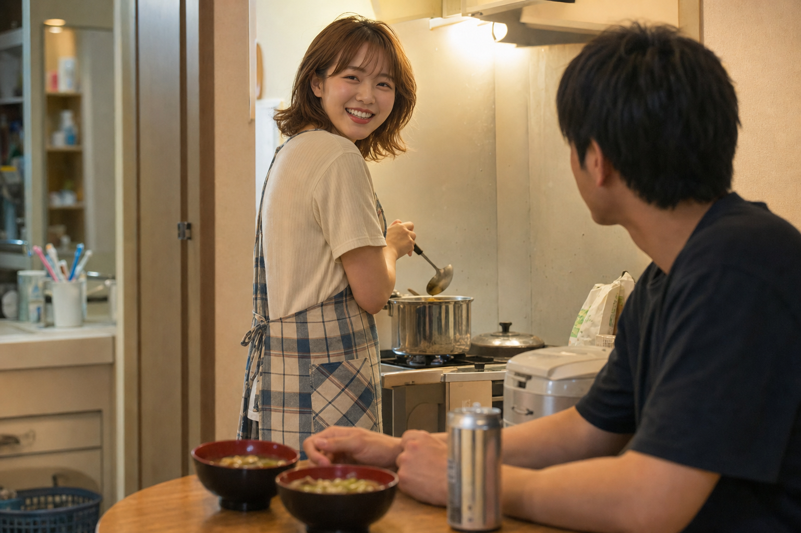

# 070. 일상이 된 밤

7월 첫째 주부터, 저녁 시간이 자연스럽게 유즈키와 겹치기 시작했다.

수업이 끝나면 유즈키가 근무를 마치고 기숙사 근처로 왔다. 편의점에서 장을 봐 와 좁은 방에서 같이 밥을 해 먹는 날도 있었고, 그녀의 원룸으로 넘어가는 날도 있었다. 용식의 칫솔이 유즈키의 세면대 한쪽에 자리 잡은 게 언제부터였는지, 정확히 기억나지 않았다. 세탁물 바구니에는 두 사람의 옷이 자연스럽게 섞여 담겼고, 냉장고 안에는 그녀가 좋아하는 반찬과 용식이 좋아하는 캔맥주가 나란히 자리를 차지했다.

화요일 저녁, 유즈키의 원룸 부엌에서 그녀는 된장국을 끓이며 콧노래를 흥얼거렸다.

[나카타 유즈키] 味噌汁、辛くないですか？(된장국, 맵지 않아요?)

[김용식] "아니요, 딱 좋아요."

[나카타 유즈키] よかった。(다행이다.)

식탁에는 두 사람 몫의 그릇이 나란히 놓여 있었다. 유즈키는 밥을 뜨다 말고 문득 웃었다.

[나카타 유즈키] なんか、変な感じ。(뭔가, 이상한 느낌이에요.)

[김용식] "뭐가요?"

[나카타 유즈키] こういうの、初めてだから。(이런 거, 처음이라서요.)

[나카타 유즈키] 誰かと、毎日ご飯食べるの。(누군가랑, 매일 밥 먹는 거요.)

용식은 젓가락을 든 채 그녀를 봤다. 나고야를 떠나 혼자 도쿄로 올라와 첫 사회생활을 시작한 유즈키에게, 이 저녁 시간이 어떤 의미인지 어렴풋이 짐작이 갔다. 동시에 자신에게도 이 시간이 낯설지 않게 스며들고 있다는 걸 깨달았다.

식사를 마친 뒤에는 좁은 소파에 나란히 앉아 텔레비전을 봤다. 유즈키는 자막도 없는 예능 프로그램을 보며 혼자 웃다가, 용식이 못 알아듣는 부분을 짧게 설명해 줬다. 그러다 어느새 그녀의 머리가 그의 어깨 위로 기울어져 있었다.

밤에는 나란히 누워 그날 있었던 일을 두서없이 이야기했다. 유즈키는 생활 지원실에서 있었던 사소한 실수담을, 용식은 수업 시간에 이해하지 못한 문형을 이야기했다. 대화가 끊기면 그저 손을 잡은 채 잠들었다.

주말 저녁에는 근처 슈퍼마켓에서 함께 장을 봤다. 유즈키는 카트를 밀며 이것저것 집어 담다가, 용식이 좋아하는 과자 앞에서 멈춰 서곤 했다.

[나카타 유즈키] これ、好きでしょ？(이거, 좋아하죠?)

[김용식] "어떻게 알았어요?"

[나카타 유즈키] 何回か買ってたから。(몇 번 산 적 있으니까요.)

별것 아닌 대화였지만, 그 별것 아님이 오히려 두 사람 사이의 거리를 실감하게 했다. 언제부터 서로의 취향을 이렇게 자연스럽게 기억하게 됐는지, 용식은 정확한 시점을 짚을 수 없었다.

계산대에 서서 차례를 기다리는 동안, 유즈키는 카트 손잡이에 팔을 걸친 채 용식 쪽으로 몸을 기울였다.

[나카타 유즈키] 週末、いつもこうやって買い物してるみたい。(주말마다, 늘 이렇게 같이 장 보는 것 같아요.)

[김용식] "그러게요. 익숙해졌네요."

[나카타 유즈키] 慣れるの、早いですね、私たち。(익숙해지는 거, 우리 되게 빠르네요.)

그 말에 담긴 뉘앙스를 용식도 모르지 않았다. 보통의 연인들이 몇 달, 혹은 몇 년에 걸쳐 쌓는 생활의 결을, 두 사람은 두 달도 안 되는 시간 안에 압축해서 만들어 가고 있었다. 그 속도가 설레면서도 동시에 조금 두려웠다.

봉지를 나눠 들고 돌아오는 길, 저녁 하늘이 주황빛으로 물들어 가고 있었다. 유즈키는 봉지 무게 때문에 팔이 아프다며 엄살을 부리다가, 결국 용식이 두 사람 몫을 다 들었다. 그녀는 대신 빈손으로 그의 팔짱을 꼈다.

어느 밤, 유즈키가 잠들기 직전 불쑥 물었다.

[나카타 유즈키] ヨンシクさんは、韓国に彼女いるんですか？(용식 씨는, 한국에 여자친구 있어요?)

용식은 순간 숨이 멎는 것 같았다. 대답을 고르는 사이 침묵이 길어졌다.

[나카타 유즈키] 答えなくてもいいです。(대답 안 해도 돼요.)

유즈키는 그렇게 말하고 그의 팔에 얼굴을 묻었다. 궁금하지 않아서가 아니라, 지금 이 순간을 깨고 싶지 않아서인 것 같았다.

용식은 그날 밤도, 그 이후로도 끝내 대답하지 않았다. 그리고 스스로도 그게 비겁한 회피인지, 아니면 그녀를 위한 배려인지 구분이 가지 않았다. 죄책감이라 부르기엔 지금 이 온기가 너무 편안했고, 아무렇지 않다고 하기엔 가슴 한쪽이 계속 뻐근했다. 이름 붙이기 애매한 그 감정을, 그는 애써 정리하지 않은 채로 내버려 뒀다.

초연에게서는 사나흘에 한 번꼴로 짧은 문자가 왔다. 잘 지내냐는 안부, 밥은 먹었냐는 물음. 예전처럼 매일 오던 연락이 뜸해졌다는 걸 용식도 알고 있었지만, 먼저 그 이유를 묻지도, 자신이 먼저 연락을 늘리지도 않았다.

[김초연] 요즘 좀 바쁜가 보다.

[김용식] "어, 수업이 좀 힘드네."

거짓말은 아니었다. 다만 전부를 말하지도 않았다. 화면을 끄고 나서, 그는 잠깐 폰을 손에 쥔 채 가만히 있었다. 예전 같으면 뭔가 미안한 마음이 먼저 들었을 텐데, 지금은 그 감정이 예전만큼 선명하게 다가오지 않았다. 그 사실이 오히려 낯설었다.

주말 아침, 유즈키의 방 창문으로 매미 소리가 요란하게 들어왔다. 그녀는 이불 속에서 기지개를 켜다 말고, 문득 달력을 봤다. 7월이 이미 절반 가까이 지나 있었다.

[나카타 유즈키] 夏、終わったら。(여름, 끝나면.)

말을 하다 말고, 유즈키는 입을 다물었다. 그러고는 아무 일 없었다는 듯 다시 이불을 끌어당겼다.

[나카타 유즈키] ううん、なんでもない。(아니, 아무것도 아니에요.)

용식은 그 말을 다시 묻지 않았다. 대신 그녀의 어깨를 조금 더 끌어당겨 안았다. 창밖 매미 소리가 한여름의 정점을 향해 치닫고 있었다.

두 사람 다, 이 여름이 영원하지 않다는 걸 알고 있었다. 그래서 더 아무 말도 하지 않았다. 유즈키는 그의 품 안에서 눈을 감았고, 용식은 천장을 바라보며 달력에 표시되지 않은 남은 날짜를 마음속으로 가늠해 봤다.

한 달 조금 못 되는 시간이 남아 있었다. 그 시간이 길게 느껴질지 짧게 느껴질지, 지금으로서는 알 수 없었다. 매미 소리만이 창밖에서 쉼 없이 울려 퍼졌다.

용식은 유즈키의 숨소리가 고르게 잦아드는 걸 들으며, 그도 천천히 눈을 감았다. 내일 아침이면 다시 아무 일 없었다는 듯 나란히 일어나 밥을 먹고 학원으로 향할 것이었다. 그 반복이 언제까지 이어질지, 그는 굳이 헤아리지 않기로 했다.
