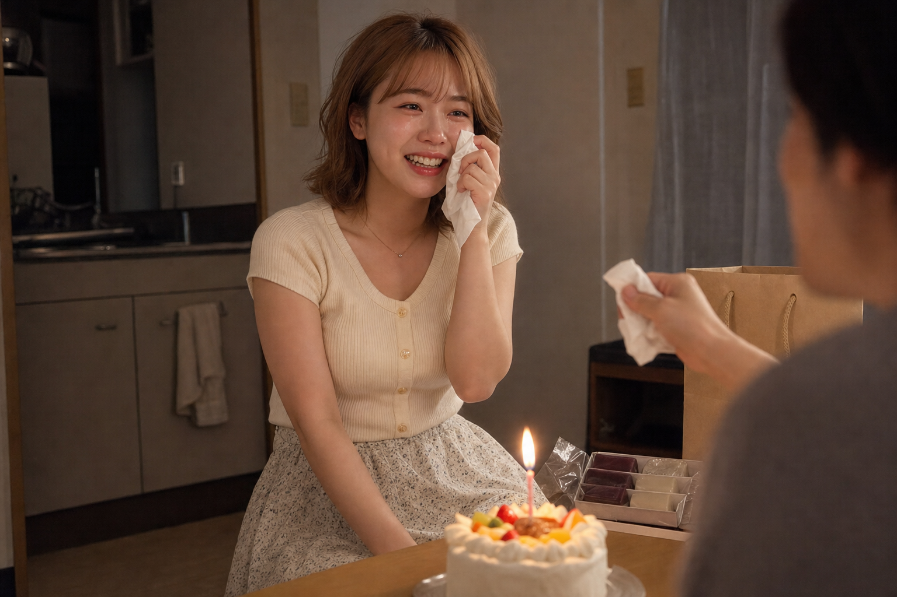

# 072. 스무 살

목요일, 7월 24일.

용식은 그날이 유즈키의 생일이라는 걸 벌써 이 주 전부터 기억하고 있었다. 지난번 슈퍼마켓에서 장을 보다가, 유즈키가 지나가듯 흘린 말이었다.

[나카타 유즈키] そういえば、来週の木曜日、私の誕生日なんです。(그러고 보니, 다음 주 목요일이, 제 생일이에요.)

[나카타 유즈키] でも別に、何もしなくていいですよ。(근데 딱히, 아무것도 안 해도 돼요.)

그렇게 말하고는 곧바로 다른 화제로 넘어갔던 걸 용식은 놓치지 않았다. 정직원 전환 심사가 다가오면서 유즈키는 요즘 부쩍 지쳐 보였다. 저녁마다 서류 이야기를 하다가 한숨을 쉬는 일이 잦아졌고, 웃음도 예전보다 옅어졌다.

용식은 그 주 내내 혼자 움직였다. 수업이 끝나면 유즈키 몰래 시내로 나가 나고야 명물 과자인 우이로를 파는 곳을 수소문했다. 처음 들른 백화점 지하 식품관에는 없었고, 두 번째로 찾아간 역 근처 지방 특산품 코너에서도 허탕을 쳤다. 점원에게 물어물어 나고야 상설 매장이 따로 있다는 걸 알아냈고, 결국 사흘째 되던 날 도쿄 시내 한 백화점 지하에서 나고야산 우이로를 발견했을 때는 이상하게 마음이 놓였다. 포장지에 찍힌 나고야 지명을 손끝으로 한 번 쓸어 보고서야, 그는 이게 맞는 물건이라는 확신이 들었다.

작은 케이크도 하나 예약해 뒀다. 초 스무 개를 꽂을 만큼 큰 케이크는 아니었지만, 촛불 하나로도 충분할 것 같았다. 카드에 짧은 메시지를 적을까 고민하다가, 결국 아무것도 쓰지 않기로 했다. 말로 직접 전하는 편이 나을 것 같았다.

목요일 저녁, 유즈키는 근무를 마치고 평소보다 처진 얼굴로 원룸에 들어왔다.

[나카타 유즈키] ただいま。今日、疲れた。(다녀왔어요. 오늘, 피곤했어요.)

말을 하다 말고, 그녀는 식탁 위에 놓인 작은 케이크와 촛불, 그리고 종이봉투에 담긴 우이로를 발견했다. 잠깐 그 자리에 멈춰 섰다.

[나카타 유즈키] え。(어.)

[김용식] "생일 축하해."

[나카타 유즈키] これ...ういろう？名古屋の？(이거... 우이로예요? 나고야?)

[김용식] "네가 전에 그랬잖아요. 여기선 못 구한다고."

유즈키는 종이봉투를 조심스럽게 받아 들고, 한참 동안 아무 말도 하지 못했다. 촛불을 켜자 방 안이 조금 더 따뜻한 빛으로 물들었다.

[나카타 유즈키] なんで、覚えてるんですか。(왜, 기억하고 있어요.)

[김용식] "그냥, 기억나던데요."

용식은 별일 아니라는 듯 말했지만, 사실 그 한마디를 듣던 순간부터 계속 신경 쓰고 있었다는 걸 스스로도 잘 알고 있었다. 초연과의 관계에서는 늘 받는 쪽이었다. 먼저 챙기고, 먼저 확인하고, 먼저 화를 내는 건 대부분 그녀 쪽이었다. 이렇게 누군가를 위해 먼저 움직인 게 언제였는지, 기억도 잘 나지 않았다.

[나카타 유즈키] 私、誕生日、あんまり気にしてなかったんです。(저, 생일, 별로 신경 안 쓰고 있었어요.)

[나카타 유즈키] 家族も、電話一本くらいだし。(가족도, 전화 한 통 정도니까요.)

말끝이 흐려졌다. 유즈키는 촛불을 바라보다가, 눈가가 서서히 붉어졌다. 눈물이 뺨을 타고 흘러내렸지만, 그녀는 울면서도 웃고 있었다.

[나카타 유즈키] なんで泣いてるんだろう、私。(왜 울고 있지, 나.)

[김용식] "괜찮아요. 안 이상해요."

용식은 티슈를 뽑아 건넸다. 유즈키는 그걸 받아 눈가를 눌렀지만, 눈물은 쉽게 멈추지 않았다.

[나카타 유즈키] こっち来てから、誰かにこんなにちゃんと見てもらったの、初めてで。(여기 오고 나서, 누군가한테 이렇게 제대로 챙김받은 거, 처음이라서요.)

[나카타 유즈키] 仕事も、審査も、全部一人で頑張ってると思ってたのに。(일도, 심사도, 다 혼자 버티고 있다고 생각했는데.)

그녀는 말을 잇지 못하고 결국 얼굴을 감쌌다. 용식은 그런 그녀를 조용히 끌어안았다. 어깨가 작게 떨리는 게 품 안으로 그대로 전해졌다.

[김용식] "생일 정도는 챙겨야지."

[나카타 유즈키] うん。(응.)

한참 뒤, 유즈키는 눈물을 닦고 우이로를 조심스럽게 잘라 한 조각을 용식에게 건넸다.

[나카타 유즈키] 食べてみて。(먹어 봐요.)

[김용식] "맛이 어때요?"

[나카타 유즈키] 懐かしい味。(그리운 맛이에요.)

부드럽고 쫀득한 식감의 과자였다. 특별히 화려한 맛은 아니었지만, 유즈키는 한 입 베어 물고 눈을 감았다. 그 표정에서 용식은 나고야의 작은 동네가, 그녀가 떠나온 고향의 냄새가 잠깐이나마 되살아났다는 걸 느낄 수 있었다.

촛불을 끈 뒤, 두 사람은 케이크를 나눠 먹으며 별다른 말 없이 서로의 어깨에 기대어 있었다. 창밖으로 여름밤의 열기가 아직 식지 않은 채 남아 있었다.

[나카타 유즈키] 今日、一生忘れないと思う。(오늘, 평생 못 잊을 것 같아요.)

용식은 그 말에 대답 대신, 그녀의 손을 조금 더 힘주어 잡았다.

[나카타 유즈키] ヨンシクさんって、こういうところ、ずるいです。(용식 씨는, 이런 부분, 되게 반칙이에요.)

[김용식] "뭐가 반칙이에요?"

[나카타 유즈키] 普段は素っ気ないのに、たまにこうやって、優しいから。(평소엔 무뚝뚝한데, 가끔 이렇게, 다정하니까요.)

용식은 뭐라 대꾸할 말을 찾지 못해 그냥 웃었다. 스스로도 다정한 사람이라고 생각해 본 적은 별로 없었다. 그저 유즈키가 지쳐 보일 때마다 뭘 해 줄 수 있을지 자연스럽게 고민하게 됐을 뿐이었다.

유즈키는 남은 우이로 조각을 냉장고에 정성스럽게 넣어 두며, 내일 아침에도 나눠 먹자고 말했다. 그러고는 케이크 상자를 접어 정리하다 말고, 문득 용식을 향해 몸을 돌렸다.

[나카타 유즈키] 審査、来週なんです。(심사, 다음 주예요.)

[김용식] "잘될 거예요."

[나카타 유즈키] うん。今日のおかげで、ちょっと頑張れそう。(응. 오늘 덕분에, 조금 힘낼 수 있을 것 같아요.)

용식은 그 말을 들으며, 심사 결과가 어느 쪽으로 나오든 자신이 해 줄 수 있는 건 딱 오늘만큼의 위로뿐이라는 사실을 새삼 실감했다. 정직원이 되면 그녀는 도쿄에 남을 것이고, 되지 못하면 나고야 본가로 돌아갈 가능성이 크다고 했다. 어느 쪽이든 자신은 곧 한국으로 돌아가야 하는 처지였다. 그 사실이 오늘의 다정함 뒤에 조용히 걸려 있었지만, 지금 이 순간만큼은 애써 떠올리지 않기로 했다.

방의 불이 조금씩 낮아졌다.
