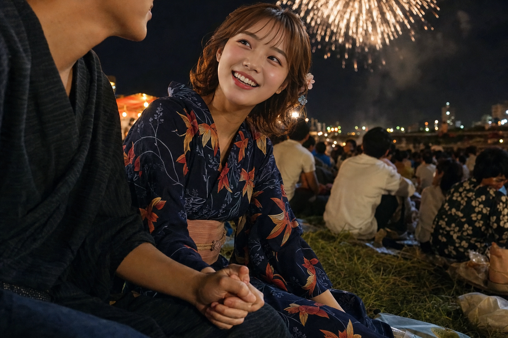

# 074. 불꽃 아래

일요일 저녁, 강변 둔치로 향하는 길은 이미 인파로 붐볐다.

근처에서 열리는 하나비 마츠리 소식을 들은 건 유즈키였다. 그녀는 며칠 전부터 이날을 손꼽아 기다린 눈치였다. 약속한 시간에 맞춰 기숙사 앞으로 나온 그녀는, 남색 바탕에 금붕어 무늬가 들어간 유카타 차림이었다. 머리는 평소보다 조금 더 정성스럽게 손질되어 있었다.

[나카타 유즈키] どう？ちゃんと着れてる？(어때요? 제대로 입었어요?)

[김용식] "네, 예뻐요."

[나카타 유즈키] え、急に。(어, 갑자기.)

유즈키는 당황한 듯 손부채질을 하며 얼굴을 붉혔다. 손에는 작은 향낭이 달린 손가방을 들고 있었다. 두 사람은 인파를 따라 강변으로 천천히 걸었다.

기숙사 골목을 벗어나 큰길로 나서자, 저녁 공기 사이로 축제 특유의 냄새가 섞여 들었다. 기름에 튀기는 냄새, 달게 조린 소스 냄새, 그리고 사람들의 땀과 향수가 뒤섞인 여름밤 특유의 공기였다. 유즈키는 나막신 굽 소리를 또각또각 내며 걸었다.

[나카타 유즈키] 下駄、久しぶりに履いたから、ちょっと痛い。(게다, 오랜만에 신어서, 조금 아파요.)

[김용식] "괜찮아요? 천천히 가요."

[나카타 유즈키] 平気。楽しみの方が大きいから。(괜찮아요. 기대되는 마음이 더 크니까요.)

노점이 늘어선 골목에는 야키소바와 초코바나나, 킨교스쿠이 좌판이 줄지어 있었다. 유즈키는 킨교스쿠이 앞에서 발을 멈추고 종이 뜰채를 하나 샀다.

[나카타 유즈키] 一匹だけ捕まえてみせます。(딱 한 마리만 잡아 볼게요.)

뜰채는 몇 번 담그기도 전에 찢어졌다. 유즈키는 아쉬운 표정을 짓다가도 금세 웃음을 터뜨렸다.

[나카타 유즈키] やっぱり無理でした。(역시 안 되네요.)

[김용식] "제가 해 볼게요."

용식이 시도한 두 번째 뜰채도 얼마 못 가 찢어졌다. 결국 두 사람은 금붕어 잡기를 포기하고, 대신 야키소바와 초코바나나를 하나씩 사 들었다. 좁은 골목을 지나는 동안 사람들에 밀려 어깨가 계속 부딪혔고, 그때마다 유즈키는 자연스럽게 용식의 소매를 붙잡았다.

강둔치에 자리를 잡고 앉았을 때는 이미 해가 거의 저물어 있었다. 유즈키는 유카타 자락을 정리하며 용식 옆에 바짝 붙어 앉았다.

[나카타 유즈키] もうすぐ始まりますね。(이제 곧 시작하네요.)

첫 번째 불꽃이 하늘로 솟아오르며 터졌다. 굉음과 함께 어두운 하늘이 붉고 푸른 빛으로 물들었다. 유즈키는 탄성을 지르며 하늘을 올려다봤고, 그 얼굴 위로 불꽃의 잔광이 스쳐 지나갔다.

[나카타 유즈키] きれい。(예뻐요.)

[김용식] "그러네요."

용식은 하늘보다 그녀의 옆얼굴을 더 오래 봤다. 불빛이 터질 때마다 유즈키의 표정이 환하게 밝아졌다가 다시 어두워졌다. 그 반복을 지켜보는 것만으로도 마음 한쪽이 저릿했다.

연달아 터지는 불꽃 사이로, 유즈키가 슬쩍 손을 뻗어 용식의 손을 잡았다. 손가락 사이가 자연스럽게 얽혔다. 주변은 인파로 가득했지만, 아무도 두 사람을 신경 쓰지 않았다. 그 익명성 안에서만큼은, 두 사람도 평범한 연인처럼 보일 수 있었다.

[나카타 유즈키] こうやって、誰にも気にされずに手を繋げるの、初めてかも。(이렇게, 아무한테도 신경 안 쓰이고 손잡는 거, 처음일지도 몰라요.)

[김용식] "그러게요."

[나카타 유즈키] 学校では、いつも周り見ながらだから。(학원에서는, 늘 주변 살피면서니까.)

말끝에 옅은 한숨이 섞였다. 용식은 그 한숨의 의미를 알아챘지만, 굳이 되묻지 않았다. 대신 잡은 손에 조금 더 힘을 줬다.

불꽃이 절정으로 치닫는 순간, 유즈키가 문득 고개를 기울여 그의 어깨에 머리를 기댔다.

[나카타 유즈키] 審査、明日結果出るんです。(심사, 내일 결과 나와요.)

용식은 순간 숨을 멈췄다.

[김용식] "그렇구나. 떨리겠네요."

[나카타 유즈키] うん。でも、今は考えたくない。(응. 근데, 지금은 생각하고 싶지 않아요.)

[나카타 유즈키] 今だけは、この花火だけ見てたい。(지금만큼은, 이 불꽃만 보고 싶어요.)

그녀는 그렇게 말하며 눈을 감았다. 용식은 그 옆얼굴을 바라보다가, 조용히 그녀의 어깨를 감싸 안았다. 밤하늘 가득 터지는 불꽃 소리가 두 사람 사이의 침묵을 채웠다.

마지막 대형 불꽃이 터지고 하늘이 완전히 어두워졌을 때, 유즈키는 눈을 뜨고 용식을 올려다봤다.

[나카타 유즈키] ヨンシクさん。(용식 씨.)

[김용식] "네."

[나카타 유즈키] 今日、幸せでした。(오늘, 행복했어요.)

그 말이 끝나기가 무섭게, 그녀가 발끝을 들어 짧게 입을 맞췄다. 인파 속에서 아무도 눈치채지 못한, 짧고 조용한 입맞춤이었다.

돌아오는 길, 두 사람은 손을 놓지 않은 채 천천히 걸었다. 축제의 여운이 가시지 않은 거리에는 아직 노점 냄새와 사람들의 웃음소리가 남아 있었다. 유즈키는 걷는 내내 별말이 없었지만, 잡은 손만은 놓지 않았다.

내일이면 그녀의 앞날을 가르는 결과가 나온다는 사실이, 오늘의 행복 뒤에 조용히 그림자를 드리우고 있었다.

기숙사 앞 갈림길에서 헤어질 시간이 되자, 유즈키는 아쉬운 듯 발끝으로 바닥을 톡톡 찼다.

[나카타 유즈키] もう少しだけ、一緒にいたい。(조금만 더, 같이 있고 싶어요.)

[김용식] "내일 아침에 결과 나오면 바로 연락해요."

[나카타 유즈키] うん。良くても、悪くても。(응. 좋아도, 나빠도.)

그녀는 그렇게 말하며 애써 밝게 웃었다. 용식은 그 웃음 뒤에 감춰진 긴장을 모르지 않았다. 골목 어귀에서 그녀를 꼭 안아 준 뒤에야, 두 사람은 각자의 방으로 흩어졌다.

방에 돌아와 잠옷으로 갈아입을 옷을 찾으면서도, 용식은 자꾸 오늘 낮에 봤던 유즈키의 옆얼굴이 눈앞에 어른거렸다. 불꽃이 터질 때마다 밝아지던 얼굴, 아무도 신경 쓰지 않는 인파 속에서 마주 잡았던 손, 그리고 마지막 그 짧은 입맞춤까지. 내일 아침 그녀에게 어떤 소식이 전해지든, 오늘 이 하루만큼은 온전히 두 사람의 것이었다는 확신이 들었다.

창밖 멀리서 축제의 여운으로 남은 폭죽 소리가 간간이 들려왔다. 용식은 그 소리를 들으며 잠자리에 들었다. 내일 아침이 오면 모든 게 지금과는 조금 달라질지도 모른다는 예감이, 잠이 드는 순간까지도 마음 한구석을 떠나지 않았다.
