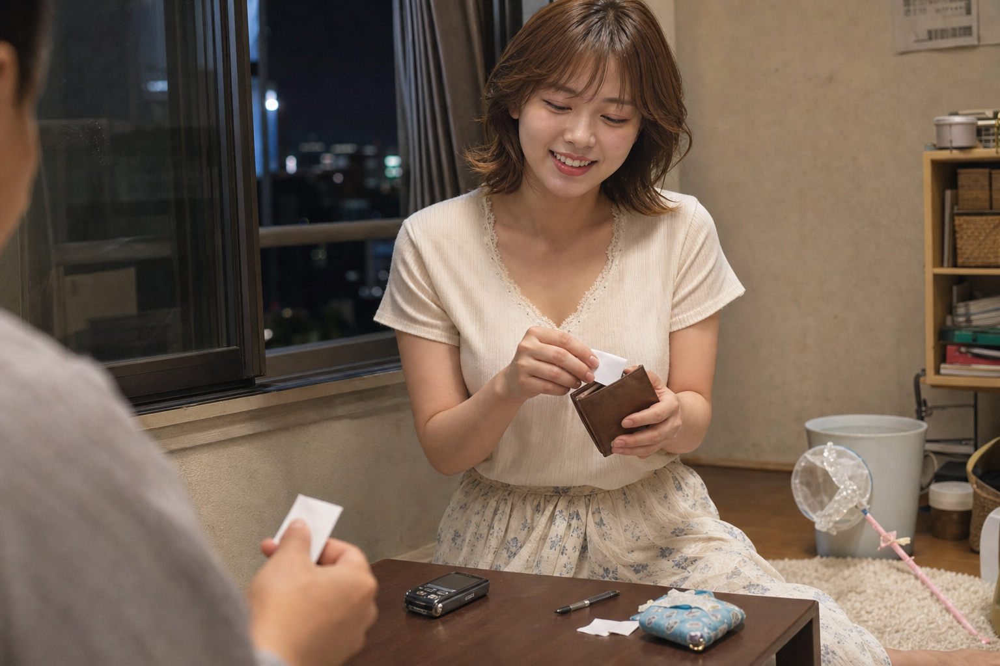

# 075. 겨울에 다시

월요일 아침, 유즈키에게서 문자가 온 건 수업 시작 직전이었다.

[나카타 유즈키] 結果、出ました。(결과, 나왔어요.)

용식은 수업 중인데도 몰래 폰을 확인했다. 다음 문자가 오기까지의 몇 분이 유독 길게 느껴졌다.

[나카타 유즈키] 正社員には、なれませんでした。(정직원은, 안 됐어요.)

[나카타 유즈키] でも、来年また挑戦していいって言われました。(근데, 내년에 다시 도전해도 된대요.)

남은 수업 시간 내내 용식은 칠판 글씨가 눈에 들어오지 않았다. 옆자리 학생이 필기를 재촉해도 손이 움직이지 않았다. 쉬는 시간마다 폰을 확인했지만, 유즈키에게서 추가 문자는 오지 않았다.

수업이 끝나자마자 용식은 생활 지원실로 향했다. 유즈키는 사무실 한쪽 책상에 앉아 서류를 정리하고 있었다. 표정은 담담했지만, 눈이 조금 부어 있었다.

[김용식] "괜찮아요?"

[나카타 유즈키] うん、大丈夫。予想はしてたから。(응, 괜찮아요. 어느 정도 예상은 했으니까요.)

말은 그렇게 했지만, 목소리 끝이 살짝 떨렸다. 유즈키는 서류를 정리하던 손을 멈추고 창밖을 바라봤다.

[나카타 유즈키] このバイトも、契約は九月までなんです。(이 아르바이트도, 계약은 9월까지예요.)

[나카타 유즈키] 更新されなかったら、名古屋に戻ることになると思います。(갱신 안 되면, 나고야로 돌아가게 될 것 같아요.)

용식은 그 말을 들으며 가슴 한쪽이 무거워지는 걸 느꼈다. 자신은 8월 중순이면 한국으로 돌아가야 했고, 유즈키는 그보다 조금 더 늦게 어쩌면 나고야로 돌아갈 처지였다. 두 사람 모두, 지금 있는 이 도시에 계속 머물 수 없는 사람들이었다.

퇴근 후 저녁, 유즈키의 원룸 창가에 나란히 앉아 두 사람은 오랫동안 말이 없었다. 방 안에는 어제 축제에서 사 온 킨교스쿠이 종이 뜰채 조각이 여전히 쓰레기통 옆에 놓여 있었다.

[나카타 유즈키] ねえ、ヨンシクさん。(있잖아요, 용식 씨.)

[김용식] "네."

[나카타 유즈키] もう、一ヶ月も残ってないですよね。(이제, 한 달도 안 남았죠.)

그 말이 처음으로 두 사람 사이에 정확한 숫자로 놓였다. 지금까지는 애써 셈하지 않으려 피해 왔던 셈이었다. 용식은 손가락을 접어 가며 날짜를 헤아려 봤다. 열엿새. 정확히는 그보다 조금 더 짧았다.

[김용식] "열엿새 남았어요."

[나카타 유즈키] ちゃんと数えてたんですね。(제대로 세고 있었네요.)

[김용식] "안 세려고 했는데, 저절로 세게 되더라고요."

유즈키는 그 말에 옅게 웃었다. 웃음 끝이 조금 떨렸다.

[나카타 유즈키] 私、契約も更新されなかったら、たぶん九月に名古屋帰ります。(저, 계약까지 갱신 안 되면, 아마 9월에 나고야 돌아가요.)

[나카타 유즈키] そしたら、ヨンシクさんとも、本当に会えなくなるかもしれない。(그러면, 용식 씨랑도, 정말 못 만나게 될지도 몰라요.)

용식은 그 말에 순간 숨이 막혔다. 지금까지 이 관계를 여름 한정이라고 스스로 되뇌어 온 건 자신이었다. 그런데 막상 완전히 끝날지도 모른다는 말을 들으니, 그 되뇜이 얼마나 얄팍한 자기방어였는지 뒤늦게 깨달았다.

[김용식] "겨울에 다시 올게요."

말이 먼저 튀어나왔다. 생각을 정리하기도 전에 입 밖으로 나온 말이었다.

[나카타 유즈키] え？(어?)

[김용식] "겨울방학 있잖아요. 그때 다시 올게요. 나고야든 어디든."

유즈키는 그를 빤히 쳐다봤다. 눈에 다시 눈물이 차오르기 시작했다.

[나카타 유즈키] 本当に？適当に言ってるんじゃなくて？(진짜로요? 그냥 하는 말 아니고요?)

[김용식] "진짜예요."

[나카타 유즈키] 約束ですよ。(약속이에요.)

[김용식] "약속이에요."

유즈키는 그 말을 듣고서야 참았던 눈물을 흘렸다. 이번에는 생일 때와 다른 눈물이었다. 슬픔과 안도가 뒤섞인, 복잡한 눈물이었다. 그녀는 용식의 품에 얼굴을 묻으며 한참을 그렇게 있었다.

[나카타 유즈키] メールアドレス、ちゃんと交換しておきましょう。(이메일 주소, 제대로 교환해 둬요.)

[나카타 유즈키] 携帯電話、まだ持ってないから。(휴대폰은, 아직 없으니까요.)

[김용식] "귀국하면 컴퓨터로 매주 한 번씩 메일 보낼게요."

[나카타 유즈키] 毎週？本当に？(매주요? 진짜로요?)

[김용식] "네, 진짜로."

[나카타 유즈키] じゃあ、私も毎週返します。(그럼, 저도 매주 답장할게요.)

두 사람은 서로의 이메일 주소를 종이에 적어 나눠 가졌다. 국제전화나 국제문자보다 훨씬 저렴하고 편한 방법이었다. 유즈키는 그 종이를 소중하게 접어 지갑 안쪽에 넣었다.

[나카타 유즈키] 冬まで、頑張れる気がします。(겨울까지, 버틸 수 있을 것 같아요.)

창밖으로 늦은 여름밤의 바람이 불어왔다. 용식은 그녀의 어깨를 끌어안으며, 지금 이 순간 자신이 내뱉은 약속의 무게를 오래도록 되새겼다. 여름 한정이라 여겼던 관계가, 이제는 겨울을 넘어 계속 이어질 무언가로 바뀌어 있었다.

늦은 밤, 유즈키가 먼저 잠든 뒤에도 용식은 쉽게 잠들지 못했다. 그는 그녀의 숨소리를 들으며, 남은 열엿새 동안 무엇을 더 해 줄 수 있을지 하나씩 헤아려 봤다. 함께 가 보지 못한 곳, 아직 나누지 못한 이야기, 아직 찍지 못한 사진들이 머릿속에 줄지어 떠올랐다.

동시에 한국에 두고 온 초연의 얼굴도 잠깐 스쳐 지나갔다. 겨울에 다시 온다는 약속을, 그는 아직 누구에게도 설명할 방법을 찾지 못한 채였다. 그 사실을 애써 밀어내며, 용식은 유즈키의 손을 조금 더 꼭 쥐었다. 오늘 밤만큼은, 그 복잡한 계산을 뒤로 미뤄 두고 싶었다.

창밖 매미 소리가 어느새 잦아들고, 대신 풀벌레 우는 소리가 여름의 끝자락을 알리듯 낮게 깔렸다. 열엿새 뒤에는 이 방도, 이 소리도, 곁에서 잠든 이 얼굴도 더 이상 매일 볼 수 없게 될 것이었다. 용식은 그 사실을 몇 번이고 곱씹으며, 눈을 감았다. 매주 한 통씩 오갈 이메일이, 앞으로 두 사람을 이어 줄 유일한 끈이 될 것이었다. 그 끈이 얼마나 가늘고 얼마나 오래갈지는, 지금으로선 아무도 알 수 없었다. 다만 오늘 이 순간만큼은, 그 불확실함조차 견딜 만하게 느껴졌다. 창밖 풀벌레 소리가 두 사람의 숨소리 위로 조용히, 오래도록 겹쳐지고 있었다.
