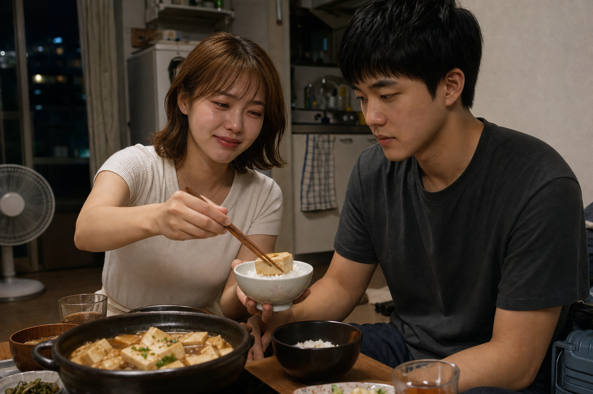

# 077. 두부 한 모

캐리어 지퍼 소리가 좁은 원룸 안에 유난히 크게 울렸다.

용식은 옷장 서랍을 하나씩 열어 자신의 물건을 골라냈다. 어느새 여기저기 흩어져 있던 것들이었다. 세면대 위의 칫솔, 냉장고 옆에 걸어둔 여벌 티셔츠, 침대 밑에 굴러다니던 충전기. 하나씩 캐리어에 넣을 때마다 방 안의 풍경이 조금씩 비어 갔다.

[나카타 유즈키] そんな急いで片付けなくても。(그렇게 서둘러 안 정리해도 되는데.)

유즈키는 부엌 쪽에서 도마를 두드리다 말고 고개를 내밀었다. 용식은 손에 든 충전기 코드를 만지작거리다 대답 대신 어깨를 으쓱했다. 서두르는 게 아니라, 눈에 보일 때마다 그냥 손이 먼저 갔다.

[김용식] "미리 좀 챙겨두려고요."

[나카타 유즈키] まだ五日もあるのに。(아직 닷새나 남았는데.)

닷새. 그 숫자가 입 밖으로 나오자 부엌 쪽 도마 소리가 잠깐 멈췄다. 용식이 고개를 들었을 때, 유즈키는 이미 다시 칼질을 시작하고 있었다.

캐리어 앞주머니를 정리하던 중, 책 사이에 끼워둔 프리쿠라 사진이 손끝에 걸렸다. 며칠 전 오다이바에서 찍은 그 컷이었다. 유즈키가 팔짱을 끼고 붙어 있고, 마지막 한 장에서만 그가 옆으로 고개를 돌린 사진. 용식은 그걸 잠깐 들여다보다가, 지갑 안쪽 칸에 옮겨 넣었다. 두꺼운 지폐 뭉치 옆에 작은 사진 한 장이 자리를 잡았다.

[김용식] "이메일 계정은 만들었어요?"

[나카타 유즈키] うん、昨日作った。(응, 어제 만들었어요.)

[나카타 유즈키] でも、携帯電話じゃないから、返事はパソコンのある時間しかできないです。(근데, 휴대폰이 아니니까, 답장은 컴퓨터 있는 시간에만 할 수 있어요.)

[나카타 유즈키] 週末に、支援室のパソコン借りて書きます。(주말에, 지원실 컴퓨터 빌려서 쓸게요.)

용식은 그 말에 고개를 끄덕였다. 매주 한 통이라는 약속이 이제 막연한 말이 아니라, 실제로 지켜야 할 일정이 되어 있었다. 그 사실이 오히려 마음 한쪽을 더 무겁게 만들었다. 한국에 돌아가면, 초연 몰래 이 계정을 열어봐야 할 시간을 따로 만들어야 한다는 생각이 스치듯 지나갔다가, 그는 그 생각을 얼른 지웠다.

저녁 메뉴는 두부조림이었다. 유즈키가 근처 슈퍼에서 사 온 연두부와 파, 실곤약을 손질하는 동안 용식은 옆에 앉아 그 손놀림을 지켜봤다. 냄비에서 간장 국물이 끓어오르는 냄새가 좁은 방을 채웠다.

[김용식] "이거, 그때 말한 그 두부예요?"

[나카타 유즈키] ううん、これはスーパーの。(아니요, 이건 슈퍼에서 산 거예요.)

[나카타 유즈키] 父の店のは、もっと固くて、味が濃いんです。(아빠 가게 두부는, 더 단단하고, 맛이 진해요.)

유즈키는 젓가락으로 두부를 뒤집으며 말을 이었다.

[나카타 유즈키] 子供の頃、父の店番を手伝ったら、いつも余った豆腐で母がこれ作ってくれました。(어렸을 때, 아빠 가게 일을 도와드리면, 항상 남은 두부로 엄마가 이거 만들어 줬어요.)

[나카타 유즈키] だから、今日はこれにしたかった。(그래서, 오늘은 이걸로 하고 싶었어요.)

용식은 그 말에 별다른 대꾸를 하지 못했다. 대신 그릇을 놓는 그녀의 손끝을 눈에 담았다. 밥상은 좁았지만, 두 사람은 무릎이 닿을 만큼 가까이 앉았다. 유즈키가 두부 한 조각을 그의 밥그릇 위에 올려줬다.

[나카타 유즈키] 熱いから、気をつけて。(뜨거우니까, 조심해요.)

용식은 두부를 입에 넣었다. 짭짤하면서도 깊은 간장 맛 뒤로 은은한 단맛이 남았다. 특별할 것 없는 집밥의 맛이었는데, 그 평범함이 오히려 목 안쪽을 뻐근하게 만들었다.

[김용식] "맛있어요."

[나카타 유즈키] よかった。(다행이다.)

유즈키는 그 말 한마디에 눈이 살짝 붉어졌다가, 곧 밥그릇으로 시선을 돌렸다. 식사가 끝난 뒤 두 사람은 설거지를 함께 했다. 용식이 그릇을 헹구고 유즈키가 물기를 닦는 동안, 창밖 매미 소리가 조금씩 잦아들었다. 어느새 방 안에는 선풍기 돌아가는 소리만 남았다.

유즈키가 마지막 그릇을 정리하다 말고 창가에 기대섰다. 밖은 완전히 어두워져 있었다.

[나카타 유즈키] あと五回しか、こんな夜ないんですね。(이제 다섯 번밖에, 이런 밤이 없네요.)

용식은 다가가 그녀의 어깨에 손을 얹었다. 유즈키는 그 손 위에 자기 손을 겹쳤다. 두 사람 다 아무 말도 하지 않았다. 선풍기 바람이 커튼을 살짝 흔들 때마다, 방 안의 미지근한 공기가 조금씩 자리를 바꿨다.

[김용식] "안 자요, 아직?"

[나카타 유즈키] うん。(응.)

유즈키가 고개를 돌려 그를 봤다. 눈이 마주쳤을 때, 먼저 시선을 피한 건 용식이었다. 그러나 손은 놓지 않았다. 유즈키의 손가락이 그의 손등을 천천히 쓸어내렸다.

[나카타 유즈키] 今日は、電気消していい？(오늘은, 불 꺼도 돼요?)

용식은 곧바로 대답하지 못했다. 스위치까지는 세 걸음, 그 세 걸음이 유난히 멀게 느껴졌다. 유즈키는 그 침묵을 재촉하지 않고, 그저 그의 손을 조금 더 세게 쥐었다. 용식이 먼저 시선을 내려 그녀의 눈을 봤다. 유즈키는 피하지 않았다.

선풍기가 한 번 크게 고개를 돌리는 소리가 들렸다. 용식은 그제야 스위치 쪽으로 손을 뻗었다.

방 안의 불이 꺼지고, 선풍기 바람 소리만 남았다.

*

아침이 되자 커튼 틈으로 새어든 빛이 먼저 방을 채웠다. 유즈키가 몸을 뒤척이며 이불을 끌어당겼고, 용식은 그 옆에서 천장을 바라보고 있었다. 어젯밤의 온기가 아직 손끝에 남아 있었다.

캐리어는 어제와 똑같은 자리에 그대로 놓여 있었다. 방 안 어디에도 더 이상 그의 물건은 눈에 띄지 않았다. 세면대도, 냉장고 옆도, 침대 밑도 전부 비어 있었다. 그 빈자리가 오히려 남은 날짜를 더 선명하게 세게 만들었다.

유즈키가 잠결에 손을 뻗어 그의 팔을 찾았다. 용식은 그 손을 마주 잡으며, 이제 나흘 남았다는 계산을 다시 하지 않으려 애썼다. 창밖에서 아침 첫 매미가 다시 울기 시작했다.

지갑은 어젯밤 그대로 협탁 위에 놓여 있었다. 그 안쪽 칸에 넣어둔 사진 한 장이, 두꺼운 지폐 뭉치 사이에서 얇게 자리를 지키고 있었다. 용식은 그 지갑을 물끄러미 보다가, 오늘 안에 이메일 계정 하나쯤은 자신도 만들어둬야겠다고 생각했다. 초연에게는 아직 아무 말도 하지 않은 계정이었다.
