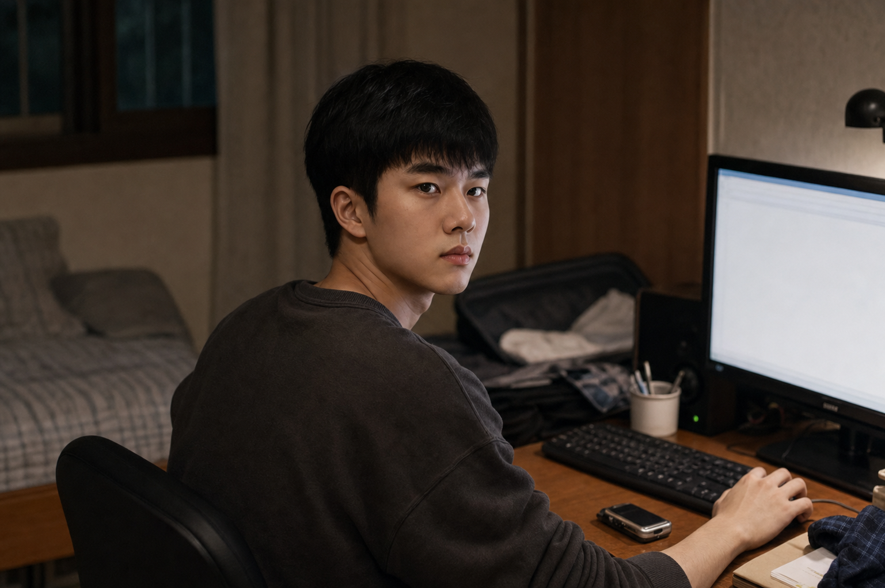

# 081. 안 보낸 메일

펜션에서 나온 두 사람은 해안도로를 따라 천천히 돌아왔다. 중간에 휴게소에 들러 호두과자를 나눠 먹었고, 초연은 종이봉투에 남은 부스러기까지 손가락으로 훑어 먹으며 창밖 논밭을 구경했다. 조수석 창을 조금 열어 놓고 바람을 맞던 초연은 수원 집 앞에 도착해서야 아쉬운 얼굴로 안전벨트를 풀었다.

[김초연] "오늘 진짜 좋았다."

[김용식] "그래, 다음에 또 가자."

[김초연] "다음은 또 언제 올지도 모르는데."

초연은 웃으면서 말했지만 그 말끝에 살짝 가시가 있었다. 용식은 대답 대신 그녀의 이마에 짧게 입을 맞추고 차 문을 열어 주었다. 초연이 손을 흔들며 계단을 올라가는 걸 확인한 뒤에야 그는 핸들을 돌렸다.

집에 도착한 건 저녁 여덟 시가 넘은 시각이었다. 어머니는 반찬가게 마감 정리를 하느라 아직 돌아오지 않았고, 아버지 방에는 불이 꺼져 있었다. 용식은 가방을 내려놓고 방문을 닫았다. 방 안에는 캐리어가 아직도 절반쯤 짐이 빠진 채로 벽에 세워져 있었다.

그는 책상 앞에 앉아 컴퓨터를 켰다. 부팅 소리가 유난히 크게 들렸다. 모니터가 밝아지는 동안 그는 손끝으로 마우스패드를 두드렸다. 한 번, 두 번.

한메일 로그인 창이 뜨자 손이 잠깐 멈췄다.

귀국한 지 벌써 사흘이었다. 매주 한 통씩 보내겠다고 약속했던 메일을 아직 한 번도 쓰지 않았다는 사실이, 오늘 아침 협탁 위 폴더폰 화면을 보는 순간부터 계속 목 뒤에 걸려 있었다.

새 메일 쓰기 창을 열었다. 받는 사람 칸에 익숙한 주소를 적었다. 제목 칸에서 커서가 한참 깜빡였다.

[제목] (제목 없음)

그는 지웠다가 다시 썼다.

[제목] 미안

썼다가 그것도 다시 지웠다. 미안하다는 말로 시작하면 뭐가 미안한지부터 설명해야 할 것 같았다. 초연을 만난 걸 미안해할 수도 없고, 답장이 늦은 걸 미안해하기엔 사흘이 그렇게 긴 시간도 아니었다. 그런데도 손끝은 계속 그 단어 근처를 맴돌았다.

결국 제목 칸은 비워 둔 채 본문으로 넘어갔다.

그는 한 줄을 썼다. 한국 잘 도착했어, 라고. 다시 지웠다. 너무 사무적이었다. 두 줄을 더 썼다가 지웠다. 도쿄는 아직도 덥냐고 묻는 문장은 날씨 얘기치고는 어색했다.

방 밖에서 현관문 열리는 소리가 났다. 어머니가 돌아온 모양이었다. 용식은 반사적으로 모니터를 향해 몸을 조금 기울이며 화면 밝기를 낮췄다.

[김용식 모] "용식아, 저녁 먹었어?"

[김용식] "먹었어요."

문 너머로 대답한 뒤 그는 다시 화면을 봤다. 커서가 깜빡이는 빈칸이 여전히 그대로였다.

그는 키보드에서 손을 떼고 잠깐 뒤로 기댔다. 천장을 봤다. 나리타 공항 게이트 앞에서 유즈키가 손을 흔들던 모습이 떠올랐다. 그다음엔 인천공항에서 피켓을 들고 있던 초연의 얼굴이 겹쳐 떠올랐다. 두 장면이 순서 없이 뒤섞이는 게 낯설어서, 그는 눈을 한 번 세게 감았다 떴다.

다시 몸을 앞으로 당겨 앉았다.

이번엔 지우지 않고 끝까지 썼다.

[본문] 잘 지내? 한국 온 지 사흘 됐는데 이제야 써. 미안. 여기 오니까 이것저것 정리할 게 많아서 정신이 없었어. 두부조림 진짜 맛있었어. 그날 얘기 자주 생각나.

거기까지 쓰고 손이 다시 멈췄다. 겨울에 다시 가겠다는 약속을 문장으로 다시 쓸까 하다가, 이미 공항에서 몇 번이나 말한 걸 또 적으면 오히려 가벼워 보일 것 같아서 그만두었다. 대신 마지막 줄에는 다른 말을 적었다.

[본문] 계약 얘기는 어떻게 됐는지 궁금해. 힘든 일 있으면 말해.

전송 버튼 위에서 마우스 커서가 한 번 흔들렸다.

그는 클릭했다.

메일이 전송되었다는 창이 뜨는 순간, 폴더폰이 진동했다. 화면에는 초연의 이름이 떠 있었다. 그는 반사적으로 모니터 창을 최소화하고 폴더폰을 열었다.

손끝이 아직 마우스 위에 남아 있었다. 방금 보낸 문장들이 잘한 건지, 너무 짧은 건지 가늠이 서지 않았다. 두 달이나 미뤄 둔 메일 한 통으로 그 여름을 다 설명할 수 없다는 걸 알면서도, 그는 이 정도가 지금 자신이 할 수 있는 최선이라고 스스로를 다독였다.

[김초연] 자? 나 방금 씻고 나왔는데 갑자기 오늘 하루가 아까워서 문자함ㅋㅋ

용식은 짧게 답장을 보냈다.

[김용식] 나도 좋았어. 잘 자.

[김초연] 응 너도. 다음 주 개강 준비해야 하는데 하나도 안 한 거 알지

용식은 대답 대신 웃음 표시만 하나 눌러 보냈다. 폴더폰을 내려놓고 다시 모니터를 켰을 때, 보낸 메일함에는 방금 보낸 메일이 그대로 남아 있었다. 그는 그 제목 없는 메일을 한동안 바라봤다.

답장이 언제 올지, 그 사이에 무슨 말을 또 숨겨야 할지, 아직은 아무것도 알 수 없었다. 그는 모니터를 끄고 방 불도 끈 채 침대에 누웠다. 창밖으로 옆집 에어컨 실외기 돌아가는 소리가 낮게 이어졌다.

다음 날 아침, 부엌에서는 된장국 냄새가 났다. 어머니는 앞치마를 두른 채 생선을 굽고 있었고, 아버지는 이미 식탁 한쪽에 앉아 신문을 넘기고 있었다. 용식이 자리에 앉자 어머니가 그의 얼굴을 슬쩍 훑어봤다.

[김용식 모] "얼굴이 탔네. 일본 가서 뭐 했다고 이렇게 탔어."

[김용식] "학원 끝나고 좀 돌아다녔어요."

[김용식 모] "돌아다니는 데 돈은 안 들었니. 알바비로 두 달 버틴 거 맞아?"

용식은 국그릇을 당겨 오며 짧게 그렇다고만 답했다. 아버지는 신문에서 눈을 떼지 않았지만, 그 침묵이 오히려 방 안 공기를 더 무겁게 만들었다. 어머니는 더 묻지 않고 생선 접시를 그의 앞으로 밀어 주었다. 용식은 그 손짓이 고마우면서도, 그 뒤에 숨겨야 할 통장의 숫자가 다시 목 뒤를 눌렀다.

식사를 마치고 방으로 돌아온 그는 습관처럼 컴퓨터를 켰다. 받은 메일함은 비어 있었다. 시차를 생각하면 당연한 일이었지만, 그는 잠깐 그 빈 화면을 들여다보다가 창을 닫았다. 대신 책상 위에 던져둔 폴더폰을 열어 다이어리 기능으로 넘어갔다. 다음 주 개강, 그리고 그 사이에 밀린 일본어 학원 출석이 붉은 글씨로 떠 있었다. 두 달 가까이 발을 끊었던 그 학원 교실 문을 다시 열어야 한다는 사실이, 그제야 다른 무게로 다가왔다. 폴더폰을 닫고 캐리어 쪽으로 시선을 돌렸다. 아직 짐도 다 풀지 않았는데, 벌써 다른 문 앞에 서야 하는 기분이었다.
