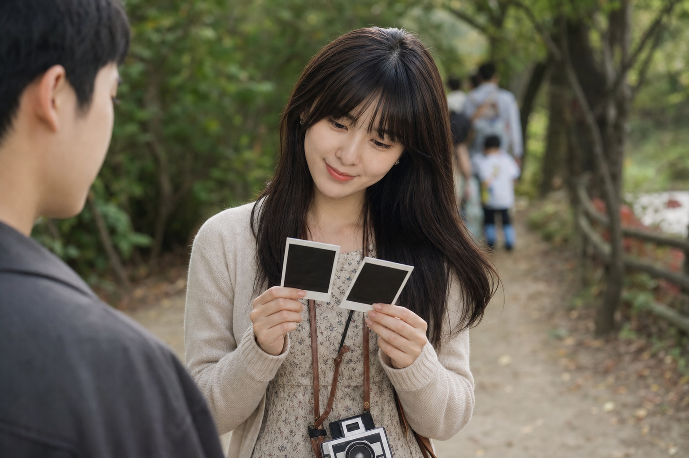

# 087. 토요일의 산책

개강한 지 일주일이 지난 토요일 아침, 초연이 문자로 먼저 물었다.

[김초연] 오늘 날씨 좋은데 어디 좀 걷고 싶다. 시간 돼?

용식은 오전 내내 밀린 잠을 자고 일어나 거울 앞에서 한참 머리를 정리했다. 부엌에서는 어머니가 반찬가게에 내놓을 나물을 무치고 있었다.

[김용식 모] "오늘도 나가?"

[김용식] "네, 초연이 좀 만나려고요."

[김용식 모] "그 아가씨 한번 데려와. 얼굴이나 보자."

[김용식] "다음에요."

어머니는 더 캐묻지 않고 나물 그릇을 앞으로 밀어 하나 집어 먹으라는 손짓을 했다. 용식은 오이무침을 손으로 집어 먹고 지갑을 챙겼다. 지갑 안에는 두꺼운 현금 뭉치가 그대로였다. 그는 그중 몇 장만 따로 꺼내 주머니에 넣었다. 통장 액수를 어머니가 알게 되는 일은 상상만으로도 아득했다.

현관으로 나서는데 아버지 방문이 살짝 열려 있었다. 아버지는 텔레비전 뉴스를 보다가 그를 흘깃 봤다.

[아버지] "어디 가냐."

[김용식] "친구 좀 만나러요."

짧은 대답에 아버지는 별다른 말 없이 다시 텔레비전으로 시선을 돌렸다. 용식도 더 이상 말을 붙이지 않고 현관을 나섰다. 두 사람 사이의 대화는 늘 그 정도에서 끝났다. 그게 서운하지는 않았다. 익숙한 온도였다.

초연을 태우고 도착한 곳은 차로 삼십 분 거리의 근처 수목원이었다. 주말이라 나들이 나온 가족들이 많았다. 두 사람은 손을 잡고 산책로를 따라 걸었다. 매미 소리는 이제 확실히 줄어 있었고, 대신 나뭇잎 사이로 여름 끝 무렵의 선선한 바람이 지나갔다. 자갈길을 밟는 발소리와 저 멀리 아이들이 뛰어다니는 웃음소리가 뒤섞여 들렸다. 초연은 발밑의 낙엽 하나를 주워 손끝으로 굴리다가 다시 던져 버렸다.

[김초연] "여기 진짜 오랜만이다. 고3 때 수학여행 대신 온 데였는데."

[김용식] "그때도 왔었어?"

[김초연] "어, 그때는 친구들이랑. 지금은 남자친구랑."

그녀는 그 말을 하며 그의 팔을 더 세게 붙잡았다. 벤치 근처를 지날 때 초연이 걸음을 멈추고 폴라로이드 카메라를 꺼냈다.

[김초연] "여기서 하나 찍자."

지나가던 아주머니에게 부탁해 두 사람의 사진을 찍었다. 사진이 나오는 데 걸리는 몇 초 동안 초연은 필름을 살랑살랑 흔들며 웃었다.

[김초연] "잘 나왔다. 이것도 다이어리에 붙일 거야."

전망대 계단을 오르며 초연이 몇 번이나 숨을 헐떡였다. 정상에 다다르자 시야가 탁 트이며 멀리 저수지가 내려다보였다. 초연은 난간에 팔을 걸치고 한동안 그 풍경을 바라봤다.

[김초연] "여기 오니까 머리가 좀 맑아지는 것 같아."

[김용식] "요즘 뭐가 그렇게 복잡해."

[김초연] "시험도 있고, 그냥 이것저것."

그녀는 구체적으로 설명하지 않았다. 용식도 굳이 캐묻지 않았다. 두 사람은 다시 계단을 내려와 수목원 안 카페에서 아이스티를 나눠 마셨다. 초연은 다음 학기 조모임에서 같은 과 동기 얘기를 하다가, 문득 생각난 듯 말했다.

[김초연] "정다은이는 요즘 조용하네. 방학 전에는 좀 그랬는데."

용식은 순간 컵을 쥔 손에 힘이 들어갔지만, 겉으로는 아무렇지 않게 대답했다.

[김용식] "조별 과제만 하니까 그렇지."

[김초연] "그런가 보네. 그래도 다행이야, 걔 좀 신경 쓰였거든."

초연은 그 얘기를 오래 끌지 않고 다시 다음 주 시험 계획으로 넘어갔다. 용식은 그 화제 전환이 고마우면서도, 동시에 그녀가 아무것도 모른 채 편하게 웃고 있다는 사실이 마음 한쪽을 계속 찔렀다.

카페를 나와 다시 산책로를 걷던 중, 초연이 갑자기 걸음을 멈추고 그를 정면으로 봤다.

[김초연] "용식아."

[김용식] "왜."

[김초연] "그냥, 오늘처럼만 계속 있었으면 좋겠다."

그녀는 그렇게 말하고 다시 걸음을 옮겼다. 용식은 그 말의 무게를 잠깐 곱씹었다. 오늘처럼만 계속 있는 게 얼마나 어려운 일인지, 그녀는 알지 못했다. 그는 대답 대신 그녀의 손을 조금 더 세게 잡았다.

해가 기울 무렵 두 사람은 수목원 입구 근처 포장마차에서 어묵 국물을 나눠 마셨다. 어묵 꼬치를 하나씩 나눠 들고, 초연은 뜨거운 국물에 입김을 불어 가며 후루룩 마셨다.

[김초연] "이거 진짜 맛있다. 하나 더 먹을까?"

[김용식] "먹고 싶은 만큼 먹어."

[김초연] "그럼 두 개 더."

그녀는 신이 나서 아주머니에게 손을 들어 추가를 시켰다. 포장마차 안 작은 라디오에서는 그해 여름 유행하던 가요가 흘러나오고 있었다. 초연은 그 노래를 흥얼거리며 꼬치를 씹었다. 용식은 그런 그녀를 보며 웃었지만, 그 웃음 뒤에는 며칠 전 밤의 일이 조용히 겹쳐 있었다.

초연은 오늘 하루가 완벽했다고 몇 번이나 말했다. 용식은 그 말에 웃으며 고개를 끄덕였지만, 집으로 돌아가는 차 안에서는 다시 다음 주 일본어 학원 생각이 슬며시 고개를 들었다.

초연을 집 앞에 내려주기 전, 그녀는 조수석에서 오늘 찍은 폴라로이드 두 장을 나란히 들고 비교했다.

[김초연] "이거 봐, 아까 전망대에서 찍은 거랑 벤치에서 찍은 거. 둘 다 잘 나왔어."

[김용식] "그러네."

[김초연] "한 장은 너 줄까?"

용식은 잠깐 망설이다가 고개를 저었다.

[김용식] "네가 가지고 있어. 나중에 또 보게."

초연은 그 대답에 만족한 듯 사진을 다이어리 사이에 조심스럽게 끼워 넣었다. 집 앞에 도착하자 그녀는 아쉬운 얼굴로 안전벨트를 풀었다.

[김초연] "오늘 진짜 고마웠어. 잘 가."

그녀가 계단을 올라가 현관으로 사라지는 걸 확인한 뒤, 용식은 핸들을 돌려 혼자 집으로 향했다. 라디오를 틀어 놓고 한동안 아무 생각 없이 운전만 했다. 신호에 걸려 멈춰 선 사이, 창밖으로 하교하는 고등학생들이 시끄럽게 떠들며 지나갔다. 그 모습이 문득 자신의 재수 시절과 겹쳐 낯설게 느껴졌다.

집에 도착해 방에 들어온 뒤, 그는 컴퓨터를 켜고 메일함을 다시 확인했다. 받은 메일함은 여전히 텅 비어 있었다. 오늘 하루는 분명 좋았다. 다만 그 좋음이 다음 주에도 그대로 이어질 수 있을지, 그는 확신할 수 없었다. 모니터를 끄고 나서도 그는 한참 동안 어두워진 화면을 그대로 바라봤다.
