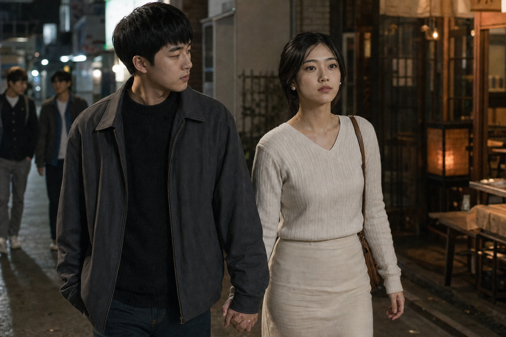

# 089. 자꾸 이러면

수업 시작 전, 폴더폰이 짧게 울렸다. 초연이었다.

[김초연] 오늘 학원 몇 시에 끝나? 끝나고 통화하자.

[김용식] 늦을 수도 있어. 조별 자료 정리하다가.

거짓말은 아직 아니었다. 다만 오늘 저녁 일정이 정말 그렇게 될지는 그 스스로도 알 수 없었다. 그는 폴더폰을 도로 가방에 넣고 강의실로 들어갔다. 수업이 끝나자 한서윤이 가방을 챙기며 아무렇지 않게 물었다.

[한서윤] "오늘도 한잔?"

[김용식] "오늘은 좀 힘들 것 같은데."

[한서윤] "왜, 초연 씨한테 걸릴까 봐?"

초연의 이름을 그녀가 직접 부른 건 처음이었다. 용식은 순간 말을 고르지 못했다. 한서윤은 그 반응을 보고도 별일 아니라는 듯 웃었다.

[한서윤] "장난이야. 그렇게 얼어붙긴."

[김용식] "장난처럼 안 들렸어."

[한서윤] "그럼 진심으로 들어. 딱 한 잔만 하고 가자. 오늘 좀 별로였어."

그녀는 대답을 기다리지 않고 가방을 어깨에 걸치며 앞장서 계단을 내려갔다. 용식은 몇 초 서 있다가 결국 그 뒤를 따라갔다. 건물 밖으로 나오자 저녁 공기는 이제 확실히 서늘해져 있었다. 여름 내내 요란했던 매미 소리도 완전히 사라지고, 대신 풀벌레 소리가 낮게 깔려 있었다.

두 사람이 들어선 곳은 학원 뒷골목의 처음 가 보는 작은 이자카야풍 술집이었다. 한서윤은 문을 열자마자 익숙하게 구석 테이블로 가 앉으며 말했다.

[한서윤] "여기 새로 생겼어. 혼자 와 봤는데 괜찮더라."

혼자 와 봤다는 말이 이상하게 오래 남았다. 벽에는 작은 등롱 모양 조명이 줄지어 걸려 있었고, 스피커에서는 낮게 재즈풍 음악이 흘렀다. 사케 한 병과 안주가 나오자, 그녀는 잔을 채우며 오늘 있었던 일을 얘기했다. 이번 달에도 새로 넣었던 자리에서 서류조차 못 붙었다는 것, 집에서는 언제까지 학원이나 다니고 있을 거냐는 잔소리가 쌓여 가고 있다는 것. 말투는 가벼웠지만 눈은 웃지 않았다.

[한서윤] "너는 그래도 학교가 있잖아. 나는 이거 말고는 딱히 할 게 없어."

[김용식] "구직은 계속하고 있어요?"

[한서윤] "몇 군데 더 넣어 놓긴 했는데, 이번 달에도 떨어지면 진짜 어떡할지 모르겠어."

[김용식] "면접까지 간 데는 없었어요?"

[한서윤] "두 군데는 서류 붙었는데 면접에서 떨어졌어. 뭐가 문제인지도 잘 모르겠어."

그녀는 그렇게 말하며 잔을 만지작거렸다. 손톱 끝으로 잔 표면에 맺힌 물기를 긋는 손짓이 평소보다 느렸다. 용식은 그 손을 잠깐 보다가 조용히 시선을 들었다.

[김용식] "그럼 학원은 계속 다니는 거예요?"

[한서윤] "몰라. 엄마가 자꾸 아는 사람 통해서 자리 알아본다는데, 그런 식으로 들어가는 건 더 싫어."

[김용식] "그렇게 싫어요?"

[한서윤] "계속 집에서 눈치 보고 사는 것도 지겹고."

그녀는 잔을 비우고 스스로 다시 채웠다. 술이 올라오자 말투가 조금씩 느슨해졌다. 계산을 마치고 나온 골목에서, 그녀는 자연스럽게 그의 손을 잡았다. 예전의 팔짱보다 한 단계 더 나간 접촉이었다.

[김용식] "이러면 사람들이 봐요."

[한서윤] "보라고 해. 누가 뭐라고 하는데."

[김용식] "..."

[한서윤] "나 요즘 그런 거 신경 안 쓰기로 했어. 어차피 취직하면 여기 사람들 다시 볼 일도 없을 텐데."

그 말에는 자조와 대담함이 동시에 섞여 있어서, 어느 쪽이 진심인지 가늠하기 어려웠다. 용식은 손을 빼려다가, 그녀의 손가락이 더 세게 얽혀 오는 걸 느끼고 그만두었다. 골목을 벗어나며 두 사람의 발걸음 소리만 나란히 이어졌다. 편의점 앞을 지날 때, 안에서 나오던 학원 다른 수강생 두 명과 눈이 마주쳤다. 그들은 한서윤과 용식을 번갈아 보다가 짧게 목례하고 지나갔다. 용식은 순간 손을 빼려 했지만, 한서윤은 오히려 그 시선을 즐기듯 어깨를 펴고 걸었다.

[김용식] "저 사람들 학원 사람들이잖아요."

[한서윤] "그래서?"

[김용식] "소문 나면 어쩌려고."

[한서윤] "소문 나면 뭐. 취직하면 어차피 얼마 못 다닐 텐데."

그 말투에 서운함이 섞여 있는 건지, 자조인지 구분이 되지 않았다. 큰길로 나오는 동안 지나가던 사람 몇이 두 사람을 흘깃 봤지만, 한서윤은 개의치 않고 걸음을 옮겼다. 가로수 아래 벤치에 앉은 노인이 그 손을 흘깃 보고는 아무 말 없이 시선을 돌렸다.

[한서윤] "우리 이제 슬슬 정해야 하지 않아?"

[김용식] "뭘요."

[한서윤] "뭔지 알잖아."

그녀는 그 이상 설명하지 않았다. 역 앞에 도착해서야 손을 놓으며, 오늘은 유난히 길게 그를 쳐다봤다. 가로등 불빛 아래 그녀의 눈에는 술기운과는 다른 결의 같은 게 분명하게 비쳤다.

[한서윤] "다음 학원 날, 나 진짜 물어볼 거야."

용식은 대답하지 못했다. 그녀가 개찰구 너머로 사라진 뒤, 그는 손바닥에 남은 온기를 내려다봤다.

집으로 돌아오는 길, 폴더폰이 울렸다. 초연이었다. 그는 잠깐 화면을 보다가 받았다.

[김초연] "왜 이렇게 늦었어. 조별 자료 그렇게 오래 걸려?"

[김용식] "어, 정리할 게 좀 많아서."

[김초연] "밥은 먹었어?"

[김용식] "먹었어."

[김초연] "뭐 먹었는데?"

용식은 순간 말이 막혔다. 사케와 안주 이름을 그대로 말할 수는 없었다.

[김용식] "그냥, 학교 앞에서 대충."

[김초연] "대충 뭐. 왜 자꾸 얼버무려."

[김용식] "안 얼버무렸어. 그냥 별거 아니라서 그래."

초연은 그 대답에 별다른 의심을 두지 않고 다음 주 시험 얘기로 넘어갔다. 통화가 끝나고 나서도 용식은 한참 폴더폰을 손에 쥔 채 서 있었다. 오늘 하루 동안 쌓인 거짓말이 또 하나 늘었다. 별거 아니라는 말이 별거 아닌 게 아니라는 걸 그는 스스로 가장 잘 알고 있었다.

방에 들어와 침대에 걸터앉은 그는 손바닥을 펼쳐 다시 들여다봤다. 한서윤의 손가락이 얽혀 있던 자리에는 아직 온기가 남아 있는 것 같았다. '다음 학원 날 진짜 물어볼 거야'라는 말이 자꾸 되풀이됐다. 그날이 오면 뭐라고 답해야 할지, 그는 여전히 아무 준비도 되어 있지 않았다. 창밖 풀벌레 소리를 들으며 그는 밤이 깊도록 잠들지 못했다.
