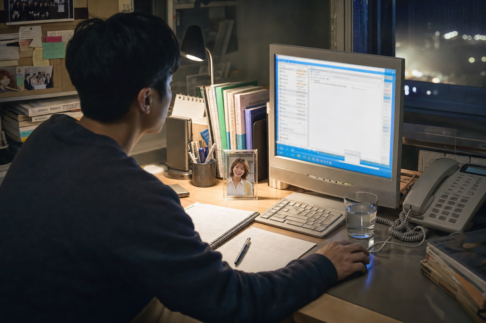

# 092. 나고야라는 말

새벽 한 시가 조금 넘은 시간이었다.

방 안은 컴퓨터 본체 돌아가는 소리만 낮게 울리고 있었다. 용식은 책상 앞에 앉아 일본어 단어장을 펼쳐 놓은 채 멍하니 모니터를 보고 있었다. 받은 메일함에는 새 메일 하나가 떠 있었다. 보낸 사람 이름은 나카타 유즈키였다.

제목은 짧았다.

[Nakata Yuzuki] 結果が出ました。

결과가 나왔습니다.

용식은 마우스를 잡은 손에 힘을 줬다. 클릭 한 번이면 열리는 메일이었다. 그런데 그 클릭이 이상하게 어려웠다. 창밖에서는 새벽 도로를 지나는 오토바이 소리가 길게 지나갔다. 그는 물컵을 들어 한 모금 마셨지만, 물은 이미 미지근했다.

메일을 열었다.

유즈키의 문장은 여전히 서툴렀다. 일본어 문장 아래에는 한국어로 쓰려다 고친 흔적이 군데군데 남아 있었다. 정직원 전환 재심사에서도 좋은 결과를 받지 못했다는 내용이었다. 계약은 9월 말까지이고, 그 뒤에는 나고야 집으로 돌아갈 것 같다고 했다. 도쿄에서 더 버티고 싶었지만, 생활비와 집안 사정이 마음처럼 되지 않는다고 했다.

마지막 문장은 조금 길었다.

겨울에 도쿄에서 눈을 같이 보는 약속은 못 지킬지도 모르지만, 그래도 겨울에 볼 수 있으면 좋겠다고. 도쿄가 아니어도 괜찮다고. 나고야는 도쿄보다 조용하지만, 두부 가게 앞 골목에 겨울 냄새가 좋다고.

용식은 그 문장을 몇 번이나 다시 읽었다.

나고야.

화면 위의 세 글자가 방 안에 실제 장소처럼 놓였다. 유즈키가 떠나면 도쿄 어학원 생활은 더 이상 같은 기억으로 남지 않을 것이다. 생활 지원실 창구, 기숙사 앞 골목, 비 오는 날 나눠 쓴 우산, 하나비 마츠리에서 손을 놓지 못하던 인파. 그 모든 게 한 도시 안에 묶여 있었는데, 이제 그 도시에서 빠져나와 다른 이름으로 밀려나고 있었다.

폴더폰이 울렸다.

초연이었다.

[김초연] 자?

용식은 화면을 보고도 바로 답하지 못했다. 메일 창을 닫을 수가 없었다. 유즈키의 문장과 초연의 문자가 한 모니터와 한 손 안에서 겹쳤다.

[김용식] 아직. 공부하다가.

답장을 보내고 나서도 초연은 곧바로 다시 물었다.

[김초연] 이렇게 늦게까지?

[김용식] 시험 얼마 안 남았잖아.

[김초연] 전화해도 돼?

용식은 메일 창을 내려놓았다. 완전히 닫지는 못했다. 작업표시줄 아래에 작게 남은 창이, 숨긴 물건처럼 눈에 걸렸다.

[김용식] 잠깐만. 씻고.

거짓말이었다. 그는 이미 씻었다. 머리도 말랐다. 다만 지금 목소리로 초연과 통화하면, 뭔가 다른 게 섞여 나올 것 같았다. 그는 의자 등받이에 기대 눈을 감았다. 초연에게 미안한 마음과 유즈키에게 미안한 마음은 닮은 것 같으면서도 달랐다. 초연에게는 숨긴 일들이 너무 많아서 미안했고, 유즈키에게는 자신이 돌아갈 수 없는 곳에 계속 약속을 걸어 둔 것 같아서 미안했다.

그는 답장을 쓰기 시작했다.

처음에는 일본어로 썼다. 한 줄 쓰고 지웠다. 너무 정중했다. 다시 썼다. 이번에는 너무 가벼웠다. 또 지웠다. 결국 그는 천천히, 자신이 실제로 할 수 있는 말만 남겼다.

겨울에 갈게요. 도쿄가 아니어도 괜찮아요. 나고야도 괜찮아요. 그때 두부 가게 앞 골목도 보여 주세요.

그 문장을 쓰는 동안, 그는 자신이 무엇을 약속하고 있는지 알고 있었다. 초연에게는 말하지 않은 겨울이었다. 한서윤에게도, 정다은에게도, 누구에게도 말하지 않은 겨울이었다.

보내기 버튼 위에서 손가락이 멈췄다.

폴더폰이 다시 울렸다.

[김초연] 아직 씻어?

그는 메일을 보냈다. 그리고 바로 폴더폰을 열었다.

[김용식] 이제 전화할게.

통화 연결음이 두 번 울리고 초연이 받았다.

[김초연] "왜 이렇게 오래 걸렸어."

[김용식] "머리 말리느라."

[김초연] "목소리 왜 그래?"

[김용식] "졸려서."

초연은 잠깐 말이 없었다. 전화 너머로 침대 이불이 바스락거리는 소리가 들렸다. 그녀도 누워 있는 것 같았다. 평소 같으면 시험 범위 얘기나 과제 얘기로 넘어갔을 텐데, 오늘은 그 침묵이 쉽게 지나가지 않았다.

[김초연] "너 요즘 나한테 말 안 하는 거 많지."

용식은 의자 팔걸이를 붙잡았다.

[김용식] "뭐가."

[김초연] "그냥 느낌이 그래."

[김용식] "느낌으로 사람 잡지 마."

말이 나가고 나서야 세다는 걸 알았다. 초연도 바로 다쳤다. 숨을 삼키는 소리가 들렸다.

[김초연] "나 사람 잡는 거야?"

[김용식] "그런 뜻 아니야."

[김초연] "너는 꼭 말해 놓고 그런 뜻 아니래."

용식은 눈을 감았다. 모니터 아래 작업표시줄에는 방금 보낸 메일 창이 아직 남아 있었다. 그 작은 표시 하나가 목에 걸린 가시 같았다.

[김용식] "미안. 내가 피곤해서 그래."

[김초연] "피곤하면 자. 나도 잘게."

[김용식] "초연아."

[김초연] "응."

[김용식] "화났어?"

[김초연] "아니."

아니라는 말은 화났다는 말보다 더 차가웠다.

통화가 끊긴 뒤, 용식은 한참 동안 수화기에서 귀를 떼지 못했다. 방 안 스탠드 불빛 아래, 책상 위에는 일본어 단어장, 물컵, 폴더폰, 그리고 모니터 속 보낸 편지함이 놓여 있었다. 각각 따로 보면 아무 문제 없는 물건들이었다.

같이 놓이면 전부 문제였다.

다음 날 학교에서 정다은은 그 변화를 금방 알아봤다. 오전 수업이 끝난 뒤 학생식당으로 가는 길, 그녀는 용식 옆으로 와서 발걸음을 맞췄다.

[정다은] "너 어제 잠 못 잤지."

[김용식] "시험 기간이라고 했잖아."

[정다은] "시험 핑계 되게 좋아하네."

[김용식] "핑계 아니야."

[정다은] "초연이랑 싸웠어?"

용식은 대답하지 않았다. 정다은은 그 침묵을 보며 입꼬리를 아주 조금 올렸다. 그녀는 손에 들고 있던 파일을 가슴에 안고, 사람들 사이를 피해 한 걸음 가까이 붙었다. 어깨가 스칠 듯 말 듯한 거리였다.

[정다은] "너희는 사귀는 게 아니라 출석 체크하는 것 같아."

[김용식] "말 좀 가려서 해."

[정다은] "왜. 찔려?"

용식은 멈춰 섰다. 복도 한가운데서 멈추는 바람에 뒤에서 오던 동기 하나가 어깨를 피해 지나갔다. 정다은도 멈췄다. 그녀는 놀라지 않았다. 오히려 그 반응을 기다렸다는 듯 그를 올려다봤다.

[김용식] "너 그만해."

[정다은] "그만하라니까 더 티 나."

그녀는 웃으면서 먼저 걸어갔다. 밝은 노란색 머리핀이 짧은 단발 사이에서 작게 흔들렸다. 용식은 그 뒷모습을 보다가 뒤늦게 학생식당 쪽으로 걸었다.

그날 점심 메뉴는 돈가스였다. 그는 접시를 받아 들고도 식욕이 없었다. 초연에게서는 아직 연락이 오지 않았다. 오지 않으니 편해야 했다. 그런데 이상하게 더 불안했다.

연락이 오면 숨이 막히고, 안 오면 목이 말랐다.

그 사이를 정다은이 너무 쉽게 알아보고 있었다.
