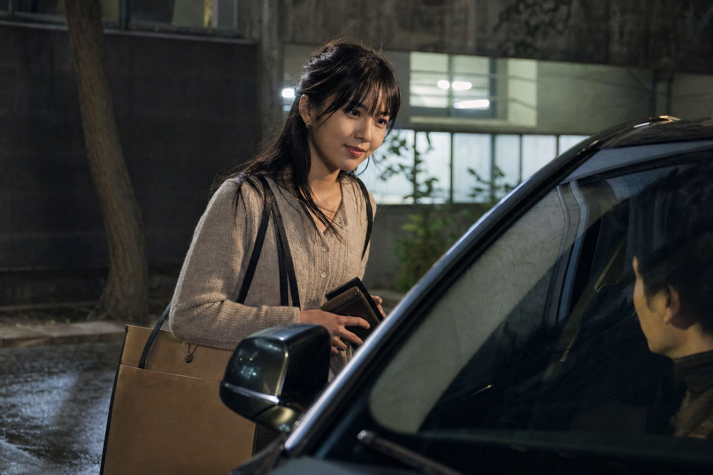

# 093. 바로 연락해

목요일 오후, 캠퍼스에는 흐린 빛이 깔려 있었다.

비가 오지는 않았지만 하늘은 종일 젖은 색이었다. 강의실 창문에는 바람이 부딪힐 때마다 얇은 먼지가 흔들렸고, 학생들은 시험 범위가 적힌 프린트를 접어 가방에 넣으며 하나둘씩 빠져나갔다. 용식은 마지막 줄에 앉아 폴더폰을 열었다.

초연에게서 문자가 세 개 와 있었다.

[김초연] 끝났어?

[김초연] 나 작업실 끝나가.

[김초연] 끝나면 바로 연락하라니까.

마지막 문장은 보낸 지 7분이 지나 있었다. 7분. 예전에는 아무것도 아니던 시간이 이제는 설명해야 할 간격이 됐다. 그는 답장을 쓰다 지웠다. 전화하려다 멈췄다. 주변에 아직 같은 과 동기들이 남아 있었다. 그중 정다은은 창가 쪽에서 가방을 챙기며 그를 보고 있었다.

[김용식] 방금 끝났어. 미안.

답장을 보내자 초연에게서 바로 전화가 왔다.

용식은 복도로 나와 받았다.

[김초연] "왜 안 받았어?"

[김용식] "수업 중이었어."

[김초연] "수업 끝난 지 좀 됐잖아."

[김용식] "정리하고 나왔지."

[김초연] "누구랑 있었는데?"

그 질문은 예전보다 빨랐다. 앞뒤를 돌지 않고 바로 들어왔다. 용식은 복도 끝 유리창에 비친 자기 얼굴을 보았다. 지친 얼굴이었다. 화가 난 것도 아니고 슬픈 것도 아닌데, 눈 밑이 조금 꺼져 보였다.

[김용식] "그냥 강의실에 있었어."

[김초연] "그냥?"

[김용식] "응."

[김초연] "정다은도 있었어?"

용식은 숨을 들이켰다. 이름이 너무 쉽게 나왔다. 초연은 이제 한서윤만 의심하는 게 아니었다. 캠퍼스 안의 여자 이름까지 하나씩 자기 안에 올려놓고 있었다.

[김용식] "같은 수업인데 있겠지."

[김초연] "말투 왜 그래."

[김용식] "네가 자꾸 이렇게 물어보니까."

전화 너머가 조용해졌다. 복도에는 다른 학생들의 웃음소리와 발걸음이 섞여 있었다. 누군가 자판기 앞에서 동전을 떨어뜨렸고, 동전이 바닥을 굴러가는 소리가 길게 들렸다.

[김초연] "나 자꾸 이렇게 묻게 만든 게 누군데."

그 말에는 힘이 빠져 있었다. 화라기보다 지침에 가까웠다. 용식은 대답하지 못했다. 그가 침묵하자 초연은 더 작은 목소리로 말했다.

[김초연] "오늘 나 데리러 와."

[김용식] "어디로?"

[김초연] "작업실 앞. 끝나면 바로."

바로.

또 그 말이었다.

저녁 여섯 시 반, 용식은 패션디자인과 작업실 건물 앞에 차를 세웠다. 건물 창문마다 형광등이 켜져 있었고, 계단 쪽에서는 재봉틀 소리 같은 낮은 진동이 흘러나왔다. 초연은 큰 종이봉투를 들고 내려왔다. 머리는 대충 묶여 있었고, 앞머리 몇 가닥이 땀에 젖어 이마에 붙어 있었다.

[김초연] "늦진 않았네."

[김용식] "바로 오라며."

[김초연] "말투 또."

그녀는 조수석에 앉아 종이봉투를 무릎 위에 올렸다. 차 안에는 천 냄새와 샴푸 냄새가 같이 들어왔다. 용식은 기어를 바꾸려다 말고 그녀를 봤다. 초연은 창밖을 보고 있었다. 화난 얼굴은 아니었다. 그래서 더 조심스러웠다.

[김용식] "밥 먹었어?"

[김초연] "아니."

[김용식] "뭐 먹을래."

[김초연] "아무거나."

아무거나라는 말은 아무거나가 아니었다. 용식은 학교 근처 김밥집 앞에 차를 세웠다. 둘은 라면과 김밥을 시켰다. 초연은 젓가락으로 김밥 끝을 건드리기만 했다.

[김용식] "왜 안 먹어."

[김초연] "입맛 없어."

[김용식] "아까 밥 안 먹었다며."

[김초연] "너 때문에 입맛 없는 거잖아."

용식은 숟가락을 내려놓았다. 김밥집 텔레비전에서는 드라마 재방송이 소리 낮게 흘러나오고 있었다. 주방 쪽에서는 라면 끓는 냄새가 진하게 났다. 이런 장소에서 큰 소리로 싸울 수는 없었다. 그래서 두 사람의 말은 오히려 더 낮아졌다.

[김용식] "내가 뭘 그렇게 했는데."

[김초연] "그걸 몰라서 물어?"

[김용식] "말해 줘야 알지."

[김초연] "나 진짜 이상해진 것 같아. 나도 알아. 근데 네가 자꾸 숨기는 것 같은 표정을 하니까 미치겠어."

초연은 말을 하다 말고 물컵을 잡았다. 손끝이 컵 벽에 붙은 물기를 문질렀다.

[김초연] "너 나한테 다 말 안 하지."

[김용식] "다 말 안 하는 게 아니라..."

[김초연] "봐. 또 말 끊잖아."

용식은 입을 다물었다. 사실 다 말할 수 없었다. 유즈키의 메일도, 한서윤과의 일도, 정다은과의 입맞춤도, 돈의 출처도. 다 말하면 무너질 것들이 너무 많았다. 그는 그 무너짐을 막으려고 매번 하나씩 숨겼고, 그 숨김이 다시 초연을 이렇게 만들고 있었다.

김밥집을 나와 차로 돌아오는 길, 초연은 그의 손을 잡았다. 손을 잡는 힘은 세지 않았다. 그런데 놓지 않았다.

[김초연] "나 너 좋아해서 이러는 거야."

[김용식] "알아."

[김초연] "알면 잘해."

[김용식] "잘하고 있잖아."

초연은 걸음을 멈췄다.

[김초연] "아니. 너는 잘하는 척하고 있어."

그 말이 정확해서 용식은 화를 낼 수도 없었다.

다음 날 학교에서 정다은은 그 차이를 또 알아봤다. 용식이 매점 앞에서 초연과 통화하는 동안, 그녀는 조금 떨어진 벤치에 앉아 캔 사이다를 마시고 있었다. 용식은 초연에게 수업 시간, 점심 메뉴, 도서관 자리까지 설명했다. 전화를 끊고 돌아섰을 때, 정다은이 먼저 웃었다.

[정다은] "와, 보고 되게 자세하다."

[김용식] "들었어?"

[정다은] "너 목소리가 복도 끝까지 들리던데."

[김용식] "남의 통화 듣는 취미 있냐."

[정다은] "네가 그렇게 크게 말했잖아. 누가 보면 외박 허락받는 줄."

용식은 표정이 굳었다. 정다은은 사이다 캔을 흔들며 자리에서 일어났다. 그녀는 바로 떠나지 않고 그의 옆에 섰다. 초연과 비슷한 질문을 하는 게 아니라, 초연이 하지 않는 방식으로 찔렀다.

[정다은] "근데 너 왜 그렇게 다 설명해?"

[김용식] "오해하기 싫으니까."

[정다은] "네가?"

[김용식] "초연이가."

[정다은] "아."

정다은은 고개를 끄덕였다. 그리고 아주 작게 웃었다.

[정다은] "그럼 너는?"

[김용식] "뭐."

[정다은] "너는 안 답답해?"

용식은 대답하지 않았다. 정다은은 그 대답 없는 얼굴을 보며 천천히 사이다를 마셨다. 입술 끝에 탄산 거품이 잠깐 묻었다가 사라졌다.

[정다은] "나였으면 못 버틸 것 같은데."

그녀는 그렇게 말하고 먼저 강의실 쪽으로 걸어갔다. 용식은 그 뒤를 보다가 주머니 속 폴더폰이 다시 울리는 걸 느꼈다. 초연이었다.

그는 화면을 보고도 바로 열지 않았다.

처음이었다.
