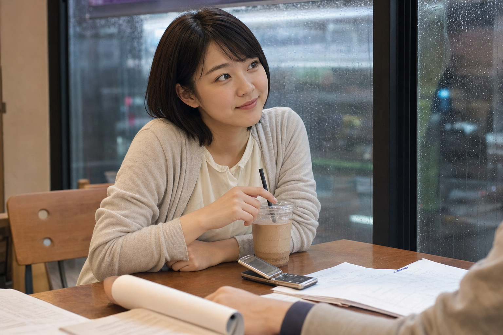

# 094. 늦은 답장

토요일 오후에는 비가 왔다.

아침부터 흐리던 하늘은 점심 무렵이 되자 참지 못한 것처럼 물기를 쏟아냈다. 용식은 수원역 근처 카페 창가에 앉아 시험 프린트를 넘기고 있었다. 테이블 위에는 식어 가는 아메리카노와 폴더폰이 나란히 놓여 있었다. 폰은 무음이 아니었다. 그런데도 울릴 때마다 심장이 먼저 반응했다.

초연은 오늘 작업실에 있었다. 과제 마감이 다가오고 있어서 주말에도 학교에 간다고 했다. 원래라면 용식이 데려다주고 데리러 갔겠지만, 오전에 초연은 혼자 가겠다고 했다.

괜찮다는 말이 아니라, 시험해 보겠다는 말처럼 들렸다.

오후 세 시 십이분.

[김초연] 뭐 해?

[김용식] 공부.

[김초연] 어디서?

[김용식] 수원역 카페.

[김초연] 누구랑?

용식은 커피잔을 들어 한 모금 마셨다. 식은 커피 맛이 혀끝에 오래 남았다.

[김용식] 혼자.

[김초연] 사진 보내 봐.

그 문장을 보는 순간, 그는 폴더폰을 내려놓았다. 창밖 유리에는 비가 흘러내리고 있었다. 카페 안에는 커플 두 쌍과 노트북을 켜 놓은 직장인 한 명이 있었다. 사진을 찍어 보내는 건 어렵지 않았다. 정말 혼자였으니까. 그런데 지금 이걸 보내는 순간, 앞으로도 계속 보여 줘야 할 것 같았다.

그는 폰을 열었다 닫았다.

답장을 늦추는 사이, 다시 문자가 왔다.

[김초연] 왜 말이 없어?

[김용식] 지금 사람 많아서 좀 그래. 진짜 혼자야.

[김초연] 알았어.

알았어.

그 짧은 답장이 오히려 마음을 더 찜찜하게 만들었다. 초연은 예전 같으면 "찍어 보내면 되지 뭐가 그래" 하고 더 밀어붙였을 것이다. 그런데 오늘은 알았다고 했다. 물러난 게 아니라 기억해 두는 느낌이었다.

카페 문이 열리며 비 냄새가 들어왔다. 용식은 고개를 들었다. 정다은이었다. 그녀는 접힌 우산을 들고 들어와 카운터 앞에 섰다가, 창가에 앉은 용식을 발견하고 눈을 동그랗게 떴다.

[정다은] "어? 너 여기 있었네."

[김용식] "너는?"

[정다은] "나 수원역에서 친구 만나기로 했는데 시간 남아서."

그녀는 음료를 주문하고 자연스럽게 그의 맞은편에 앉았다. 자리가 없는 것도 아니었다. 빈 테이블은 두 개나 있었다. 용식이 그쪽을 흘깃 보자, 정다은은 모르는 척 가방을 내려놓았다.

[정다은] "왜. 앉으면 안 돼?"

[김용식] "누가 보면 또 말 나와."

[정다은] "누가 보는데."

[김용식] "그냥."

[정다은] "초연이?"

이름이 나오자마자 용식의 표정이 굳었다. 정다은은 그걸 보고 컵홀더를 손끝으로 돌렸다.

[정다은] "너 진짜 요즘 초연이 이름 나오면 바로 티 난다."

[김용식] "너는 왜 자꾸 그 얘기야."

[정다은] "재밌어서."

[김용식] "사람 불편한 게 재밌냐."

[정다은] "불편해?"

그녀는 몸을 조금 앞으로 기울였다. 짧은 단발 끝에서 빗물이 한 방울 떨어져 목덜미 쪽으로 흘렀다. 용식은 그걸 봤다가 바로 프린트로 시선을 내렸다.

[정다은] "그럼 진짜구나. 답답한 거."

[김용식] "아니라고 몇 번 말해."

[정다은] "말은 계속 아니래. 근데 표정은 계속 맞대."

정다은은 음료를 마시며 창밖을 봤다. 비 때문에 바깥 풍경은 흐릿했다. 역 앞 버스정류장에 선 사람들은 우산을 낮게 쓰고 있었고, 택시들은 물웅덩이를 지나며 낮은 소리를 냈다.

[정다은] "그날도 그랬잖아."

용식의 손이 멈췄다.

[김용식] "무슨 날."

[정다은] "너 알잖아."

그녀는 직접 말하지 않았다. 그러나 말하지 않는 방식이 더 정확했다. 9월 초 술기운이 남은 길, 비틀거리던 정다은을 부축하다가 닿았던 입술. 둘 다 없었던 일로 하자고 했던 그 일.

용식은 목이 말랐다.

[김용식] "그 얘기 하지 말자며."

[정다은] "내가 언제? 내가 없던 일로 하자고 했지, 기억까지 지우자고는 안 했는데."

그녀의 목소리는 낮았다. 카페 안 음악 소리에 섞여 테이블 밖으로 거의 새지 않았다. 용식은 창밖을 봤다. 초연에게서 문자가 올까 봐 폴더폰을 뒤집어 놓은 상태였다. 그 엎어진 폰이 테이블 가운데서 두 사람 사이를 가로막고 있었다.

[정다은] "너 그때 싫었어?"

[김용식] "다은아."

[정다은] "싫었냐고."

그는 대답하지 못했다. 정다은은 바로 웃지 않았다. 오히려 그 대답 없는 시간을 조용히 기다렸다. 빗소리가 창문을 얇게 두드렸다.

그때 폴더폰이 울렸다.

초연이었다.

용식은 반사적으로 폰을 집어 들었다. 정다은은 그 손을 봤다. 화면을 확인하는 순간 그의 얼굴이 다시 굳는 것도 봤다.

[정다은] "받아."

[김용식] "..."

[정다은] "검사 받아야지."

그 말에 용식은 전화를 받지 않았다. 진동은 몇 번 더 울리다가 끊겼다. 정다은의 눈이 살짝 커졌다. 용식 스스로도 자기가 뭘 한 건지 늦게 알았다.

곧 문자가 왔다.

[김초연] 왜 안 받아?

용식은 답장을 쓰려 했다. 손가락이 자꾸 헛나갔다.

[김용식] 카페라서 못 받았어. 공부 중.

보내고 나서야 카페라서 전화를 못 받는다는 말이 이상하다는 걸 알았다. 정다은은 그 문장을 볼 수 없었지만, 그의 얼굴만 보고도 대충 알았다는 듯 작게 웃었다.

[정다은] "너 거짓말 못한다."

[김용식] "못하는데 계속 하게 만드네."

말이 튀어나왔다. 정다은의 표정이 잠깐 달라졌다. 웃음이 사라진 건 아니었지만, 그 밑에 다른 것이 스쳤다. 관심, 혹은 승부욕.

[정다은] "내가?"

[김용식] "아니. 그냥."

[정다은] "초연이가?"

용식은 대답하지 않았다.

정다은은 이번엔 웃음을 숨기지 않았다.

[정다은] "너 진짜 위험하다."

[김용식] "뭐가."

[정다은] "그렇게 억울해하는 얼굴로 다른 여자 앞에 있으면."

그녀는 말을 끝까지 하지 않았다. 친구에게서 전화가 왔다며 가방을 챙겼다. 나가면서도 한 번 돌아봤다.

[정다은] "다음에 차 태워 줘. 나 부탁할 일 생길 수도 있어."

[김용식] "무슨 부탁."

[정다은] "생기면 말할게."

카페 문이 닫히고, 비 냄새가 다시 얇게 남았다. 용식은 식은 커피를 끝까지 마셨다. 폴더폰에는 초연의 부재중 전화 하나와 짧은 문자가 남아 있었다.

[김초연] 집에 갈 때 전화해.

그 문장을 보며 그는 정다은이 남긴 말을 떠올렸다.

다음에 차 태워 줘.

비는 쉽게 그치지 않았다.
