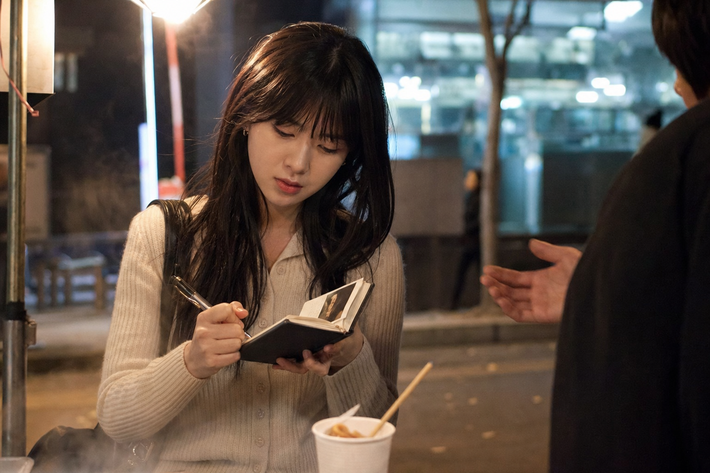

# 095. 표시

월요일 아침, 초연은 먼저 전화를 걸지 않았다.

그게 더 이상했다. 용식은 수업 준비를 하면서도 몇 번이나 폴더폰을 열었다. 받은 문자함에는 어젯밤 마지막으로 온 "잘 자"가 남아 있었다. 늘 붙던 하트도 없었고, 장난스러운 이모티콘도 없었다. 그냥 잘 자. 세 글자였다.

그는 강의실에 앉아 프린트를 정리하다가 결국 먼저 문자를 보냈다.

[김용식] 일어났어?

답장은 12분 뒤에 왔다.

[김초연] 응. 수업 가는 중.

용식은 그 12분을 세고 있었다는 사실이 싫었다. 초연이 자신에게 하던 일을, 이제 자기가 하고 있었다. 누가 더 늦게 답했는지, 어떤 말이 빠졌는지, 지금 어디쯤인지 머릿속으로 계산하는 일. 그런 건 사랑의 방식이 아니라 불안의 방식이었다.

그런데 불안은 사람을 닮게 만들었다.

오전 수업이 끝나고 용식은 학생식당에서 혼자 밥을 먹었다. 초연은 작업실 친구들과 먹는다고 했고, 정다은은 다른 동기들과 한 테이블에 앉아 있었다. 평소 같으면 정다은이 일부러 한 번쯤 다가와 말을 걸었을 텐데, 오늘은 그러지 않았다. 오히려 멀리서만 봤다.

그 시선이 더 신경 쓰였다.

점심을 거의 남긴 채 자리에서 일어났을 때, 초연에게서 문자가 왔다.

[김초연] 오늘 몇 시 끝나?

[김용식] 네 시.

[김초연] 끝나고 뭐 해?

[김용식] 도서관.

[김초연] 나도 갈래.

용식은 식판을 반납대에 올려놓고 잠깐 멈췄다. 뒤에서 기다리던 학생이 작게 헛기침을 했다. 그는 옆으로 비켜서 답장을 썼다.

[김용식] 너 작업실 간다며.

[김초연] 좀 미루면 돼.

함께 있고 싶다는 말이었다. 동시에 지켜보겠다는 말처럼 들렸다. 용식은 그 두 가지를 분리하지 못했다.

오후 네 시, 도서관 2층 창가 자리에서 초연은 정말 기다리고 있었다. 긴 머리를 낮게 묶고, 얇은 니트 위에 카디건을 걸친 채였다. 그녀 앞에는 전공 서적과 스케치북이 펼쳐져 있었지만, 책장은 거의 넘어가지 않은 것 같았다.

[김초연] "왔네."

[김용식] "일찍 왔어?"

[김초연] "조금."

그녀는 웃었다. 평범한 웃음이었다. 그런데 용식은 그 웃음 뒤에서 뭔가를 찾으려 했다. 초연도 똑같이 그를 보고 있었다. 둘은 서로를 보고 있었지만, 믿기 위해 보는 게 아니라 확인하기 위해 보고 있었다.

공부는 제대로 되지 않았다. 초연은 중간중간 그의 폴더폰 쪽으로 시선을 보냈고, 용식은 그 시선을 느낄 때마다 폰을 책 아래로 밀어 넣었다. 한 번은 진동이 울렸고, 둘 다 동시에 그쪽을 봤다.

학과 동기의 단체 문자였다.

[동기] 이번 주 과 자료 취합 오늘 밤까지.

용식은 화면을 초연에게 보여 주었다.

[김용식] "봐. 과 문자야."

초연은 짧게 고개를 끄덕였다.

[김초연] "내가 보여 달랬어?"

그 말에 용식은 더 할 말이 없어졌다. 보여 달라는 사람처럼 굴어서 보여 줬더니, 왜 보여 주냐는 얼굴이었다. 사실 둘 다 알고 있었다. 초연은 보고 싶었고, 용식은 보이는 척하고 싶었다. 그런데 말로 꺼내면 둘 다 너무 초라해졌다.

저녁에는 도서관 앞 포장마차에서 어묵을 먹었다. 초연은 종이컵에 담긴 국물을 두 손으로 감싸 쥐고 있었다. 바람이 제법 차가웠다. 용식은 그녀의 어깨에 손을 올리려다가 멈췄다. 초연이 먼저 그의 손목을 잡았다.

[김초연] "왜 멈춰."

[김용식] "뭐가."

[김초연] "요즘 너 나 만질 때도 생각하고 만지는 것 같아."

용식은 웃으려 했지만 잘 되지 않았다.

[김용식] "그런 것까지 느껴?"

[김초연] "응."

초연은 국물을 한 모금 마셨다. 입김이 하얗게 올라왔다.

[김초연] "내가 좀 이상해진 거 알아. 근데 너도 달라졌어."

[김용식] "나 안 달라졌어."

[김초연] "그 말 하지 마. 나 그 말 싫어졌어."

그녀는 종이컵을 쓰레기통에 버리고, 가방에서 작은 다이어리를 꺼냈다. 표지 안쪽에는 폴라로이드 사진 한 장이 끼워져 있었다. 9월 수목원에서 찍은 사진이었다. 초연은 그 사진 옆 빈칸에 볼펜으로 작은 표시를 했다.

[김용식] "뭐 해?"

[김초연] "일정 적는 거."

[김용식] "무슨 일정."

[김초연] "네 학원 보강일. 문자 왔다며. 정해지면 나도 알아야지."

용식은 목 뒤가 서늘해지는 걸 느꼈다. 초연은 아무렇지 않은 얼굴로 다이어리를 닫았다. 웃지도, 따지지도 않았다. 그 평온함이 더 불편했다.

[김초연] "나 너 믿고 싶어."

[김용식] "믿으면 되잖아."

[김초연] "믿고 싶은 거랑 믿어지는 건 달라."

그 말은 포장마차 불빛 아래에서 오래 남았다.

초연을 집까지 데려다준 뒤, 용식은 혼자 학교 쪽으로 다시 차를 돌렸다. 학과 자료 취합 때문에 도서관 사물함에 두고 온 프린트를 챙겨야 했다. 주차장에는 차가 거의 없었다. 그는 시동을 끄고 잠깐 핸들에 이마를 기대었다.

폴더폰이 울렸다.

정다은이었다.

[정다은] 너 학교 근처야?

용식은 화면을 보고 한참 있다가 답했다.

[김용식] 왜.

[정다은] 자료 때문에 USB 맡긴 거 찾아야 하는데, 늦어서 버스 끊길 것 같아. 있으면 좀 태워 줄 수 있어?

그는 답장을 바로 보내지 못했다. 초연이 방금 다이어리에 표시하던 손이 떠올랐다. 믿고 싶다는 얼굴도, 믿어지지 않는다는 말도.

그런데 동시에 정다은이 카페에서 했던 말이 떠올랐다.

그렇게 억울해하는 얼굴로 다른 여자 앞에 있으면.

용식은 창밖을 봤다. 주차장 가로등 아래 빗물 자국이 아직 마르지 않고 있었다.

[김용식] 지금 학교야. 어디로 와.

보내고 나서야 숨을 내쉬었다.

그 답장이, 어디까지 가는 길인지 그는 알면서도 모르는 척했다.
