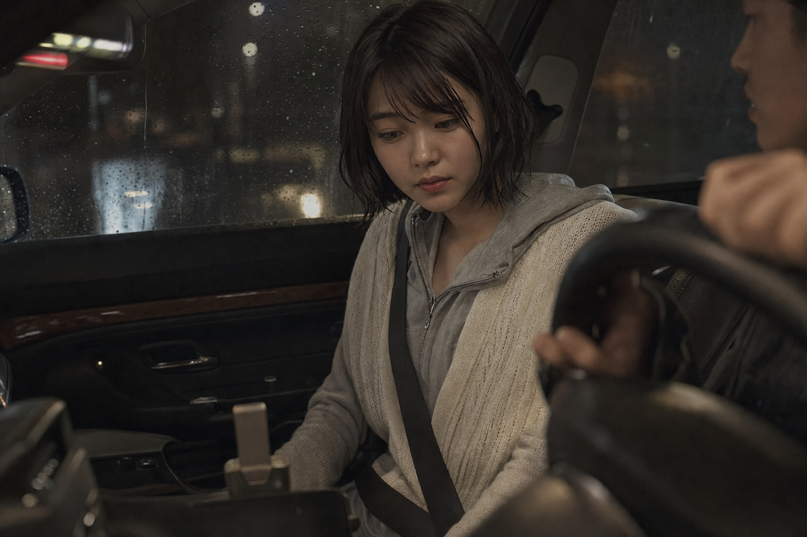

# 096. 조수석

밤 아홉 시가 넘은 학교 주차장은 비어 있었다.

가로등 아래에 세워진 BMW 유리창에는 젖은 노면이 희미하게 비쳤다. 용식은 운전석에 앉아 히터를 약하게 틀어 놓고 있었다. 창문 안쪽으로 김이 조금씩 서렸다. 폴더폰은 컵홀더 옆에 놓여 있었고, 화면은 검게 꺼져 있었다.

정다은은 5분쯤 뒤에 나타났다.

회색 후드집업 위에 짧은 니트 카디건을 걸치고, 한 손에는 작은 USB와 파일철을 들고 있었다. 머리끝은 비에 살짝 젖어 안쪽으로 더 말려 있었다. 그녀는 조수석 문을 열기 전 유리창을 톡톡 두드렸다. 용식이 잠금을 풀자, 찬 공기와 젖은 운동화 냄새가 함께 차 안으로 들어왔다.

[정다은] "미안. 진짜 버스 끊길 뻔했어."

[김용식] "어디로 가면 돼."

[정다은] "수원역 쪽. 거기서 택시 타도 되고."

그녀는 조수석에 앉아 안전벨트를 맸다. 딸깍, 하는 소리가 차 안에 짧게 울렸다. 용식은 그 소리를 들으며 기어를 넣었다. 별일 아니었다. 같은 과 동기를 늦은 밤 태워 주는 일. 학교 근처에서 수원역까지. 설명하려면 얼마든지 설명할 수 있었다.

그런데 설명할 수 있다는 생각 자체가 이미 거짓말의 시작 같았다.

차가 주차장을 빠져나가자 정다은은 앞유리에 낀 김을 손가락으로 작게 문질렀다.

[정다은] "너 아까 되게 늦게 답하더라."

[김용식] "운전 중이었어."

[정다은] "아까는 주차장이라며."

용식은 대답하지 않았다. 정다은은 피식 웃었다.

[정다은] "거짓말 진짜 못한다니까."

[김용식] "또 그 얘기냐."

[정다은] "아니, 그냥 웃겨서. 나 태워 준다고 답장 하나 보내는 것도 그렇게 고민할 일이야?"

[김용식] "너도 알잖아."

[정다은] "초연이?"

초연의 이름이 나오자마자 용식은 핸들을 잡은 손에 힘을 줬다. 정다은은 그걸 봤다. 차 안이라는 공간은 이상했다. 강의실이나 매점에서는 스쳐 지나가던 표정도, 여기서는 도망칠 곳 없이 남았다. 앞만 보고 있어도 옆자리의 시선이 피부에 닿는 것 같았다.

[정다은] "너 요즘 진짜 숨 막히겠다."

[김용식] "그 말 좀 그만해."

[정다은] "싫어?"

[김용식] "좋을 리가 없잖아."

[정다은] "근데 맞잖아."

차는 학교 앞 큰길로 들어섰다. 신호에 걸려 멈추자, 옆 차선의 버스가 천천히 지나갔다. 버스 안 사람들의 얼굴은 형광등 아래서 피곤하게 흔들렸다. 용식은 신호등을 보았다. 빨간불이 길었다.

정다은은 조용히 있다가 말했다.

[정다은] "너 초연이한테 나 태워 준다고 말할 거야?"

[김용식] "말할 필요 없지."

[정다은] "왜?"

[김용식] "별일 아니니까."

[정다은] "별일 아닌데 왜 숨겨?"

그 질문이 정확했다. 용식은 입을 다물었다. 정다은은 몸을 살짝 돌려 그를 바라봤다. 차 안에 히터 바람이 낮게 흘렀고, 그녀의 젖은 머리끝에서 샴푸와 비 냄새가 섞여 났다.

[정다은] "그때도 그랬잖아."

용식은 신호가 바뀌기도 전에 브레이크에서 발을 뗄 뻔했다. 뒤차가 짧게 경적을 울렸다. 그는 정신을 차리고 차를 앞으로 움직였다.

[김용식] "그 얘기는 하지 말자."

[정다은] "왜. 진짜 아무 일도 아니면 얘기해도 되잖아."

[김용식] "없었던 일로 하자며."

[정다은] "그건 네가 불편해할까 봐 그랬지."

정다은은 창밖을 봤다. 수원으로 이어지는 도로 양옆에는 젖은 간판 불빛이 번져 있었다. 편의점, 분식집, 노래방, PC방. 2008년 가을 밤의 거리에는 아직 스마트폰 불빛보다 간판 불빛이 더 많았다.

[정다은] "나는 가끔 생각났는데."

용식은 그녀를 보지 않았다. 볼 수 없었다.

[김용식] "다은아."

[정다은] "응."

[김용식] "그런 말 하지 마."

[정다은] "왜."

[김용식] "나 여자친구 있어."

정다은은 그 말을 듣고 바로 웃지 않았다. 대신 손끝으로 안전벨트 끈을 만지작거렸다. 검은 벨트 위에 그녀의 손가락이 작게 움직였다.

[정다은] "그 말 진짜 신기하다."

[김용식] "뭐가."

[정다은] "너는 꼭 그 말을 나한테 하는 게 아니라 너한테 하는 것 같아."

차 안이 조용해졌다. 용식은 라디오를 켤까 하다가 그만두었다. 어떤 노래가 흘러나와도 지금 이 공기를 덮을 수 없을 것 같았다.

수원역 근처에 가까워질수록 차가 많아졌다. 정다은은 내려야 할 곳을 말하지 않고 있었다. 용식도 묻지 않았다. 둘 다 그 침묵을 조금 더 끌고 있었다.

폴더폰이 울렸다.

초연이었다.

용식은 화면을 봤다. 정다은도 봤다. 그가 받지 않자, 진동이 컵홀더 안에서 작게 떨었다. 한 번, 두 번, 세 번. 용식은 결국 폰을 집어 들어 화면을 뒤집었다.

정다은이 낮게 웃었다.

[정다은] "봐. 또 숨잖아."

그 말은 비웃음이 아니었다. 오히려 너무 가까운 곳에서 나온 확인처럼 들렸다. 용식은 차를 갓길에 세웠다. 비가 다시 조금씩 내리고 있었다. 와이퍼를 한 번 움직이자 앞유리의 물방울이 옆으로 밀려났다.

[김용식] "내가 뭘 숨는데."

[정다은] "지금 나랑 있는 거."

[김용식] "별일 아니니까."

[정다은] "그 말도 아까 했어."

정다은은 그를 바라봤다. 눈웃음은 사라져 있었다. 장난스럽던 얼굴 대신, 뭔가를 기다리는 얼굴이었다. 용식은 목이 말랐다. 초연의 전화는 끊겼고, 곧 문자가 왔다.

[김초연] 어디야?

그 문장을 본 순간, 답답함이 가슴 안쪽에서 올라왔다. 어디냐. 누구랑 있냐. 왜 안 받냐. 바로 연락하라니까. 믿고 싶다. 믿어지지 않는다. 그 말들이 한꺼번에 밀려왔다.

정다은은 그 화면을 직접 보지는 않았지만, 그의 얼굴만으로 충분히 읽었다.

[정다은] "너 진짜 힘들어 보인다."

이번에는 장난이 아니었다.

용식은 그 말에 더 흔들렸다. 누군가 자기 답답함을 알아봤다는 사실이 위로처럼 들어왔고, 그 위로가 위험하다는 걸 알면서도 밀어내지 못했다.

그는 답장을 쓰지 않았다.

정다은은 천천히 말했다.

[정다은] "나 여기서 내려도 돼."

그녀는 안전벨트를 풀었다. 딸깍, 하는 소리가 다시 울렸다. 하지만 문은 열지 않았다. 손은 문고리에 닿아 있다가 멈췄다.

[정다은] "근데 너 지금 내가 내리길 바라는 얼굴은 아닌데."

용식은 아무 말도 하지 못했다.

정다은도 더 움직이지 않았다.

앞유리에는 비가 아주 얇게 내리고 있었다.
