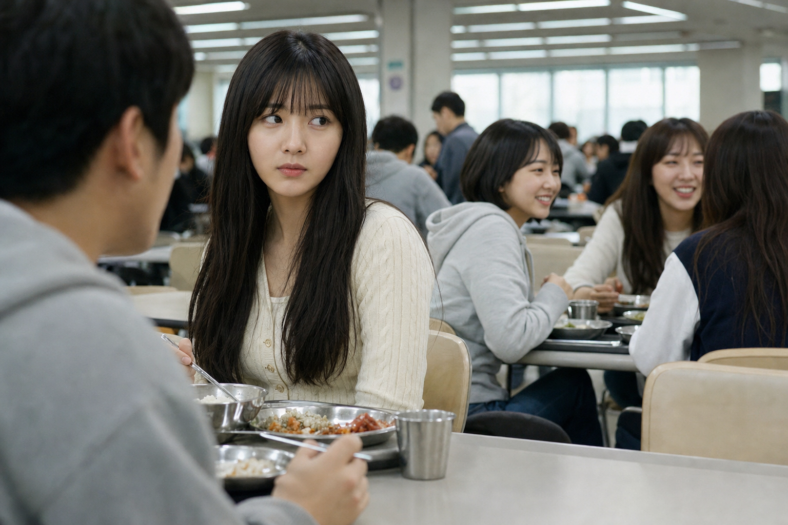

# 097. 아니라고 말하는 얼굴

정다은은 결국 그날 수원역 앞에서 내렸다.

아무 일도 없었다. 적어도 그렇게 말할 수는 있었다. 그녀는 문을 열고 나가기 전에 잠깐 돌아보며 "고마워"라고 했고, 용식은 "조심히 가"라고 답했다. 그게 전부였다. 손이 닿지도 않았고, 입술이 가까워지지도 않았다. 차 안에는 비 냄새와 히터 바람, 받지 않은 초연의 전화만 남았다.

그런데 아무 일도 없었다는 말은 이상하게 가벼웠다.

집으로 돌아가는 길, 용식은 초연에게 전화했다. 초연은 세 번 울린 뒤 받았다.

[김초연] "어디였어."

[김용식] "운전 중이었어."

[김초연] "운전 중이면 전화 못 받아도 문자 하나는 할 수 있잖아."

[김용식] "갓길에 세우기 애매했어."

[김초연] "어디서 어디 가는 길이었는데."

용식은 한 박자 늦었다. 그 한 박자는 전화선을 타고 초연에게 그대로 갔다.

[김용식] "학교에서 집."

[김초연] "학교에서 집 가는데 수원역 쪽으로 지나가?"

그는 핸들을 잡은 손을 고쳐 쥐었다. 차는 이미 수지 방향으로 빠지고 있었지만, 머릿속은 아까 갓길에 멈춰 있었다.

[김용식] "돌아서 왔어. 프린트 찾느라 늦어서."

[김초연] "돌아서?"

[김용식] "초연아, 나 피곤해."

그 말은 방패처럼 나갔다. 초연은 바로 받아치지 않았다. 대신 아주 작게 웃었다. 웃음이라기보다 숨이 빠지는 소리였다.

[김초연] "넌 피곤하면 내가 다 넘어가야 돼?"

[김용식] "그런 뜻 아니야."

[김초연] "그래. 맨날 그런 뜻은 아니지."

통화는 오래 가지 않았다. 초연은 자겠다고 했고, 용식은 알겠다고 했다. 집에 도착해 차를 상가 지하주차장에 숨기듯 세운 뒤, 그는 한참 운전석에 앉아 있었다. 초연에게 거짓말을 했다. 정다은을 태웠다고 말하지 않았다. 정말 아무 일도 없었는데도 숨겼다.

숨겼다는 사실이, 아무 일도 없었다는 말을 망쳤다.

다음 날 오전 수업에서 정다은은 평소처럼 행동했다. 강의실 앞자리에서 노트를 펴고, 옆자리 동기와 시험 범위 얘기를 하며 웃었다. 용식과 눈이 마주쳤을 때도 특별한 표정은 없었다. 오히려 너무 평범해서 더 불편했다.

쉬는 시간, 용식은 복도 끝 자판기 앞에 섰다. 동전을 넣고 캔커피 버튼을 누르려는 순간 정다은이 옆으로 왔다.

[정다은] "어제 잘 들어갔어?"

[김용식] "어."

[정다은] "초연이한테 혼났어?"

[김용식] "그런 거 아니야."

[정다은] "또 아니래."

그녀는 사이다 버튼을 눌렀다. 캔이 떨어지는 소리가 짧게 울렸다. 두 사람은 자판기 앞 좁은 공간에 나란히 섰다. 지나가던 학생들이 몇 명 있었지만, 아무도 특별히 신경 쓰지 않았다. 그래서 더 이상했다. 남들이 보면 아무것도 아닌 장면인데, 둘 사이에는 어젯밤 차 안이 그대로 남아 있었다.

[정다은] "너 그 말 버릇이야?"

[김용식] "뭐가."

[정다은] "아니야. 그런 거 아니야. 아무 일 아니야."

그녀는 그의 말투를 흉내 내지 않았다. 그냥 나열했을 뿐인데, 용식은 목덜미가 뜨거워졌다.

[김용식] "너는 왜 자꾸 사람을 몰아가."

[정다은] "몰아가는 게 아니라 보이는 걸 말하는 건데."

[김용식] "뭐가 보이는데."

정다은은 캔을 따지 않고 손에 쥔 채 그를 올려다봤다.

[정다은] "너는 초연이 연락 오면 답답해하고, 나랑 있으면 그 답답한 얼굴을 숨기려 해."

용식은 말을 잃었다.

[정다은] "그리고 내가 그걸 알아보면 화내."

[김용식] "..."

[정다은] "왜 화내는지 알아?"

[김용식] "그만해."

[정다은] "맞아서."

그녀는 그렇게 말하고 캔을 땄다. 탄산이 올라오는 소리가 작게 터졌다. 용식은 커피를 뽑지 않고 동전 반환 버튼을 눌렀다. 동전이 철컥거리며 내려왔다. 그는 그것을 집어 주머니에 넣었다.

점심시간에는 초연이 학교로 왔다. 패션디자인과 수업이 빨리 끝났다고 했다. 그녀는 학생식당 앞에서 기다리고 있다가 용식을 보자 손을 흔들었다. 밝게 웃고 있었지만, 눈은 주변을 먼저 훑었다. 용식 옆에 누가 있는지, 누구와 눈이 마주치는지.

정다은은 멀리 있었다. 일부러 가까이 오지 않았다. 대신 지나가며 초연에게 먼저 인사했다.

[정다은] "초연아, 안녕."

[김초연] "어. 안녕."

둘은 동갑답게 짧게 반말로 인사했다. 정다은은 용식에게는 말하지 않았다. 그런데 그 말하지 않음이 오히려 초연을 건드렸다. 초연은 정다은이 지나간 뒤, 용식의 얼굴을 봤다.

[김초연] "너희 요즘 어색해?"

[김용식] "아니."

[김초연] "근데 왜 서로 말 안 해?"

[김용식] "방금 인사했잖아."

[김초연] "나한테만 했잖아."

용식은 대답을 삼켰다. 초연은 식판을 들고 자리로 가면서도 한 번 뒤돌아 정다은 쪽을 봤다. 정다은은 다른 동기들과 웃으며 밥을 먹고 있었다. 아무것도 숨기지 않는 사람처럼.

그게 더 수상해 보일 수 있다는 걸 정다은은 알고 있을까.

아마 알고 있을 것이다.

저녁에 초연을 집 앞까지 데려다주는 길, 그녀는 조수석에서 폴더폰 고리를 만지작거렸다. 차 안은 조용했다. 라디오에서는 오래된 발라드가 낮게 흘러나왔다.

[김초연] "너 정다은이랑 무슨 일 있어?"

[김용식] "없어."

[김초연] "진짜?"

[김용식] "응."

초연은 바로 믿는다고 하지 않았다. 창밖으로 시선을 돌렸다가, 다시 물었다.

[김초연] "그럼 왜 걔 이름 나오면 너도 표정이 굳어?"

용식은 신호 앞에서 차를 멈췄다. 빨간불이 길었다. 어제 정다은이 했던 말과 거의 같은 말이었다. 다른 두 여자가 같은 표정을 보고 있었다.

그는 대답할 수 없었다.

초연은 그 침묵을 대답처럼 받아들였다.

[김초연] "너 진짜 나한테 뭐 숨기지."

[김용식] "안 숨겨."

[김초연] "알았어."

또 알았어였다.

집 앞에 도착하자 초연은 바로 내리지 않았다. 안전벨트를 풀고도 한동안 앉아 있었다. 그러다 갑자기 그의 손을 잡았다. 손끝이 차가웠다.

[김초연] "나 바보 만들지 마."

그 말은 화보다 부탁에 가까웠다.

용식은 그 손을 잡고도 제대로 쥐지 못했다.

초연이 내린 뒤, 그는 혼자 차 안에 남았다. 폴더폰이 울렸다. 정다은이었다.

[정다은] 내일 자료 옮기는 거 도와줄 수 있어? USB 말고 박스가 좀 있어서.

용식은 답장을 쓰지 않았다.

하지만 지우지도 않았다.
