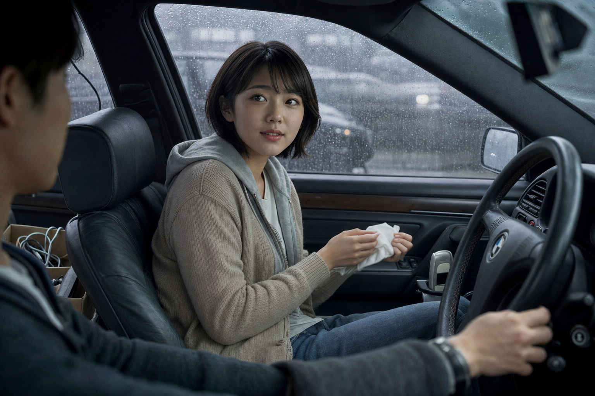

# 098. 박스

금요일 오후, 정보통신학과 실습실 앞 복도에는 낡은 컴퓨터 부품 박스들이 쌓여 있었다.

다음 주 실습 점검에 쓰일 장비를 다른 강의실로 옮겨야 한다는 공지가 늦게 내려왔고, 남아 있던 학생 몇 명이 대충 짐을 나눠 들었다. 용식은 모니터 케이블이 든 박스를 들고 복도 끝까지 걸었다. 상자 밑면이 축축하게 눌리는 느낌이 손바닥에 전해졌다.

정다은은 USB와 자료철을 챙겨 들고 따라왔다.

[정다은] "이거 끝나면 차로 좀 옮겨야 할 수도 있대."

[김용식] "어디까지."

[정다은] "학생회관 창고. 비 오면 들고 가기 애매해서."

[김용식] "비 안 오는데."

[정다은] "올 것 같은데."

그녀는 창밖을 가리켰다. 하늘은 어제처럼 흐렸고, 운동장 쪽 나무들이 바람에 낮게 흔들리고 있었다. 용식은 대답하지 않았다. 어젯밤 정다은의 문자를 결국 읽기만 하고 답하지 않았는데, 그녀는 아무렇지 않게 다음 날 다시 말을 걸고 있었다.

그 태도가 더 무서웠다. 끊어진 것처럼 굴지 않고, 기다렸다는 듯 이어 붙였다.

오후 수업이 끝날 무렵 정말 비가 내리기 시작했다. 굵지는 않았지만, 상자를 들고 이동하기에는 충분히 번거로운 비였다. 교수 조교는 남아 있는 학생들에게 차가 있는 사람이 있으면 몇 개만 실어 달라고 했다. 동기들의 시선이 자연스럽게 용식에게 모였다.

[동기] "용식이 차 있잖아."

[김용식] "몇 개나."

[동기] "두세 박스면 될 것 같은데."

정다은은 아무 말도 하지 않았다. 하지만 그 침묵이 오히려 부탁처럼 작동했다. 용식은 결국 고개를 끄덕였다.

박스를 싣는 동안 초연에게서 문자가 왔다.

[김초연] 오늘 몇 시 끝나?

[김용식] 과 장비 좀 옮기고.

[김초연] 누구랑?

용식은 트렁크에 박스를 넣다가 화면을 봤다. 비가 폰 화면에 작게 떨어졌다. 그는 손등으로 물기를 닦았다.

[김용식] 과 애들이랑.

틀린 말은 아니었다. 과 애들이 있었다. 다만 그중 정다은이 조수석 문 옆에 서 있다는 말은 빠졌다.

[김초연] 끝나면 바로 전화해.

[김용식] 알았어.

그는 폰을 주머니에 넣고 트렁크를 닫았다. 정다은은 우산을 접으며 물었다.

[정다은] "초연이?"

[김용식] "응."

[정다은] "뭐래?"

[김용식] "끝나면 전화하래."

[정다은] "또 바로?"

용식은 그녀를 봤다. 정다은은 일부러 웃음을 참는 얼굴이었다.

[김용식] "타."

정다은은 조수석에 앉았다. 다른 동기 하나가 뒷좌석에 타려다가, 전화가 왔다며 먼저 뛰어갔다. 결국 차 안에는 용식과 정다은만 남았다. 트렁크에는 학과 박스 세 개가 실려 있었다. 이유는 분명했다. 증인도 있었다. 그런데 조수석에 앉은 정다은의 존재는 그 모든 합리적인 이유를 순식간에 약하게 만들었다.

차가 학생회관 쪽으로 움직이자 정다은은 젖은 앞머리를 손으로 쓸어 넘겼다.

[정다은] "너 어제 답장 안 하더라."

[김용식] "바빴어."

[정다은] "읽긴 했잖아."

[김용식] "..."

[정다은] "괜찮아. 안 해도 돼. 답장도 검사받으면 피곤하잖아."

용식은 브레이크를 밟았다. 앞에 지나가던 학생들이 우산을 쓰고 천천히 길을 건너고 있었다. 정다은은 창밖을 보다가 다시 그를 봤다.

[정다은] "농담이야."

[김용식] "농담처럼 안 들려."

[정다은] "그럼 진심으로 들어."

학생회관 앞에 도착했을 때 비는 조금 더 굵어졌다. 둘은 트렁크에서 박스를 꺼내 창고 앞까지 옮겼다. 정다은은 생각보다 힘이 없어서 박스를 들고 두 걸음 걷다가 자꾸 멈췄다. 용식은 결국 그녀 몫까지 받아 들었다.

[정다은] "오, 멋있는데."

[김용식] "장난치지 말고 문 열어."

창고 안은 오래된 종이와 먼지 냄새가 났다. 박스를 내려놓고 나오자, 정다은의 손등에 먼지가 묻어 있었다. 그녀는 그걸 털다가 웃었다.

[정다은] "나 손 더러워졌어."

[김용식] "화장실 가서 씻어."

[정다은] "차에 물티슈 없어?"

있었다. 조수석 앞 수납함에 예전에 초연이 넣어 둔 물티슈가 있었다. 용식은 그 사실을 떠올리고 잠깐 멈췄다. 정다은은 그의 반응을 봤다.

[정다은] "왜. 그것도 초연이 거야?"

[김용식] "그냥 있어."

차 안으로 돌아와 그는 수납함을 열었다. 물티슈 포장에는 초연이 장난으로 붙여 둔 작은 스티커가 그대로 있었다. 정다은은 그것을 보고 웃지 않았다. 오히려 손끝으로 스티커 가장자리를 가볍게 눌렀다.

[정다은] "초연이는 되게 표시를 잘 남긴다."

[김용식] "..."

[정다은] "차에도, 폰에도, 너 표정에도."

용식은 물티슈를 건넸다. 정다은은 손등을 닦았다. 좁은 차 안에서 물티슈 향이 퍼졌다. 비에 젖은 옷 냄새와 섞여 묘하게 답답한 향이 됐다.

폴더폰이 울렸다.

초연이었다.

용식은 받았다. 이번엔 일부러 빨리 받았다.

[김초연] "끝났어?"

[김용식] "거의."

[김초연] "누구랑 있어?"

정다은은 손등을 닦던 동작을 멈췄다. 그녀는 소리 내지 않고 입모양만 만들었다.

말해.

용식은 그녀를 보지 않으려 했다.

[김용식] "과 애들이랑."

[김초연] "아직?"

[김용식] "응. 박스 정리 중."

정다은은 조용히 웃었다. 소리는 없었지만, 용식은 그 웃음을 느꼈다. 통화가 끝나자마자 그녀가 말했다.

[정다은] "나도 과 애들이긴 하지."

[김용식] "그래서 그렇게 말했어."

[정다은] "근데 왜 나라고는 못 해?"

용식은 대답하지 않았다.

정다은은 물티슈를 접어 쓰레기봉투에 넣고, 다시 안전벨트를 맸다.

[정다은] "너 그때도 그렇게 못 했지."

[김용식] "뭘."

[정다은] "싫었다고."

차 안의 공기가 달라졌다. 용식은 손을 핸들 위에 올렸다. 비는 앞유리를 계속 두드리고 있었다.

[정다은] "싫었으면 그냥 싫었다고 했으면 되잖아."

[김용식] "..."

[정다은] "근데 너 지금까지 한 번도 그렇게 말 안 했어."

그녀는 더 가까이 오지 않았다. 그런데 이미 가까워져 있었다. 조수석이라는 거리는 그런 거리였다. 팔을 조금만 움직여도 닿을 수 있고, 닿지 않으려고 가만히 있으면 오히려 더 의식되는 거리.

용식은 시동을 걸었다.

[김용식] "데려다줄게."

[정다은] "어디로?"

[김용식] "수원역."

[정다은] "오늘은 거기서 바로 내려?"

용식은 대답하지 못했다.

정다은은 안전벨트를 잡고 작게 웃었다.

[정다은] "알았어. 오늘은."

그날은 정말 수원역에서 내려줬다. 정다은은 우산을 펴고 내리며 뒤돌아보지 않았다. 하지만 조수석에는 물티슈 향과 그녀가 남긴 말이 그대로 남아 있었다.

싫었으면 그냥 싫었다고 했으면 되잖아.

용식은 그 말을 지우지 못한 채 초연에게 전화를 걸었다.
