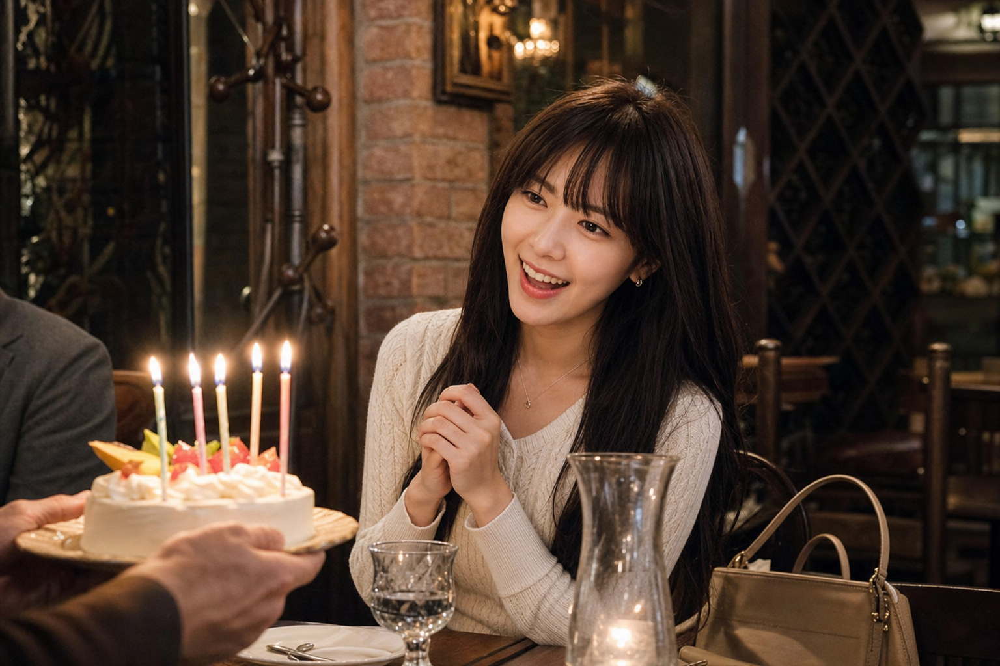

# 099. 확인하는 사람

초연은 일요일 낮에 용식의 차에 탔다.

전날은 초연의 생일이었다.

용식은 그날을 가볍게 넘기지 않았다. 시험 기간이라는 핑계를 댈 수도 있었고, 초연이 요즘 예민하다는 말로 마음을 덜 쓸 수도 있었지만, 그러고 싶지는 않았다. 그는 토요일 오전부터 수원역 지하상가와 백화점 매장을 몇 군데 돌았다. 너무 비싸 보이는 물건은 초연이 부담스러워할 것 같았고, 너무 가벼운 물건은 자기 마음이 가벼워 보일 것 같았다.

결국 그는 부드러운 베이지색 가죽 숄더백 하나와 얇은 은색 목걸이를 골랐다. 패션디자인과 애가 매일 들고 다녀도 촌스럽지 않을 것 같아서, 그리고 초연의 긴 머리와 가는 목선에 잘 어울릴 것 같아서였다. 계산대 앞에서 카드를 내밀 때 손끝이 잠깐 굳었다. 돈 때문은 아니었다. 이 정도 선물이 초연을 기쁘게 할 수는 있어도, 자신이 숨긴 것들을 지워 주지는 못한다는 걸 이미 알고 있어서였다.

저녁에는 수원역 근처 작은 이탈리안 식당을 예약했다. 창가 자리에는 낮은 조명이 켜져 있었고, 초연은 처음 자리에 앉을 때만 해도 정말 좋아했다. 가방 상자를 열었을 때는 입을 가리고 웃었고, 목걸이를 꺼냈을 때는 "이런 걸 왜 사"라고 말하면서도 상자를 놓지 못했다.

[김초연] "나 이런 거 받아도 돼?"

[김용식] "생일이잖아."

[김초연] "그래도 너무 비싼 거 아니야?"

[김용식] "네가 쓰면 안 비싸."

말은 매끄럽게 나왔다. 초연은 그 말에 웃다가 고개를 숙였다. 목걸이 줄이 손가락 사이에서 얇게 빛났다. 용식은 자리에서 일어나 그녀 뒤로 갔다. 초연이 머리를 한쪽으로 넘겼고, 목덜미가 조명 아래 드러났다. 그는 걸쇠를 채우면서 잠깐 숨을 멈췄다. 초연은 거울도 보지 않고 손끝으로 펜던트를 만졌다.

[김초연] "예뻐?"

[김용식] "응."

[김초연] "나 말고, 이거."

[김용식] "둘 다."

초연은 그제야 제대로 웃었다. 그 웃음 때문에 용식은 잠깐 아무것도 들키지 않은 사람처럼 기분이 가벼워졌다. 케이크가 나오고, 초 하나가 켜지고, 초연이 양손을 모아 짧게 소원을 비는 동안까지는 그랬다.

문제는 촛불이 꺼진 뒤였다.

초연의 폴더폰이 아니라 용식의 폴더폰이 먼저 짧게 떨렸다. 화면을 확인하지 않았는데도, 용식의 손이 먼저 반응했다. 테이블 아래로 폰을 살짝 밀어 넣는 움직임. 아주 작은 움직임이었다. 그런데 초연은 봤다.

[김초연] "누구야?"

[김용식] "과 문자."

[김초연] "봤어?"

[김용식] "아니. 그냥."

초연은 더 묻지 않았다. 생일날이었기 때문인지, 아니면 묻기 시작하면 정말 생일이 망가질 것 같아서인지, 그녀는 물컵만 만지작거렸다. 용식은 그 침묵이 더 불편했다. 차라리 바로 따졌으면 변명이라도 했을 텐데, 초연은 그날만큼은 일부러 참는 사람처럼 굴었다.

집 앞에 데려다줄 때, 초연은 선물 가방을 무릎 위에 꼭 안고 있었다. 좋아하지 않는 건 아니었다. 가방을 내려다보는 시선에는 분명히 기쁨이 있었다. 그런데 그 기쁨 아래에 다른 것이 같이 깔려 있었다. 뭔가를 받은 사람의 미안함, 뭔가를 확인하고 싶은 사람의 불안, 그리고 생일날만큼은 그런 사람이 되고 싶지 않았다는 자존심.

[김초연] "고마워."

[김용식] "마음에 들어?"

[김초연] "응. 진짜 예뻐."

초연은 안전벨트를 풀고도 바로 내리지 않았다. 목걸이 펜던트를 한 번 더 만졌다.

[김초연] "근데 있잖아."

[김용식] "응."

[김초연] "나 오늘은 안 물어볼게."

용식은 그 말에 대답하지 못했다.

[김초연] "생일이니까."

그녀는 그렇게 말하고 내렸다. 문이 닫힌 뒤에도 용식은 한참 움직이지 못했다. 안 물어본다는 말은 믿는다는 말이 아니었다. 오히려 물어볼 것이 있다는 뜻이었다.

그 생일의 여운이 다음 날까지 남아 있었다.

약속 장소는 수원역 뒤편 골목의 작은 카페였다. 시험이 끝나면 가까운 데라도 가자고 했던 말을 기억해 낸 건 초연이었다. 생일 다음 날까지 멀리 가고 싶지는 않다고, 그냥 차 타고 드라이브라도 하자고 했다. 용식은 알겠다고 했다. 거절할 이유가 없었다.

초연은 차에 타자마자 조수석을 한 번 살폈다.

아주 짧은 시선이었다. 시트, 수납함, 바닥 매트, 컵홀더. 눈으로 훑는 시간이 길지는 않았지만, 용식은 전부 보았다. 초연은 아무 말 없이 안전벨트를 맸다. 딸깍, 하는 소리가 유난히 또렷하게 들렸다. 그녀의 새 가방은 무릎 위에 얌전히 놓여 있었고, 목걸이는 니트 목선 아래에서 작게 빛났다.

[김용식] "가방 불편해?"

[김초연] "아니. 좋아."

초연은 짧게 대답하고 창밖을 봤다. 용식은 시동을 걸었다. 라디오에서는 주말 낮 프로그램이 흘러나왔고, 진행자의 밝은 목소리가 차 안의 공기와 어울리지 않게 들떴다. 컵홀더에는 접힌 영수증 하나와 동전 두 개가 있었다. 초연의 시선이 아주 잠깐 그쪽에 닿았다가 빠졌다. 묻지는 않았다.

[김초연] "어디 갈래?"

[김용식] "네가 정하라며."

[김초연] "그냥 가까운 데. 한강은 멀고, 광교 쪽 갈까."

[김용식] "그래."

차가 출발했다. 초연은 새 가방 끈을 손끝으로 쓸었다. 어제 식당 조명 아래서 그렇게 좋아하던 손이었다. 그런데 오늘 그 손은 자꾸 폰 고리와 가방 끈 사이를 오갔다.

[김초연] "어제 고마웠어."

[김용식] "오늘도 말하네."

[김초연] "좋아서."

그 말은 진심이었다. 용식은 안도하려 했다. 하지만 초연은 바로 이어 말했다.

[김초연] "좋은데, 그래서 더 이상해."

[김용식] "뭐가."

[김초연] "좋은 날에도 내가 네 폰부터 보게 되는 거."

용식은 대답하지 못했다. 초연은 그를 몰아붙이지 않았다. 어제처럼, 오늘도 한 번 참는 사람처럼 숨을 골랐다.

[김초연] "나 원래 이런 애 아니었는데."

광교 근처 호수길에는 가족 단위 사람들이 많았다. 아이들은 킥보드를 타고 지나갔고, 커플들은 종이컵 커피를 들고 천천히 걸었다. 용식과 초연도 차를 세우고 산책로를 걸었다. 초연은 그의 손을 잡았다. 손을 잡는 힘은 평소보다 조금 셌다.

[김초연] "너 요즘 나 피곤하지."

[김용식] "아니."

[김초연] "그 말 하지 말랬잖아."

용식은 말을 멈췄다.

[김초연] "내가 연락 많이 하는 거 알아. 나도 싫어. 근데 안 하면 더 싫어."

[김용식] "..."

[김초연] "네가 뭐 하는지 모르는 시간이 생기면, 내가 이상한 상상을 해."

바람이 호수 쪽에서 불어왔다. 초연의 긴 머리카락이 얼굴 앞으로 흘렀다. 그녀는 손등으로 머리를 넘기며 작게 웃었다. 웃는 얼굴이었지만 눈 밑이 피곤했다.

[김초연] "어제도 참고 싶었어. 그냥 생일이니까 좋게 지나가고 싶었어."

[김용식] "그럼 그렇게 하면 되잖아."

[김초연] "그게 마음대로 되면 내가 이러겠어?"

초연은 화내지 않았다. 그게 더 아팠다. 그녀는 어제 받은 목걸이를 손끝으로 만졌다. 햇빛을 받은 작은 펜던트가 잠깐 반짝였다.

[김초연] "나 선물 싫다는 거 아니야. 진짜 좋아. 가방도, 목걸이도."

[김용식] "알아."

[김초연] "근데 비싼 거 받아도, 네가 어디서 뭘 숨기는지 모르는 시간은 그대로야."

용식은 그 말 앞에서 아무 말도 못 했다. 돈으로 해결하려는 건 아니었다고 말하고 싶었다. 하지만 그 말을 꺼내면 오히려 돈으로 해결하려 했다는 고백처럼 들릴 것 같았다.

그때 폴더폰이 짧게 울렸다.

용식은 반사적으로 화면을 봤다가 바로 닫았다. 이름을 확인하기 전이었다. 단체 문자일 수도 있고, 학원 문자일 수도 있고, 정말 아무것도 아닐 수도 있었다. 그런데 초연은 그의 손을 봤다. 화면 내용이 아니라, 화면을 숨기는 속도를 봤다.

[김초연] "봐."

[김용식] "그냥 문자야."

[김초연] "나 누구냐고 안 물어봤어."

용식은 입을 다물었다. 초연은 폰을 빼앗으려 하지 않았다. 소리치지도 않았다. 대신 손을 놓고 한 걸음 앞서 걸었다.

[김초연] "나 오늘은 묻기 싫어."

[김용식] "초연아."

[김초연] "어제 생일이었잖아. 오늘까지는 그냥 좋았다고 생각하고 싶어."

그 말은 부탁에 가까웠다. 용식은 따라가서 손을 잡았다. 초연은 피하지 않았다. 대신 손을 잡은 채로도 한동안 그를 보지 않았다. 호수 위로 바람이 지나갔고, 물결이 잔잔하게 흔들렸다.

[김초연] "다음엔 숨기지 마."

[김용식] "응."

[김초연] "그 응도 요즘 믿기 어렵다."

초연은 작게 웃었다. 웃으면서도 눈이 젖지는 않았다. 차라리 울었으면 용식은 안아 줄 수 있었을 것이다. 그런데 그녀는 울지 않았다. 울지 않는 사람 앞에서 용식은 더 할 수 있는 게 없었다.

주차장으로 돌아오는 길, 초연은 가방을 다시 무릎 위에 올리고 안전벨트를 맸다. 조수석 아래쪽을 다시 보지는 않았다. 하지만 보지 않는다는 것이 잊었다는 뜻은 아니었다. 그녀는 집 앞에 도착할 때까지 선물 얘기를 몇 번 더 했다. 예쁘다고, 잘 쓸 거라고, 내일 학교에 들고 가면 친구들이 물어볼 것 같다고.

그 말들이 다 진심이라서, 용식은 더 괴로웠다.

집 앞에 도착하자 초연은 안전벨트를 풀고 내리려다 잠깐 멈췄다.

[김초연] "어제 진짜 좋았어."

[김용식] "응."

[김초연] "그래서 더 잘했으면 좋겠어. 너도, 나도."

그녀는 내렸다. 차 문이 닫혔다.

용식은 혼자 남아 폴더폰을 열었다. 방금 온 문자는 학과 단체 문자였다. 정말 별것 아니었다. 정말 별것 아닌데도 그는 숨겼다.

그 사실이, 어제 산 가방보다 오래 차 안에 남았다.
