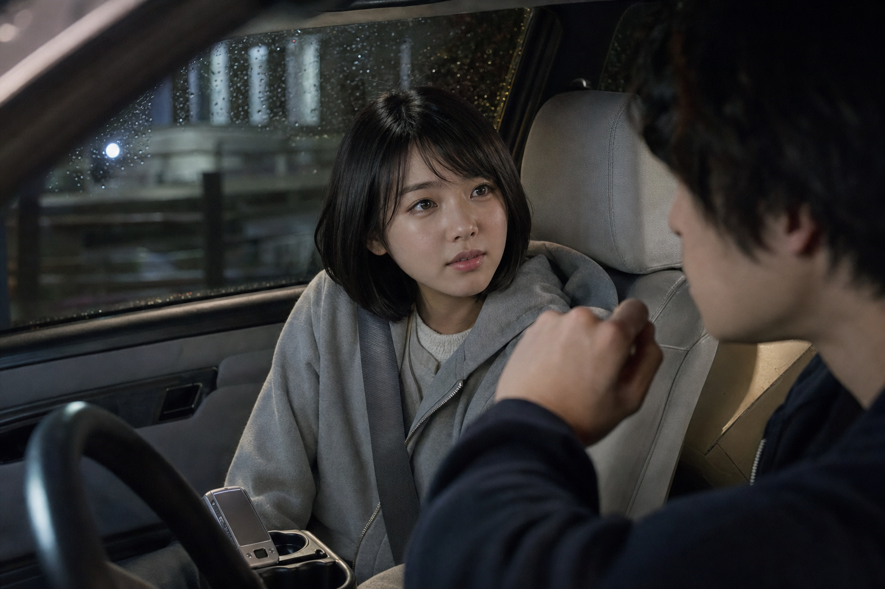

# 100. 그만하라고 하는 사람

화요일 저녁, 캠퍼스 주차장에는 안개처럼 얇은 비가 내려앉아 있었다.

시험 하나가 끝났고, 다음 시험까지는 이틀이 남아 있었다. 학생들은 잠깐 풀린 얼굴로 강의실을 빠져나왔지만, 용식은 오히려 더 지쳐 있었다. 초연과는 일요일 이후로 매일 연락했지만, 대화는 점점 짧아졌다. 어디야. 밥 먹었어. 누구랑 있어. 끝나면 연락해. 그 말들 사이에 예전처럼 장난스럽게 끼어들던 "보고 싶다"는 말은 거의 사라졌다.

그는 주차장 쪽으로 걸으며 폴더폰을 열었다.

[김초연] 끝났어?

[김용식] 어. 지금 나왔어.

[김초연] 바로 집 가?

[김용식] 응.

보내고 나서 그는 걸음을 멈췄다. 바로 집에 갈 생각이었다. 적어도 문자를 보내는 순간에는 그랬다.

주차장 입구 쪽에서 정다은이 서 있었다.

그녀는 작은 박스 하나를 발치에 두고 있었다. 지난주 실습실 정리 때 분류가 잘못돼 빠진 자료라고 했다. 비가 와서 종이박스 모서리가 젖어 있었다. 정다은은 용식을 보자 손을 들었다. 밝은 얼굴이었다. 너무 밝아서, 용식은 오히려 피곤해졌다.

[정다은] "잠깐만."

[김용식] "또 뭐."

[정다은] "이거 학생회관 창고에 다시 갖다 놓아야 하는데, 나 오늘 진짜 약속 늦어서. 차로 한 번만."

[김용식] "다른 애들 시켜."

[정다은] "다 갔어."

[김용식] "나도 가야 돼."

[정다은] "초연이한테?"

그 이름은 이제 정다은의 입에서 너무 쉽게 나왔다. 용식은 대답하지 않고 박스를 내려다봤다. 상자는 가벼워 보였다. 차가 필요할 만큼 무거운 것도 아니었다. 정다은도 그걸 알 것이다.

[김용식] "너 일부러 이러지."

정다은은 웃었다. 이번엔 숨기지 않았다.

[정다은] "응."

너무 쉽게 인정해서 용식은 오히려 말문이 막혔다.

[정다은] "근데 너도 일부러 모르는 척하잖아."

비가 후드 끝에 작게 맺혔다. 정다은은 박스를 들어 올리려다 손이 미끄러져 다시 내려놓았다. 용식은 한숨을 쉬고 박스를 들었다. 가벼웠다. 정말 가벼웠다.

[김용식] "이번만이야."

[정다은] "그 말 되게 많이 한다."

그녀는 조수석에 앉았다. 박스는 뒷좌석에 놓였다. 차 안에는 지난번의 물티슈 향은 거의 남아 있지 않았지만, 용식은 이상하게 그 향을 떠올렸다. 초연이 붙여 둔 스티커, 정다은의 손등, 전화 너머의 "누구랑 있어?"라는 질문.

차가 학생회관 쪽으로 움직였다. 주차장에서 창고까지는 걸어도 5분 거리였다. 차로는 더 짧았다. 그래서 더 이상했다. 이 짧은 동선 안에 두 사람이 일부러 들어와 있는 것 같았다.

[정다은] "일요일에 혼났어?"

[김용식] "그 얘기를 네가 왜 해."

[정다은] "얼굴에 써 있었으니까."

[김용식] "뭘 봤다고."

[정다은] "월요일에 너랑 초연이. 둘 다 생일 지나간 사람들 얼굴은 아니던데."

[김용식] "..."

[정다은] "좋은 날에도 계속 검사받으면 그렇지."

용식은 브레이크를 밟았다. 학생회관 앞이었다. 그러나 그는 바로 내리지 않았다. 와이퍼가 느리게 움직이며 앞유리의 비를 밀어냈다. 정다은은 창밖을 보지 않고 그를 보고 있었다.

[정다은] "너 진짜 그만하라고 하고 싶으면 이렇게 안 흔들리면 돼."

[김용식] "그만해."

[정다은] "또."

[김용식] "정다은."

그가 이름을 부르자 그녀의 표정이 잠깐 멈췄다. 장난이 한 겹 벗겨진 얼굴이었다. 정다은은 안전벨트를 풀지 않았다. 대신 몸을 아주 조금 돌려 그를 마주 봤다.

[정다은] "그날 얘기 계속 피하는 것도 웃겨."

[김용식] "피하는 게 맞으니까."

[정다은] "왜?"

[김용식] "하면 안 되는 얘기니까."

[정다은] "하면 안 되는 게 다 싫은 건 아니잖아."

그 말은 조용했지만 차 안을 꽉 채웠다. 용식은 눈을 감았다가 떴다. 초연의 얼굴이 떠올랐다. 집 앞에서 "나 바보 만들지 마"라고 하던 얼굴. 호수길에서 폰을 보여 달라고 하지 않고 물러나던 얼굴. 그리고 방금 보낸 문자.

바로 집 가?

응.

그는 바로 집에 가지 않고 있었다.

폴더폰이 울렸다.

초연이었다.

정다은은 화면 쪽으로 시선을 내렸다. 용식은 폰을 집어 들었다. 받을 수 있었다. 받아서 "지금 학생회관 앞이야. 과 자료 때문에"라고 말하면 됐다. 정다은이 옆에 있다고까지 말하면 더 좋았다. 그러면 적어도 지금 이 순간은 정리될 수 있었다.

그는 받지 않았다.

진동이 끊겼다.

정다은이 아주 작게 말했다.

[정다은] "봐."

[김용식] "..."

[정다은] "너 나 때문만은 아니야."

그 말에 용식은 그녀를 봤다. 정다은은 웃고 있지 않았다. 입술을 살짝 다문 채, 피하지 않는 눈으로 그를 보고 있었다. 장난처럼 찌르던 말들이 사라지자, 오히려 더 가까워 보였다.

[정다은] "초연이가 숨 막히게 해서만도 아니고."

[김용식] "그럼 뭔데."

[정다은] "너도 궁금한 거잖아."

비가 차 지붕을 얇게 두드렸다. 바깥은 어두웠고, 학생회관 창문 안쪽 형광등만 희게 켜져 있었다. 박스는 뒷좌석에 그대로 놓여 있었다. 두 사람은 내려야 했지만, 아무도 문을 열지 않았다.

정다은이 먼저 가까워졌다.

아주 급하지 않았다. 오히려 느렸다. 피할 수 있는 속도였다. 용식은 피하지 않았다. 정다은의 얼굴이 가까워졌고, 젖은 머리끝에서 비 냄새가 났다. 그녀는 멈춰서 그를 봤다.

[정다은] "싫으면 밀어."

그 말은 작았다.

용식은 밀지 않았다.

입술이 닿았다. 처음에는 짧게, 확인하듯. 그다음에는 더 오래. 차 안의 공기가 한꺼번에 좁아졌다. 용식은 핸들 위에 있던 손을 내렸다가, 어느새 조수석 쪽으로 뻗어 있었다. 손끝이 정다은의 무릎 가까이에 닿았고, 그녀는 피하지 않았다. 그가 정신을 차린 건 자기 손이 그녀의 허벅지 위에 놓여 있다는 걸 알아차린 순간이었다.

그는 손을 거뒀다.

두 사람 사이의 거리가 아주 조금 벌어졌다. 숨소리만 남았다. 정다은은 고개를 숙인 채 웃지도, 장난치지도 않았다. 용식은 입술을 닦지 못했다. 닦으면 방금 일이 더 선명해질 것 같았다.

폴더폰이 다시 울렸다.

이번에도 초연이었다.

용식은 화면을 봤다. 정다은도 봤다. 이번에는 그가 전화를 받았다.

[김초연] "왜 안 받아?"

용식은 목소리를 고르려 했지만, 목이 잠겨 있었다.

[김용식] "미안. 운전 중이었어."

정다은은 조용히 창밖을 봤다. 학생회관 유리창의 형광등 불빛이 그녀의 옆얼굴에 얇게 걸렸다.

[김초연] "집 가는 중이야?"

[김용식] "응."

두 번째 거짓말은 첫 번째보다 쉽게 나왔다.

[김초연] "목소리 왜 그래."

[김용식] "좀 피곤해서."

초연은 잠깐 말이 없었다.

[김초연] "알았어. 도착하면 연락해."

통화가 끊겼다.

용식은 폰을 내려놓았다. 손가락 끝이 떨렸다. 정다은은 안전벨트를 풀었다. 딸깍, 하는 소리가 너무 크게 들렸다.

[정다은] "박스 내려야지."

그녀의 목소리는 평소보다 낮았다.

둘은 차에서 내려 박스를 창고 앞에 가져다 놓았다. 비는 거의 그쳐 있었다. 창고 문을 닫을 때, 정다은의 손등이 용식의 손등에 스쳤다. 둘 다 바로 손을 뺐다.

돌아오는 길에 정다은은 수원역에서 내려 달라고 했다. 차 안에서는 아무 말도 하지 않았다. 역 앞에 도착하자 그녀는 문을 열고 내리기 전 잠깐 멈췄다.

[정다은] "오늘도 없었던 일로 할래?"

용식은 대답하지 못했다.

정다은은 그 대답 없는 얼굴을 보고 문을 닫았다.

집으로 가는 길, 초연에게서 문자가 왔다.

[김초연] 도착했어?

용식은 갓길에 차를 세웠다. 답장을 쓰기 전에, 조수석을 봤다. 아무것도 남아 있지 않았다. 머리카락도, 물티슈도, 박스도.

그런데 차 안은 달라져 있었다.

[김용식] 거의 다 왔어.

보내고 나서 그는 한참 핸들을 잡고 있었다.

거의 다 왔다는 말도 거짓말이었다.
