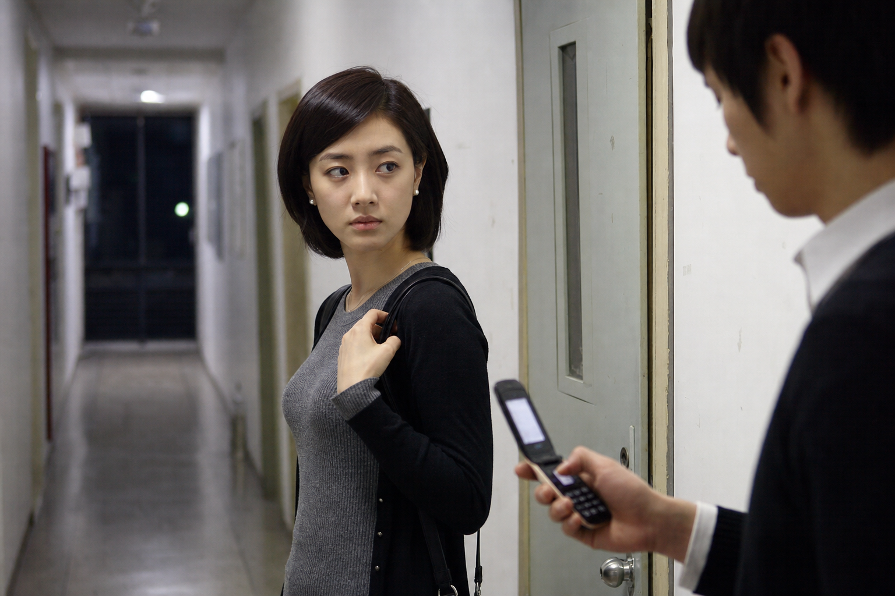

# 101. 보강일

수요일 오후, 일본어 학원에서 보낸 문자는 점심시간이 끝나기 직전에 왔다.

[수원일본어학원] 지난 휴강분 보강 수업은 10월 9일 목요일 19:00에 진행됩니다. 출석 가능한 분은 회신 바랍니다.

용식은 학생식당 플라스틱 의자에 앉은 채 화면을 오래 봤다. 숟가락 위에 얹힌 김치볶음밥은 이미 식어 있었다. 맞은편에서는 같은 과 남자애들이 중간고사 얘기를 하며 웃고 있었고, 오른쪽 끝자리에서는 정다은이 요구르트 빨대를 입에 문 채로 그를 보고 있었다.

[김초연] 오늘은 학원 안 가지?

문자가 겹쳐 들어왔다.

용식은 폴더폰을 닫았다가 다시 열었다. 단순한 일정이었다. 보강일이 잡혔다고 말하면 됐다. 그런데 손가락이 자꾸 멈췄다. 어젯밤 학생회관 앞 차 안에서 비에 젖은 유리, 초연의 전화, 다은의 낮아진 목소리, 손바닥에 닿았던 천의 감촉이 한 번에 떠올랐다.

[김용식] 오늘은 안 가.

보내고 나서야 그는 자신이 반만 대답했다는 걸 알았다.

[김초연] 그럼 보강은 언제 해?

정다은이 빨대를 뺐다.

[정다은] "또 검사야?"

옆자리 남자애 하나가 웃으며 고개를 들었다.

[남자 동기] "뭐야, 용식이 여자친구한테 잡혀 사냐?"

[정다은] "잡혀 사는 게 아니라 보고 중이신 것 같은데."

그 말은 장난처럼 들렸지만, 용식에게만 칼끝처럼 들어왔다. 그는 휴대폰을 책상 아래로 내렸다. 초연의 답장을 피하려는 손이 아니라, 다른 애들이 보지 못하게 숨기는 손이었다.

[김용식] "밥이나 먹어."

[정다은] "먹고 있잖아."

정다은은 웃었다. 입꼬리는 가벼웠지만 눈은 웃지 않았다. 그녀는 어젯밤 일을 꺼내지 않았다. 그래서 더 신경 쓰였다. 없는 일로 하자고 말하지도 않고, 있었던 일처럼 굴지도 않았다. 그냥 평소처럼 앉아 있었다. 그 평소가 용식에게는 자꾸 어긋난 자리에 놓인 컵처럼 보였다.

수업이 끝난 뒤, 용식은 주차장으로 가는 길에 초연에게 전화를 걸었다.

[김초연] "왜 이제 전화해?"

[김용식] "점심 먹고 수업 있어서."

[김초연] "보강 언제래?"

그는 발끝으로 주차장 바닥의 낙엽을 밀었다.

[김용식] "목요일."

[김초연] "내일?"

[김용식] "응."

[김초연] "몇 시?"

[김용식] "일곱 시."

짧은 침묵이 있었다. 초연은 바로 화내지 않았다. 요즘의 초연은 그렇게 변해 있었다. 예전 같으면 '왜 바로 말 안 했어?'가 먼저 나왔을 텐데, 이제는 한 박자 멈추고, 용식이 스스로 더 말하길 기다렸다. 그 기다림이 더 불편했다.

[김초연] "나 내일 작업실 늦게 끝날 수도 있는데."

[김용식] "응."

[김초연] "끝나면 내가 학원 앞으로 갈게."

용식은 주차장 출입구 앞에서 멈췄다.

[김용식] "뭐 하러."

[김초연] "데리러 가려고."

[김용식] "수원에서 너 또 기다리게 하기 싫어."

[김초연] "나 기다리는 거 괜찮아."

괜찮다는 말에 괜찮지 않은 것이 들어 있었다. 용식은 손에 쥔 차 키를 돌렸다. 금속 모서리가 손가락 안쪽을 눌렀다.

[김용식] "학원 끝나면 바로 갈게. 내가 갈게."

[김초연] "바로?"

[김용식] "응."

[김초연] "알았어. 바로 연락해."

통화가 끊기고도 용식은 차 문을 열지 않았다. 폴더폰 화면이 꺼진 검은 유리에 자기 얼굴이 비쳤다. 피곤한 얼굴이었다. 거짓말을 아직 시작하지 않았는데도, 이미 들킨 사람처럼 보였다.

목요일 저녁의 학원 로비는 평소보다 붐볐다. 휴강 보강이라 그런지 수업을 바꿔 온 사람들까지 섞여 있었다. 낡은 엘리베이터 앞에는 안내문이 붙어 있었고, 복도 끝 자판기에서는 캔커피 떨어지는 소리가 났다.

용식은 평소보다 늦게 들어갔다. 일부러였다. 수업 시작 직전이면 한서윤과 오래 마주 앉을 시간이 줄어들 거라고 생각했다. 그런데 강의실 문을 열자, 한서윤은 이미 그의 옆자리에 책을 펴 두고 있었다.

짧은 흑갈색 머리가 턱선 아래로 단정하게 떨어져 있었다. 얇은 회색 니트 위에 검은 카디건을 걸쳤고, 귀 옆의 작은 진주귀걸이가 형광등 빛을 받을 때마다 작게 반짝였다. 그녀는 고개를 들었다. 왼쪽 눈 아래 작은 점이 먼저 보였다.

[한서윤] "늦었네."

[김용식] "차가 좀 막혀서요."

[한서윤] "수원 오는데 차 막히는 건 항상 있던 일 아니야?"

용식은 가방을 내려놓았다.

[김용식] "오늘 사람이 많네요."

[한서윤] "말 돌리는 것도 여전하고."

강사가 들어오면서 대화는 끊겼다. 용식은 책을 폈지만, 글자가 눈에 들어오지 않았다. 초연에게는 수업 시작 전에 문자를 보냈다.

[김용식] 학원 도착했어.

[김초연] 끝나면 바로 연락해.

그 문자는 주머니 안에서 계속 뜨거웠다.

수업이 끝나자 학생들이 한꺼번에 일어났다. 의자 끄는 소리, 가방 지퍼 소리, 복도에서 울리는 발소리가 섞였다. 용식은 책을 급히 넣었다. 한서윤은 천천히 필통을 닫았다.

[한서윤] "오늘도 바로 가야 돼?"

[김용식] "좀 늦어서요."

[한서윤] "여자친구가 기다려?"

그 말에 용식의 손이 멈췄다.

[김용식] "기다리는 건 아니고."

[한서윤] "그럼."

서윤은 자리에서 일어나 가방끈을 어깨에 걸었다. 그녀는 용식보다 먼저 복도로 나가다가, 문 앞에서 돌아섰다.

[한서윤] "우리 이제 슬슬 정해야 하지 않아?"

지난번에 미뤄졌던 말이었다. 휴강 안내문 뒤로 숨어 있던 말. 용식은 복도 형광등 아래에서 아무 대답도 하지 못했다.

[한서윤] "대답 어려우면 오늘은 듣지 않을게."

[김용식] "서윤 씨."

[한서윤] "근데 다음에는 나도 내가 뭘 기다리는지 알고 싶어."

그녀는 웃었다. 크게 웃지 않았다. 입가만 아주 조금 부드러워졌다. 그런데 그 웃음은 사과를 받는 사람의 얼굴이 아니었다. 이미 계산을 시작한 사람의 얼굴이었다.

그때 폴더폰이 울렸다.

[김초연] 끝났어?

한서윤의 시선이 화면까지 내려오지는 않았다. 대신 용식의 얼굴에 머물렀다.

[한서윤] "또 숨기네."

짧은 말이었다.

용식은 화면을 닫았다.

그리고 아무 말도 하지 못했다.
