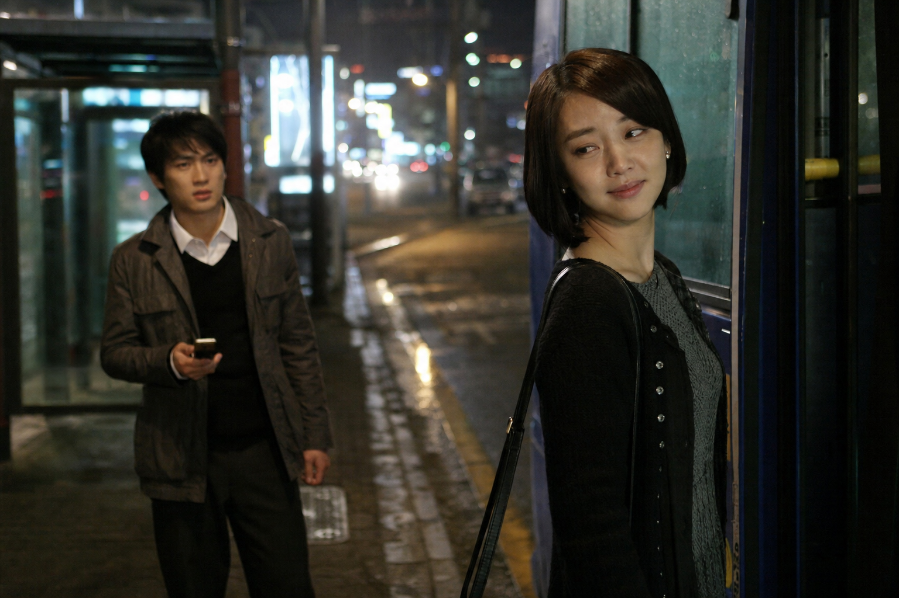

# 102. 서울로 가는 길

목요일 밤, 학원 건물 앞 보도블록은 낮에 내린 비 때문에 군데군데 검게 젖어 있었다.

용식은 폴더폰을 쥔 손을 코트 주머니에 넣었다. 초연에게는 끝났다고 답장을 해야 했다. 바로 연락하겠다고 약속했다. 그런데 한서윤이 옆에서 천천히 계단을 내려오는 동안, 그는 폴더폰을 열지 못했다.

[한서윤] "안 가?"

[김용식] "가야죠."

[한서윤] "그럼 연락해. 기다리는 사람 있다며."

서윤은 기다리는 사람이라는 말을 너무 가볍게 말했다. 초연을 직접 부르지 않는 그 방식이 오히려 더 불편했다. 용식은 도로 쪽을 보았다. 택시들이 물기 묻은 바퀴 소리를 내며 지나갔다.

[김용식] "잠깐만 얘기해요."

[한서윤] "여기서?"

학원 앞이었다. 수원역과 멀지 않은 거리. 초연이 마음만 먹으면 올 수 있는 곳이었다. 용식은 자신도 모르게 주변을 훑었다. 편의점 앞, 버스정류장, 횡단보도. 아는 얼굴은 없었다. 그래도 목 뒤가 뻣뻣했다.

서윤이 그 시선을 놓치지 않았다.

[한서윤] "누구 찾는 것처럼 보이는데."

[김용식] "아니에요."

[한서윤] "아니면 됐고."

그녀는 먼저 걷기 시작했다. 용식은 두 걸음 늦게 따라붙었다. 폴더폰이 다시 울렸다.

[김초연] 왜 답 없어?

그는 화면을 보자마자 닫았다.

[김용식] "내일 시간 돼요?"

서윤이 멈췄다.

[한서윤] "왜."

[김용식] "면접 준비한다고 했잖아요. 정장도 봐야 한다고."

[한서윤] "그 얘기를 지금 해?"

[김용식] "내가 도와줄게요."

그 말은 준비해 둔 말처럼 나왔지만, 실제로는 방금 만든 말이었다. 용식은 자신이 무엇을 하고 있는지 알았다. 관계의 답을 요구받는 자리에서 답 대신 선물을 꺼내려 하고 있었다. 예전에도 그랬다. 진주귀걸이를 샀을 때도, 미안하다는 말보다 결제가 더 빨랐다.

그래도 이번에는 달라 보이게 만들고 싶었다.

[김용식] "수원이나 분당은 눈에 띄어서 서윤 씨도 신경 쓰이잖아요. 서울 가서 마음에 드는 걸로 제대로 사요. 오늘은 아니고, 내일. 편하게 쇼핑하자고요."

서윤은 한동안 대답하지 않았다. 버스정류장 유리벽에 그녀의 옆얼굴이 비쳤다. 긴 눈매가 유리 속에서 더 차갑게 보였다.

[한서윤] "서울까지?"

[김용식] "그게 편하잖아요."

[한서윤] "누가 편한 건데?"

용식은 바로 대답하지 못했다. 서윤은 피식 웃었다.

[한서윤] "나 배려하는 척하는 거야, 아니면 너 숨는 거야?"

[김용식] "둘 다면 안 돼요?"

그 말은 너무 솔직해서, 오히려 거짓말처럼 들렸다. 서윤은 눈을 내리깔았다가 다시 용식을 봤다.

[한서윤] "너 그런 식으로 말하면 되게 다정한 사람 같아."

[김용식] "다정하려고 하는 건 맞아요."

[한서윤] "하려고는 하는구나."

그녀는 손에 든 일본어 교재 모서리를 엄지로 문질렀다. 용식은 그 손가락 움직임을 보았다. 서윤은 감정을 크게 드러내지 않았다. 화가 나도 목소리가 올라가지 않았고, 마음이 풀려도 갑자기 웃지 않았다. 대신 손끝이나 시선이 먼저 변했다.

[한서윤] "내일 몇 시."

[김용식] "오후 수업 끝나고. 내가 데리러 갈게요."

[한서윤] "학원 앞 말고."

[김용식] "그럼 어디."

[한서윤] "수원역 뒤쪽. 사람 덜 보는 데."

용식은 고개를 끄덕였다. 그 순간 폴더폰이 다시 울렸다. 이번에는 전화였다. 초연이었다.

서윤은 화면을 보지 않았는데도 안다는 듯 물러섰다.

[한서윤] "받아."

[김용식] "잠깐만요."

[한서윤] "받으라니까."

용식은 통화 버튼을 눌렀다.

[김초연] "왜 이렇게 늦게 받아?"

[김용식] "수업 끝나고 나오는 중이었어."

[김초연] "누구랑 있어?"

서윤은 한 걸음 떨어진 곳에서 길가 광고판을 보고 있었다. 하지만 듣고 있었다. 용식은 그것을 알았다.

[김용식] "혼자."

말이 입 밖으로 나오자마자, 등 뒤의 공기가 식었다. 서윤은 돌아보지 않았다. 오히려 그게 더 무서웠다.

[김초연] "바로 와?"

[김용식] "응. 지금 차로 가."

[김초연] "도착하면 연락해."

[김용식] "응."

통화가 끊겼다.

서윤은 그제야 고개를 돌렸다.

[한서윤] "혼자였구나."

[김용식] "서윤 씨."

[한서윤] "괜찮아. 나도 방금 없었던 사람이면 되잖아."

그녀의 목소리는 담담했다. 그래서 용식은 더 급해졌다.

[김용식] "내일 꼭 가요."

[한서윤] "정장 사주면 풀릴 거라고 생각해?"

[김용식] "그렇게만 생각하는 거 아니에요."

[한서윤] "근데 그렇게도 생각하잖아."

용식은 대답하지 못했다.

서윤은 교재를 가방에 넣었다. 그리고 버스정류장 쪽으로 걸어가다가 다시 말했다.

[한서윤] "내일 갈게."

[김용식] "고마워요."

[한서윤] "고마워할 건 너 아닌 것 같은데."

버스가 와서 멈췄다. 문이 열리며 따뜻한 공기와 사람 냄새가 흘러나왔다. 서윤은 올라타기 전, 한 번 더 용식을 봤다.

[한서윤] "서울까지 나 숨기러 가는 거면, 제대로 숨겨."

문이 닫혔다.

용식은 버스가 출발한 뒤에야 초연에게 문자를 보냈다.

[김용식] 이제 차 탔어. 집 가는 중.

거짓말은 짧았다.

그런데 그 짧은 말이 밤새 손에 남았다.
