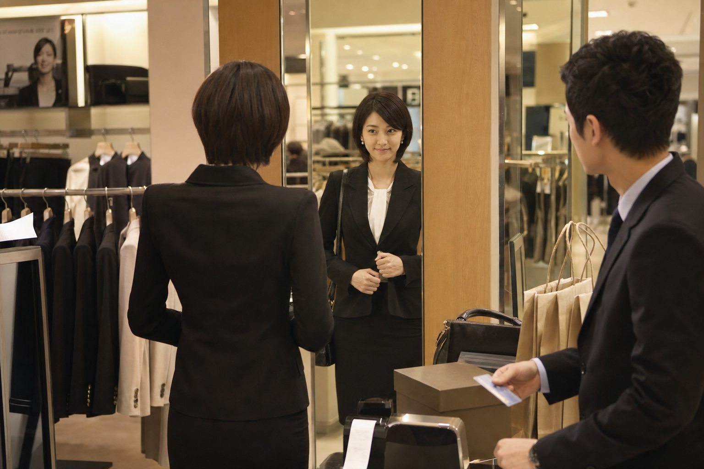

# 103. 풀세트

금요일 오후, 서울로 들어가는 도로는 차선마다 붉은 브레이크등이 이어져 있었다.

용식은 핸들을 잡은 손에 힘을 줬다. 내비게이션은 느리게 움직였고, 라디오에서는 가을 발라드가 흘렀다. 조수석에 앉은 한서윤은 창밖을 보고 있었다. 무릎 위에는 작은 가방 하나, 그 위에는 일본어 학원 교재가 얌전히 놓여 있었다.

[한서윤] "진짜 서울까지 오네."

[김용식] "말했잖아요."

[한서윤] "수원이나 분당은 아는 사람 만날까 봐?"

용식은 앞차의 번호판을 보며 대답했다.

[김용식] "서윤 씨도 불편하잖아요. 괜히 누가 보면 말 나오고."

[한서윤] "내가 불편할까 봐?"

[김용식] "응."

서윤은 고개를 돌려 그를 봤다. 그녀의 눈은 길고 조용했다. 웃지 않았지만, 완전히 차갑지도 않았다. 마치 답을 이미 알고 있으면서도 상대가 어디까지 말하는지 지켜보는 눈이었다.

[한서윤] "그럼 오늘은 나 편하라고 온 거네."

[김용식] "그래요."

[한서윤] "좋다. 그렇게 해 둬."

용식은 그 말이 허락인지 비꼼인지 구분하지 못했다. 대신 차선을 바꿨다. 서울 대형 백화점 주차장 입구로 들어갈 때, 차 안 공기가 갑자기 더 조용해졌다. 지하주차장의 형광등이 보닛 위를 일정한 간격으로 지나갔다.

백화점 안은 평택대 강의동이나 수원역 지하상가와 다른 냄새가 났다. 향수, 새 옷감, 커피, 광택제 냄새가 섞여 있었다. 매장 직원들은 서윤을 보자마자 부드럽게 웃었다. 서윤은 그 웃음 앞에서 잠깐 어깨를 세웠다가, 곧 아무렇지 않은 척 고개를 들었다.

[직원] "면접용 정장 보시는 걸까요?"

용식이 먼저 대답했다.

[김용식] "네. 깔끔하고 오래 입을 수 있는 걸로요. 구두랑 가방도 같이 볼게요."

서윤의 시선이 옆에서 움직였다.

[한서윤] "다 같이?"

[김용식] "면접 보러 가는데 정장만 있으면 뭐해요."

[한서윤] "너 말 참 잘한다."

[김용식] "틀린 말 아니잖아요."

직원이 가져온 첫 번째 재킷은 서윤의 어깨에 조금 컸다. 두 번째는 허리선이 너무 단단했다. 세 번째 검은 재킷은 몸에 맞았다. 서윤은 피팅룸에서 나와 거울 앞에 섰다. 짧은 흑갈색 머리가 목선을 드러내고, 작은 진주귀걸이가 정장 칼라 위에서 더 선명해 보였다.

용식은 잠깐 말을 잃었다.

[한서윤] "이상해?"

[김용식] "아니요."

[한서윤] "그럼 왜 그렇게 봐."

[김용식] "잘 어울려서."

서윤은 거울 속의 용식을 봤다. 직접 돌아보지 않았다. 그게 더 가까운 느낌을 만들었다.

[한서윤] "면접 잘 볼 것 같아?"

[김용식] "잘 볼 것 같아요."

[한서윤] "옷 때문에?"

[김용식] "서윤 씨가 원래 잘할 사람이라서. 옷은 그냥, 그걸 남들도 바로 보게 해 주는 거고."

그 말은 조금 과했다. 그래도 서윤은 이번에는 웃었다. 아주 작게. 직원이 옆에서 구두 사이즈를 물었다. 서윤은 잠깐 망설이다가 대답했다.

구두를 신고 걸어 보는 동안, 용식은 매장 한쪽 소파에 앉아 폴더폰을 확인했다.

[김초연] 오늘은 수업 끝났어?

[김용식] 응. 과 애들이랑 밥 먹으러 가.

문자를 보내고 나니 백화점 천장 조명이 너무 밝게 느껴졌다. 과 애들이라는 말 속에는 아무도 없었다. 그는 화면을 닫았다. 닫힌 폴더폰 위로 백화점 조명이 길게 번졌다.

서윤이 구두를 신고 돌아왔다.

[한서윤] "과 애들이랑 밥 먹으러 가?"

용식은 움찔했다.

[김용식] "봤어요?"

[한서윤] "화면은 못 봤고. 네 얼굴은 봤어."

[김용식] "미안해요."

[한서윤] "뭘."

서윤은 거울 앞에 다시 섰다. 이번에는 구두까지 신은 모습이었다. 자세가 조금 달라졌다. 평소의 얌전한 움직임이 아니라, 자신이 어떻게 보이는지 확인하는 사람의 조용한 자신감이 생겼다.

[한서윤] "가방도 봐야 한다며."

그 말에 용식은 안도했다. 그녀가 화제를 받아 준 것 같았다. 그는 직원에게 고개를 끄덕였다.

가방 매장에서는 서윤이 더 오래 망설였다. 너무 큰 로고가 박힌 것은 바로 내려놓았고, 지나치게 귀여운 디자인도 피했다. 결국 검은색 가죽 가방 하나를 골랐다. 작지 않고, 서류가 들어가며, 손잡이가 단단한 가방이었다.

[한서윤] "이거면 됐어."

[김용식] "마음에 들어요?"

[한서윤] "응. 면접 끝나고도 들 수 있을 것 같아."

계산대 앞에서 직원이 금액을 말했다. 정장과 블라우스, 구두, 가방, 수선비까지 합친 금액은 2,870,000원이었다. 용식은 카드 지갑을 꺼냈다. 손이 굳지는 않았다. 그 정도 금액은 그의 잔액에 비하면 작은 숫자였다. 하지만 직원이 카드를 받아 들고 결제기에 꽂는 순간, 서윤이 영수증 나오는 소리를 듣고 있다는 게 신경 쓰였다.

길고 얇은 영수증이 출력됐다.

직원이 그것을 접어 쇼핑백 안쪽 봉투에 넣었다.

서윤은 그 봉투가 어디에 들어가는지 정확히 봤다.

[김용식] "너 취업 때문에 스트레스받아서 나한테 초연이 얘기까지 꺼낸 거잖아요. 서윤 씨 스스로 비참하게 만들지 마요. 이거 입고 면접 잘 봐요."

말하고 나서 용식은 그 문장이 자기에게도 필요했다는 걸 알았다. 그는 돈으로 누군가를 사는 게 아니라고, 면접 준비를 돕는 거라고, 다정한 일을 한 거라고 스스로에게 말하고 싶었다.

서윤은 쇼핑백 손잡이를 쥐었다. 손가락이 길어서 검은 끈이 더 가늘어 보였다.

[한서윤] "나 비참하게 만들지 말라는 말, 되게 이상하다."

[김용식] "왜요."

[한서윤] "나보다 네가 더 급해 보여서."

용식은 대답하지 못했다.

백화점 밖으로 나왔을 때는 벌써 저녁이었다. 서울 거리의 불빛이 젖은 유리창처럼 번졌다. 서윤은 쇼핑백을 뒷좌석에 올려놓고 조수석에 앉았다. 안전벨트를 매는 손이 느렸다.

[한서윤] "밥은?"

[김용식] "먹고 가요."

[한서윤] "과 애들이랑?"

용식은 한숨을 삼켰다.

[김용식] "오늘은 서윤 씨랑."

서윤은 창밖을 보며 웃었다.

[한서윤] "그 말은 마음에 든다."

그날 용식은 서울에서 저녁까지 계산했다. 식당 영수증은 지갑 안쪽으로 들어갔다. 주차권은 재킷 주머니에 들어갔다. 백화점 쇼핑백은 뒷좌석에서 아주 조용히 흔들렸다.

용식은 그 모든 것이 지나간 하루의 물건이라고 생각했다.

서윤은 아니었다.
