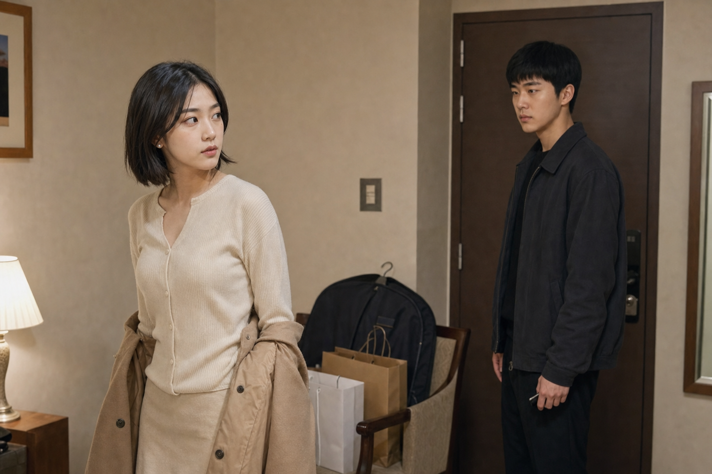

# 104. 비밀로 해줄게

서울의 밤은 수원보다 늦게 식었다.

식당을 나왔을 때, 거리에는 퇴근길 사람들과 쇼핑백을 든 커플들이 아직 많았다. 용식은 계산서를 지갑 안쪽에 넣고, 주차권을 따로 접어 재킷 주머니에 밀어 넣었다. 한서윤은 그 손을 보았다. 말없이 보았다. 용식은 괜히 주머니에서 손을 빼며 웃었다.

[김용식] "왜요."

[한서윤] "너는 뭘 숨길 때 손부터 바빠져."

[김용식] "안 숨겨요."

[한서윤] "지금도?"

서윤은 그렇게 물어놓고 대답을 기다리지 않았다. 백화점 옆 골목은 큰길보다 어두웠고, 비가 갠 뒤라 보도블록 사이에 물기가 남아 있었다. 그녀의 새 구두 상자는 뒷좌석에 있었지만, 지금 신고 있는 낮은 구두도 젖은 바닥을 조용히 밟았다.

차에 오르자마자 폴더폰이 울렸다.

[김초연] 밥 다 먹었어?

용식은 화면을 보고 곧바로 닫지 않았다. 이번에는 너무 빨리 닫으면 서윤이 또 볼 것 같았다. 그렇다고 답장을 오래 쓰기도 어려웠다. 그는 짧게 눌렀다.

[김용식] 응. 이제 들어가.

[김초연] 누구랑 먹었는데?

그 다음 문자가 오기까지 십 초도 걸리지 않았다.

용식은 운전대를 잡았다.

[한서윤] "대답 안 해?"

[김용식] "운전해야 하니까."

[한서윤] "아직 출발 안 했잖아."

그 말에 용식은 시동을 걸었다. 엔진 소리가 지하주차장 벽에 낮게 울렸다. 서윤은 창밖을 보며 안전벨트를 매지 않았다.

[김용식] "벨트."

[한서윤] "나 내려도 돼."

용식은 브레이크에서 발을 떼지 못했다.

[김용식] "무슨 말이에요."

[한서윤] "너 불편하면. 오늘 충분히 샀잖아."

[김용식] "그런 뜻 아니에요."

[한서윤] "그럼 무슨 뜻인데."

용식은 핸들 위에 손을 올려놓은 채로 고개를 숙였다. 지하주차장 형광등이 앞유리에 길게 비쳤다. 차 안에는 새 가죽 가방 냄새와 서윤의 카디건에서 나는 옅은 향, 식당에서 묻은 고기 굽는 냄새가 섞여 있었다.

[김용식] "오늘은 그냥, 서윤 씨 기분 풀어주고 싶었어요."

[한서윤] "내 기분?"

[김용식] "나 때문에 많이 불편했잖아요."

[한서윤] "불편한 정도였을까."

그 말에는 목소리가 거의 없었다. 용식은 옆을 봤다. 서윤은 정면을 보고 있었다. 긴 눈매가 유리에 비쳐 두 겹으로 겹쳐 보였다.

[김용식] "미안해요."

[한서윤] "미안하다는 말 말고."

[김용식] "그럼 뭘 말해야 하는데요."

서윤은 그제야 고개를 돌렸다.

[한서윤] "오늘은 나한테만 집중해."

용식은 숨을 멈췄다.

서윤이 천천히 안전벨트를 당겨 맸다. 딸깍, 하는 소리가 차 안에 선명하게 울렸다. 그녀는 몸을 기대지 않았다. 손을 뻗지도 않았다. 다만 낮은 목소리로 말했다.

[한서윤] "나 배려해서 서울까지 와준 거 고마워. 아는 사람 피해서, 나 불편하지 말라고 여기까지 데려온 거잖아."

용식은 그 말이 자신이 했던 포장이라는 걸 알았다. 그런데 서윤이 그렇게 다시 말하자, 거짓말이 잠깐 다정한 말처럼 변했다.

[한서윤] "나도 너랑 초연이 사이 망치려는 사람은 아니야."

[김용식] "서윤 씨."

[한서윤] "오늘 선물받은 것도, 우리 만난 것도 전부 비밀로 해줄게."

폴더폰이 다시 울렸다. 초연의 이름이 화면에 떴다. 용식은 보지 않았다. 아니, 보았지만 받지 않았다. 서윤도 화면을 보았다. 이번에는 일부러 봤다.

[한서윤] "받고 싶으면 받아."

[김용식] "아니요."

[한서윤] "괜찮아?"

이번에는 확인이었다. 밀어붙이는 말이 아니라, 멈출 수 있는 문이었다. 용식은 대답 대신 폴더폰을 뒤집어 컵홀더에 놓았다. 진동이 플라스틱 바닥을 짧게 떨렸다가 멈췄다.

[김용식] "오늘은 안 받을래요."

서윤은 한동안 그를 보았다. 그리고 아주 천천히 웃었다. 상처가 풀린 웃음이 아니라, 상대가 스스로 문을 닫는 걸 확인한 사람의 웃음이었다.

그들은 큰길로 나가지 않았다. 용식은 차를 몰아 백화점에서 조금 떨어진 조용한 골목의 작은 호텔 주차장으로 들어갔다. 프런트 앞의 조명은 따뜻했고, 엘리베이터 안에는 방향제 냄새가 났다. 서윤은 쇼핑백 하나만 들고 내렸다. 정장 봉투가 구겨지지 않게 품에 안고 있었다.

엘리베이터 문이 닫히기 직전, 용식의 폴더폰이 다시 울렸다.

그는 받지 않았다.

방 안에 들어서자 서윤은 쇼핑백을 의자 위에 올려놓았다. 새 정장 봉투가 하얀 벽 앞에서 지나치게 단정해 보였다. 용식은 문 앞에 서 있었다. 서윤은 코트를 벗기 전에 그를 돌아봤다.

[한서윤] "정말 괜찮아?"

[김용식] "응."

처음으로 반말이 나왔다. 서윤은 그 짧은 변화를 놓치지 않았다.

[한서윤] "그럼 오늘은 나한테만."

그녀가 먼저 다가왔다. 용식은 한 번 손을 들었다가 멈췄다. 서윤이 피하지 않는 걸 보고서야, 그는 그녀의 손목을 잡았다. 손목은 차가웠고, 손바닥은 조금 따뜻했다.

두 사람 사이의 거리가 사라졌다.

창밖으로 지나가는 차 소리가 몇 번 낮게 번졌다. 방 안의 조명은 늦게 꺼졌다.

새벽이 가까워졌을 때, 폴더폰 배터리는 한 칸만 남아 있었다.

서윤은 잠든 척 눈을 감고 있었다. 용식은 침대 가장자리에서 구겨진 셔츠를 찾아 입었다. 재킷 주머니에서 호텔 계산서 봉투가 떨어졌다. 바닥에 닿는 소리가 작게 났다.

서윤의 눈이 열렸다.

[한서윤] "그거 잃어버리지 마."

[김용식] "응?"

[한서윤] "그 봉투."

용식은 그것을 주워 지갑에 넣었다. 이상하게도 그 말이 다정하게 들렸다. 챙겨주는 말처럼.

서윤은 이불을 끌어올리며 다시 눈을 감았다.

서울까지 나를 숨기려고 애쓰는 게 보였다. 들키지 않으려고 고른 길, 달래려고 산 옷, 안심하려고 하지 않은 전화. 용식은 오늘 하루를 잘 넘겼다고 생각하겠지만, 서윤은 알았다.

사람은 거짓말을 숨길 때보다, 숨겼다고 안심할 때 더 많은 흔적을 남긴다.
