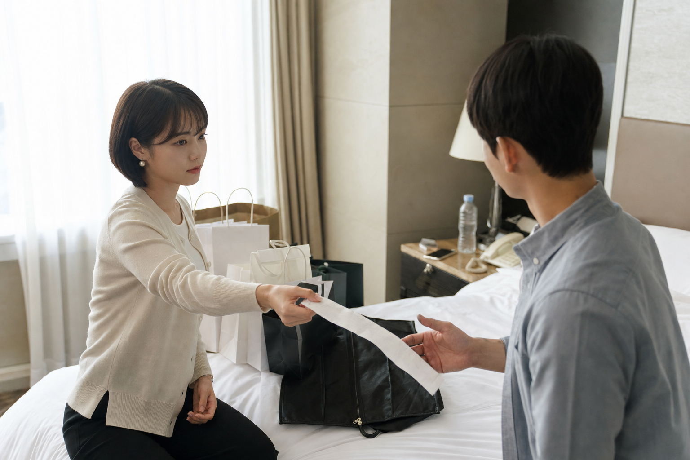

# 105. 남은 봉투

토요일 아침, 서울의 작은 호텔 방 커튼 사이로 옅은 빛이 들어왔다.

용식은 먼저 깼다. 목이 말랐다. 침대 옆 협탁에는 편의점 생수병 하나가 반쯤 비어 있었고, 폴더폰은 충전기 없이 꺼져 있었다. 그는 화면이 켜지지 않는 걸 확인하고 나서야 어젯밤 초연의 부재중 전화가 몇 통이었는지 모른다는 사실을 떠올렸다.

한서윤은 옆으로 누운 채 아직 눈을 감고 있었다. 짧은 머리끝이 뺨에 붙어 있었고, 왼쪽 눈 아래 점은 베개 그림자에 반쯤 가려져 있었다. 그녀의 얼굴은 평소보다 어려 보였다. 그래서 더 곤란했다. 깨어 있을 때의 서윤은 질문이었고, 잠든 척한 서윤은 흔적이었다.

용식은 조심스럽게 침대에서 내려왔다. 바닥에는 어젯밤 벗어 둔 양말, 접히다 만 영수증, 주차권, 백화점 종이봉투가 흩어져 있었다. 정장 봉투는 의자 등받이에 걸려 있었다. 검은색 가방 상자는 테이블 위에 단정하게 놓여 있었다.

그는 영수증을 집어 들었다.

금액이 한 줄로 찍혀 있었다.

2,870,000.

숫자는 아무 감정도 없었다. 그런데 그 숫자를 보는 순간, 용식은 어젯밤 자신의 말이 다시 들렸다. 이거 입고 면접 잘 봐요. 비참하게 만들지 마요. 그 말은 서윤에게 한 말이었지만, 사실은 자기가 듣고 싶었던 말이었다.

[한서윤] "버릴 거야?"

용식은 돌아섰다. 서윤이 눈을 뜨고 있었다.

[김용식] "아니요."

[한서윤] "버릴 줄 알았어."

[김용식] "왜요."

[한서윤] "너 흔적 싫어하잖아."

용식은 영수증을 접었다.

[김용식] "필요하면 가져요."

[한서윤] "나?"

[김용식] "수선 맡기거나 교환할 수도 있으니까."

서윤은 천천히 몸을 일으켰다. 이불이 어깨에서 흘러내리기 전에 그녀는 카디건을 끌어와 걸쳤다. 장면은 아무렇지 않은 아침처럼 보였지만, 둘 사이에는 어젯밤 닫힌 문이 아직 서 있었다.

[한서윤] "그럼 내가 갖고 있을게."

그녀는 손을 내밀었다. 용식은 영수증을 건넸다. 서윤은 그것을 가방 안쪽 작은 지퍼칸에 넣었다. 아주 자연스럽게. 마치 오래전부터 그렇게 하기로 정해져 있었던 사람처럼.

용식은 그 행동을 보고도 별 생각을 하지 않으려 했다. 교환하려면 필요하다. 수선하려면 필요하다. 면접용 옷이니 당연히 챙기는 게 맞다. 그는 그렇게 생각했다.

폴더폰을 충전하자마자 화면이 켜졌다.

[김초연] 왜 전화 안 받아?

[김초연] 집 도착했어?

[김초연] 자?

[김초연] 아침에 연락해.

용식의 손끝이 굳었다. 마지막 문자는 새벽 한 시가 넘어서 와 있었다. 그때 그는 서울의 방 안에 있었다.

[한서윤] "많이 왔어?"

[김용식] "조금."

[한서윤] "뭐라고 할 건데."

[김용식] "잠들었다고요."

[한서윤] "차에서?"

용식은 대답하지 못했다.

서윤은 침대 가장자리에 앉아 발끝으로 바닥에 떨어진 주차권을 밀었다.

[한서윤] "거짓말도 동선이 맞아야 해."

[김용식] "알아요."

[한서윤] "알면서 왜 자꾸 그렇게 해."

[김용식] "그러게요."

그 말은 한숨처럼 나왔다. 서윤은 그를 빤히 보았다. 크게 다그치지 않았다. 오히려 조용해서, 용식은 자신이 혼나는 게 아니라 기대고 있는 것처럼 느꼈다.

[한서윤] "나 때문에 곤란해진 거면, 나 때문이라고 하지 마."

[김용식] "그런 말 안 해요."

[한서윤] "내가 너 난처하게 만들 생각 없다고 했잖아."

그 말은 또 안심시키는 말이었다. 용식은 고개를 끄덕였다. 이상하게도 어젯밤보다 마음이 조금 놓였다. 서윤은 자신을 몰아붙이지 않았다. 초연처럼 어디냐고 묻지도 않았고, 다은처럼 숨잖아 하고 웃지도 않았다. 그냥 옆에서 거짓말의 모양을 같이 봐 주었다.

그는 그걸 배려라고 착각했다.

체크아웃을 하고 나오자 서울 거리는 이미 밝았다. 서윤은 백화점 쇼핑백을 하나씩 뒷좌석에 실었다. 용식은 운전석 문을 열기 전 초연에게 전화를 걸었다.

[김초연] "이제 연락해?"

[김용식] "미안. 어제 집 와서 씻고 바로 잠들었어."

[김초연] "전화 못 받을 정도로?"

[김용식] "피곤했어."

[김초연] "학원 보강하고 과 애들이랑 밥 먹은 것뿐인데?"

그 말에 용식의 등줄기가 차가워졌다. 초연은 기억하고 있었다. 학원. 과 애들. 밥. 집. 그의 거짓말은 이미 문장끼리 서로 발목을 잡고 있었다.

[김용식] "요즘 시험 때문에 잠을 잘 못 잤어."

[김초연] "오늘 볼 수 있어?"

용식은 조수석을 봤다. 서윤은 창밖을 보고 있었다. 쇼핑백 손잡이가 그녀의 손목 근처에 가지런히 놓여 있었다.

[김용식] "오늘은 집에 일이 좀 있어서."

[김초연] "무슨 일."

[김용식] "그냥. 엄마 가게 좀."

거짓말이 하나 더 붙었다.

통화가 끊긴 뒤, 차 안은 한동안 조용했다. 서울을 빠져나가는 길목에서 서윤이 말했다.

[한서윤] "나 내려주는 데는 수원역 뒤쪽이면 돼."

[김용식] "집 앞까지 갈게요."

[한서윤] "아는 사람 피해야 한다며."

용식은 핸들을 더 세게 잡았다.

[김용식] "서윤 씨까지 그렇게 말하지 마요."

[한서윤] "알았어."

그녀는 쉽게 물러났다. 너무 쉽게.

수원역 뒤쪽 골목에 차를 세웠을 때, 서윤은 쇼핑백을 챙겨 내렸다. 문을 닫기 전에 그녀가 몸을 조금 숙였다.

[한서윤] "면접 날짜 나오면 말할게."

[김용식] "응."

[한서윤] "그리고 어제 일은 걱정하지 마."

[김용식] "고마워요."

[한서윤] "나 그런 거 잘 숨겨."

그녀는 웃었다. 용식은 그 웃음을 보고 안도했다.

서윤은 골목 안으로 걸어가며 가방 안쪽 지퍼칸을 손끝으로 한 번 눌렀다. 영수증은 그 안에 있었다. 백화점 결제 시간, 브랜드명, 금액, 수선 접수 번호까지 전부 찍힌 종이였다.

용식은 차를 출발시켰다.

뒷좌석에는 백화점 봉투에서 묻은 종이 냄새가 아직 남아 있었다.
