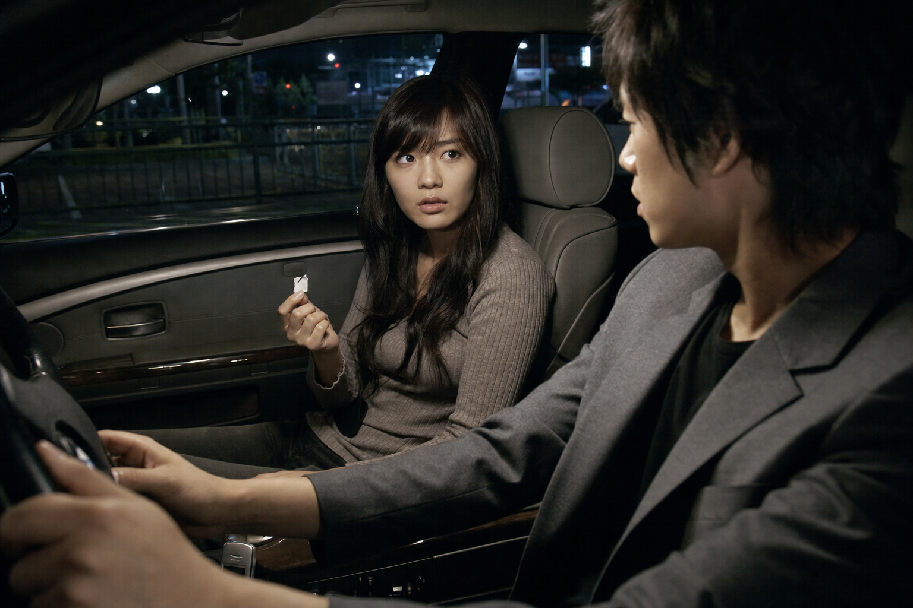

# 107. 냄새

화요일 저녁, 초연은 용식의 차에 타자마자 조수석 발밑을 봤다.

그 시선은 아주 짧았다. 용식이 못 봤다고 믿을 만큼 짧았고, 봤다는 걸 숨기지 않으려는 사람치고는 너무 조용했다. 그녀는 가방을 무릎 위에 올려놓고 안전벨트를 맸다. 긴 머리 끝이 얇은 니트 어깨 위로 흘러내렸다.

[김용식] "뭐 먹을래?"

[김초연] "아무거나."

예전의 아무거나는 장난의 시작이었다. 너 알아서 골라 봐. 이상한 데 데려가면 죽는다. 그런 말이 뒤따랐다. 요즘의 아무거나는 문을 닫는 말이었다.

용식은 학교를 빠져나와 큰길로 들어섰다. 차 안에는 세차장에서 뿌린 방향제 냄새가 조금 강하게 남아 있었다. 그는 일부러 전날 밤 세차를 했다. 조수석 매트도 털었고, 컵홀더도 닦았다. 백화점 봉투 냄새가 남아 있을까 봐 창문도 오래 열어 두었다.

초연은 창문을 조금 내렸다.

[김용식] "추워?"

[김초연] "아니."

[김용식] "그럼 왜 열어."

[김초연] "냄새가 좀 나서."

용식의 손가락이 핸들 위에서 굳었다.

[김용식] "방향제?"

[김초연] "응. 원래 이런 냄새 썼어?"

[김용식] "세차장에 있던 거 그냥 뿌렸어."

[김초연] "갑자기 세차했어?"

질문은 천천히 왔다. 초연은 몰아치지 않았다. 하나 묻고, 용식이 대답하면 그 대답의 옆을 다시 찔렀다. 용식은 그 방식이 더 힘들었다.

[김용식] "비 맞아서 더러워졌길래."

[김초연] "조수석도?"

용식은 앞차와의 거리를 확인했다. 브레이크등이 붉게 번졌다.

[김용식] "전체적으로."

초연은 더 묻지 않았다. 대신 가방에서 작은 손거울을 꺼내 앞머리를 정리했다. 손거울 뒷면에는 둘이 수목원에서 찍은 폴라로이드 스티커가 붙어 있었다. 용식은 그 사진을 보고 목 안쪽이 막히는 느낌을 받았다. 사진 속 초연은 웃고 있었다. 아무것도 모르는 얼굴이 아니라, 믿고 싶어서 웃던 얼굴이었다.

수원역 근처 우동집에 들어갔을 때도 분위기는 풀리지 않았다. 뜨거운 국물 냄새와 김이 테이블 위로 올라왔다. 초연은 젓가락을 들었다가 내려놓았다.

[김초연] "너 금요일에 진짜 과 애들이랑 밥 먹었어?"

용식은 물컵을 들었다.

[김용식] "응."

[김초연] "누구."

[김용식] "그냥. 애들."

[김초연] "정다은도?"

그 이름이 나오는 순간, 용식은 물을 삼키다 멈췄다.

[김용식] "아니."

[김초연] "그럼 한서윤 씨?"

젓가락이 테이블에 닿는 소리가 났다.

[김용식] "왜 또 그 얘기야."

[김초연] "또?"

초연의 눈이 올라왔다. 맑고 둥근 눈이었지만, 안쪽에 피곤함이 있었다.

[김초연] "내가 그 얘기하면 너는 항상 또라고 하더라. 나는 아직 한 번도 제대로 들은 적이 없는데."

[김용식] "학원 사람이라고 했잖아."

[김초연] "학원 사람인데 왜 이름만 나오면 네 얼굴이 바뀌어?"

용식은 대답을 찾지 못했다. 우동집 안은 시끄러웠다. 옆 테이블 대학생들이 웃고, 주방에서는 그릇 부딪치는 소리가 났다. 그런데 그들의 테이블만 물속에 잠긴 것처럼 조용했다.

[김초연] "나 요즘 내가 이상한 사람 되는 것 같아."

[김용식] "그런 거 아니야."

[김초연] "그런 거 아니면, 네가 나를 그렇게 만들지 마."

그 말은 화보다 지친 부탁에 가까웠다. 용식은 순간 초연의 손을 잡고 싶었다. 손을 잡으면 잠깐은 괜찮아질 것 같았다. 하지만 손을 뻗는 순간, 금요일 밤 서윤의 손목을 잡았던 감각이 겹쳤다. 어젯밤 도서관 앞에서 다은이 했던 말도 겹쳤다.

그는 손을 뻗지 못했다.

초연은 그것을 보았다.

[김초연] "됐어."

[김용식] "초연아."

[김초연] "먹자. 식겠다."

그들은 우동을 먹었다. 국물은 뜨거웠지만, 용식은 맛을 거의 느끼지 못했다. 계산을 하고 나오는 길에 초연은 먼저 차로 걸어갔다. 조수석 문을 열기 전, 그녀는 잠깐 뒷좌석을 봤다.

용식은 그제야 뒷좌석 바닥에 작은 흰 종이 조각이 남아 있는 걸 봤다. 백화점 포장지 모서리였다. 세차할 때 놓친 것이었다.

초연은 그것을 집어 들었다.

[김초연] "이거 뭐야?"

용식의 입술이 마른다.

[김용식] "아, 그거."

[김초연] "그거?"

흰 종이는 손가락 사이에서 작게 구겨졌다. 정확한 브랜드명도, 금액도 없었다. 그냥 종이 조각이었다. 하지만 거짓말은 꼭 큰 증거에서만 시작되지 않았다.

[김용식] "학교 애가 뭐 산 거 잠깐 실었어."

[김초연] "누구."

용식은 또 늦었다.

그 한 박자 늦은 침묵이, 종이 조각보다 더 큰 단서가 되었다.
