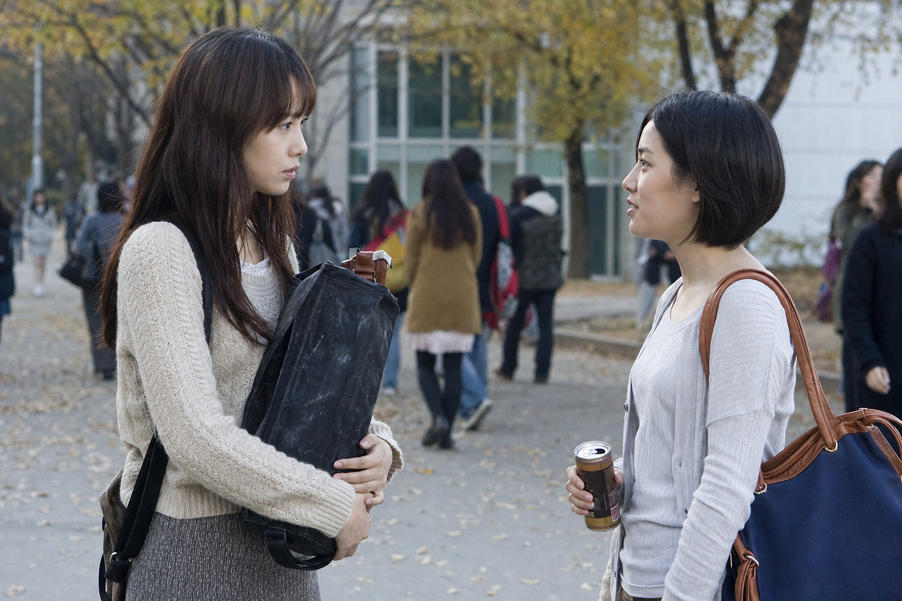

# 108. 많이 피곤해 보이죠

수요일 오후, 패션디자인과 작업실 앞 복도에는 천 조각과 종이 패턴이 흩어져 있었다.

초연은 가위와 자를 챙겨 가방에 넣었다. 손끝에는 분필가루가 묻어 있었다. 동기들은 중간고사 뒤 과제 얘기를 하며 하나둘 나갔지만, 그녀는 작업대 위에 놓인 폴더폰을 계속 보고 있었다.

[김용식] 오늘은 과 애들이랑 과제 좀 보고 갈게.

문장은 평범했다. 그런데 너무 평범해서 이상했다. 용식은 요즘 무엇을 하든 먼저 설명했다. 설명이 빨라질수록 초연은 더 늦게 믿게 됐다.

그녀는 답장을 쓰지 않고 복도를 나왔다. 계단을 내려와 학생회관 쪽으로 걸을 때, 캠퍼스 나무 아래에서 정다은을 봤다. 정다은은 다른 정보통신학과 남자애 둘과 같이 서 있었다. 작은 단발이 바람에 튀고, 손에는 캔커피가 들려 있었다. 그녀는 초연을 먼저 알아보고 손을 들었다.

[정다은] "초연아."

초연은 걸음을 늦췄다.

[김초연] "어."

둘은 동갑이었다. 처음부터 반말을 쓰는 사이였지만, 친한 사이는 아니었다. 정확히는 친해질 수 없는 사이였다. 같은 학교, 같은 남자, 다른 자리. 그 정도면 충분했다.

[정다은] "작업 끝났어?"

[김초연] "응."

[정다은] "힘들겠다. 너네 과는 맨날 뭐 들고 다니더라."

[김초연] "너네도 과제 많잖아."

[정다은] "우리는 그냥 컴퓨터 앞에서 욕하지 뭐."

정다은은 웃었다. 옆에 있던 남자애들이 먼저 내려가자고 손짓했지만, 그녀는 잠깐만 하고 손을 흔들었다. 초연은 그 모습이 거슬렸다. 정다은은 언제나 빠져나갈 구멍을 만들었다. 그냥 인사한 것처럼. 그냥 장난친 것처럼. 그냥 같은 과 얘기를 한 것처럼.

[정다은] "요즘 용식이 많이 피곤해 보이죠?"

초연의 표정이 굳었다.

[김초연] "왜 나한테 존댓말해?"

[정다은] "아."

다은은 눈을 동그랗게 떴다가 웃었다.

[정다은] "아니, 그냥. 말이 그렇게 나왔어. 요즘 용식이 피곤해 보이더라."

[김초연] "네가 왜 그렇게 봐?"

[정다은] "같은 과잖아. 옆에서 보이지."

초연은 가방끈을 고쳐 잡았다. 분필가루 묻은 손끝이 검은 가방끈에 흰 자국을 남겼다.

[김초연] "요즘 너희 과제 같이 해?"

[정다은] "가끔? 자료 때문에."

[김초연] "차도 타고?"

다은의 입꼬리가 아주 조금 움직였다. 그 짧은 변화가 초연의 속을 건드렸다.

[정다은] "그건 왜?"

[김초연] "그냥 물어봤어."

[정다은] "아. 조수석 때문에?"

초연은 대답하지 않았다.

정다은은 캔커피를 손바닥 안에서 굴렸다. 금속이 손톱에 닿아 작게 울렸다.

[정다은] "나 용식이랑 아무 사이 아니야."

그 말은 안심시키는 말이어야 했다. 그런데 초연에게는 오히려 더 이상했다. 아무 사이 아니라고 먼저 말하는 사람은, 대개 아무 사이가 아닌 걸 설명해야 할 이유가 있는 사람처럼 보였다.

[김초연] "내가 뭐라고 했어?"

[정다은] "아니. 네 얼굴이."

[김초연] "내 얼굴이 왜."

[정다은] "요즘 되게 많이 참고 있는 얼굴이라."

초연은 숨을 삼켰다. 다은은 한 걸음 물러났다.

[정다은] "오해하지 마. 나는 그냥, 용식이가 요즘 여기저기서 숨 막혀 보인다는 말이었어."

[김초연] "여기저기?"

[정다은] "아니, 학교랑 학원?"

한서윤이라는 이름은 나오지 않았다. 그런데 나오지 않아서 더 선명해졌다. 초연은 다은의 얼굴을 보았다. 밝고 친근한 같은 과 새내기 얼굴. 모르는 척하기 쉬운 얼굴. 그래서 더 미웠다.

[김초연] "너 한서윤 씨 알아?"

정다은은 눈을 깜박였다.

[정다은] "전에 네가 말했잖아."

[김초연] "내가?"

[정다은] "아닌가? 용식이 폰에서 봤나."

말끝이 흐려졌다. 실수처럼. 하지만 초연은 이제 정다은의 실수를 믿지 않았다.

[김초연] "너 일부러 그러지."

정다은은 웃지 않았다. 그 잠깐의 정색이 오히려 진짜 같았다.

[정다은] "초연아."

[김초연] "왜."

[정다은] "용식이한테 직접 물어봐. 나한테 묻지 말고."

그녀는 그렇게 말하고 캔커피를 들고 돌아섰다. 남자 동기들이 기다리는 쪽으로 가면서 다시 평소처럼 밝은 목소리로 떠들었다. 초연은 그 뒷모습을 보며 폴더폰을 열었다.

[김초연] 너 지금 어디야?

보내고 나서 바로 답이 오지 않았다. 십 초, 삼십 초, 일 분. 캠퍼스 바람이 치마 끝을 흔들었다. 초연은 학생회관 앞 벤치에 앉았다. 손끝에 묻은 분필가루가 폴더폰 버튼 사이에 희미하게 남았다.

[김용식] 도서관.

초연은 바로 전화를 걸었다.

용식은 받지 않았다.

두 번째 전화도 받지 않았다.

세 번째에야 통화가 연결됐다.

[김용식] "왜?"

목소리가 낮았다. 주변이 조용하지 않았다. 책장 넘기는 소리보다는 바깥 바람 소리와 차 지나가는 소리가 섞여 있었다.

[김초연] "도서관이라며."

[김용식] "응. 잠깐 밖에 나왔어."

[김초연] "누구랑 있어?"

짧은 침묵.

[김용식] "혼자."

초연은 눈을 감았다. 혼자라는 말이 이제 제일 믿기 어려운 말이 됐다.

[김초연] "나 지금 학교야."

통화기 너머에서 용식의 숨이 멈추는 게 느껴졌다.

[김초연] "도서관으로 갈게."

그녀는 전화를 끊었다.

그리고 천천히 일어났다.
