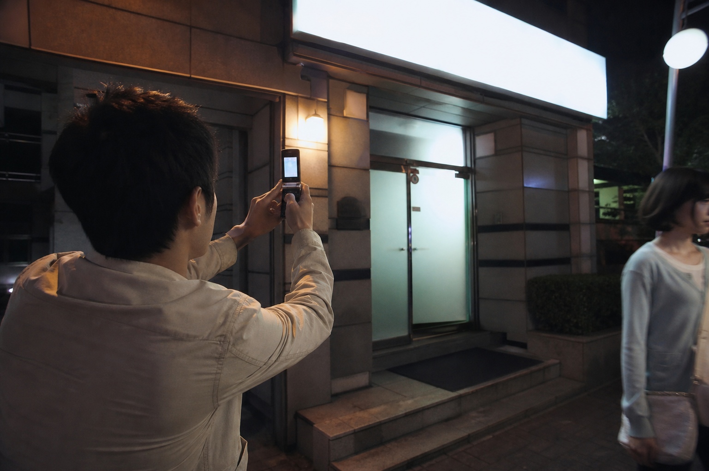

# 109. 정장 입고

목요일 저녁, 수원 일본어 학원 강의실은 보강 다음 주의 피곤함이 그대로 남아 있었다.

학생들은 중간고사와 회사 야근, 취업 준비 얘기를 섞어 하며 늦게 들어왔다. 용식은 평소보다 먼저 자리에 앉았다. 옆자리는 비어 있었다. 그는 책을 펴 놓고 폴더폰을 뒤집었다.

초연은 전날 도서관까지 왔다. 용식은 정말 도서관 앞 벤치에 혼자 있었다. 다은과 통화한 것도 아니었고, 서윤과 만난 것도 아니었다. 그런데 혼자였다는 사실이 오히려 초연의 의심을 풀어주지 못했다. 거짓말을 여러 번 한 사람은 진실을 말해도 냄새가 났다.

[김초연] 오늘 학원 끝나면 바로 전화해.

그 문자를 받은 지 오 분도 지나지 않아 다른 문자가 왔다.

[한서윤] 오늘 정장 수선 찾았어.

용식은 폴더폰을 뒤집었다가 다시 열었다.

[한서윤] 면접 날짜 나왔어. 다음 주 수요일.

그는 답장을 쓰지 못했다. 바로 옆자리 의자가 천천히 당겨졌다. 한서윤이 앉았다. 오늘은 얇은 아이보리 블라우스 위에 어두운 카디건을 걸치고 있었다. 진주귀걸이는 그대로였고, 눈 아래 작은 점은 형광등 아래에서 또렷했다.

[한서윤] "문자 봤네."

[김용식] "봤어요."

[한서윤] "답은 안 하고."

[김용식] "수업 시작하니까."

[한서윤] "아직 안 시작했어."

용식은 책장을 넘겼다. 글자가 손끝 아래에서 부스럭거렸다.

[한서윤] "정장 입어봤는데 잘 맞더라."

[김용식] "다행이네요."

[한서윤] "그거 입고 면접 보면 네 생각 날 것 같아."

그 말은 다정했다. 다정해서 더 압박이었다. 서울, 백화점, 호텔, 받지 않은 전화, 접힌 영수증이 한꺼번에 문장 안으로 들어왔다. 용식은 목을 가다듬었다.

[김용식] "면접 잘 보면 돼요."

[한서윤] "그게 끝이야?"

[김용식] "서윤 씨."

[한서윤] "나 다음에 대답 듣겠다고 했잖아."

강사가 들어왔고, 수업이 시작됐다. 용식은 그 덕분에 살았다고 생각했다. 하지만 수업 내내 서윤은 너무 조용했다. 질문도 하지 않았고, 필기도 적게 했다. 대신 중간중간 용식의 손을 봤다. 그가 폴더폰 쪽으로 손을 뻗는지, 아니면 꾹 참는지.

쉬는 시간에 초연에게서 전화가 왔다.

용식은 복도로 나갔다. 서윤은 따라오지 않았다. 하지만 문가에서 보였다.

[김초연] "수업 중이야?"

[김용식] "쉬는 시간."

[김초연] "끝나고 바로 전화할 거지?"

[김용식] "응."

[김초연] "오늘은 누구랑 따로 가지 마."

그 말에 용식은 복도 창문을 봤다. 어두운 유리 속에 자기 얼굴과 강의실 안쪽 서윤의 희미한 옆모습이 같이 비쳤다.

[김용식] "응."

[김초연] "응만 하지 말고."

[김용식] "바로 갈게."

[김초연] "나 믿어도 되는 거지?"

용식은 대답을 삼켰다. 믿어도 된다는 말은 너무 컸다. 지금 그의 입에서 나오면, 그 말은 바로 거짓말이 될 것 같았다.

[김용식] "걱정하지 마."

통화가 끊기고, 그는 한동안 복도에 서 있었다.

수업이 끝난 뒤 서윤은 바로 일어나지 않았다. 다른 학생들이 나가고, 강사가 교재를 챙겨 나간 뒤에도 그녀는 의자에 앉아 있었다. 용식도 가방을 들지 못했다.

[한서윤] "나 오늘 너 안 붙잡을게."

[김용식] "고마워요."

[한서윤] "고마워할 일이야?"

용식은 눈을 피했다.

[한서윤] "대신 하나만 물어볼게."

[김용식] "뭔데요."

[한서윤] "나 말고 또 있지?"

강의실 형광등이 낮게 웅웅거렸다. 용식은 대답하지 않았다. 초연을 말하는 거라면 당연히 있었다. 그런데 서윤의 질문은 초연을 묻는 게 아니었다. 그녀는 용식의 침묵을 보고 이미 답을 얻은 것처럼 눈을 내렸다.

[한서윤] "있구나."

[김용식] "아니에요."

[한서윤] "아니면 왜 그렇게 늦어."

[김용식] "서윤 씨가 생각하는 그런 거 아니에요."

[한서윤] "나는 아직 아무것도 생각한다고 말 안 했어."

용식은 입을 다물었다. 서윤은 가방을 닫고 일어섰다.

[한서윤] "정장 고마워."

[김용식] "그 얘기는 됐어요."

[한서윤] "왜. 좋은 일이잖아. 네가 나 면접 잘 보라고 사준 거."

그녀는 교재를 품에 안았다.

[한서윤] "나 비밀 잘 지키는 거 알지?"

그 말은 부드러웠다. 그러나 부드러운 말이 전부 위로는 아니었다. 용식은 그제야 깨달았다. 서울에서 서윤을 안심시킨 건 자신이 아니었다. 서윤이 자신을 안심시킨 것이었다.

학원 밖으로 나오자 초연에게서 문자가 와 있었다.

[김초연] 끝났어?

용식은 바로 답장을 썼다.

[김용식] 응. 지금 나가.

[김초연] 전화해.

그는 통화 버튼을 누르기 전에 뒤를 돌아봤다. 서윤은 학원 계단 아래에서 그를 보지 않고 버스정류장으로 걸어가고 있었다. 뒷모습은 조용했다. 그런데 용식은 그 조용함이 더 오래 남을 걸 알았다.

전화가 연결됐다.

[김초연] "지금 어디야?"

[김용식] "학원 앞."

[김초연] "사진 보내."

용식은 숨을 멈췄다.

[김초연] "학원 앞이면, 지금 사진 하나 보내."

그는 폴더폰 카메라를 켰다. 밤의 학원 간판이 화면에 들어왔다. 그런데 프레임 오른쪽 끝, 버스정류장 쪽에 한서윤의 옆모습이 작게 걸렸다.

용식은 저장 버튼을 누르지 못했다.

