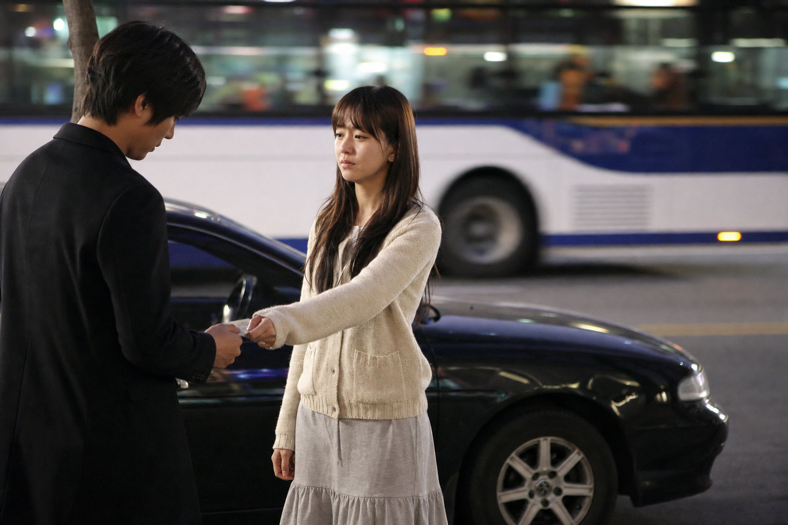

# 110. 서울은 왜 갔어

금요일 낮, 용식은 학교 주차장에 세워 둔 BMW 안에서 사진 한 장을 지우고 있었다.

전날 밤 학원 앞에서 찍은 사진이었다. 초연이 보내라고 했고, 그는 결국 보냈다. 보내기 전에 한서윤이 프레임에서 빠질 때까지 기다렸다. 다시 찍고, 확인하고, 확대해서 보고, 간판만 남은 사진을 보냈다. 초연은 그 사진에 아무 말도 하지 않았다.

그게 더 불안했다.

용식은 폴더폰 사진첩을 닫았다. 삭제했는데도 지워지지 않은 기분이었다. 손에는 아직 학원 앞 차가운 공기가 남아 있었고, 귀에는 초연의 목소리가 남아 있었다. 사진 보내. 짧은 말이었다. 이제 초연은 설명보다 증거를 원했다.

강의가 끝나고 학생식당으로 내려가는 길에 정다은이 따라붙었다.

[정다은] "오늘도 얼굴이 장례식이네."

[김용식] "말 좀 가려."

[정다은] "가렸어. 더 심한 말 할 수 있었는데."

[김용식] "밥 먹으러 가?"

[정다은] "응. 너는?"

[김용식] "나도."

그들은 나란히 걷지 않았다. 반 걸음쯤 어긋나게 걸었다. 그 정도 거리는 남들이 보기에는 그냥 같은 과 동기였고, 두 사람에게는 이미 너무 가까운 거리였다.

[정다은] "어제 학원 갔어?"

[김용식] "응."

[정다은] "한서윤 씨 봤고?"

용식이 멈췄다.

[김용식] "너 진짜 어디까지 알고 말하는 거야."

[정다은] "이름은 내가 예전부터 알았잖아."

[김용식] "그 얘기 하지 마."

[정다은] "왜. 초연이 앞에서만 하면 돼?"

그는 주변을 봤다. 학생들이 오가고 있었다. 다은은 목소리를 낮췄다. 장난이었지만, 완전히 장난만은 아니었다.

[정다은] "너 요즘 초연이한테만 숨기는 게 아닌 것 같아."

[김용식] "무슨 뜻인데."

[정다은] "나한테도 숨기잖아."

용식은 헛웃음을 냈다.

[김용식] "내가 너한테 뭘 보고해야 하는데."

[정다은] "보고 말고."

다은은 학생식당 입구 앞에서 그를 올려다봤다. 눈웃음은 없었다. 작은 얼굴이 의외로 진지해졌다.

[정다은] "그 차 안에서 있었던 일, 너 혼자 없애려고 하지 말라고."

그 말이 식당 입구의 소음 사이로 낮게 박혔다. 용식은 입술을 다물었다.

[정다은] "나는 너한테 뭐 해달라는 거 아니야. 그냥 네가 숨 막힐 때 나만 생각나는 척하지 말라는 거야."

그녀는 말하고 먼저 식당 안으로 들어갔다. 용식은 한동안 그 자리에 서 있었다. 다은은 초연처럼 확인하지 않았다. 서윤처럼 영수증을 쥐고 있지도 않았다. 그런데 이상하게도 그녀의 말은 더 직접적으로 목을 잡았다.

오후 수업이 끝난 뒤, 초연에게서 문자가 왔다.

[김초연] 오늘 저녁에 잠깐 보자.

용식은 바로 답했다.

[김용식] 어디로 갈까?

[김초연] 수원역. 카페 말고 밖에서.

카페 말고 밖에서. 그 말 때문에 용식은 더 불안해졌다. 카페는 앉아서 오래 말하는 곳이었다. 밖은 언제든 돌아설 수 있는 곳이었다.

저녁 여섯 시 반, 수원역 뒤쪽 버스정류장에는 퇴근길 사람들로 붐볐다. 초연은 우산도 없는데 비가 올 것 같은 하늘 아래 서 있었다. 가을 바람이 긴 머리를 흔들었다. 그녀는 용식의 차가 다가오자 바로 타지 않았다.

용식이 내려서 다가갔다.

[김용식] "왜 안 타."

[김초연] "여기서 얘기해."

[김용식] "추운데."

[김초연] "차 안에 타면 또 네가 운전하면서 넘길 것 같아서."

용식은 말을 잃었다. 버스가 정류장에 들어오며 매연 냄새를 남겼다. 초연은 가방에서 작은 종이 하나를 꺼냈다. 구겨진 흰 종이 조각이 아니라, 길쭉한 주차권이었다.

용식의 심장이 내려앉았다.

[김초연] "이거 네 차 조수석 밑에 있었어."

그는 그것을 알아봤다. 서울 백화점 지하주차장 주차권. 세차할 때 백화점 포장지 조각은 찾았지만, 매트 아래로 밀린 주차권은 못 본 모양이었다. 초연은 그것을 펴서 날짜를 확인했다.

[김초연] "10월 10일."

금요일.

[김초연] "너 그날 과 애들이랑 밥 먹었다고 했잖아."

용식은 대답을 찾으려 했다. 서울에 혼자 갔다. 엄마 부탁이었다. 과 애들이랑 갔다. 백화점은 잠깐 들렀다. 어떤 말도 첫 문장을 넘기기 전에 무너졌다.

[김용식] "그게."

초연은 눈을 감았다가 떴다.

[김초연] "서울은 왜 갔어?"

목소리는 크지 않았다. 화내는 말투도 아니었다. 그래서 주변 사람들은 아무도 돌아보지 않았다. 그러나 용식에게는 그 말이 버스정류장 전체를 멈추게 하는 것처럼 들렸다.

[김용식] "볼 일이 있었어."

[김초연] "무슨 볼일."

[김용식] "그냥."

[김초연] "그냥 서울 백화점에?"

초연은 주차권을 접었다. 손끝이 떨리지 않았다. 오히려 너무 가만했다.

[김초연] "수원이나 분당은 눈에 띄어서?"

용식은 고개를 들었다.

[김용식] "뭐?"

[김초연] "아니. 그냥 그런 생각이 들어서."

그 말은 우연처럼 나왔다. 하지만 용식은 알았다. 초연은 정답을 맞힌 게 아니었다. 그의 거짓말이 만들어 낸 빈칸을 보고 있었다. 수원, 분당, 학원, 한서윤, 정다은, 조수석, 냄새, 포장지, 주차권. 모든 단어가 아직 연결되지는 않았지만, 초연은 이제 그 단어들이 한 방향으로 누워 있다는 걸 보고 있었다.

[김초연] "누구랑 갔어?"

용식은 대답하지 못했다.

초연은 그 침묵을 오래 보았다. 눈물이 나올 것 같은 얼굴이었지만, 울지 않았다. 화를 낼 것 같은 입술이었지만, 소리치지 않았다.

[김초연] "정다은?"

용식의 반응은 아주 작았다. 그러나 초연은 봤다.

[김초연] "아니구나."

그녀의 얼굴에서 피가 빠졌다.

[김초연] "한서윤 씨야?"

버스 한 대가 둘 사이를 가리며 지나갔다. 바람이 일었고, 초연의 머리카락이 얼굴로 흩어졌다. 용식은 손을 뻗어 넘겨주고 싶었지만 그러지 못했다.

버스가 지나간 뒤에도 초연은 같은 자리에 서 있었다.

[김초연] "대답해."

용식은 입을 열었다.

아무 말도 나오지 않았다.

초연은 고개를 아주 조금 끄덕였다. 답을 들은 사람처럼.

[김초연] "나 오늘은 차 안 탈래."

그녀는 주차권을 용식의 손에 쥐여 주었다. 종이는 차가웠다. 그런데 손바닥에서는 금방 축축해졌다.

[김초연] "그리고 너, 이제 사진 보내는 걸로는 안 돼."

초연은 돌아섰다. 용식은 따라가야 했다. 붙잡아야 했다. 그런데 발이 바로 움직이지 않았다. 손 안의 주차권 때문이었다. 서울 백화점 이름과 날짜가 찍힌 작은 종이.

서윤이 말했었다.

그거 잃어버리지 마.

용식은 이제 알았다.

그 말은 챙겨주는 말이 아니었다.
