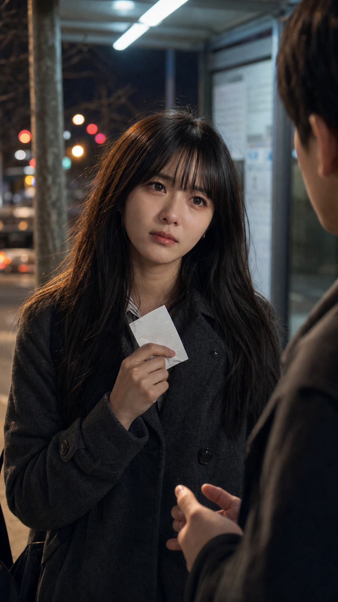

# 111. 끝이라고 말하지는 않았다

수원역 뒤쪽 버스정류장에는 버스가 한 대 지나갈 때마다 바람이 남았다.

초연의 머리카락이 그 바람에 흩어졌다. 용식은 손을 뻗지 못했다. 예전 같았으면, 적어도 한 달 전만 해도 그는 별생각 없이 그 머리카락을 넘겨 줬을 것이다. 초연은 민망한 얼굴로 손등을 밀어냈을 수도 있고, 아니면 아무 말 없이 가만히 있었을 수도 있었다.

지금은 그럴 수 없었다.

그의 손에는 서울 백화점 주차권이 있었다.

종이는 작았다. 손바닥 안에 접히는 크기였다. 그런데 그 종이 하나가 수원역 뒤편 골목과 정류장, 지나가는 버스, 초연의 얼굴, 용식이 그동안 아무렇지 않은 척 쌓아 올렸던 말들을 전부 눌러 버렸다.

[김초연] "대답해."

초연은 다시 말했다.

목소리가 올라가지 않았다. 그래서 더 못 견디게 들렸다.

[김초연] "한서윤 씨야?"

용식은 주차권을 쥔 손에 힘을 줬다. 젖은 것도 아닌데 종이가 축축하게 눌렸다. 매트 아래에 밀려 들어갔던 그 작은 종이는 이제 그의 손 안에서 더 이상 종이가 아니었다. 날짜였다. 장소였다. 거짓말이었다.

10월 10일.

서울.

그는 그날 초연에게 과 애들과 밥을 먹고 집에 갔다고 말했다. 말을 하면서도 너무 쉬웠다. 쉬워서, 오히려 나중에 걸리지 않을 거라고 생각했다. 수원도 아니고 분당도 아니고 서울이었다. 학교 애들이 볼 일도 없고, 초연이 우연히 지나갈 일도 없고, 정다은이 어디서 보고 툭 던질 일도 없었다.

그런데 차 안에 종이가 남았다.

초연은 사람보다 물건을 먼저 믿기 시작했다.

[김용식] "초연아."

[김초연] "이름 부르지 말고."

그 말에 용식은 숨을 삼켰다.

초연은 용식을 보고 있었다. 눈이 젖어 있지는 않았다. 울음을 참는 얼굴도 아니었다. 오히려 너무 맑았다. 사람을 붙잡으려고 울던 얼굴보다, 지금처럼 한 번 멀리 서서 보는 얼굴이 더 무서웠다.

[김초연] "나 네가 거짓말하는 거, 이제 표정으로 알아."

[김용식] "거짓말한 건 맞아."

입 밖으로 나온 말은 그가 생각한 것보다 빨랐다.

초연의 눈썹이 아주 조금 움직였다.

용식은 그 움직임을 보고 바로 후회했다. 인정하면 조금은 나아질 거라고, 여기서 아무 말도 못 하는 것보다는 덜 최악일 거라고 생각한 것이었다. 하지만 인정은 문을 여는 일이었다. 그 문 뒤에 뭐가 있는지 초연은 모르고, 용식은 알고 있었다.

서울 백화점.

한서윤의 정장.

가방, 구두, 블라우스.

호텔 계산서 봉투.

서윤의 말.

비밀로 해줄게.

[김초연] "뭐가 맞아."

용식은 초연의 눈을 피했다. 정류장 옆 편의점 유리창에 두 사람의 모습이 비쳤다. 멀리서 보면 그냥 싸운 커플 같았다. 여자가 팔짱을 끼고 서 있고, 남자가 말 못 하고 서 있는 흔한 장면. 아무도 그 안에 들어 있는 이름들을 몰랐다.

정다은.

한서윤.

나카타 유즈키.

초연은 그중 한 이름을 이미 입에 올렸다.

[김용식] "서울 간 거."

[김초연] "누구랑."

[김용식] "한서윤 씨랑."

초연은 고개를 끄덕이지 않았다. 놀라지도 않았다. 이미 알고 있었다는 듯한 얼굴이었다. 용식은 그게 더 아팠다. 들키는 순간의 놀람이 아니라, 맞을 줄 알았다는 확인. 사랑하는 사람이 자기를 믿고 싶어서 끝까지 버틴 끝에, 결국 자기 의심이 맞았다는 걸 확인하는 얼굴.

그 얼굴 앞에서 그는 아직도 다 말하지 않았다.

[김용식] "근데 네가 생각하는 그런 건 아니야."

초연의 입술 끝이 아주 조금 움직였다. 웃음은 아니었다.

[김초연] "내가 뭘 생각하는데."

[김용식] "그냥... 그 사람 취업 준비하는데. 면접 때문에 정장 필요하다고 해서."

[김초연] "그래서 네가 서울까지 데리고 가서 사줬어?"

[김용식] "수원이나 분당은..."

그는 말을 멈췄다.

초연이 눈을 들었다.

[김초연] "수원이나 분당은?"

용식은 혀끝이 마르는 걸 느꼈다. 버스정류장 앞 도로에는 퇴근길 차량들이 느리게 밀렸다. 빨간 브레이크등이 초연의 얼굴 옆으로 지나갔다가 사라졌다. 그 빛이 지나갈 때마다 그녀의 표정도 조금씩 달라지는 것 같았다. 화난 얼굴, 상처받은 얼굴, 체념한 얼굴.

그리고 다시 묻는 얼굴.

[김용식] "아는 사람 만날까 봐."

[김초연] "아는 사람 만나면 안 되는 일이었네."

[김용식] "아니, 그런 뜻이 아니라."

[김초연] "그런 뜻이지."

짧았다.

용식은 그 짧은 말을 이길 수가 없었다.

초연은 다시 주차권을 보지 않았다. 이제 그 종이는 다 쓴 증거였다. 그녀가 확인하고 싶은 건 종이에 찍힌 글자가 아니라, 용식의 입에서 어디까지 나오는지였다.

[김초연] "정장은 왜 네가 사줘."

[김용식] "내가 미안한 일이 있었어."

[김초연] "무슨 미안한 일."

[김용식] "그냥. 전에 좀..."

[김초연] "전에 좀 뭐."

용식은 대답하지 못했다. 5월의 진주 귀걸이가 떠올랐다. 수원 술집, 모텔 앞 불빛, 학원자료라는 저장명, 초연이 옆에 누워 있던 아침의 전화. 모든 것이 서울 백화점의 정장으로 이어져 있었다. 그런데 그중 하나를 꺼내면 다 같이 올라올 것 같았다.

그는 결국 가장 덜 위험한 말만 골랐다.

[김용식] "그 사람 취업 때문에 많이 힘들어해서. 내가 도와준 거야."

[김초연] "착하네."

초연은 그렇게 말하고, 바로 시선을 돌렸다.

그 말이 칭찬이 아니라는 걸 모를 수 없었다.

[김초연] "너는 왜 나한테는 그렇게 착하게 못 해."

[김용식] "나 너한테도..."

[김초연] "아니."

초연은 처음으로 목소리를 조금 올렸다. 지나가던 여학생 둘이 잠깐 돌아봤다가 다시 걸어갔다. 초연은 그 시선도 신경 쓰지 않았다.

[김초연] "나한테 잘해 주는 거랑 나한테 착한 건 달라."

용식은 입술을 다물었다.

[김초연] "가방 사주고, 밥 사주고, 차로 데려다주고, 생일 챙겨 주고. 그런 거 말고."

그녀는 손가락으로 가방끈을 만졌다. 며칠 전 생일에 받은 베이지색 가죽 가방이었다. 용식이 골라 줬고, 초연이 정말 좋아했던 가방. 지금 그 가방은 사랑의 증거가 아니라 이상한 부끄러움처럼 초연의 어깨에 걸려 있었다.

[김초연] "내가 바보 되는 거 막아 주는 거."

말끝이 흔들렸다.

용식은 그제야 한 걸음 다가갔다.

[김용식] "초연아, 진짜 아무 사이 아니야."

초연은 물러서지 않았다. 하지만 가까워진 거리만큼 더 차갑게 그를 봤다.

[김초연] "아무 사이 아닌 사람한테 정장 사줘?"

[김용식] "그냥 도와준 거야."

[김초연] "아무 사이 아닌데 나한테 숨겨?"

[김용식] "오해할까 봐."

[김초연] "오해할 만한 짓을 했으니까 숨긴 거잖아."

용식은 그 말에 대답할 말을 찾지 못했다. 오해라는 말은 편했다. 상대가 잘못 이해한 것처럼 만들 수 있었다. 그러나 지금 초연은 오해를 하고 있는 게 아니었다. 정확한 전체를 모를 뿐이었다.

전체를 모른다는 게, 용식에게는 아직 숨 쉴 틈이었다.

그래서 그는 비겁하게 그 틈에 섰다.

[김용식] "정말 아무 일도 없었어. 정장 사고, 밥 먹고, 데려다준 게 다야."

호텔은 말하지 않았다.

서울에서 다시 깊은 밤을 보낸 것도 말하지 않았다.

한서윤이 영수증과 호텔 계산서 봉투를 어떻게 봤는지도 말하지 않았다.

초연은 그의 말을 듣고 한참 가만히 있었다. 버스가 또 들어왔다. 이번엔 앞문이 열리고 사람들이 내렸다. 누군가는 우산을 들고 있었고, 누군가는 붕어빵 봉투를 들고 있었다. 평범한 금요일 저녁이었다. 사람들은 각자의 집으로 갔다.

초연은 어디로 가야 할지 모르는 사람처럼 서 있었다.

[김초연] "밥은 어디서 먹었어."

용식의 목 안쪽이 굳었다.

[김용식] "백화점 안에서."

[김초연] "몇 시까지 있었어."

[김용식] "정확히는 기억 안 나."

[김초연] "집에는 몇 시에 갔어."

그 질문에서 용식은 완전히 멈췄다.

초연은 그 멈춤을 보았다.

그녀는 작게 숨을 내쉬었다. 추워서 나온 숨 같기도 했고, 참던 것을 포기하며 나온 숨 같기도 했다.

[김초연] "됐다."

[김용식] "초연아."

[김초연] "됐다고."

초연은 가방끈을 고쳐 멨다. 돌아서려다가, 다시 멈췄다. 손가락이 주먹처럼 접혔다가 풀렸다. 용식은 그 손을 봤다. 예전에는 먼저 잡아 오던 손이었다. PC방 앞에서, 수원역 골목에서, 영화관 계단에서, 차 안에서. 마음이 급할 때마다 용식보다 먼저 다가오던 손.

지금 그 손은 자기 자신만 붙잡고 있었다.

[김초연] "나 너 좋아해."

그 말은 갑자기 나왔다.

용식은 눈을 들었다.

[김초연] "그래서 지금 바로 헤어지자고 못 하겠어. 내가 너무 바보 같아서, 그 말까지 하면 진짜 내가 너무 불쌍해질 것 같아서 못 하겠어."

[김용식] "그런 말 하지 마."

[김초연] "근데 너도 알지."

초연은 웃으려다 실패했다. 입꼬리가 올라가지 못하고 떨렸다.

[김초연] "나 예전처럼 못 해."

용식은 그 말을 듣는 순간, 차라리 헤어지자는 말보다 더 무거운 것이 있다는 걸 알았다. 끝내자는 말은 선을 긋는다. 하지만 못 하겠다는 말은 선을 지우지 않은 채 발밑에 놔둔다. 언제 밟아도 피가 나는 곳에.

[김초연] "앞으로 학원 끝나면 바로 연락해."

[김용식] "응."

[김초연] "사진도 보내."

[김용식] "보낼게."

[김초연] "누구랑 있는지 내가 물어보면 바로 말해."

[김용식] "알았어."

대답은 빨랐다. 빠를수록 초연의 얼굴은 더 어두워졌다.

[김초연] "그리고..."

초연은 잠깐 말을 멈췄다. 목이 잠긴 듯했다. 그녀는 도로 쪽을 보았다. 버스 전광판에는 수원역, 영통, 망포 같은 글자가 흘러갔다. 정확히 읽히지 않는 불빛들이 그녀의 눈에 지나갔다.

[김초연] "다시 이런 일 있으면 끝이야."

용식은 아무 말도 하지 못했다.

[김초연] "한서윤 씨든, 정다은이든, 누구든."

정다은이라는 이름이 나왔을 때, 용식의 손이 아주 조금 굳었다. 초연은 이번에도 봤다. 그러나 더 캐묻지 않았다. 오늘은 이미 하나를 잡았고, 그 하나만으로도 충분히 무거웠다.

[김초연] "나한테 들키기 전에 네가 말해. 아니면..."

초연은 끝까지 말하지 않았다.

그 말하지 않은 뒤가 더 선명했다.

용식은 고개를 끄덕였다.

[김용식] "미안해."

초연은 그 말을 듣고도 풀리지 않았다. 미안하다는 말은 너무 늦게 나왔고, 너무 적게 나왔다. 그녀는 한참 그를 바라보다가 가방에서 주차권을 다시 꺼냈다. 아까 용식에게 쥐여 줬던 것과 같은 종이였다. 아니, 같은 줄 알았다.

초연은 다른 작은 조각을 꺼냈다.

백화점 포장지 조각이었다.

용식이 차 안에서 찾지 못했던 또 다른 것.

[김초연] "이런 거, 네가 생각하는 것보다 잘 보여."

그녀는 포장지 조각을 용식의 손에 올려놓지 않았다. 다시 자기 가방 안에 넣었다.

[김초연] "이건 내가 가지고 있을게."

[김용식] "왜."

[김초연] "내가 바보 아니었다는 거 기억하려고."

그 말에 용식은 아무 대답도 할 수 없었다.

초연은 돌아섰다. 이번에는 정말 버스정류장 쪽으로 걸었다. 용식은 따라가려다가 멈췄다. 붙잡으면 어떻게든 될 것 같았지만, 붙잡아서 할 수 있는 말이 없었다. 다 말할 수 없으면, 붙잡는 것도 또 하나의 거짓말이었다.

초연은 버스를 타지 않았다.

그녀는 사람들 사이에 섞여 수원역 쪽으로 걸어갔다. 걸음이 빠르지 않았다. 울지도 않았다. 그래서 더 멀어 보였다.

용식은 손 안의 주차권을 내려다봤다.

서울 백화점.

10월 10일.

흰 종이 위의 잉크는 조금 번져 있었다. 손바닥의 땀 때문인지, 차 안 어딘가에서 이미 눅눅해졌던 탓인지 알 수 없었다. 그는 그것을 접어 지갑에 넣으려다가 멈췄다. 지갑에는 카드 영수증 몇 장이 있었다. 주유소, 편의점, 학교 앞 식당.

그리고 아직 버리지 못한 백화점 카드전표 하나.

그는 지갑을 닫았다.

버스정류장 불빛 아래에서 폴더폰이 짧게 떨렸다.

처음에는 초연인 줄 알았다.

용식은 숨을 고르고 폴더폰을 열었다.

[학원자료] 어제는 잘 넘어갔어?

그는 화면을 한동안 보고 있었다.

뒤쪽 도로에서 버스가 출발했다. 매연 냄새와 차가운 바람이 같이 밀려왔다. 초연이 사라진 방향에는 사람들이 계속 걸어가고 있었다. 아무도 뒤돌아보지 않았다.

용식은 답장을 쓰지 못했다.

그런데 삭제도 하지 못했다.
