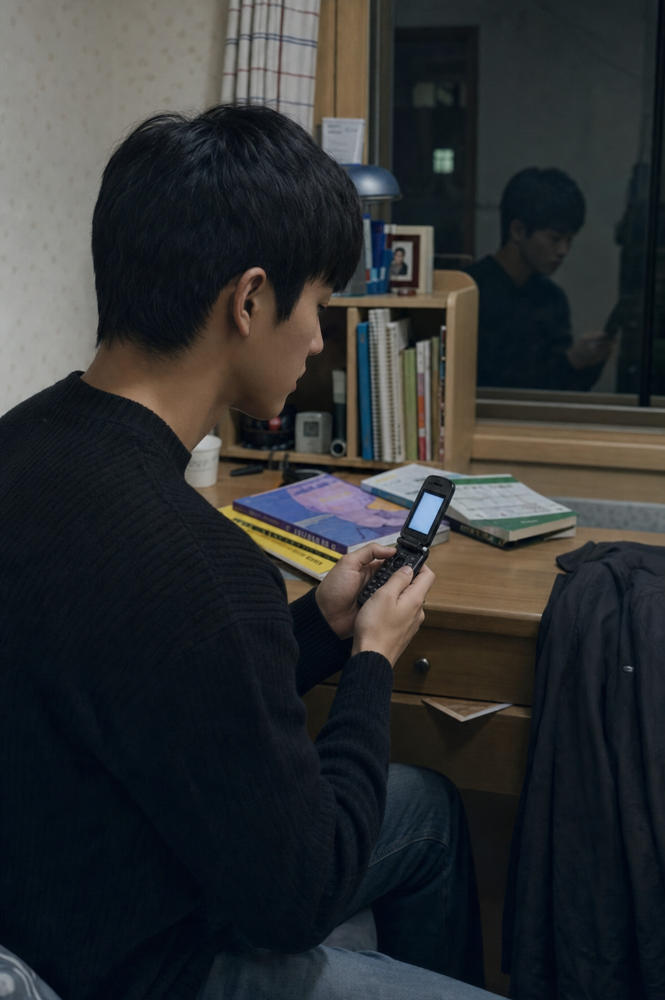

# 112. 지워도 남는 것

밤 열한 시가 조금 넘어서야 용식은 집 근처 골목에 차를 세웠다.

집 앞까지 가져가지 않았다. 늘 그랬다. BMW는 학교에서는 소문이었고, 초연에게는 데이트의 편의였고, 집에서는 설명할 수 없는 물건이었다. 그는 한 블록 떨어진 빌라 담장 옆에 차를 붙이고 시동을 껐다. 엔진 열이 식는 소리가 조용한 골목 안에서 작게 튀었다.

용식은 바로 내리지 못했다.

폴더폰을 열었다.

문자함에는 초연의 마지막 문자가 남아 있었다.

[김초연] 집에 들어가면 연락해.

예전 같으면 아무 생각 없이 `응 들어가면 할게`라고 보냈을 문장이었다. 그런데 이제 그 문장은 인사말이 아니었다. 확인이었다. 그가 정말 집에 들어갔는지, 누구와 더 만나지 않는지, 오늘 밤 더 거짓말을 얹지 않는지 확인하는 가느다란 줄이었다.

용식은 문자함을 아래로 내렸다.

[학원자료] 어제는 잘 넘어갔어?

그 문자를 보고 손가락이 멈췄다.

서윤은 물어본 게 아니었다. 알고 있었다. 어제 무슨 일이 있었는지, 용식이 어디까지 몰렸는지, 초연이 뭘 들고 나왔는지까지 다 알지는 못해도, 자기 이름이 언젠가 다시 불려 나올 거라는 건 알고 있는 사람의 말투였다.

용식은 삭제 버튼 위에 엄지손가락을 올렸다.

한 번만 누르면 사라졌다.

문자는 그랬다.

하지만 통화 시간은 남았다. 발신 기록도 남았고, 수신 기록도 남았고, 삭제한 자리에 생기는 빈칸 같은 것도 남았다. 무엇보다 초연은 이제 문장을 믿지 않았다. 그녀는 시간과 위치와 표정과 물건을 보기 시작했다. 문자를 지우는 행동 하나도 언젠가 걸리면, 지운 내용보다 지웠다는 사실이 더 큰 증거가 될 수 있었다.

용식은 폴더폰을 닫았다.

어둠 속에서 액정 불빛이 사라지자 차 안은 갑자기 더 좁아졌다. 조수석 매트는 깨끗했다. 주차권도, 포장지 조각도 없었다. 그는 수원역에서 초연을 보낸 뒤 편의점 앞 쓰레기통에 남은 종이들을 전부 버렸다. 손으로 매트 밑까지 훑었다. 좌석 사이도 봤다. 아무것도 없었다.

그런데도 조수석은 비어 있는 자리처럼 보이지 않았다.

초연이 앉았던 자리.

정다은이 가방을 던지듯 올려놓았던 자리.

서윤이 서울에서 조용히 창밖을 보던 자리.

사람이 내린 뒤에도 자리는 기억을 남겼다.

용식은 차 문을 잠그고 집으로 걸었다. 밤공기는 차가웠고, 골목 안 음식물 쓰레기통 옆에는 김치 국물 냄새가 희미하게 났다. 현관문을 열자 반찬가게에서 남은 기름 냄새와 된장국 냄새가 섞여 있었다. 어머니는 이미 방에 들어간 듯했고, 거실 불만 작게 켜져 있었다.

그는 신발을 벗고 방으로 들어가자마자 초연에게 문자를 보냈다.

[김용식] 들어왔어. 씻고 잘게.

답장은 바로 왔다.

[김초연] 사진.

용식은 침대 앞에서 멈췄다.

처음에는 무슨 뜻인지 몰랐다. 그러다 곧 알았다. 집에 들어왔다는 말을 믿지 않겠다는 뜻이었다. 그는 방 안을 둘러봤다. 책상 위에는 전공책과 일본어 학원 교재가 섞여 있었고, 의자 등받이에는 낮에 입었던 재킷이 걸려 있었다. 침대 위에는 캐리어가 반쯤 열린 채 있었다. 아직 겨울 이야기를 꺼낼 시기도 아닌데, 그는 이미 일본어 학원 자료와 유즈키에게 받은 작은 사진을 어디에 숨길지 생각하고 있었다.

그는 폴더폰 카메라를 켰다.

찰칵.

방 천장 형광등 아래, 책상 모서리와 침대 끝이 비스듬히 찍혔다. 사진을 보내고 나서야 그는 숨을 내쉬었다.

[김초연] 오늘부터 이렇게 해.

[김용식] 뭐를?

[김초연] 학원 끝나면 학원 앞에서 사진. 집 들어가면 방 사진. 늦으면 왜 늦는지 먼저 말하고.

용식은 화면을 오래 보았다.

한 줄씩 읽을 때마다 목에 보이지 않는 끈이 감기는 느낌이었다. 초연이 나쁘다는 생각은 들지 않았다. 오히려 그게 더 답답했다. 그녀는 자기가 잡은 증거만큼만 요구하고 있었다. 주차권을 들고도 헤어지지 않았다. 욕을 하지도 않았고, 소리를 지르지도 않았다. 대신 규칙을 만들었다.

믿음이 빠진 자리에 절차가 들어왔다.

[김용식] 알겠어.

문자를 보내고도 그는 손을 떼지 못했다. 알겠다고 말하는 건 쉬웠다. 그는 언제나 그랬다. 당장은 고개를 끄덕이고, 뒤에서 다른 길을 찾았다. 초연에게는 학원 앞 사진을 보내고, 사진 바깥에서 서윤을 만나면 됐다. 집에 들어온 사진을 보내고, 그 뒤에 다시 나가면 됐다. 전화는 받으면 되고, 못 받으면 배터리를 핑계 대면 됐다.

그런데 초연은 이제 핑계를 기다리지 않을 것이다.

그때 폴더폰이 다시 떨렸다.

[학원자료] 대답 안 하네.

용식은 본능적으로 화면을 뒤집었다.

문제는 그 뒤였다.

초연에게서 전화가 왔다.

그는 방 안에서 폴더폰 두 개의 빛을 동시에 보는 사람처럼 굳었다. 실제로는 하나뿐인데도 그랬다. 하나의 화면에 두 여자의 시간이 겹쳐 있었다.

그는 초연의 전화를 받았다.

[김용식] "응."

[김초연] "왜 이렇게 늦게 받아."

[김용식] "옷 갈아입고 있었어."

[김초연] "방금 사진 보냈잖아."

용식은 입술을 다물었다.

작은 거짓말은 더 작은 질문에 걸렸다.

[김용식] "폰 침대에 던져놨다가..."

[김초연] "용식아."

초연은 그의 이름을 불렀다. 낮에는 부르지 말라고 했던 이름이었다. 그런데 밤에는 다시 불렀다. 그게 더 무서웠다. 화가 풀려서가 아니라, 이름을 불러야만 아직 붙잡을 수 있다고 생각하는 사람처럼 들렸다.

[김초연] "나도 내가 이러는 거 싫어."

용식은 아무 말도 하지 못했다.

[김초연] "근데 네가 나를 이렇게 만들었어."

수화기 너머로 이불이 스치는 소리가 들렸다. 초연도 방 안인 듯했다. 그녀는 아마 침대에 앉아 있거나, 벽에 기대어 있거나, 아까 버스정류장에서 집까지 들고 간 마음을 아직 내려놓지 못하고 있을 것이다.

[김초연] "내일부터 학원 끝나면 바로 전화해. 사진도 보내고."

[김용식] "응."

[김초연] "정다은이랑도 단둘이 차 타지 마."

용식은 숨을 멈췄다.

초연은 서윤을 물고 있다가, 갑자기 다은을 꺼냈다. 증거는 없었다. 하지만 이름은 이미 그녀 안에서 자리를 잡았다.

[김용식] "정다은이 왜 나와."

[김초연] "몰라. 그냥 나와."

그 말은 설명이 아니었다. 하지만 설명보다 정확했다.

[김초연] "내가 이상한 거면 네가 안 이상하게 해줘. 네가 해줘야 돼."

용식은 방 안 형광등 아래서 고개를 숙였다.

[김용식] "알겠어."

그는 또 같은 말을 했다.

통화가 끝나고 방 안은 조용해졌다. 책상 위 학원 교재 사이에서 유즈키에게 받은 작은 사진 봉투가 살짝 보였다. 그는 황급히 서랍을 열어 봉투를 밀어 넣었다. 그러고 나서 다시 폴더폰을 열었다.

[학원자료] 나한테도 설명은 해줘야 하지 않아?

용식은 답장을 쓰지 못했다.

삭제도 하지 못했다.

그는 폴더폰을 닫고 침대 위에 엎어 놓았다. 화면은 보이지 않았다. 하지만 진동은 손바닥 아래에 그대로 전해졌다.

지운다고 없어지는 건 이제 거의 없었다.
