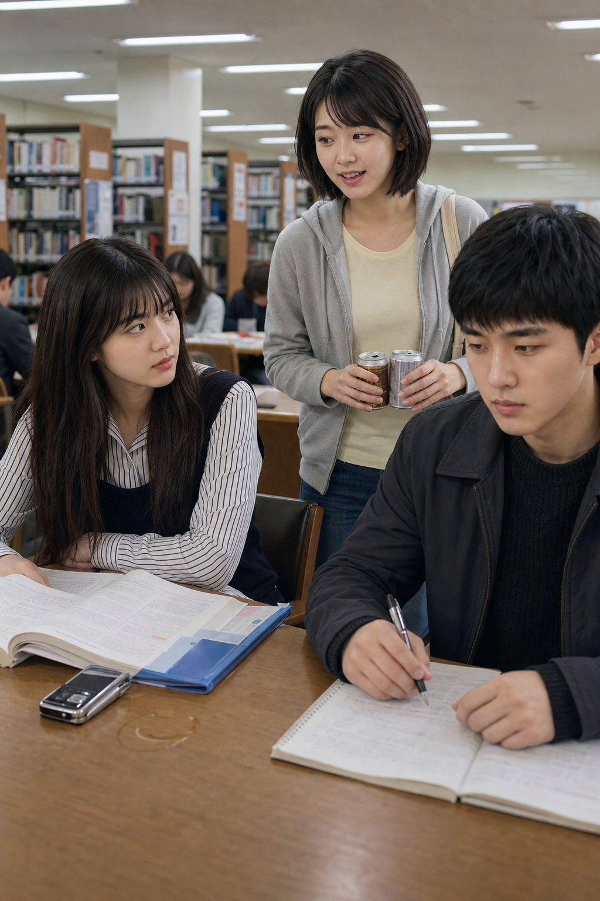

# 113. 검사받는 사람

월요일 오전 도서관은 생각보다 조용했다.

중간고사가 끝난 지 얼마 지나지 않았고, 기말까지는 아직 멀었다. 평소 같으면 1층 열람실은 자리가 조금 비어 있어야 했다. 그런데 그날은 이상하게 사람들이 많았다. 누군가는 과제를 미루다 온 얼굴이었고, 누군가는 잠을 덜 깬 채 전공책을 펴 놓고 고개를 끄덕였다. 형광등은 낮인데도 너무 환했고, 난방이 애매하게 돌아가서 공기가 답답했다.

용식은 창가 쪽 긴 책상에 앉았다.

일부러 사람이 많은 곳을 골랐다. 사람들 사이에 있으면 오히려 덜 의심받을 것 같았다. 서윤에게 답장을 못 한 채 주말을 넘겼고, 초연에게는 방 사진과 집 도착 문자를 꼬박꼬박 보냈다. 월요일 아침에도 학교 도착 사진을 찍어 보냈다. 주차장 한쪽, BMW 보닛 위에 낙엽이 붙어 있는 사진이었다.

초연은 답장 대신 이십 분 뒤 도서관 문을 열고 들어왔다.

그녀는 말없이 용식 맞은편에 앉았다.

가방을 내려놓고, 전공책을 꺼내고, 필통을 놓는 동작이 차분했다. 너무 차분해서 용식은 더 불편했다. 싸운 사람이 아니라, 정해진 자리에 앉은 감독관 같았다. 초연은 그를 쳐다보지 않고 책을 펼쳤다. 그러다 펜 끝으로 책상 위를 두 번 톡톡 쳤다.

[김초연] "공부해."

[김용식] "너 수업은?"

[김초연] "한 시간 뒤."

[김용식] "그럼 굳이 여기까지..."

초연이 눈을 들었다.

용식은 말을 멈췄다.

[김초연] "굳이 왔어."

그 말 뒤에 더 붙는 말은 없었다.

용식은 노트북을 열지 않았다. 화면을 열면 메일이 떠오를 것 같았다. 유즈키의 답장, 서윤의 문자, 지우지 못한 것들. 그는 전공책을 폈다. 글자는 눈에 들어오지 않았다. 페이지 위 회로도는 선과 점으로 얽혀 있었고, 그 선들이 마치 자신의 거짓말처럼 어디서 시작해 어디로 가는지 알 수 없게 보였다.

십오 분쯤 지났을 때, 정다은이 열람실 문 앞에 나타났다.

용식은 먼저 보지 않았다. 초연이 먼저 고개를 들었다. 그 시선의 방향을 따라가자 다은이 보였다. 짧은 단발, 가벼운 니트, 손에 든 캔커피 두 개. 그녀는 용식과 눈이 마주치자 작게 웃었다가, 초연을 보고 웃음을 조금 줄였다.

다은은 그냥 지나갈 수도 있었다.

지나가지 않았다.

그녀는 긴 책상 옆을 돌아 용식 쪽으로 왔다. 발소리가 열람실 바닥에서 작게 났다. 누군가가 고개를 들었다가 다시 책을 봤다.

[정다은] "여기 있었네."

용식은 펜을 잡은 손에 힘을 줬다.

[김용식] "왜."

[정다은] "자료 물어보려고. 어제 단톡에 올린 거 봤어?"

[김용식] "봤어. 나중에 얘기하자."

다은은 그 말에 바로 물러서지 않았다. 그녀는 캔커피 하나를 책상 끝에 살짝 놓았다. 용식 앞이 아니라, 둘 사이에 걸친 자리였다. 초연이 볼 수밖에 없는 위치였다.

[정다은] "너 요즘 되게..."

다은은 말을 고르듯 잠깐 멈췄다.

용식은 그 짧은 멈춤이 싫었다. 다은은 늘 그랬다. 노골적으로 선을 넘을 때보다, 말하기 직전의 숨으로 사람을 더 불안하게 했다.

[정다은] "검사받는 사람 같아."

초연의 펜이 멈췄다.

딱.

뚜껑 닫히는 소리가 작게 났다.

용식은 다은을 보았다.

[김용식] "그런 말 하지 마."

[정다은] "왜. 내가 뭐 틀린 말 했어?"

다은은 웃고 있었지만 눈은 웃지 않았다. 장난처럼 던졌지만, 장난만은 아니었다. 그녀는 초연을 대놓고 보지 않았다. 하지만 초연이 듣고 있다는 걸 모를 리 없었다.

초연은 책을 덮었다.

[김초연] "정다은 씨."

다은이 고개를 돌렸다.

[정다은] "응?"

초연은 잠깐 말을 삼켰다. 같은 학교, 같은 나이대, 같은 남자를 사이에 둔 여자끼리의 말은 생각보다 쉽게 나오지 않았다. 서로가 서로의 이름을 이미 너무 많이 들었고, 그래서 처음 하는 말도 처음 같지 않았다.

[김초연] "용식이랑 자료 얘기면, 지금 말고 수업 끝나고 해 줄래요?"

존댓말이었다.

다은은 그 존댓말을 듣고 눈썹을 아주 조금 올렸다.

[정다은] "아, 네."

그녀는 캔커피를 다시 집어 들었다. 그러고는 용식 쪽으로 몸을 조금 기울였다.

[정다은] "나중에 봐."

그 말은 평범했다.

하지만 너무 가까웠다.

다은이 돌아서자 초연은 다시 책을 펼쳤다. 용식은 아무 말도 하지 못했다. 열람실 안에서 페이지 넘기는 소리만 났다. 형광등이 윙 하고 작게 울었다.

오 분.

십 분.

초연은 한 줄도 읽지 않는 얼굴로 책을 보고 있었다.

[김용식] "아무것도 아니야."

그 말이 먼저 나왔다.

초연은 책에서 눈을 떼지 않았다.

[김초연] "내가 물어봤어?"

[김용식] "그냥 자료 때문에."

[김초연] "내가 물어봤냐고."

용식은 입을 닫았다.

초연은 펜을 내려놓았다. 책상 위에 놓인 폴더폰을 뒤집어 놓았다가 다시 바로 놓았다. 화면은 꺼져 있었다.

[김초연] "나 한서윤 씨만 의심하는 거 아니야."

용식의 등 뒤로 식은땀이 났다.

[김초연] "정다은이랑도 뭐 있어?"

그 질문은 예상했는데도 갑자기 맞은 것처럼 아팠다. 초연의 눈은 주차권을 들고 있던 밤보다 더 흔들렸다. 그때는 증거가 있었다. 지금은 증거가 없었다. 그래서 그녀는 더 초라해 보이기 싫어하는 얼굴을 하고 있었다.

용식은 고개를 저었다.

[김용식] "없어."

너무 빨랐다.

초연은 그 빠름을 들었다.

[김초연] "없으면 왜 그렇게 대답해."

[김용식] "진짜 없으니까."

[김초연] "그럼 걔가 왜 너 보고 검사받는 사람 같다고 해?"

용식은 펜을 만졌다. 손끝에 잉크가 묻었다. 언제 새었는지 모를 파란 잉크였다.

[김용식] "요즘 네가 나 확인하는 거... 걔도 봤겠지."

[김초연] "부끄러워?"

[김용식] "그런 말이 아니잖아."

[김초연] "내가 너 확인하는 거, 남들한테 보이는 게 부끄러워?"

용식은 대답하지 못했다.

그건 맞았다. 하지만 맞다고 하면 끝이었다.

초연은 의자를 뒤로 밀었다. 소리가 크게 났다. 주변 사람들이 고개를 들었다. 그녀는 책과 필통을 가방에 넣었다. 동작은 빠르지 않았지만, 하나하나가 딱딱했다.

[김용식] "수업 아직 남았다며."

[김초연] "나 여기 있으면 진짜 이상한 사람 될 것 같아."

용식은 손을 뻗으려다 멈췄다.

초연이 그의 손을 보았다.

[김초연] "잡지 마."

그녀는 가방을 메고 열람실을 나갔다.

용식은 따라가지 못했다. 따라가면 더 많은 시선이 붙을 것 같았다. 안 따라가면 더 나쁜 사람이 되는 것 같았다. 그는 그 사이에서 굳어 있었다.

책상 위에는 다은이 놓았다가 가져간 캔커피 자국만 남아 있었다. 차가운 원형 물기가 나무 상판에 천천히 번졌다.

폴더폰이 울린 건 그때였다.

[김초연] 오늘은 데리러 오지 마.

용식은 화면을 보고 한참 움직이지 않았다.

열람실 문 밖 복도에서, 정다은이 벽에 기대어 그를 보고 있었다.

이번에는 웃지 않았다.
