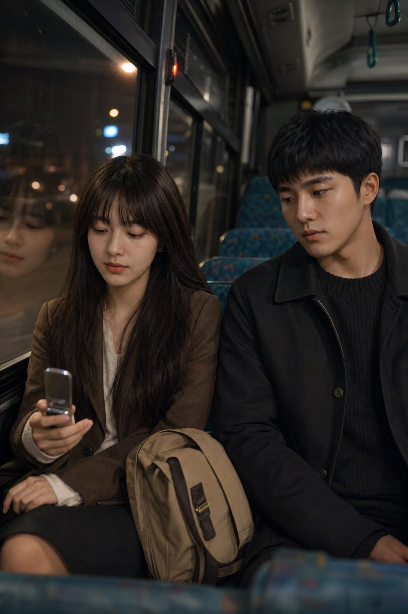

# 114. 그냥 친구라는 말

초연의 폴더폰이 울린 건 수원행 버스 안이었다.

버스는 평택 캠퍼스를 벗어나 국도 위로 천천히 올라가고 있었다. 해가 일찍 져서 창밖은 이미 어두웠고, 차창에는 사람들의 얼굴과 노란 손잡이가 겹쳐 비쳤다. 초연은 창가 자리에 앉아 있었고, 용식은 통로 쪽에 앉아 있었다. 둘 사이에는 작은 가방 하나가 놓여 있었다.

원래는 용식이 차로 데려다주겠다고 했다.

초연이 거절했다.

그래도 용식은 버스정류장까지 따라왔고, 결국 같은 버스에 올라탔다. 둘 다 그게 화해가 아니라는 걸 알고 있었다. 다만 헤어져 각자 집에 가기엔 아직 싸움이 끝나지 않았고, 같은 차를 타기엔 조수석이라는 자리가 너무 많은 이름을 품고 있었다.

폴더폰 화면이 켜졌다.

초연은 무심코 화면을 확인했다가 바로 닫았다.

용식은 그 짧은 동작을 보았다.

[김용식] "누구야."

초연은 창밖을 보았다.

[김초연] "친구."

그 단어가 이상하게 들렸다.

용식은 자신이 그 단어를 얼마나 많이 이용했는지 떠올렸다. 학원 사람. 같은 과. 아는 누나. 자료. 아무 사이 아닌 사람. 그런 말들은 관계를 설명하기보다 숨기기 위해 더 자주 쓰였다.

[김용식] "남자?"

초연이 그제야 고개를 돌렸다.

[김초연] "왜."

[김용식] "그냥 물어본 건데."

[김초연] "너는 그냥 물어보는 거고, 나는 검사하는 거야?"

버스가 과속방지턱을 넘으며 덜컹거렸다. 둘 사이의 가방이 조금 움직였다. 용식은 손으로 가방을 잡아 주려다 멈췄다. 초연은 자기 가방을 직접 당겨 안았다.

[김용식] "그런 뜻 아니야."

[김초연] "남자 맞아. 고등학교 때부터 알던 애."

용식은 입 안쪽을 씹었다.

초연이 이어 말했다.

[김초연] "그냥 친구야."

그 말이 나오자마자 두 사람 모두 잠깐 조용해졌다.

그냥 친구.

너무 익숙하고, 너무 믿기 어려운 말이었다.

[김용식] "밤에 문자하는 친구?"

[김초연] "아직 밤도 아니야."

[김용식] "술자리 끝나면 데리러 와도 되냐고 했던 그 사람?"

초연의 눈이 가늘어졌다.

[김초연] "내 폰 봤어?"

용식은 바로 대답하지 못했다. 본 게 아니었다. 지난번 수원 버스정류장에서 잠깐 화면에 떴던 문장, 술자리 단체사진 밑에 남아 있던 이름, 초연이 숨기듯 접던 폴더폰. 그걸 다 모아 자기 마음대로 그림을 만든 것이었다.

그런데 그게 꼭 틀린 그림 같지도 않았다.

[김용식] "보려고 본 건 아니고."

[김초연] "너는 참 편하다."

초연은 웃었다.

이번엔 정말 조금 웃었다. 그런데 그 웃음은 사람을 밀어내는 쪽이었다.

[김초연] "너는 내가 뭐만 물어보면 숨 막힌다, 못 믿냐, 왜 그러냐 하면서. 너도 다 보네."

[김용식] "나는 네가..."

[김초연] "내가 뭐."

용식은 말을 삼켰다.

그는 따지고 싶었다. 왜 남자애가 밤늦게 연락하느냐고, 왜 술자리 끝나면 데리러 오겠다는 말을 끊지 않느냐고, 왜 네가 받는 관심은 그냥 친구고 내가 받는 관심은 의심이 되느냐고. 그런데 그 모든 말 끝에는 서울 백화점과 한서윤이 붙어 있었다. 정다은의 차 안 입맞춤도 붙어 있었다.

그는 자기 손으로 만든 벽 앞에서 목소리를 낮췄다.

[김용식] "걔가 너 좋아하는 거 아니야?"

초연은 바로 부정하지 않았다.

그 짧은 침묵이 용식의 속을 더 긁었다.

[김초연] "그럴 수도 있겠지."

[김용식] "뭐?"

[김초연] "근데 난 아니야."

[김용식] "상대가 그러면 끊어야 되는 거 아니야?"

초연은 창밖으로 고개를 돌렸다. 버스 창에는 용식의 얼굴도 같이 비쳤다. 따지는 얼굴. 억울한 얼굴. 그런데 그 얼굴은 깨끗하지 않았다. 초연은 그걸 알고 있었다.

[김초연] "너도 숨기는 거 있잖아."

버스 안 소음이 갑자기 멀어졌다.

용식은 그 말을 들은 순간, 더 따지면 안 된다는 걸 알았다. 초연은 지금 자기 남사친 이야기를 방패로 쓰는 게 아니었다. 자신도 완전히 떳떳하지 않다는 걸 알고 있으면서도, 용식이 더 큰 것을 숨긴다는 감각으로 버티고 있었다.

둘은 각자의 흠을 손에 쥔 채 서로를 겨누고 있었다.

버스가 수원 시내로 들어오자 사람들이 조금씩 내리기 시작했다. 차 안에는 난방 냄새와 젖은 외투 냄새가 섞였다. 초연의 폴더폰이 다시 울렸다.

이번에는 화면을 숨기지 못했다.

[민준] 술자리 끝나면 연락해. 늦으면 내가 데리러 갈게.

용식은 이름을 봤다.

민준.

처음 듣는 이름은 아니었다. 초연의 과 술자리 얘기에서 몇 번 흘러나온 이름이었다. 과 선배도 아니고, 같은 동네에서 오래 알고 지낸 친구. 초연은 늘 대수롭지 않게 말했다. 그냥 걔. 원래 그래. 어릴 때부터 봐서 남자로 안 보여.

용식은 그 모든 말이 갑자기 싫어졌다.

[김용식] "답장할 거야?"

[김초연] "해야지. 걱정해서 보낸 건데."

[김용식] "내가 데리러 가면 되잖아."

초연은 그를 보았다.

[김초연] "오늘은 네 차 타기 싫다고 했잖아."

그 말은 조수석을 다시 열었다.

용식은 더 말하지 못했다.

초연은 문자 답장을 눌렀다. 손가락이 빠르지 않았다. 일부러 보여 주려는 것도 아니고, 일부러 숨기려는 것도 아닌 애매한 속도였다. 용식은 그 애매함이 견디기 힘들었다. 그는 자신이 초연에게 남긴 애매함이 이런 모양이었겠구나, 잠깐 생각했다.

생각만 했다.

인정하지는 못했다.

수원역에 도착했을 때 초연은 먼저 일어났다. 용식은 뒤따라 내렸다. 버스 문이 열리자 차가운 공기가 확 들어왔다. 두 사람은 정류장 앞에서 마주 섰다.

[김용식] "그 사람 연락 줄여."

초연은 가방끈을 고쳐 멨다.

[김초연] "너부터 해."

[김용식] "나 한다고 했잖아."

[김초연] "말 말고."

초연은 폴더폰을 가방 안에 넣었다.

[김초연] "나도 줄일게. 근데 너도 진짜 줄여. 한서윤 씨든, 정다은이든."

[김용식] "정다은은 진짜..."

[김초연] "그 이름 나올 때마다 네 얼굴 달라져."

용식은 멈췄다.

초연은 그 멈춤을 보고 입술을 깨물었다. 이긴 얼굴이 아니었다. 확인하고 싶지 않은 걸 또 확인한 사람의 얼굴이었다.

[김초연] "나 집에 갈게."

[김용식] "데려다줄게."

[김초연] "오늘은 혼자 갈래."

초연은 뒤돌아섰다.

용식은 그녀를 붙잡지 못했다. 버스정류장 불빛 아래에서 초연의 뒷모습이 점점 작아졌다. 그때 그의 폴더폰이 울렸다.

[학원자료] 잠깐 볼 수 있어요?

용식은 화면을 보고 손을 굳혔다.

방금 전까지 초연에게 남사친 연락을 줄이라고 말했던 손이었다.
