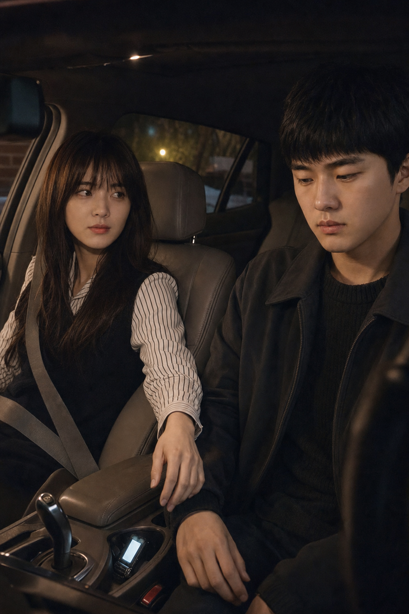

# 115. 끝난 줄 알았던 밤

초연은 금요일 저녁 용식의 차에 타자마자 바닥을 봤다.

말보다 먼저 시선이 내려갔다. 조수석 매트, 좌석 사이, 문 아래 수납칸, 컵홀더. 용식은 운전석에 앉은 채 그 시선을 따라가다가 숨을 가늘게 내쉬었다. 그는 며칠 동안 차 안을 거의 병적으로 치웠다. 포장지 조각도 없고, 주차권도 없고, 영수증도 없었다. 방향제도 바꿨다. 조수석에 남은 머리카락까지 손으로 훑었다.

깨끗했다.

그래서 더 이상했다.

초연은 너무 깨끗한 차 안을 보고 아무 말도 하지 않았다.

[김용식] "밥 뭐 먹을래."

[김초연] "아무거나."

[김용식] "아무거나 말고."

[김초연] "그럼 분식."

예전 같으면 그 대답 뒤에 장난이 붙었을 것이다. 떡볶이 먹으면 너 땀 흘리잖아, 김밥은 네가 더 많이 먹잖아, 순대 간은 내가 안 먹으니까 네가 먹어. 그런 말들이 둘 사이에 작게 굴러다녔다. 지금은 메뉴가 대화가 아니라 시간을 메우는 말이었다.

차는 수원역 쪽으로 천천히 움직였다. 초연은 창밖을 보고 있었다. 가방은 무릎 위에 단정하게 올려 두었고, 손은 가방끈을 잡고 있었다. 용식은 그 손을 보고 싶지 않았다. 주차권을 들고 있던 손과 너무 같았다.

분식집은 사람이 많았다.

고등학생들이 떡볶이 접시를 가운데 두고 떠들었고, 계산대 옆 텔레비전에서는 주말 예능 예고가 흘러나왔다. 기름 냄새와 어묵 국물 냄새가 섞여 있었다. 초연은 구석 자리에 앉았다. 용식은 떡볶이, 김밥, 어묵을 시켰다. 예전처럼 넉넉하게 시켰지만, 둘 다 많이 먹지 않았다.

[김초연] "학원은 오늘 안 가?"

[김용식] "응. 오늘은 없어."

[김초연] "사진 안 보내도 되는 날이네."

용식은 젓가락을 내려놓았다.

[김용식] "그 말 꼭 그렇게 해야 돼?"

초연은 어묵 국물을 한 숟가락 떠서 입에 가져갔다. 뜨거웠는지 잠깐 멈췄다가 내려놓았다.

[김초연] "나도 내가 싫다고 했잖아."

[김용식] "그럼 하지 마."

말이 나온 순간 용식은 후회했다.

초연은 천천히 고개를 들었다.

[김초연] "하지 말까?"

용식은 대답하지 못했다.

[김초연] "내가 안 물어보고, 안 보고, 안 확인하면 너는 안 숨겨?"

분식집 안 소음이 두 사람 주변만 피해 가는 것 같았다. 용식은 물컵을 들었다가 다시 내려놓았다. 손바닥에 물방울이 묻었다.

[김용식] "나 노력하고 있어."

[김초연] "나도."

그 말에는 화보다 피로가 더 많았다.

둘은 한동안 말없이 먹었다. 떡볶이는 식으면서 소스가 굳었고, 김밥 밥알은 젓가락 끝에 자꾸 흩어졌다. 계산을 하고 밖으로 나오자 바람이 차가웠다. 초연은 목을 움츠렸다. 용식은 자기 재킷을 벗어 주려다 멈췄다. 그런 친절도 이제 돈이나 물건처럼 이상한 의미가 붙을까 봐 겁이 났다.

초연이 먼저 손을 내밀었다.

용식은 놀라서 그녀를 봤다.

[김초연] "잡아."

그는 손을 잡았다.

초연의 손은 차가웠다. 손가락 끝이 얼음처럼 굳어 있었다. 용식은 그 손을 두 손으로 감쌌다. 초연은 빼지 않았다. 수원역 뒤쪽 골목을 걷는 동안 둘은 거의 말하지 않았다. 간판 불빛이 젖은 보도블록 위에 번졌고, 지나가는 사람들의 어깨가 두 사람 사이를 스치듯 지나갔다.

차에 돌아왔을 때 초연은 조수석 문을 열고 잠깐 멈췄다.

[김초연] "나 여기 앉는 거 싫어지면 어떡하지."

용식은 대답하지 못했다.

초연은 웃지 않았다.

[김초연] "원래 여기 내 자리 같았는데."

그 말은 조용히 내려앉았다.

용식은 차 키를 쥔 손을 굳혔다. 그 자리는 누구의 자리라고 정한 적 없었다. 하지만 초연은 그렇게 믿고 있었다. 학교 끝나고 데려다주던 길, 신학기 쇼핑을 끝내고 수원으로 돌아오던 밤, 귀국 뒤 울면서 탔던 차, 생일 다음 날 새 가방을 안고 앉았던 자리. 그 모든 시간이 조수석에 쌓여 있었다.

그리고 용식은 그 자리에 다른 사람들을 태웠다.

[김용식] "네 자리 맞아."

초연은 그 말을 듣고 차에 탔다.

집까지 가는 길, 라디오에서는 겨울 노래가 너무 이르게 흘러나왔다. 용식은 볼륨을 낮췄다. 초연은 안전벨트를 만지작거렸다. 그러다 갑자기 손을 뻗어 용식의 손등을 덮었다.

[김초연] "나 아직 너 좋아해."

차가 신호에 멈췄다.

용식은 앞을 봤다.

[김초연] "그래서 더 싫어. 이러는 내가."

용식은 그녀의 손을 뒤집어 잡았다.

[김용식] "미안해."

[김초연] "미안하다는 말 말고."

초연은 몸을 조금 돌렸다. 가까워진 얼굴에 거리감이 사라졌다. 그녀는 화난 사람처럼 보이지 않았다. 오히려 너무 외로워 보였다. 확인하고, 캐묻고, 화내고, 돌아섰다가도 결국 다시 손을 내미는 자신을 스스로 견디지 못하는 얼굴이었다.

용식은 그 얼굴을 보며 입을 맞췄다.

짧았다.

초연은 밀어내지 않았다. 대신 그의 코트 자락을 잡았다. 손끝에 힘이 들어갔다. 입맞춤이 길어지려는 순간, 그녀가 먼저 고개를 뗐다.

[김초연] "이걸로 넘어간 거 아니야."

[김용식] "알아."

[김초연] "알면 진짜 잘해."

용식은 고개를 끄덕였다.

그때 폴더폰이 운전석 옆 컵홀더 안에서 짧게 떨렸다.

둘 다 봤다.

진동은 한 번으로 끝났다. 하지만 한 번이면 충분했다. 초연의 손이 천천히 빠졌다. 용식은 화면을 보지 않았다. 보지 않는다는 행동도 이제는 행동이었다. 초연은 그것까지 봤다.

[김초연] "봐."

[김용식] "나중에."

[김초연] "지금 봐."

용식은 폴더폰을 집었다.

액정에는 저장명 하나가 떠 있었다.

[학원자료] 그럼 나는 뭐야?

용식은 화면을 닫지 못했다.

초연은 문장을 다 읽지 못했을 수도 있었다. 액정은 작았고, 차 안은 어두웠고, 저장명만 정확히 보였을 수도 있었다. 하지만 그녀는 그의 얼굴을 봤다.

그 얼굴이면 충분했다.

초연은 안전벨트를 풀었다.

[김용식] "초연아."

[김초연] "오늘은 여기까지."

그녀는 차 문을 열었다.

찬 공기가 들어왔다.

[김초연] "너 진짜, 끝난 줄 알지 마."

문이 닫혔다.

용식은 시동을 끄지 못한 채 한참 앉아 있었다. 라디오는 너무 작은 소리로 계속 겨울 노래를 틀었다. 컵홀더 안 폴더폰은 더 이상 울리지 않았다.

그래서 더 시끄러웠다.
