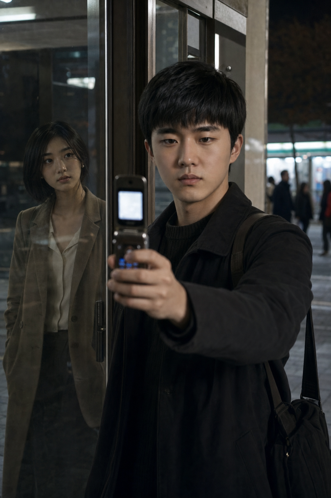

# 116. 같은 각도

수요일 저녁, 수원 일본어 학원 유리문 앞에는 겨울옷을 꺼내 입은 사람들이 늘었다.

아직 완전히 겨울은 아니었다. 그래도 해가 지면 목덜미가 먼저 식었다. 학원 건물 1층 편의점 앞에는 군고구마 냄새가 났고, 엘리베이터 앞에는 수업을 마친 사람들이 한꺼번에 몰렸다. 용식은 교재를 가방에 넣고도 바로 내려가지 못했다.

초연에게 사진을 보내야 했다.

그냥 사진이 아니었다.

같은 각도.

어제 밤 초연은 문자로 그 말을 덧붙였다.

[김초연] 학원 앞 사진은 매번 같은 자리에서 찍어. 그래야 나중에 봐도 알지.

용식은 그 문장을 처음 봤을 때 웃음이 나오려다 말았다. 웃긴 게 아니었다. 너무 정확해서 헛웃음이 나오려던 것이다. 같은 자리, 같은 각도, 같은 시간. 초연은 이제 사랑을 확인하는 게 아니라 사진 속 배경의 변화를 읽으려 했다. 유리문 뒤 그림자, 옆에 선 사람, 늦어진 시간, 조명이 꺼진 층수. 그런 것들.

그는 학원 건물 밖으로 나와 유리문 오른쪽 기둥 옆에 섰다.

폴더폰 카메라를 켰다.

액정 속 학원 입구가 작게 잡혔다. 간판은 흐릿했고, 유리문에는 지나가는 사람들의 그림자가 겹쳤다. 용식은 화면을 확인하다가 손을 멈췄다.

유리문 안쪽에 서윤이 비쳤다.

짧게 자른 머리, 진주 귀걸이, 팔에 걸친 코트. 그녀는 용식을 보고 있는 게 아니었다. 엘리베이터에서 내려오는 사람들 사이에 서서 가방끈을 고쳐 메고 있었다. 그런데 반사된 유리 안에서는 마치 용식의 어깨 바로 뒤에 선 것처럼 보였다.

용식은 황급히 한 걸음 옆으로 움직였다.

다시 화면을 잡았다.

찰칵.

사진을 보내고 나서야 숨을 내쉬었다.

[김용식] 끝났어. 바로 갈게.

초연의 답장은 늦지 않았다.

[김초연] 잠깐만.

용식은 그 자리에서 굳었다.

잠깐만.

그 세 글자가 이제 얼마나 긴 시간인지 그는 알고 있었다. 초연은 사진을 확대하고 있을 것이다. 유리문 오른쪽 끝, 반사된 그림자, 옆 사람의 가방, 시계. 그녀가 무엇을 보는지 알 수 없어서 더 불안했다.

[김초연] 오늘은 왜 어제보다 왼쪽에서 찍었어?

용식은 입술 안쪽을 깨물었다.

들켰다.

아니, 들킨 건 아니었다. 서윤이 찍힌 것도 아니고, 사진에는 그냥 학원 입구만 있었다. 하지만 초연은 어제 사진과 오늘 사진을 비교했다. 그 자체가 문제였다. 그는 이제 거짓말만 하는 게 아니라, 매번 같은 장면을 재현해야 했다.

[김용식] 사람들 나와서 살짝 옆으로 갔어.

답장을 보내자마자 뒤에서 목소리가 들렸다.

[한서윤] "이제 사진도 찍어서 보내?"

용식은 폴더폰을 닫았다.

서윤은 유리문을 밀고 나와 계단 앞에 서 있었다. 코트 안에는 지난번 서울에서 산 블라우스가 보였다. 아주 노골적으로 자랑하지는 않았지만, 용식은 알아볼 수밖에 없었다. 그가 고른 색이었다. 그녀에게 잘 어울릴 거라고 생각해서 집어 들었던 옅은 회색.

[김용식] "오늘은 그냥..."

[한서윤] "그냥?"

서윤은 웃지 않았다.

[김용식] "초연이가 좀 예민해져서."

[한서윤] "예민해진 게 아니고 알게 된 거겠지."

용식은 대답하지 못했다.

서윤은 계단 난간에 손을 올렸다. 진주 귀걸이가 형광등 아래에서 작게 빛났다. 그 귀걸이도 용식이 사 준 것이었다. 정장도, 가방도, 구두도. 그는 자신이 준 물건들이 위로라고 생각했는데, 이제 보니 전부 증거가 될 수 있었다. 서윤의 몸에 남은 증거.

[한서윤] "어제는 잘 넘어갔어?"

[김용식] "어느 정도."

[한서윤] "어느 정도면 안 넘어간 거네."

용식은 주변을 둘러봤다. 학원 사람들이 아직 건물 앞을 오가고 있었다. 초연이 언제 전화를 걸지 몰랐다. 지금 이 순간도 사진을 보다가 이상하다 싶으면 바로 전화할 수 있었다.

[김용식] "여기서 말하지 말자."

서윤은 그 말에 고개를 조금 기울였다.

[한서윤] "그럼 어디서 말해?"

[김용식] "나중에."

[한서윤] "나중에 언제."

그 질문은 조용했다. 그런데 피할 수 없었다.

용식은 폴더폰을 다시 열었다. 초연의 답장이 와 있었다.

[김초연] 바로 전화해.

서윤도 화면을 봤다.

글자는 읽지 못했을 것이다. 하지만 용식의 표정은 읽었다.

[한서윤] "받아."

[김용식] "서윤 씨."

[한서윤] "받으라고. 나는 어차피 안 보이는 사람이잖아."

용식은 전화를 받았다.

[김용식] "응."

[김초연] "지금 어디야."

[김용식] "학원 앞."

[김초연] "주변에 누구 있어?"

용식은 서윤을 보았다.

서윤은 피하지 않았다. 오히려 한 걸음 더 가까이 와서, 용식이 대답하는 얼굴을 정면으로 봤다. 그녀의 눈은 이상하게 차분했다. 화난 사람보다, 어디까지 하나 보자는 사람 같았다.

[김용식] "사람들 많아. 수업 끝나서."

[김초연] "한서윤 씨 있어?"

용식은 혀끝이 굳었다.

서윤의 입술이 아주 조금 움직였다. 웃음은 아니었다.

[김용식] "모르겠어. 사람 많아서."

거짓말은 이번에도 작았다.

그래서 더 선명했다.

초연은 잠깐 말이 없었다. 수화기 너머에서 숨소리만 들렸다.

[김초연] "그럼 지금 바로 차 타. 집까지 가는 길에 계속 통화해."

[김용식] "운전하면서?"

[김초연] "이어폰 끼고."

용식은 눈을 감았다가 떴다.

[김용식] "알겠어."

전화를 끊지 않은 채 그는 주차장 쪽으로 걸었다. 서윤은 따라오지 않았다. 대신 그 자리에서 그를 보고 있었다. 용식이 몇 걸음 걷다가 뒤돌아보자, 서윤은 코트 주머니에서 폴더폰을 꺼냈다.

잠시 뒤 용식의 폰이 진동했다.

[학원자료] 같은 각도로 찍는 거, 나도 배워야 하나?

용식은 전화를 끊을 수 없어서 답장도 못 했다.

초연의 목소리가 이어폰 너머로 들렸다.

[김초연] "왜 말이 없어."

용식은 주차장 불빛 아래에서 차 키를 꺼냈다.

[김용식] "그냥, 추워서."

거짓말은 이제 날씨처럼 흔해지고 있었다.
