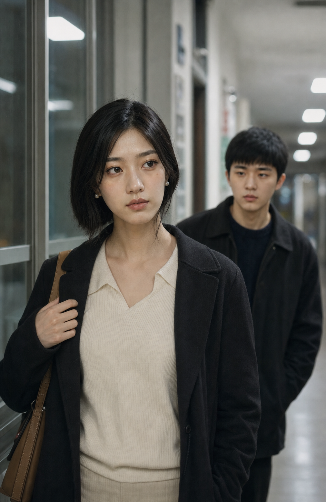

# 117. 필요할 때만

서윤은 다음 수업 때 용식을 보고도 먼저 지나쳤다.

그게 더 이상했다. 예전의 서윤은 일부러 모르는 사람처럼 굴 때도, 그 안에 작은 장난을 남겼다. 스치는 손끝, 늦게 들어오는 시선, 문장 끝에만 붙는 웃음. 밖에서는 남처럼 행동하자는 규칙을 세운 사람답게 숨길 때조차 숨기는 맛을 알았다.

그날은 달랐다.

그녀는 정말 지나갔다.

수원 일본어 학원 복도에는 형광등이 너무 밝았다. 수업 시작 전이라 사람들이 교재를 들고 왔다 갔다 했고, 벽에는 겨울 단기 특강 안내문이 붙어 있었다. 용식은 그 안내문 앞에서 서윤이 지나가는 걸 봤다. 진주 귀걸이가 보였고, 서울에서 산 가방끈이 어깨에 걸려 있었다.

그녀는 고개를 돌리지 않았다.

[김용식] "서윤 씨."

서윤의 발이 멈췄다.

하지만 바로 돌아보지는 않았다.

[한서윤] "수업 들어가야 돼."

[김용식] "잠깐만."

[한서윤] "잠깐은 네가 필요할 때 쓰는 말이잖아."

복도 소음이 그 말 앞에서 잠깐 가라앉는 것 같았다. 용식은 주변을 봤다. 사람들은 각자 바빴고, 아무도 크게 신경 쓰지 않는 듯했다. 그런데도 그는 목소리를 낮췄다.

[김용식] "그런 뜻 아니야."

서윤이 천천히 돌아섰다.

그녀의 얼굴에는 화가 난 흔적이 과하게 드러나 있지 않았다. 오히려 피곤해 보였다. 오래 참은 사람의 피곤함. 한 번 소리 지르고 끝낼 수 있었다면 차라리 덜했을 얼굴이었다.

[한서윤] "어제 전화하면서도 나 앞에 두고 모른다고 했잖아."

[김용식] "그 상황에서는..."

[한서윤] "상황."

서윤은 그 단어를 따라 했다.

[한서윤] "너는 늘 상황이 있지."

용식은 입을 다물었다.

서윤은 복도 창가 쪽으로 걸었다. 용식은 그녀를 따라갔다. 창밖에는 어두워진 수원 거리가 보였고, 아래층 편의점 간판 불빛이 유리창에 번졌다. 두 사람의 얼굴이 창에 겹쳐 비쳤다. 가깝지만, 서로를 직접 보지 않는 얼굴.

[한서윤] "취업 얘기 했을 때도 그랬어. 힘들겠다, 도와줄게. 말은 예뻐."

[김용식] "진심이었어."

[한서윤] "나도 그때는 믿고 싶었어."

그녀는 가방끈을 고쳐 잡았다.

[한서윤] "근데 너는 내가 힘들 때 오는 게 아니라, 네가 곤란할 때 와."

용식은 그 말을 반박할 수 없었다.

3월 밤에도 그랬다. 초연과 싸운 뒤 서윤의 술자리 제안을 받아들였다. 5월에도 그랬다. 초연이 숨 막힌다고 느낄 때 서윤에게 갔다. 10월에도 그랬다. 서윤이 관계를 묻자 정장과 서울로 답했고, 주차권이 걸리자 다시 연락을 피했다.

그는 서윤을 좋아하지 않는다고 말할 수도 없었다.

좋아했다.

다만 그 좋아함은 늘 다른 거짓말의 그늘 밑에 있었다.

[김용식] "미안해."

[한서윤] "그 말 말고."

용식은 순간 초연을 떠올렸다.

미안하다는 말 말고.

두 여자가 같은 말을 했다. 이유는 달랐지만, 듣는 사람은 같았다. 용식은 자신이 같은 방식으로 두 사람을 지치게 만들고 있다는 걸 알았다. 알면서도 바로 고칠 수 없다는 게 더 나빴다.

[김용식] "내가 정리할게."

서윤은 웃었다.

이번엔 분명히 웃었다. 하지만 따뜻하지 않았다.

[한서윤] "뭘?"

[김용식] "초연이랑..."

[한서윤] "거짓말하지 마."

용식은 말을 잃었다.

[한서윤] "너 못 해. 지금도 못 하잖아. 정리할 사람이었으면 서울에서 나한테 정장 사주고 그러지 않았어."

복도 끝에서 수업 시작 종이 울렸다.

사람들이 하나둘 강의실로 들어갔다. 서윤은 움직이지 않았다. 용식도 움직이지 못했다.

[한서윤] "나는 네 여자친구한테 들키면 안 되는 사람이잖아."

[김용식] "그렇게 생각 안 해."

[한서윤] "그럼 뭔데."

용식은 대답할 말을 찾았다.

찾지 못했다.

그 침묵이 대답이었다.

서윤은 고개를 끄덕였다. 작고 느린 동작이었다.

[한서윤] "수업 들어가."

[김용식] "서윤 씨."

[한서윤] "나 필요할 때만 부르지 마."

그녀는 강의실로 들어갔다.

용식은 복도에 남았다. 벽에 붙은 겨울 단기 특강 안내문이 눈에 들어왔다. `일본어 집중 과정`, `겨울방학 단기`, `출국 준비`. 정확한 글자는 흐릿했지만, 단어들은 이상하게 선명했다. 겨울. 출국. 준비.

그는 유즈키에게 보냈던 메일을 떠올렸다.

겨울에 나고야도 괜찮다고 했던 문장.

초연에게는 아직 겨울 얘기를 제대로 꺼내지도 못했다.

서윤에게는 아무것도 확답하지 못했다.

수업이 시작되고도 용식은 잠깐 더 복도에 서 있었다. 폴더폰이 울린 건 그때였다.

[김초연] 오늘 사진은?

그는 학원 복도에서 유리문 쪽으로 뛰듯 내려갔다.

같은 각도.

같은 자리.

같은 거짓말.

하지만 이번엔 유리문에 서윤이 비치지 않았다.

그게 안심이 아니라 더 불안했다.
