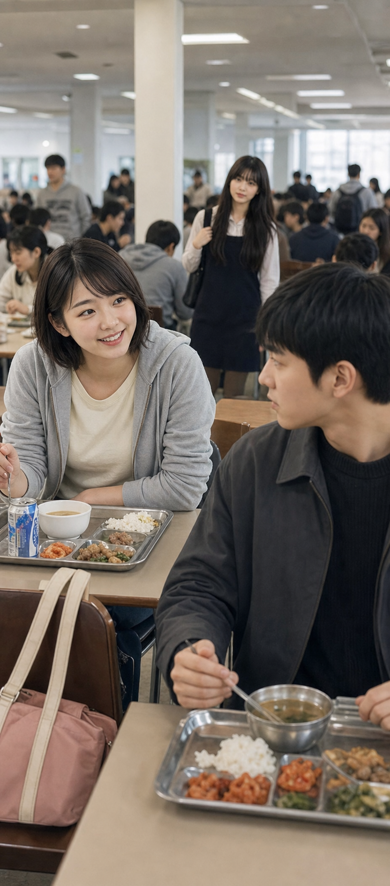

# 118. 식판 사이

학생식당 점심시간은 늘 소란스러웠다.

철제 숟가락이 식판을 긁는 소리, 누군가가 의자를 끌어당기는 소리, 배식대 앞에서 메뉴를 두고 투덜대는 목소리. 된장국 냄새와 튀김 기름 냄새가 섞여 천장 쪽으로 올라갔다. 용식은 식판을 들고 창가 쪽 빈자리를 찾았다.

혼자 먹고 싶었다.

그 마음이 이미 실패의 시작이었다.

정다은이 맞은편 빈자리에 가방을 던지듯 올렸다.

툭.

가방끈 끝이 식판 모서리를 건드렸다. 용식은 고개를 들었다. 다은은 아무렇지 않은 얼굴로 자리에 앉았다. 머리는 짧게 정돈되어 있었고, 회색 니트 소매가 손등을 반쯤 덮고 있었다.

[정다은] "여기 비었지?"

[김용식] "다른 데도 비었잖아."

[정다은] "그러니까 여기 앉아도 되잖아."

말은 가벼웠다.

그런데 용식은 웃지 못했다. 그는 식당 입구 쪽을 먼저 봤다. 초연이 여기 있을 리는 없었다. 오늘 초연은 과 작업실에 있다고 했다. 하지만 요즘의 초연은 있을 리 없는 곳에 갑자기 나타나는 사람이 되었다. 용식이 그렇게 만들었다.

다은은 그 시선을 놓치지 않았다.

[정다은] "또 확인해?"

[김용식] "뭘."

[정다은] "초연이 있는지."

용식은 젓가락을 들었다가 내려놓았다.

[김용식] "그런 거 아니야."

[정다은] "너는 아닌 게 많다."

다은은 김치 한 조각을 집어 밥 위에 올렸다. 말투는 장난스러웠지만 눈은 용식의 얼굴을 계속 보고 있었다. 그는 그 눈이 불편했다. 초연의 눈은 증거를 찾으려 했고, 서윤의 눈은 대답을 요구했다. 다은의 눈은 빈틈을 찾았다. 그리고 그 빈틈으로 들어와 앉았다.

[정다은] "학원 끝나고도 보고해야 하는 얼굴이네."

용식은 숟가락을 멈췄다.

[김용식] "누가 그래."

[정다은] "네 얼굴이."

[김용식] "얼굴이 말을 하냐."

[정다은] "응. 너 되게 많이 해."

용식은 식판을 내려다봤다. 밥은 거의 줄지 않았다. 된장국 위에는 기름이 작게 떠 있었다.

[정다은] "숨 막히지 않아?"

그 질문은 너무 정확해서, 오히려 화가 났다.

[김용식] "네가 상관할 일 아니야."

다은은 고개를 끄덕였다.

[정다은] "맞아. 내 일 아니지."

그녀는 잠깐 말을 멈췄다가, 조금 더 낮은 목소리로 말했다.

[정다은] "근데 그날 차 안 일도 네 일만은 아니잖아."

용식은 주변을 둘러봤다. 옆자리 남학생 둘이 축구 얘기를 하고 있었고, 뒤쪽 테이블에서는 누군가가 웃고 있었다. 아무도 듣지 않는 것 같았다. 그래도 식당 안은 갑자기 위험한 장소가 됐다.

[김용식] "그 얘기 하지 말자."

[정다은] "맨날 하지 말재."

[김용식] "진짜."

[정다은] "싫었으면, 그날 이후로 나 피했겠지."

용식은 그녀를 보았다.

다은은 웃지 않았다.

[정다은] "근데 너 나 피하는 척만 해."

그 말이 맞아서 더 싫었다. 그는 다은을 피하려 했다. 자리를 옮기고, 수업 끝나면 먼저 나가고, 단둘이 차에 타지 않으려고 했다. 하지만 완전히 끊지 않았다. 다은이 던지는 말에 반응했고, 그녀가 멀리서 보면 신경이 쓰였고, 초연에게서 숨 막힌다는 생각이 들 때면 다은의 말이 떠올랐다.

검사받는 사람 같아.

그 말은 나빴다.

하지만 정확했다.

식당 입구 쪽이 잠깐 조용해졌다.

용식은 고개를 돌렸다.

초연이 서 있었다.

그녀는 식판을 들고 있지 않았다. 아마 작업실에서 내려오다 우연히 본 것 같았다. 멀리서 보면 둘은 그냥 같은 과 동기처럼 앉아 있었다. 식판 두 개, 가방 하나, 맞은편 자리. 그런데 초연은 그런 장면을 더 이상 그냥 보지 않았다.

다은도 초연을 봤다.

이번에는 먼저 웃지 않았다.

초연은 다가오지 않았다. 대신 용식을 잠깐 보고, 다은의 가방을 보고, 다시 용식을 봤다. 그러고는 아무 말 없이 돌아섰다.

그게 더 무서웠다.

[김용식] "초연아."

용식은 자리에서 일어났다.

다은이 낮게 말했다.

[정다은] "따라가면 더 검사받을걸."

용식은 돌아보지 않았다.

식판은 거의 그대로 남았다.

그는 식당 밖으로 나갔다. 복도에는 초연이 없었다. 계단 쪽으로 뛰어가 봤지만 보이지 않았다. 폴더폰을 열어 전화를 걸었다. 신호는 갔다. 받지 않았다.

두 번째도 받지 않았다.

세 번째에 문자가 왔다.

[김초연] 밥 맛있게 먹어.

용식은 그 문장을 보고 계단 중간에 멈췄다.

뒤에서 식당 문이 열리는 소리가 났다.

다은이 나오지 않기를 바랐다.

나왔다.

그녀는 용식 옆에 서지 않고, 한 계단 아래에 멈췄다. 가까운 거리도 아니고 먼 거리도 아니었다.

[정다은] "내가 일부러 그런 거 아니야."

용식은 웃음이 나올 뻔했다.

일부러가 아니면 더 나빴다.

[김용식] "너는 꼭 그렇게 말하더라."

[정다은] "진짜야."

[김용식] "진짜면 더 그만해."

다은은 계단 난간을 잡았다.

[정다은] "너도 그만할 수 있으면 해."

용식은 대답하지 않았다.

초연에게 다시 전화를 걸었다.

이번에도 받지 않았다.

점심시간 식당 소음이 문틈으로 새어 나왔다. 아무것도 들키지 않은 날처럼 학교는 그대로였다. 그런데 용식의 폴더폰 화면에는 부재중 통화 숫자만 늘어나고 있었다.
