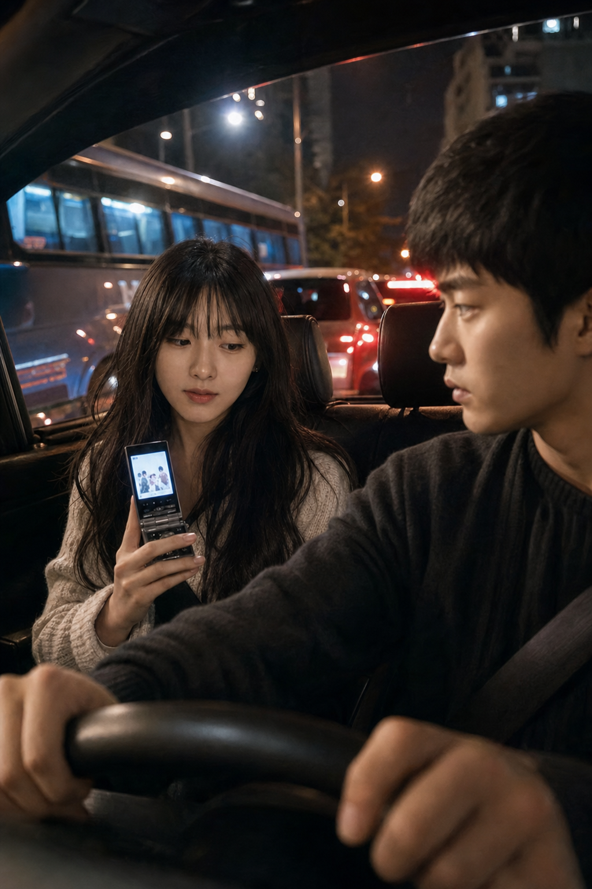

# 119. 보낸 사람 민준

술자리 사진은 밤 아홉 시 사십이분에 왔다.

용식은 초연을 집 앞까지 데려다주고 돌아오는 길이었다. 차는 수원역 근처 신호에 걸려 있었다. 앞차의 브레이크등이 붉게 켜졌고, 옆 차선 버스 창문에는 피곤한 사람들의 얼굴이 나란히 비쳤다. 초연은 조수석에 앉아 폴더폰을 보고 있었다.

화면이 켜졌다.

단체사진이었다.

정확히 보려고 한 건 아니었다. 하지만 사진은 밝았다. 술집 노란 조명 아래, 사람 여럿이 어깨를 붙이고 있었다. 초연은 사진을 보자마자 화면을 닫았다.

용식은 핸들을 잡은 손에 힘을 줬다.

[김용식] "민준?"

초연은 그를 봤다.

[김초연] "이름 봤어?"

[김용식] "사진이 보였어."

[김초연] "운전이나 해."

신호가 바뀌었다.

용식은 차를 출발시켰다. 말은 거기서 끝나야 했다. 하지만 끝나지 않았다. 초연의 폴더폰은 무릎 위에 엎어져 있었고, 그 작은 물건이 차 안 공기를 계속 누르고 있었다.

[김용식] "술자리 갔어?"

[김초연] "응."

[김용식] "나한테 말 안 했잖아."

[김초연] "과 애들이랑 잠깐."

용식은 웃지 못했다.

과 애들이랑.

그 말은 자신이 너무 많이 써먹은 말이었다. 그래서 초연 입에서 나오자마자 의심이 아니라 자기혐오가 먼저 올라왔다. 그런데 그 자기혐오를 초연에게 말할 수는 없었다. 그는 결국 가장 쉬운 감정으로 갔다.

질투.

[김용식] "민준도 과 애야?"

[김초연] "아니."

[김용식] "그럼 왜 거기 있어."

초연은 창밖을 봤다.

[김초연] "동네 애들도 같이 온 거야."

[김용식] "넌 나한테는 누구랑 있는지 다 말하라며."

초연은 고개를 돌렸다.

[김초연] "너는 말하면 믿게 해 줘?"

용식은 브레이크를 살짝 밟았다. 앞차가 느려졌다. 차 안에 안전벨트가 몸을 당기는 느낌이 남았다.

[김용식] "그 얘기랑 이 얘기는 다르지."

[김초연] "왜 달라."

[김용식] "나는..."

그는 말을 멈췄다.

나는 들킨 게 있고, 너는 아직 들키지 않았으니까.

그런 말은 할 수 없었다.

초연은 폴더폰을 열었다. 사진을 다시 봤다. 이번에는 숨기지 않았다. 화면 속 민준은 초연 옆에 서 있지 않았다. 뒤쪽에서 손을 들고 있었고, 표정은 흐릿했다. 그런데 용식은 그 흐릿한 얼굴이 더 싫었다. 정확히 모르는 사람은 마음속에서 마음대로 커졌다.

[김초연] "봐. 아무것도 아니잖아."

[김용식] "아무것도 아닌 걸 왜 숨겨."

초연은 잠깐 아무 말도 하지 않았다.

그 질문이 되돌아왔다.

아무것도 아닌 걸 왜 숨겨.

서울 백화점도 그랬다. 학원자료도 그랬다. 정다은도 그랬다. 용식은 자신이 던진 말에 스스로 맞았다.

[김초연] "그럼 너도 아무것도 아닌 거 숨기지 마."

용식은 입을 닫았다.

초연은 사진을 닫고 문자함으로 들어갔다. 손가락이 몇 번 움직였다. 용식은 그 동작을 보지 않으려 했지만, 차 안은 너무 좁았다.

[김용식] "답장해?"

[김초연] "응."

[김용식] "뭐라고."

[김초연] "잘 들어갔다고."

[김용식] "지금 나랑 있잖아."

[김초연] "집 앞이니까."

용식은 더 말하지 못했다.

초연의 집 근처 골목에 도착했을 때, 그녀는 바로 내리지 않았다. 폴더폰을 가방 안에 넣고, 손잡이에 손을 올린 채 잠깐 앉아 있었다.

[김초연] "나도 줄인다고 했잖아."

[김용식] "줄이는 게 이거야?"

[김초연] "너는 하루아침에 다 끊었어?"

용식은 대답하지 못했다.

초연은 작게 고개를 끄덕였다. 이미 답을 알고 있었다는 듯했다.

[김초연] "나 민준이 안 좋아해."

[김용식] "걔는?"

[김초연] "그건 내가 어떻게 해."

[김용식] "알면서 놔두는 거잖아."

초연의 눈이 젖었다.

[김초연] "너도 알면서 놔뒀잖아."

용식은 그녀를 봤다.

초연은 울지 않았다. 울면 지는 것 같아서 참는 얼굴이었다. 그 얼굴이 싫었다. 자신이 만든 얼굴이었다.

[김초연] "나 내일 작업실 가야 돼. 들어갈게."

[김용식] "초연아."

[김초연] "오늘은 나 검사하지 마."

그녀는 차에서 내렸다.

문이 닫히고 나서도 용식은 한참 그 자리에 있었다. 가로등 아래 초연의 뒷모습이 빌라 현관 안으로 사라졌다. 그는 핸들을 잡은 손을 놓지 못했다.

폴더폰을 열었다.

서윤에게서 온 문자는 없었다.

그런데 이상하게, 그 빈 화면이 더 자극적이었다. 그는 초연에게 따진 직후라서 더 참아야 한다는 걸 알았다. 지금 서윤에게 연락하면 자신이 방금 한 말들이 전부 썩어 버린다는 것도 알았다.

알면서도 문자 작성창을 열었다.

[김용식] 잠깐 볼 수 있어요?

그는 보내기 버튼 위에서 오래 멈췄다.

초연은 방금 민준에게 답장을 보냈다.

그 생각이 변명처럼 떠올랐다.

용식은 버튼을 눌렀다.

문자는 너무 쉽게 갔다.
