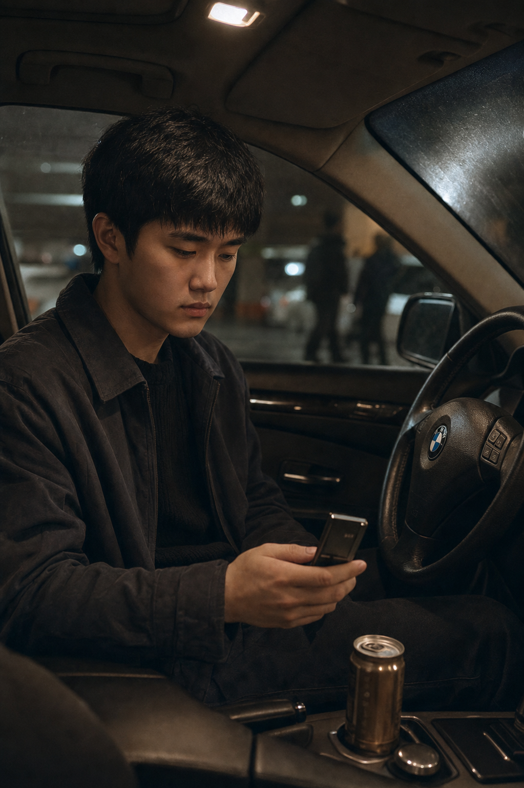

# 120. 이제야 필요해

초연이 말했다.

[김초연] "그럼 내가 한서윤 씨한테 물어볼게."

그 말은 토요일 오후 카페 테이블 위에 내려앉았다. 수원역 뒤쪽, 창가 자리에 앉은 두 사람 사이에는 거의 마시지 않은 커피 두 잔이 놓여 있었다. 창밖으로는 사람들이 두꺼운 가디건과 얇은 코트를 섞어 입고 지나갔다. 계절도 정하지 못한 날씨였다.

용식은 컵 손잡이를 잡았다.

뜨겁지 않았다.

그런데 손끝이 데였다.

[김용식] "뭘 물어봐."

[김초연] "서울 갔던 날."

[김용식] "내가 말했잖아."

[김초연] "네가 말한 거 말고."

초연은 가방에서 폴더폰을 꺼냈다. 화면을 열지는 않았다. 그냥 테이블 위에 올려놓았다. 그 동작만으로도 충분했다. 필요하면 지금이라도 전화를 걸겠다는 뜻이었다.

[김초연] "그 사람한테 직접 물어볼게. 정장 사러 간 거 맞는지. 둘이 있었던 거 맞는지. 몇 시에 헤어졌는지."

용식은 숨을 삼켰다.

몇 시에 헤어졌는지.

그 질문 하나가 호텔 계산서 봉투를 끌고 왔다. 서윤의 가방 안쪽, 영수증, 결제 시간. 초연이 정확한 사실을 모르는 게 오히려 위험했다. 아무 질문이나 던질 수 있었고, 그중 하나가 정답에 가까워질 수 있었다.

[김용식] "그 사람한테까지 이러지 마."

초연의 눈이 차가워졌다.

[김초연] "왜. 불쌍해?"

[김용식] "그런 게 아니라."

[김초연] "나는 안 불쌍해?"

용식은 대답하지 못했다.

초연은 폴더폰을 열었다. 저장된 번호는 없었다. 한서윤의 번호를 모른다. 그 사실이 용식에게 잠깐 숨 쉴 틈을 줬다. 하지만 초연은 방법을 찾을 수 있었다. 학원에 가면 됐다. 학원 앞에서 기다리면 됐다. 접수대에 물어볼 수도 있었다. 그는 그걸 막아야 했다.

[김용식] "내가 다시 설명할게."

[김초연] "너 말고."

짧았다.

[김용식] "초연아."

[김초연] "나 진짜 바보 되기 싫어."

그 말은 조용했지만, 손끝이 떨렸다. 초연은 폴더폰을 닫았다. 닫는 소리가 작게 났다.

[김초연] "내가 걔 앞에서 추한 사람 되는 것도 싫고, 너한테 이렇게 매달리는 사람 되는 것도 싫어. 근데 내가 안 물어보면 너는 또 내가 모르는 데서 끝났다고 생각하잖아."

용식은 입술을 눌렀다.

[김용식] "안 끝났다고 생각해."

[김초연] "그럼 증명해."

증명.

예전에는 좋아한다고 말하면 됐다. 손을 잡으면 됐고, 집에 데려다주면 됐고, 생일에 선물을 주면 됐다. 이제는 아니었다. 증명은 말이 아니라 절차였고, 절차는 다른 사람의 입을 필요로 했다.

용식은 카페를 나와 차에 탔다. 초연은 같이 타지 않았다. 그녀는 오늘 작업실에 간다고 했다. 하지만 용식은 안다. 작업실에만 갈 수도 있고, 학원 앞으로 갈 수도 있다. 사람은 이제 동선 하나로 믿을 수 없었다.

그는 주차장 한쪽에서 서윤에게 전화를 걸었다.

신호가 갔다.

받지 않았다.

두 번째도 받지 않았다.

세 번째에 통화 연결음이 길어지다가 끊겼다.

용식은 폴더폰을 내려다봤다. 부재중 발신 기록이 세 줄 생겼다. 이 기록도 언젠가 문제가 될 수 있었다. 하지만 지금은 기록보다 더 급한 게 있었다.

그는 문자를 보냈다.

[김용식] 통화 가능해요? 급해요.

답장은 오지 않았다.

오후가 저녁으로 바뀌었다. 차 안 유리에는 습기가 조금씩 찼다. 용식은 히터를 켰다. 공기가 뜨거워지자 더 숨이 막혔다. 그는 편의점에서 산 캔커피를 열지도 못한 채 컵홀더에 꽂아 두었다.

초연에게서 문자가 왔다.

[김초연] 월요일 학원 가지?

용식은 눈을 감았다.

[김용식] 응.

[김초연] 나도 갈게.

그는 바로 답하지 못했다.

[김초연] 싫어?

[김용식] 싫은 게 아니라, 네가 힘들까 봐.

보내고 나서 스스로도 웃기지 않았다. 초연이 힘들까 봐. 그 말은 너무 늦게 도착한 배려였다.

[김초연] 내가 힘든 건 네가 신경 쓸 일이 아닌가 봐.

용식은 머리를 핸들에 기대었다.

그때 폴더폰이 다시 떨렸다.

[학원자료] 이제야 필요해?

용식은 화면을 오래 보았다.

답장은 짧았다.

[김용식] 미안해요. 만나서 얘기하고 싶어요.

서윤의 답장은 바로 오지 않았다. 십 분. 이십 분. 삼십 분. 용식은 차 안에서 기다렸다. 주차장 불빛이 앞유리에 희미하게 번졌고, 지나가는 사람들의 발소리가 멀어졌다.

마침내 폴더폰이 울렸다.

[학원자료] 오늘 밤 수원역 계단 아래. 늦지 마.

용식은 시계를 봤다.

초연에게는 집에 들어간다고 해야 했다.

그는 또 사진을 찍어야 했다.

방 사진.

같은 각도.

같은 거짓말.

용식은 시동을 걸었다.

차 안 캔커피는 끝내 따지 않았다.
