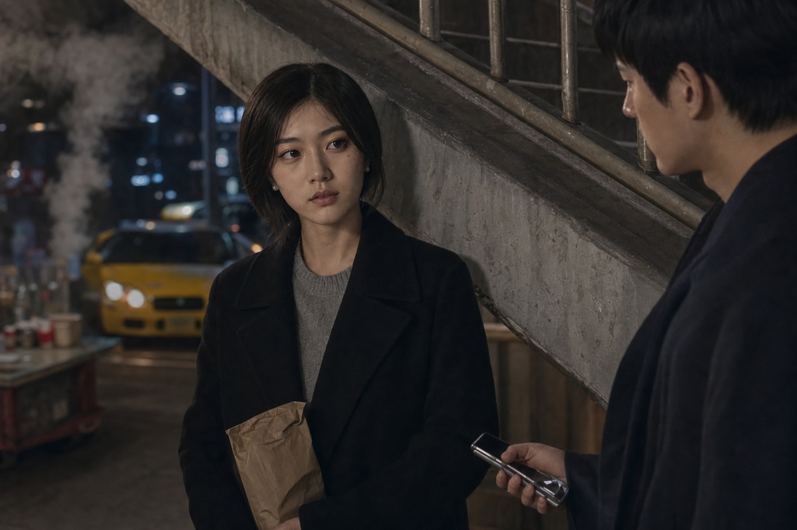

# 121. 계단 아래

수원역 계단 아래는 바람이 모이는 자리였다.

밤 열 시가 조금 넘었고, 계단 위로 오르내리는 사람들의 발소리가 콘크리트 벽에 부딪혀 낮게 울렸다. 역 앞 포장마차에서는 어묵 국물 냄새가 났고, 택시 승강장 쪽으로는 노란 불빛이 길게 번졌다. 용식은 계단 기둥 옆에 서서 폴더폰을 열었다 닫았다.

서윤은 오 분 늦게 왔다.

검은 코트 안에 얇은 회색 니트를 입고 있었다. 머리는 귀 뒤로 넘겨져 있었고, 왼쪽 눈 아래 작은 점이 가로등 아래에서 유난히 또렷했다. 그녀는 숨이 찬 얼굴도 아니었다. 급하게 온 사람처럼 보이지 않았다.

[한서윤] "늦지 말라니까 먼저 와 있긴 하네요."

[김용식] "와 줘서 고마워요."

서윤은 대답하지 않고 계단 난간에 등을 기댔다. 손에는 작은 종이봉투가 들려 있었다. 백화점 로고는 보이지 않았지만, 용식은 그 봉투를 보자마자 목 뒤가 굳었다.

[김용식] "그건..."

[한서윤] "긴장해요?"

[김용식] "그날 거예요?"

서윤은 봉투를 들어 보였다가 다시 내렸다.

[한서윤] "맞으면요?"

용식은 주변을 둘러봤다. 지나가는 사람들은 아무도 그들을 보지 않았다. 그런데도 계단 아래는 너무 밝았다. 그는 서윤에게 한 걸음 가까이 다가가려다가 멈췄다.

[김용식] "초연이가 월요일에 학원으로 온대요."

[한서윤] "알아요. 그래서 나한테 전화 세 번 했고."

[김용식] "서윤 씨."

[한서윤] "이름 부르는 거 오랜만이네."

말끝이 차가웠다. 용식은 입술을 눌렀다. 학원 복도에서 그녀를 모르는 사람처럼 지나치던 자기 모습이 너무 선명하게 떠올랐다. 그때는 초연의 얼굴만 보였다. 서윤이 어떤 표정으로 서 있었는지는 제대로 보지도 않았다.

[김용식] "미안해요. 그날은..."

[한서윤] "그날만요?"

서윤은 웃었다. 웃음은 짧았고, 따뜻하지 않았다.

[한서윤] "도쿄에서 먼저 돌아왔을 때도, 나한테는 네가 뭐라고 생각했는지 말 안 했어요. 귀국하고 학원에 왔을 때도, 술 마실 때도, 서울 갈 때도. 필요한 순간마다 잘해 주고, 필요 없는 순간에는 조용히 지워요."

용식은 말문이 막혔다.

그녀가 틀린 말을 하지 않아서였다.

계단 위에서 누군가 웃으며 내려왔다. 두 남학생이 담배 냄새를 풍기며 지나갔다. 서윤은 그들이 완전히 멀어진 뒤에야 다시 말했다.

[한서윤] "그래서 오늘은 뭐가 필요한데요?"

[김용식] "서울 갔던 날 얘기요."

[한서윤] "정장 사러 갔다고 말했잖아요."

[김용식] "초연이가 직접 물어본대요. 둘이 있었는지, 몇 시에 헤어졌는지."

서윤의 눈이 조금 가늘어졌다.

[한서윤] "몇 시에 헤어졌는지."

그녀는 그 말을 천천히 따라 했다. 용식은 고개를 떨구었다. 그 질문은 둘 사이에서 이미 답을 알고 있는 질문이었다. 백화점 지하주차장, 쇼핑백, 계산서 봉투, 서울 밤거리의 간판, 다음 날 아침 탁자 위에 놓인 물컵. 모든 것이 말없이 계단 아래에 서 있었다.

[김용식] "그건 말하면 안 돼요."

[한서윤] "누구한테요?"

[김용식] "초연이한테."

[한서윤] "그럼 나한테는 말해도 되는 거고?"

용식은 눈을 들었다.

서윤은 봉투를 양손으로 잡고 있었다. 손가락 끝이 종이를 살짝 구기고 있었다. 그녀는 화난 사람처럼 소리를 높이지 않았다. 오히려 너무 차분해서 더 피할 곳이 없었다.

[한서윤] "내가 거짓말해 주면, 네 여자친구는 이번엔 넘어가겠죠. 그럼 너는 또 한동안 착한 남자친구처럼 굴고, 나는 학원자료로 돌아가고."

[김용식] "그렇게 안 할게요."

[한서윤] "그 말을 내가 왜 믿어야 해요?"

용식은 대답을 찾지 못했다. 돈으로 달래는 건 이제 통하지 않았다. 귀걸이도, 정장도, 가방도 이미 증거가 됐다. 선물은 마음을 보여 주기도 했지만, 동시에 숨겨야 할 물건이 됐다.

서윤은 봉투를 가방 안에 넣었다.

[한서윤] "오빠가 있었다고 하면 돼요."

용식은 고개를 들었다.

[김용식] "오빠요?"

[한서윤] "지방에서 올라온 오빠를 태우고 백화점에 갔다고요. 오빠 면접 준비도 있고, 내 옷도 같이 봤다고 하면 주차권이랑 백화점은 설명되잖아요."

용식은 그 말을 듣는 순간 안도보다 먼저 불안이 왔다. 너무 구체적이었다. 구체적인 거짓말은 잠깐 사람을 살리지만, 오래 남았다.

[김용식] "초연이가 오빠를 물어보면요?"

[한서윤] "있다고 하면 되죠."

[김용식] "진짜 있어요?"

서윤은 그를 빤히 봤다.

[한서윤] "이제 와서 진짜가 중요해요?"

용식은 아무 말도 못 했다.

서윤은 계단 아래를 스쳐 가는 바람에 코트 앞섶을 여몄다. 그 동작이 이상하게 멀어 보였다. 그는 그녀가 자기 곁에 있어도, 이미 한 걸음 뒤로 물러나 있는 사람처럼 느꼈다.

[김용식] "부탁할게요."

[한서윤] "부탁은 들었어요."

[김용식] "그럼..."

[한서윤] "대신 조건 있어요."

용식은 숨을 멈췄다.

서윤은 계단 위쪽을 봤다. 전광판 불빛이 그녀 얼굴 옆으로 흐릿하게 지나갔다.

[한서윤] "나 요즘 면접 계속 떨어져요. 계약도 곧 끝나고, 집에서는 눈치 주고. 너는 내가 필요할 때마다 예쁜 말하고, 필요 없어지면 아무 말도 안 하죠."

[김용식] "서윤 씨."

[한서윤] "겨울에 일본 간다면서요."

용식의 손이 폴더폰을 꽉 쥐었다.

[한서윤] "나도 데려가요."

말은 조용했다.

그래서 더 무거웠다.

용식은 바로 대답하지 못했다. 초연에게는 혼자 학교 프로그램 때문에 간다고 해야 했다. 유즈키에게는 겨울에 다시 가겠다고 이미 약속했다. 그리고 지금 서윤은 그 겨울 속으로 들어오겠다고 말하고 있었다.

[한서윤] "비용은 네가 내요. 나한테 거짓말 시키는 값이라고 생각해도 되고, 우리 사이를 이번엔 진짜로 정하는 값이라고 생각해도 돼요."

[김용식] "일본은..."

[한서윤] "싫으면 말해요. 나도 월요일에 그냥 아는 만큼 말하면 되니까."

용식은 계단 아래 찬 바람 속에서 그녀를 봤다.

서윤은 기다렸다.

이번에는 지워지는 사람이 아니라, 답을 받을 사람의 얼굴로.
