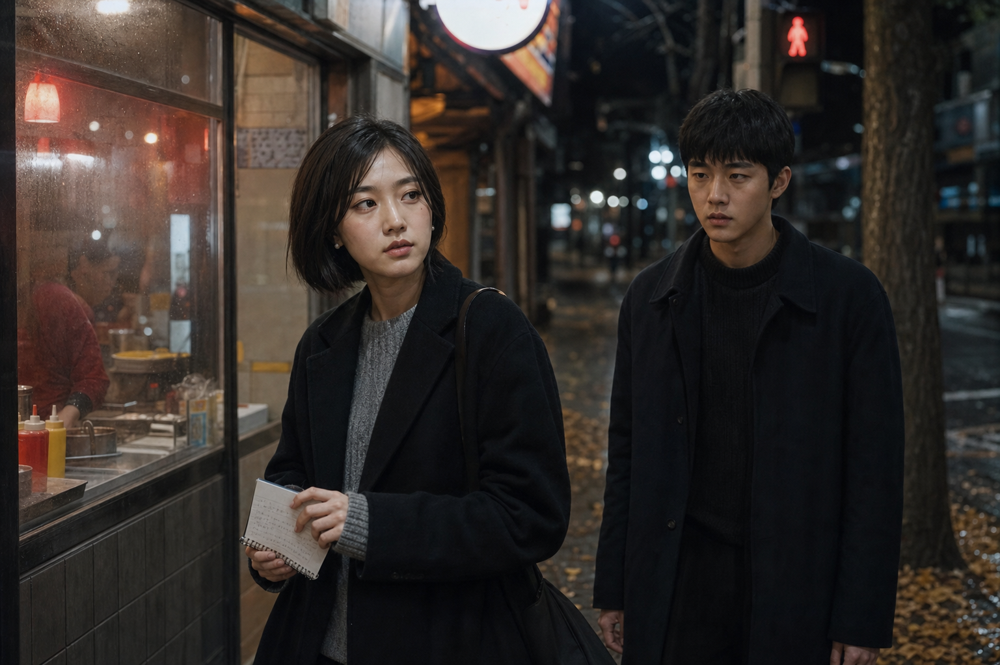

# 122. 오빠가 있었다

서윤은 먼저 걷기 시작했다.

수원역 뒤쪽 골목은 주말 밤이어서 술집 간판이 켜져 있었고, 길가에 세워진 오토바이 사이로 젖은 낙엽이 붙어 있었다. 용식은 그녀보다 반 걸음 뒤에서 걸었다. 예전 같으면 옆으로 나란히 붙었을 거리였다. 오늘은 그 반 걸음이 너무 멀었다.

[김용식] "보름은 길어요."

[한서윤] "내가 길게 가자고 했어요?"

[김용식] "아니, 그게 아니라..."

[한서윤] "네가 먼저 길게 말했잖아요. 겨울에 일본 간다고."

용식은 멈췄다. 서윤도 몇 걸음 앞에서 멈췄다. 그녀는 돌아서지 않은 채 말했다.

[한서윤] "도쿄든 어디든 상관없어요. 나한테는 네가 나를 숨기지 않고 같이 가는지가 중요해요."

그 말이 오히려 더 아팠다. 용식은 도쿄를 떠올리지 않으려 했다. 나고야라는 이름도 밀어냈다. 유즈키의 이메일, 눈 오는 도쿄를 같이 보고 싶다던 리스트의 마지막 줄, 나리타 공항 게이트 앞에서 울던 얼굴. 밀어낼수록 더 또렷해졌다.

[김용식] "일본어 어학연수 겸 여행으로 가요. 겨울방학 시작하고. 보름 정도."

서윤이 천천히 돌아섰다.

[한서윤] "나랑?"

[김용식] "네."

[한서윤] "여자친구한테는?"

용식은 입을 다물었다.

서윤은 답을 이미 알고 있었다는 얼굴이었다.

[한서윤] "혼자 간다고 하겠네요."

[김용식] "학교 프로그램이라고..."

[한서윤] "거짓말도 참 성실하게 해요."

말에 웃음기가 없었다. 용식은 변명하지 못했다. 변명하면 더 초라해질 것 같았다.

그들은 작은 분식집 앞에 섰다. 문틈으로 김이 새어 나왔고, 안쪽 텔레비전에서는 주말 예능 소리가 작게 들렸다. 서윤은 들어가지 않았다. 유리창에 비친 두 사람 사이에는 간판 불빛이 한 줄 들어와 있었다.

[한서윤] "월요일에 뭐라고 할지 정리해요."

[김용식] "오빠 얘기요?"

[한서윤] "응."

서윤은 가방에서 낡은 수첩을 꺼냈다. 면접 일정과 연락처가 적힌 듯한 페이지 사이에 빈 줄이 몇 개 있었다. 그녀는 볼펜을 꺼내더니 아무렇지 않게 적었다.

지방에서 올라온 오빠.

백화점.

면접 옷.

같이 차를 탔다.

그 네 줄이 원고처럼 보였다. 용식은 그 글씨를 내려다보며 목 안이 마르는 걸 느꼈다.

[김용식] "오빠 이름은요?"

[한서윤] "한지훈."

[김용식] "진짜..."

서윤이 고개를 들었다.

[한서윤] "있냐고요?"

용식은 대답하지 않았다.

[한서윤] "오빠는 있어요. 근데 지방에서 올라온 적은 없고, 그날 백화점에 간 적도 없어요. 이름까지 진짜면 캐물어도 조금 버티겠죠."

그녀는 수첩을 접었다.

[한서윤] "거짓말은 전부 가짜로 만들면 금방 티 나요. 진짜를 조금 섞어야 오래 가요. 너한테 배웠어요."

용식은 그 말에 맞을 수밖에 없었다.

[김용식] "서윤 씨가 그렇게까지 할 필요 없어요."

[한서윤] "없죠."

서윤은 작게 숨을 내쉬었다.

[한서윤] "근데 내가 안 하면 너는 나한테 또 연락 안 할 거잖아요. 월요일 지나면. 그래서 하는 거예요. 네가 나를 필요로 하는 순간을 내가 그냥 흘려보내기 싫어서."

용식은 그녀를 봤다. 서윤은 차갑게 굴고 있었지만, 그 밑에는 상처가 그대로 있었다. 자존심으로 잘 접어 둔 상처였다. 손끝으로 누르면 아직 뜨거운.

[김용식] "겨울에 같이 가요."

[한서윤] "비행기표부터 보여줘요."

[김용식] "바로 예매할게요."

[한서윤] "호텔도요."

[김용식] "네."

[한서윤] "이번엔 3박 이런 거 말고."

용식의 눈이 흔들렸다.

[한서윤] "보름이라고 했잖아요."

[김용식] "서윤 씨 일정도 있고..."

[한서윤] "내 일정 걱정은 내가 해요."

서윤은 다시 걸었다. 용식은 그녀를 따라갔다. 골목 끝 횡단보도 앞에서 신호가 빨간색이었다. 두 사람은 나란히 섰지만 손을 잡지 않았다. 예전에는 그런 틈을 서윤이 먼저 파고들었다. 오늘은 아무것도 하지 않았다.

그게 더 불안했다.

[한서윤] "그리고 월요일에 내가 너무 잘해 주길 바라지 마요."

[김용식] "무슨 뜻이에요?"

[한서윤] "너 살려 주려고 나까지 바보처럼 보일 생각은 없다는 뜻."

보행자 신호가 바뀌었다.

서윤은 건너지 않았다.

[한서윤] "나는 딱 필요한 만큼만 말할 거예요. 오빠가 같이 탔다. 지방에서 올라왔다. 백화점에서 오빠 옷도 보고 내 옷도 봤다. 그 이상 물으면 내가 왜 너희 커플 싸움에 끼어야 하냐고 할 거고."

[김용식] "초연이가 호텔 얘기를 하면..."

서윤의 눈이 멈췄다.

[한서윤] "그 얘기는 네가 막아야죠."

용식은 아무 말도 못 했다.

[한서윤] "내가 서울 백화점까지는 설명해 줄 수 있어요. 주차권도, 정장도, 가방도. 근데 호텔은 내 입으로 덮으면 내가 너무 불쌍하잖아요."

그 말은 조용했지만, 용식의 귓속에 오래 남았다.

택시 한 대가 물웅덩이를 밟고 지나갔다. 튄 물이 보도블록 끝을 적셨다. 서윤은 뒤로 한 걸음 물러났다.

[한서윤] "월요일 학원 끝나고, 초연 씨가 오면 내가 말할게요."

[김용식] "고마워요."

[한서윤] "고맙다는 말은 겨울 표 보여주고 해요."

서윤은 신호가 다시 바뀌자 건너편으로 걸어갔다. 용식은 따라가지 않았다. 폴더폰을 열어 초연에게 보낼 집 사진을 찍어야 했다. 방에 들어간 척해야 했다. 서윤에게는 일본 일정표를 보내야 했다.

한 화면에는 여자친구가 있었다.

다른 화면에는 위증을 해 줄 사람이 있었다.

그리고 아직 열지 않은 이메일함에는, 겨울을 믿는 사람이 있었다.
