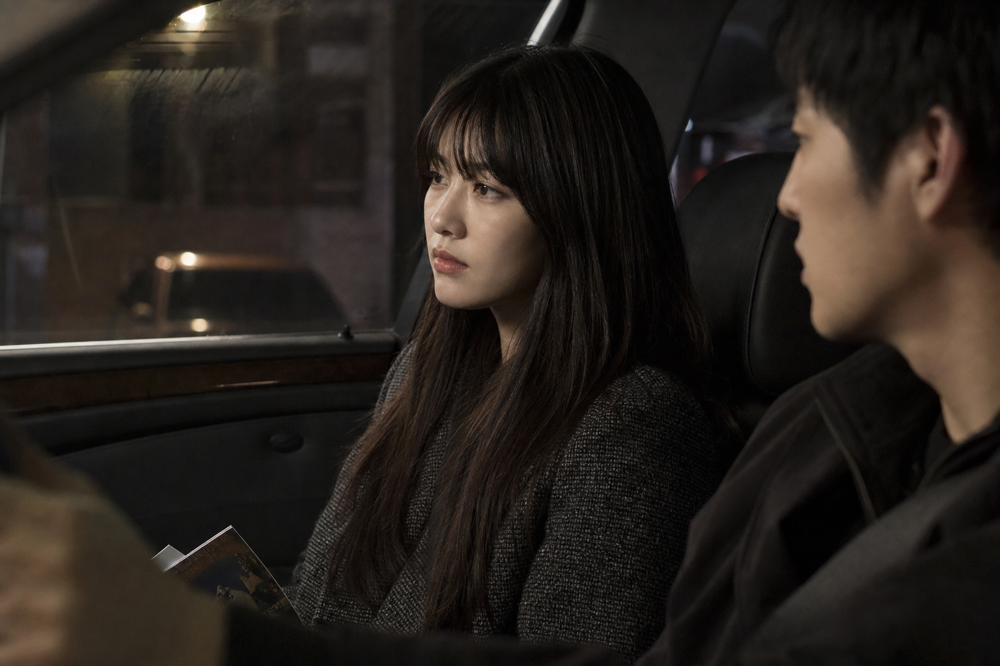

# 124. 이번엔 넘어가 줄게

차 안은 말이 없었다.

수원역에서 초연의 집으로 가는 길은 몇 번이나 지나온 길이었다. 어디에서 신호가 길게 걸리는지, 어느 골목 앞에서 버스가 갑자기 끼어드는지, 어느 편의점 앞에 밤마다 택시가 서 있는지 용식은 거의 외우고 있었다. 그런데 오늘은 길이 낯설었다.

초연은 조수석 창밖을 보고 있었다.

손에는 학원 로비에서 집어 들었다가 다시 내려놓았던 겨울방학 전단지가 들려 있었다. 언제 챙겼는지 용식은 보지 못했다. 종이 모서리가 그녀 손가락 사이에서 접혔다 폈다.

[김용식] "그거 왜 가져왔어."

[김초연] "읽어보려고."

[김용식] "일본어 할 거야?"

[김초연] "아니."

그녀는 전단지를 무릎 위에 내려놓았다.

[김초연] "너 겨울에도 일본 간다며."

용식은 핸들을 잡은 손에 힘을 줬다. 아직 말한 적 없는 내용이었다. 아니, 정확히는 언젠가 지나가듯 말했을 수도 있었다. 겨울에 다시 공부할 수도 있다고. 학교 프로그램을 알아본다고. 그는 자신이 어떤 말까지 했는지 순간적으로 기억을 더듬어야 했다.

[김용식] "아직 확정 아니야."

[김초연] "그럼 왜 자꾸 찾아봐."

[김용식] "일본어 공부 계속하려고."

[김초연] "학교 프로그램이라며."

용식은 대답이 반 박자 늦었다.

초연은 그 반 박자를 놓치지 않았다.

[김초연] "이제는 그런 것도 확인하게 되네."

말끝이 지쳐 있었다. 화라기보다 피로였다. 용식은 그 피로가 더 무서웠다. 초연이 화를 내면 붙잡을 말이라도 있었다. 지쳐 버리면, 잡을 곳이 사라졌다.

[김용식] "진짜 알아보는 중이야. 교환학생 준비도 있고, 인터뷰도 있고."

[김초연] "겨울방학 보름?"

용식은 시선을 앞에 고정했다.

[김용식] "그 정도 될 것 같아."

[김초연] "혼자?"

이번에는 바로 대답해야 했다.

[김용식] "응. 혼자."

말은 부드럽게 나갔다.

그래서 더 더러웠다.

초연은 고개를 끄덕였다. 믿어서가 아니라 기록해 두는 사람처럼. 그녀는 폴더폰을 열어 자기 일정표에 무언가를 적었다. 버튼음이 차 안에서 작게 울렸다.

[김초연] "학교 프로그램이면 서류 있겠네."

[김용식] "나오면 보여줄게."

[김초연] "나오면 말고. 신청하면."

용식은 입술 안쪽을 씹었다. 학교 프로그램이라는 말은 아직 모양도 없었다. 만들어야 했다. 전단지든, 학과 사무실 공지든, 교수님 상담이든, 무엇이든 겉으로 확인 가능한 무언가가 필요했다.

초연은 그의 옆얼굴을 봤다.

[김초연] "나도 이상한 거 알아."

용식은 그녀를 봤다.

[김초연] "내가 이렇게까지 하는 거. 학원 앞에 가고, 사진 각도 보고, 누구랑 밥 먹었는지 묻고. 나도 내가 싫어."

[김용식] "초연아."

[김초연] "근데 네가 날 그렇게 만들었잖아."

차는 빌라 골목 앞에 멈췄다. 초연은 바로 내리지 않았다. 전단지를 접어 가방 안에 넣고, 손잡이에 손을 얹었다. 용식은 그녀의 손등을 봤다. 잡아도 되는지 알 수 없었다.

[김용식] "오늘 와 줘서 고마워."

초연은 작게 웃었다.

[김초연] "나한테 고맙다고 하지 마. 내가 고마운 일 한 거 아니야."

[김용식] "그래도..."

[김초연] "나 이번엔 넘어가 줄게."

그 말이 다시 나왔다.

이번엔.

용식은 그 말이 유예라는 걸 알았다. 용서가 아니었다. 초연은 안전벨트를 풀었다. 딸깍 하는 소리가 차 안을 갈랐다.

[김초연] "근데 너 일본 가는 거, 내가 확인할 거야."

[김용식] "알겠어."

[김초연] "그리고 한서윤 씨랑 따로 연락하지 마."

용식은 숨을 삼켰다.

[김초연] "할 일이 있으면 내 앞에서 해. 학원 얘기든 뭐든."

[김용식] "응."

초연은 문을 열었다. 찬 공기가 들어왔다. 그녀는 내리기 전 잠깐 멈춰 서서 말했다.

[김초연] "너 오늘 집 들어가서 방 사진 보내."

[김용식] "알겠어."

[김초연] "각도 바꾸지 말고."

문이 닫혔다.

용식은 그녀가 빌라 현관으로 들어갈 때까지 기다렸다. 손이 폴더폰 쪽으로 갔다가 멈췄다. 방 사진을 보내야 했다. 서윤에게는 표를 보여줘야 했다. 유즈키에게는 겨울 약속을 계속 믿게 해야 했다.

그는 차를 돌렸다.

집으로 가는 길에 폴더폰이 또 울렸다.

[학원자료] 오늘 잘했죠. 이제 네 차례예요.

용식은 답장을 쓰지 못했다.

신호등 앞에 멈춘 차 안에서, 그는 조수석에 남은 전단지 냄새를 맡았다. 종이와 향수와 히터 바람이 섞여 있었다. 초연이 두고 간 건 전단지가 아니었다.

확인할 권리였다.
