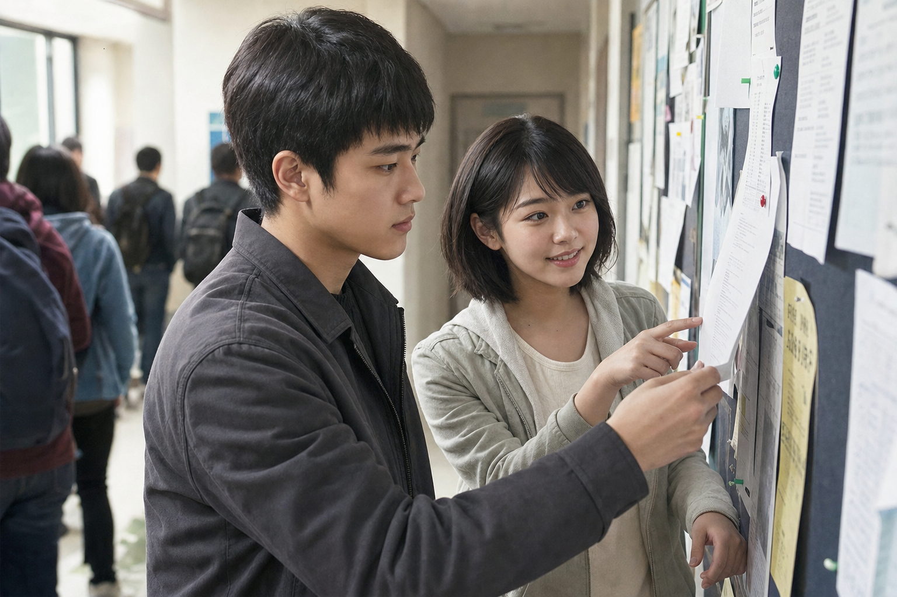

# 125. 프로그램이라는 말

화요일 아침, 학과 사무실 앞 게시판에는 겨울방학 공지가 빽빽하게 붙어 있었다.

전공 자격증 특강, 토익 단기반, 해외 어학 프로그램 설명회, 학과 MT 정산 안내. 색이 다른 A4 용지들이 압정으로 겹쳐 있었고, 오래된 종이는 모서리가 말려 있었다. 용식은 사람들 사이에 서서 일본 관련 공지를 찾았다.

진짜가 필요했다.

완전한 진짜가 아니어도 됐다. 초연에게 보여 줄 수 있는 종이 한 장. 학교 이름이 박혀 있고, 신청 기간과 담당자 연락처가 적힌 무언가. 거짓말은 이제 말만으로 버티지 못했다.

정다은이 옆에 섰다.

[정다은] "뭐 찾아?"

용식은 고개를 돌리지 않았다.

[김용식] "공지."

[정다은] "공지판 앞에서 공지 찾는 건 너무 정상적이라 재미없는데."

[김용식] "그럼 그냥 가."

다은은 가지 않았다. 그녀는 게시판에 붙은 일본어 어학 프로그램 안내문을 보고 눈을 가늘게 떴다.

[정다은] "또 일본 가?"

용식의 손이 멈췄다.

[김용식] "또라니."

[정다은] "지난 여름에도 갔잖아."

[김용식] "공부하러."

[정다은] "이번에도 공부하러."

다은은 말끝을 올리지 않았다. 질문처럼 들리지 않게 일부러 눌러 말했다. 용식은 안내문 한 장을 떼려다가 압정이 잘 빠지지 않아 손톱 끝으로 밀었다.

[정다은] "초연이는 알아?"

[김용식] "알아."

[정다은] "혼자 간대?"

용식은 그녀를 봤다.

다은은 눈웃음을 지었다. 귀여운 얼굴로, 정확히 아픈 곳만 골라 밟았다.

[김용식] "너는 모르는 일에 너무 관심 많다."

[정다은] "네 얼굴이 알려 주니까."

[김용식] "얼굴 얘기 그만해."

[정다은] "그럼 표정 관리해."

그녀는 안내문 아래쪽 신청 기간을 손가락으로 짚었다.

[정다은] "학교 프로그램은 설명회 먼저 듣고 신청서 내야 하네. 너 이런 거 안 좋아하잖아. 귀찮은 절차."

용식은 종이를 떼어냈다. 압정이 손끝을 긁고 지나가 작게 따끔했다.

[김용식] "필요하면 해야지."

[정다은] "누구한테 보여 주려고?"

그는 종이를 접지 않고 가방에 넣었다.

[김용식] "수업 늦는다."

다은은 그를 따라 강의실 쪽으로 걸었다. 복도 창문 밖으로 늦가을 햇빛이 들어와 바닥에 네모난 빛을 만들었다. 학생들이 두꺼운 후드집업과 점퍼를 입고 지나갔다. 캠퍼스는 기말고사 전 특유의 피로한 소리로 가득했다.

[정다은] "너 요즘 진짜 숨 막혀 보여."

[김용식] "그 얘기도 그만."

[정다은] "싫으면 그만할게."

말과 달리 그녀는 멈추지 않았다.

[정다은] "근데 네가 숨 막히는 걸 내가 모르는 척해 주면, 그건 착한 거야?"

용식은 강의실 문 앞에서 멈췄다.

[김용식] "다은아."

이름이 나가자 다은의 표정이 아주 조금 변했다. 장난이 빠졌다.

[김용식] "그날 차 안 일, 네가 계속 꺼내면 진짜 더 못 봐."

다은은 고개를 끄덕였다.

[정다은] "알겠어."

너무 쉽게 물러났다.

그게 더 불안했다.

강의가 시작되고도 용식은 가방 속 안내문을 의식했다. 교수의 목소리는 칠판 앞에서 흘러갔고, 노트에는 의미 없는 선만 그어졌다. 폴더폰은 진동 모드였다. 진동이 한 번 울릴 때마다 심장이 먼저 반응했다.

쉬는 시간에 초연에게서 문자가 왔다.

[김초연] 오늘 공지 확인했어?

용식은 복도 끝 창가로 나갔다.

[김용식] 응. 학교 겨울 단기 프로그램 있더라.

[김초연] 사진 보내.

그는 가방에서 안내문을 꺼내 복도 벽에 붙여 사진을 찍었다. 화면 속 종이는 빛 때문에 조금 반사됐다. 그는 다시 찍었다. 각도. 초점. 글씨.

예전에는 초연에게 잘 나온 사진을 보내고 싶었다.

이제는 의심받지 않을 사진을 보내야 했다.

[김용식] 보냈어.

답장은 금방 왔다.

[김초연] 신청서도 내면 보여줘.

용식은 한참 화면을 봤다.

수업 종이 울렸다. 복도 사람들이 움직였다. 다은은 강의실 문 옆에 기대어 그를 보고 있었다. 아무 말도 하지 않았다. 하지만 그 침묵이 더 많은 말을 했다.

용식은 폴더폰을 닫고 강의실로 들어갔다.

책상 아래에서 진동이 다시 울렸다.

[학원자료] 표는요?

그는 답하지 않았다.

다시 울렸다.

[학원자료] 거짓말 값, 너무 싸게 치면 나 서운해요.

용식은 폴더폰을 주머니 깊숙이 밀어 넣었다.

칠판에는 교수의 글씨가 쌓이고 있었다.

그런데 용식의 머릿속에는 프로그램 안내문과 비행기표와 나고야라는 지명이 한꺼번에 겹쳐졌다.

학교 프로그램이라는 말은 이제 핑계가 아니라 만들어야 할 현실이 됐다.
