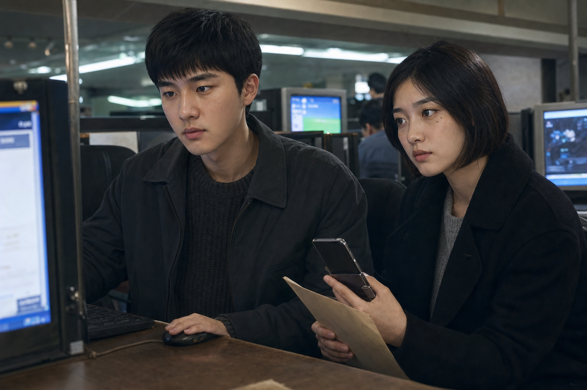

# 126. 보름의 값

예매 화면은 PC방 모니터에서 더 차갑게 보였다.

수원역 뒤쪽 2층 PC방은 평일 저녁인데도 절반쯤 차 있었다. 카트라이더 효과음, 스타크래프트 유닛 소리, 라면 물 끓는 소리가 천장에 걸려 있었다. 용식은 구석 자리에서 인터넷 창을 두 개 띄워 놓고 있었다. 하나는 항공권, 하나는 일본 호텔 예약 사이트였다.

서윤은 옆자리에 앉아 있었다.

그녀는 화면을 보면서도 몸을 멀리 뺐다. 예전처럼 어깨를 기대지도 않았고, 손끝으로 마우스 잡은 손을 건드리지도 않았다. 그 거리 때문에 용식은 더 초조했다.

[한서윤] "도쿄로 가네요."

[김용식] "도쿄가 프로그램이 많아서요."

[한서윤] "나고야도 간다면서요?"

용식의 손가락이 마우스 위에서 멈췄다.

[김용식] "언제 그런 말을..."

[한서윤] "지난번에 일본 얘기하다가 했어요. 나고야도 괜찮다고."

그녀는 화면에서 시선을 떼지 않았다.

용식은 숨을 조절했다. 서윤은 유즈키를 모른다. 나고야라는 말은 그저 지역 이름이어야 했다. 그런데 그 이름 하나가 너무 많은 걸 품고 있었다.

[김용식] "도쿄로 들어갔다가 하루 이틀 갈 수도 있죠. 관광으로."

[한서윤] "그럼 나도 같이 가는 거죠?"

용식은 바로 대답했다.

[김용식] "네."

서윤이 그를 봤다.

이번에는 늦지 않은 대답이었지만, 그녀는 믿는 얼굴이 아니었다.

[한서윤] "숙소는 같은 곳?"

[김용식] "방은..."

그는 말을 멈췄다. 성급하게 가까움을 약속하면 서윤이 더 멀어질 것 같았고, 따로 방을 잡겠다고 하면 거래처럼 보일 것 같았다. 둘 사이에는 이미 그런 밤들이 있었다. 그런데 지금 같은 화면 앞에서는 그 사실도 쉽게 말할 수 없었다.

[한서윤] "말을 왜 골라요."

[김용식] "서윤 씨가 불편할까 봐요."

[한서윤] "불편한 건 방이 아니라 너예요."

용식은 웃지 못했다.

서윤은 모니터를 가리켰다.

[한서윤] "예약해요. 같은 호텔. 방은 가서 정해요. 내가 그때 싫으면 싫다고 할 거고, 네가 숨기려고 하면 내가 알아서 나올 거예요."

[김용식] "알겠어요."

용식은 항공권 날짜를 선택했다. 겨울방학이 시작되는 12월 말, 보름 일정. 출발지 인천, 도착지 도쿄. 돌아오는 날짜를 찍는 순간 초연의 얼굴이 떠올랐다. 공항에서 울던 얼굴. 이번에도 배웅하겠다고 할 가능성이 컸다.

그는 좌석 두 개를 선택했다.

결제 금액이 떴다.

서윤은 금액을 보고도 놀라지 않았다. 오히려 조용해졌다.

[한서윤] "너는 진짜 이런 걸 아무렇지 않게 하네."

[김용식] "아무렇지 않은 건 아니에요."

[한서윤] "그래 보여요."

용식은 카드 정보를 입력했다. 손이 낯설게 느껴졌다. 돈은 충분했다. 문제는 돈이 아니었다. 돈으로 산 것은 항공권이 아니라, 다음 거짓말의 날짜였다.

결제 완료 화면이 떴다.

서윤은 그 화면을 폴더폰 카메라로 찍었다.

[김용식] "그걸 왜 찍어요."

[한서윤] "나한테도 증거가 있어야죠."

[김용식] "내가 안 갈까 봐요?"

[한서윤] "너는 가요. 대신 누구랑 가는지 계속 바꾸니까."

용식은 할 말이 없었다.

호텔 예약도 이어졌다. 도쿄 시내, 역에서 멀지 않은 곳. 보름 치 숙박비는 생각보다 컸다. 하지만 그는 망설이는 모습을 보이지 않으려 했다. 서윤은 그런 태도를 싫어하면서도, 동시에 그가 자신을 위해 망설이지 않는 걸 확인하고 싶어 했다.

예약 확인 메일 주소를 입력할 때, 용식은 순간 멈췄다.

유즈키와 주고받는 이메일 계정이 떠 있었다.

그는 황급히 다른 주소를 입력했다.

서윤은 봤다.

아무 말도 하지 않았다.

그 침묵이 더 무서웠다.

[한서윤] "방금 뭐였어요?"

[김용식] "자동 완성 떠서요."

[한서윤] "누구 메일인데요?"

[김용식] "예전에 쓴 거예요."

서윤은 더 묻지 않았다. 대신 의자를 뒤로 밀었다. 바퀴가 바닥을 긁었다.

[한서윤] "오늘은 여기까지."

[김용식] "잠깐만요. 예약 확인서 출력해서..."

[한서윤] "그건 초연 씨한테 보여줄 거 만들 때 필요하겠죠."

그녀는 가방을 들었다.

[한서윤] "나한테는 이미 봤어요."

PC방 계단을 내려가는 동안 둘은 나란히 걷지 않았다. 밖은 차가웠고, 길 건너 버스정류장에는 사람들이 목을 움츠리고 서 있었다. 서윤은 횡단보도 앞에서 멈췄다.

[한서윤] "나 이번엔 믿는 척할게요."

[김용식] "서윤 씨."

[한서윤] "믿는 게 아니라, 믿는 척."

그녀는 손에 든 폴더폰을 가방 안에 넣었다.

[한서윤] "그 차이 알아둬요."

신호가 바뀌었다.

서윤은 건너갔다.

용식은 그 자리에서 한참 서 있었다. 주머니 속 폴더폰이 울렸다. 초연이었다.

[김초연] 집이야?

그는 PC방 간판 아래에서 고개를 들었다. 2층 창문 너머 모니터 불빛들이 낡은 수족관처럼 번쩍이고 있었다.

그는 답장을 썼다.

[김용식] 응. 과제 자료 찾고 바로 들어왔어.

보름의 값은 방금 결제됐다.

그런데 거짓말은 아직 시작도 안 했다.
