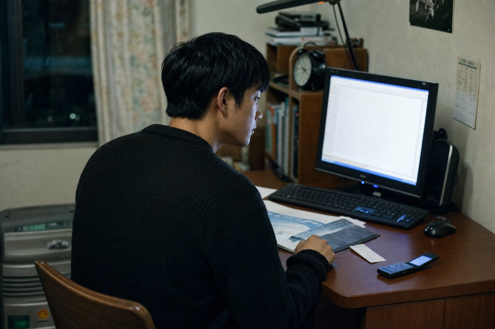

# 127. 나고야에서 온 답장

유즈키의 이메일은 새벽 한 시 십칠분에 도착했다.

용식은 방 불을 끄지 못한 채 책상 앞에 앉아 있었다. 모니터에는 학교 겨울 단기 프로그램 안내문을 편집한 파일이 열려 있었고, 옆에는 도쿄 항공권 예약 확인서가 접힌 채 놓여 있었다. 방 안은 히터 때문에 건조했고, 책상 위 물컵은 반쯤 비어 있었다.

메일 알림이 뜨자 그는 마우스를 움직였다.

보낸 사람 이름은 나카타 유즈키였다.

그는 한동안 클릭하지 못했다.

초연에게 보낼 자료.

서윤에게 보여 준 표.

유즈키가 기다리는 겨울.

세 개의 겨울이 같은 책상 위에 놓였다.

메일을 열었다.

[나카타 유즈키] 용식 씨, 나고야는 밤이 빨리 추워졌어요. 아버지 가게 앞에도 저녁이면 김이 많이 나요. 도쿄보다 조용해서 처음엔 이상했는데, 요즘은 조금 익숙해졌어요. 그래도 가끔 역 앞 불빛을 보면 도쿄 생각이 나요. 우리 같이 걸었던 길도 생각나요.

문장은 서툴렀지만 정성스러웠다. 일본어 문장 사이사이에 한글 단어가 섞여 있었다. 겨울, 약속, 눈. 그녀가 천천히 찾아 쓴 단어들이 화면 위에서 조금씩 빛났다.

[나카타 유즈키] 겨울에 정말 올 수 있어요? 도쿄가 아니어도 괜찮아요. 나고야도 괜찮으면, 내가 안내할게요. 두부 가게도 보여주고 싶어요. 아버지는 아직 몰라요. 그냥 한국 친구라고 말할게요. 그런데 나, 그날 게이트 앞에서 물어보지 않은 것들이 요즘 생각나요. 용식 씨가 한국에서 누구에게 선물을 샀는지, 왜 가끔 대답이 늦었는지. 그래도 겨울에 만나면 그때 물어볼게요.

용식은 손을 멈췄다.

물어보지 않은 것들.

유즈키는 모르는 척한 것이지, 아무것도 느끼지 못한 사람이 아니었다. 나리타 공항 상점가에서 초연에게 줄 립밤과 화과자를 고르던 순간, 그녀는 캐묻지 않았지만 봤다. 그 침묵이 시간이 지나 나고야까지 따라간 것이다.

그는 답장을 쓰려 했다.

손이 키보드 위에서 멈췄다.

무슨 말을 써야 할까.

겨울에 갈게.

진짜 보고 싶어.

나고야도 좋아.

그 모든 말은 사실이었다. 동시에 다른 두 사람을 속이는 말이었다.

폴더폰이 울렸다.

[김초연] 자?

용식은 모니터 오른쪽 아래 시계를 봤다. 새벽 한 시 반. 초연은 이 시간에도 깨어 있었다.

[김용식] 아직. 과제 정리 중.

[김초연] 방 사진.

그는 의자에서 일어났다. 침대, 책상, 모니터를 찍으면 이메일 화면이 걸릴 수 있었다. 그는 모니터를 끄고, 책상 위 예약 확인서를 서랍에 밀어 넣었다. 그 움직임이 너무 익숙해져 있었다.

찰칵.

폴더폰 카메라 소리가 방 안에 울렸다.

[김용식] 보냈어.

초연의 답장은 바로 오지 않았다. 용식은 다시 모니터를 켰다. 유즈키의 메일 화면이 어둠 속에서 다시 떠올랐다.

그는 답장을 썼다.

[김용식] 유즈키 씨, 메일 고마워요. 나고야도 좋아요. 겨울에 꼭 갈게요. 두부 가게도 보고 싶어요. 추우니까 감기 조심해요.

문장을 쓰는 동안 손이 몇 번이나 멈췄다. 꼭 갈게요. 그는 그 말을 지우지 않았다.

전송 버튼을 누르기 직전, 초연에게서 답장이 왔다.

[김초연] 모니터는 왜 꺼져 있어?

용식은 심장이 내려앉았다.

방 사진 속 책상 위 검은 모니터. 초연은 그것까지 봤다.

[김용식] 눈 아파서 꺼놨어.

[김초연] 과제 정리 중이라며.

그는 답장을 쓰지 못했다.

모니터에는 유즈키에게 보내는 메일이 아직 전송되지 않은 채 떠 있었다. 뒤쪽 서랍에는 서윤과 갈 항공권 확인서가 들어 있었다. 폴더폰 화면에는 초연의 질문이 남아 있었다.

그는 모니터 전원 버튼을 다시 눌렀다. 화면이 꺼졌다.

유즈키에게 보내려던 답장은 전송되지 않았다.

어둠 속에서 폴더폰만 다시 울렸다.

[김초연] 전화해.
