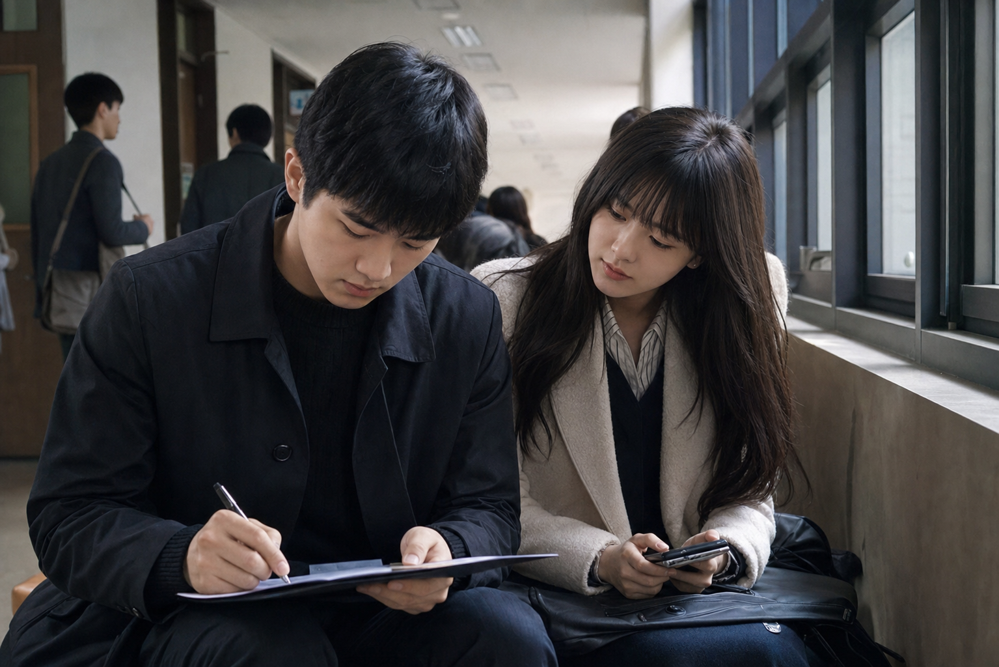

# 128. 설명회

겨울 단기 프로그램 설명회는 목요일 오후 네 시, 본관 2층 세미나실에서 열렸다.

용식은 일부러 앞쪽에 앉지 않았다. 가운데 줄 끝자리, 문이 보이는 자리였다. 세미나실 앞에는 빔프로젝터가 켜져 있었고, 스크린에는 일본 자매대학 단기 어학 프로그램이라는 제목이 떠 있었다. 학교 로고와 담당자 이름이 박혀 있었다.

진짜였다.

그래서 더 위험했다.

거짓말은 이제 진짜 종이와 진짜 설명회 뒤에 숨어야 했다. 프로그램 자체는 있었다. 하지만 용식이 가려는 일정, 함께 가는 사람, 도착 뒤 빠져나갈 동선은 그 안에 없었다.

초연은 세미나실 맨 뒤에 앉아 있었다.

패션디자인과 학생이 굳이 정보통신학과 학생들과 섞여 앉아 있을 이유는 없었다. 하지만 누구도 이상하게 보지는 않았다. 겨울방학 프로그램은 전교 공지였고, 설명회에는 여러 학과 학생들이 섞여 있었다. 초연은 그 틈에 자연스럽게 있었다.

자연스럽게 감시하고 있었다.

담당 직원이 일정표를 넘겼다.

[담당자] "희망자는 다음 주 금요일까지 신청서를 제출하시면 됩니다. 현지 학교 방문은 일주일 과정이고, 나머지 일정은 개인 선택 연장도 가능합니다."

개인 선택 연장.

용식은 그 문구를 듣는 순간 등 뒤가 서늘했다. 초연도 들었을 것이다. 서윤도 알아야 할 문구였다. 보름 일정을 설명하기 좋은 말이었고, 동시에 캐물으면 더 깊게 파야 하는 구멍이었다.

설명회가 끝나자 학생들이 신청서를 받아 갔다. 용식도 줄에 섰다. 초연은 뒤쪽에서 기다렸다. 그는 신청서 두 장을 받을 수 없었다. 하나만 받았다. 손에 쥔 종이가 너무 얇았다.

밖으로 나오자 초연이 따라왔다.

[김초연] "진짜 있긴 하네."

[김용식] "응."

[김초연] "근데 개인 연장은 뭐야?"

예상한 질문이었다. 그래도 심장은 반응했다.

[김용식] "일본어 공부 더 하고 싶은 사람은 며칠 더 있을 수 있대."

[김초연] "너는?"

[김용식] "생각 중."

초연은 신청서를 달라고 손을 내밀었다. 용식은 잠깐 멈췄다가 건넸다. 그녀는 신청서 위칸부터 아래칸까지 천천히 읽었다. 이름, 학과, 학번, 연락처, 보호자 연락처, 희망 일정.

보호자 연락처에서 그녀의 손가락이 멈췄다.

[김초연] "부모님한테는 말했어?"

[김용식] "말해야지."

[김초연] "이번엔 숨기는 거 아니지?"

[김용식] "응."

그 대답도 반만 맞았다. 가족에게는 학교 프로그램이라고 말할 수 있었다. 돈의 출처와 연장 일정과 서윤 동행은 숨길 수밖에 없었다.

초연은 신청서를 다시 건넸다.

[김초연] "내 앞에서 써."

[김용식] "지금?"

[김초연] "응."

본관 복도 창가 긴 의자에 둘이 나란히 앉았다. 용식은 펜을 꺼냈다. 이름을 썼다. 김용식. 학과. 정보통신학과. 학번. 손글씨가 평소보다 조금 더 꺾였다.

희망 일정 칸에서 펜이 멈췄다.

[김초연] "보름이라고 했잖아."

[김용식] "응."

[김초연] "그럼 그렇게 써."

용식은 날짜를 적었다. 학교 공식 일정 일주일, 개인 연장 일주일. 완전히 거짓은 아니었다. 그래서 더 무서웠다.

초연은 그걸 보고 폴더폰을 열었다.

[김용식] "뭐 해?"

[김초연] "찍어 두려고."

신청서 사진.

예전에는 둘이 폴라로이드로 얼굴을 찍었다. 이제 초연은 신청서의 희망 일정을 찍었다. 셔터음이 복도에 작게 울렸다.

용식은 펜을 내려놓았다.

[김초연] "나도 따라가면 안 돼?"

그 질문은 갑자기 왔다.

용식은 그녀를 봤다.

초연은 웃지 않았다. 진심인지 시험인지 구분할 수 없는 얼굴이었다.

[김용식] "네 과 일정도 있고, 돈도 많이 들고..."

[김초연] "내가 돈 때문에 못 간다고 하면 네가 내 줄 거잖아."

용식은 대답하지 못했다.

초연은 고개를 끄덕였다.

[김초연] "봐. 돈 문제가 아니네."

복도 끝에서 학생들이 떠드는 소리가 들렸다. 누군가 웃었고, 엘리베이터 문이 열렸다 닫혔다. 그 평범한 소리들 사이에서 용식은 아무 말도 못 했다.

초연은 신청서를 접어 그의 가방 안에 넣어 주었다.

[김초연] "이번엔 나 안 따라가."

[김용식] "초연아."

[김초연] "대신 돌아오면 바로 나한테 와."

그녀는 자리에서 일어났다.

[김초연] "공항도 내가 갈 거야."

용식의 손이 굳었다.

공항.

서윤과 같은 비행기를 타야 하는 날.

초연은 이미 그곳에 서 있을 거라고 말했다.
