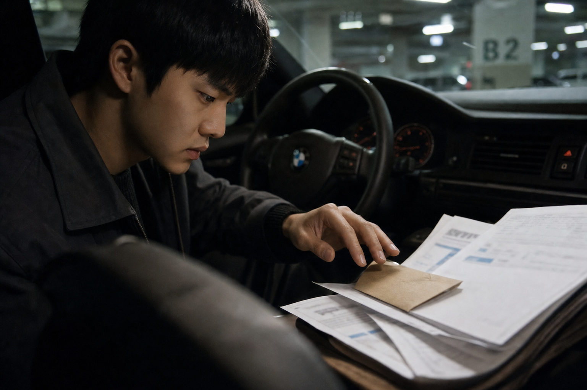

# 129. 두 장의 일정표

용식은 금요일 오후에 신청서를 냈다.

학과 사무실 조교는 별다른 질문 없이 서류를 받아 들고 접수 도장을 찍었다. 빨간 잉크가 종이에 눌리는 소리가 작게 났다. 그 소리가 이상하게 최종 판결처럼 들렸다. 용식은 접수 확인증을 받자마자 폴더폰으로 사진을 찍었다.

초연에게 보낼 사진.

그리고 서윤에게 보여 줄 사진.

같은 종이가 두 사람에게 서로 다른 의미로 가야 했다.

복도 끝에서 초연이 기다리고 있었다. 그녀는 수업이 없는 시간인데도 굳이 본관까지 올라와 있었다. 손에는 따뜻한 캔커피가 두 개 들려 있었다. 하나를 건네는 동작은 예전처럼 자연스러웠다. 그래서 잠깐 마음이 약해졌다.

[김초연] "냈어?"

[김용식] "응."

그는 확인증을 보여 주었다. 초연은 받아서 사진을 찍고, 다시 돌려줬다.

[김초연] "이제 항공권 나오면 보여줘."

[김용식] "학교에서 단체로 잡을 수도 있대."

[김초연] "그래도 보여줘."

[김용식] "알겠어."

초연은 캔커피를 열었다. 따는 소리가 복도에 울렸다. 그녀는 한 모금 마시고 창밖을 봤다. 늦가을 햇빛이 운동장 한쪽에 낮게 깔려 있었다.

[김초연] "나 너 가는 거 싫어."

용식은 그녀를 봤다.

[김초연] "근데 못 가게 하면 내가 더 이상한 사람 같아져."

[김용식] "이상한 사람 아니야."

[김초연] "아니야?"

초연은 웃었다. 아주 작게.

[김초연] "어제 신청서 사진 찍으면서 나 스스로도 웃겼어. 여자친구가 남자친구 신청서 찍어 두는 게 뭐야."

용식은 대답하지 못했다.

[김초연] "근데 안 찍으면 더 불안해."

그녀는 캔커피를 두 손으로 감쌌다. 손끝이 조금 빨갰다.

[김초연] "나 진짜 예전처럼 돌아가고 싶어. PC방에서 너 기다리던 때처럼. 네가 늦어도 그냥 게임 한 판 더 하면 되는 줄 알던 때."

용식은 그 시절을 떠올렸다. 초연이 과자를 사 와서 카운터 앞에 서 있던 날. 폴더폰에 안놓침이라고 저장하던 웃음. 그때는 거짓말이 이렇게 두꺼워질 줄 몰랐다.

[김용식] "돌아갈 수 있어."

초연은 그를 봤다.

[김초연] "그 말도 이제 확인하고 싶어."

그녀는 먼저 걸어갔다.

용식은 복도에 남아 확인증을 접었다. 그때 폴더폰이 울렸다.

[학원자료] 접수했어요?

용식은 주변을 둘러보고 계단참으로 내려갔다.

[김용식] 네. 확인증 받았어요.

[학원자료] 나한테도 사진.

그는 방금 초연에게 보여 준 확인증을 다시 펼쳤다. 같은 종이를 다른 각도로 찍었다. 초연에게 보낸 사진과 똑같으면 안 될 것 같았다. 이상한 습관이었다. 한 사람에게 보낸 흔적을 다른 사람이 알아볼까 봐, 같은 물건도 다르게 찍었다.

사진을 보냈다.

[학원자료] 항공권은?

[김용식] 그건 따로 정리해서 보여줄게요.

[학원자료] 같이 가는 날짜랑 호텔 이름까지요.

용식은 답장을 쓰려다가 멈췄다. 초연이 요구한 항공권은 학교 단체 일정이어야 했다. 서윤에게 보여 줄 항공권은 이미 결제된 두 사람의 일정이었다. 그리고 유즈키에게 보내야 할 답장에는 나고야에 갈 날짜가 필요했다.

두 장의 일정표가 필요했다.

아니, 세 장이었다.

그날 저녁, 용식은 집 근처 상가 지하주차장에 BMW를 세우고 시동을 끈 채 오래 앉아 있었다. 차 안에는 아무도 없었다. 그런데 조수석에 초연의 질문이 앉아 있었고, 뒷좌석에는 서윤의 예약 확인 화면이 놓여 있는 것 같았다. 앞유리 너머에는 집으로 올라가는 골목이 보였다.

폴더폰 이메일함을 열었다.

새 메시지는 없었다.

유즈키에게 보내지 못한 답장은 임시보관함에 남아 있었다. 용식은 그것을 열어 날짜 한 줄을 덧붙였다.

[김용식] 12월 말에 갈 것 같아요. 자세한 날짜는 곧 알려줄게요.

그는 전송 버튼을 눌렀다.

보내고 나서 바로 후회가 왔다. 하지만 이미 늦었다. 폴더폰 화면에는 발송 완료라는 짧은 문장만 남았다.

집으로 올라가기 전, 그는 초연에게 방 사진을 보내기 위해 차 안에서 가방을 정리했다. 확인증은 서랍 깊숙이 넣었다. 항공권 출력물은 다른 파일 사이에 숨겼다.

그때 서랍 사이에서 접힌 종이 하나가 미끄러져 나왔다.

서울 호텔 계산서 봉투였다.

용식은 숨을 멈췄다.
