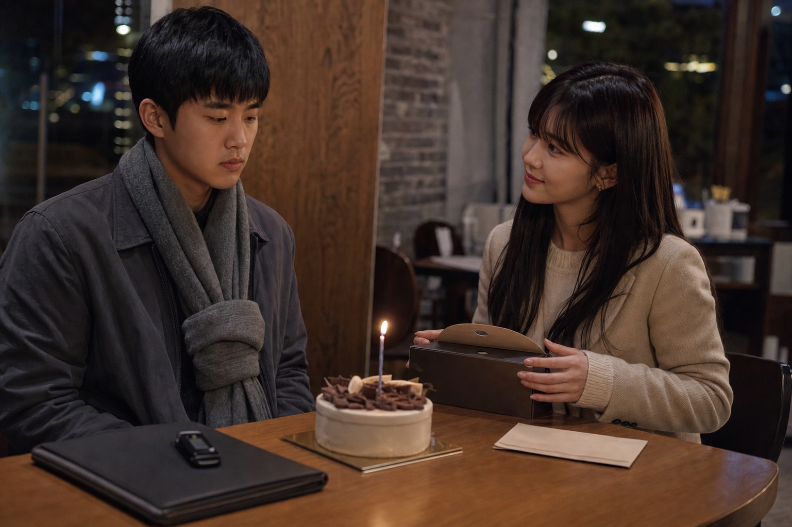

# 130. 생일 케이크의 불

12월 7일 저녁.

수원역 앞 횡단보도에는 낮에 녹다 만 눈이 검은 물자국처럼 남아 있었다. 버스가 지나갈 때마다 찬바람이 사람들 발목께를 쓸고 갔고, 유리문 안쪽 카페 조명은 밖보다 한 박자 늦게 따뜻해 보였다.

용식은 케이크 상자를 들고 서 있는 초연을 발견하고도 바로 손을 흔들지 못했다. 초연은 목도리를 코끝까지 올린 채 두 손으로 상자를 감싸고 있었다. 하얀 종이 상자 위에는 작은 초 하나가 테이프로 붙어 있었다.

[김초연] 어디야?

문자는 이미 도착해 있었다.

용식은 답장을 쓰려다 말고, 그대로 횡단보도를 건넜다.

[김용식] 앞에.

초연이 고개를 들었다. 눈이 마주치자 그녀는 먼저 웃었다. 웃음은 밝았지만, 끝이 조금 굳어 있었다. 요즘 초연의 웃음은 늘 그랬다. 믿고 싶은 쪽으로 먼저 움직이고, 그 뒤에 확인하고 싶은 마음이 천천히 따라붙었다.

김초연 "늦었어."

김용식 "미안. 학교 쪽 서류 좀 보고 오느라."

김초연 "일본 거?"

그 말이 생일 축하보다 먼저 나왔다. 초연도 자기가 먼저 뭘 물었는지 알았는지 입술을 살짝 깨물었다. 그녀는 케이크 상자를 조금 더 높이 들었다.

김초연 "아니, 그 얘기 하려고 만난 거 아닌데."

김용식 "괜찮아."

괜찮다고 말하는 목소리가 이상하게 더 거짓말 같았다.

두 사람은 수원역 뒤쪽 골목의 작은 파스타집으로 들어갔다. 초연은 미리 예약했다며 창가 자리로 용식을 끌고 갔다. 테이블 위에는 얇은 종이 냅킨과 물컵 두 개가 놓여 있었고, 창밖으로는 사람들의 어깨가 빠르게 지나갔다.

초연은 가방에서 작은 쇼핑백을 꺼냈다. 진한 회색 목도리였다. 비싸 보이는 건 아니었지만, 만져 보니 울이 부드럽고 따뜻했다.

김초연 "너 맨날 목 비어 있잖아. 일본 가면 춥다며."

김용식 "고마워."

김초연 "좋아?"

김용식 "응. 진짜 좋아."

초연은 그 말을 듣고 나서야 조금 편해진 얼굴을 했다. 그녀는 직접 목도리를 꺼내 용식의 목에 둘러 주었다. 손끝이 턱 밑을 스칠 때, 용식은 순간적으로 눈을 피했다. 초연의 손은 따뜻했다. 그 따뜻함이 오히려 부담스러웠다. 그는 며칠 뒤 같은 공항에서 한서윤을 숨겨야 했고, 보름 뒤에는 나고야로 가야 했다.

생일 케이크의 불은 아직 켜지지도 않았는데, 마음 한쪽은 벌써 꺼져 있었다.

식사가 끝날 때쯤 초연은 케이크 상자를 열었다. 작은 생크림 케이크 위에 초 하나가 꽂혔다. 가게 직원이 라이터를 빌려주고 지나가자, 초연이 두 손으로 불꽃을 가렸다.

김초연 "생일 축하해."

김용식 "고마워."

김초연 "스무 살 되기 전 마지막 생일이네."

김용식은 웃었다.

김초연 "소원 빌어."

김용식은 초를 바라봤다. 소원을 빌라는 말 앞에서 세 사람 얼굴이 차례로 떠올랐다. 초연은 자기 앞에 앉아 있었다. 서윤은 일본 항공권 확인 화면을 찍어 갔고, 유즈키는 나고야에서 겨울을 기다리고 있었다.

한 사람만 고르는 소원은 떠오르지 않았다.

그래서 그는 아무것도 빌지 않았다.

후.

불이 꺼졌다.

초연은 폴라로이드를 꺼내 케이크와 용식을 찍었다. 사진이 천천히 밀려 나오자 그녀는 손바닥 위에 올려 놓고 흔들지 않은 채 기다렸다. 예전 같았으면 바로 장난을 쳤을 텐데, 오늘은 사진이 선명해지는 걸 오래 보고 있었다.

김초연 "일본 가서도 이렇게 사진 보내."

김용식 "보낼게."

김초연 "방 사진도."

김용식 "응."

김초연 "혼자 있는 거 보이게."

말끝이 작았지만, 못 들은 척할 수 없는 크기였다.

용식은 물컵을 들었다. 얼음은 다 녹아 있었다. 컵 표면의 물기가 손바닥에 묻었다.

김용식 "알겠어."

김초연 "나 너 믿고 싶은데, 요즘 자꾸 확인하게 돼."

김용식 "미안해."

김초연 "미안하다는 말 말고. 이번엔 그냥... 진짜 혼자 갔다 와."

용식은 대답하지 못했다.

그때 폴더폰이 울렸다.

테이블 위였다.

초연의 시선이 먼저 내려갔다.

[학원자료] 오늘 생일이었어요?

초연은 화면을 읽지 못했다. 용식이 거의 반사적으로 폴더폰을 뒤집었기 때문이었다. 뒤집힌 폴더폰 위로 케이크의 하얀 크림 냄새가 희미하게 번졌다.

김초연 "누구야?"

김용식 "학원 사람."

김초연 "한서윤 씨?"

이름이 너무 정확해서, 용식은 거짓말을 붙일 틈을 놓쳤다.

김용식 "응. 그냥."

김초연 "오늘 네 생일인 거 그 사람도 알아?"

김용식 "아니. 아마... 모르고 보낸 거야."

초연은 더 묻지 않았다. 하지만 그녀는 케이크를 자르는 플라스틱 칼을 조금 세게 눌렀다. 생크림이 눌리며 옆으로 밀렸다.

식당을 나와 차로 가는 길, 초연은 용식의 손을 잡았다. 장갑을 낀 손이었다. 따뜻한 목도리와 차가운 장갑, 생일 케이크와 확인 문자, 축하와 감시가 한꺼번에 손끝에 걸려 있었다.

차 안에 앉자 초연은 가방에서 작은 편지를 꺼냈다.

김초연 "집 가서 읽어."

김용식 "지금 읽으면 안 돼?"

김초연 "안 돼. 나 울 수도 있어."

그 말이 장난처럼 들리지 않았다.

용식은 편지를 점퍼 안주머니에 넣었다. 차 안 히터가 늦게 돌기 시작했고, 앞유리에는 하얀 김이 잠깐 서렸다가 사라졌다.

김초연 "공항은 10일 맞지?"

김용식 "응."

김초연 "나 갈 거야. 싫어도."

김용식 "싫은 거 아니야."

김초연 "그럼 도망가지 마."

용식은 핸들을 잡은 손에 힘을 줬다.

김용식 "안 도망가."

그 말은 초연에게 한 말이기도 했고, 스스로에게 한 말이기도 했다. 하지만 이미 그는 여러 방향으로 도망칠 준비를 하고 있었다.

초연을 수원 집 앞에 내려주고 돌아오는 길, 폴더폰이 다시 울렸다. 이번에는 메일 알림이었다.

[나카타 유즈키] お誕生日おめでとう。나고야는 오늘 바람이 차요. 겨울에 보면, 늦었지만 케이크 같이 먹어요.

용식은 신호 대기 중에 그 문장을 오래 봤다. 뒤차가 클랙슨을 짧게 울리고 나서야 그는 차를 움직였다.

집에 도착했을 때 서윤의 답장도 와 있었다.

[학원자료] 생일인 줄도 몰랐네요. 나는 그런 것도 늦게 아는 사람이네요.

용식은 방 불을 켜지 않은 채 침대에 앉았다. 점퍼 안주머니에는 초연의 편지가 있었고, 폴더폰에는 서윤과 유즈키의 문장이 남아 있었다. 책상 서랍 안에는 12월 10일 도쿄행 항공권 출력물이 있었다.

그는 초연의 편지를 꺼내지 않았다.

먼저 서랍을 열었다.

항공권 위에는 생일 케이크 냄새가 아직 손끝에 남아 있었다.
