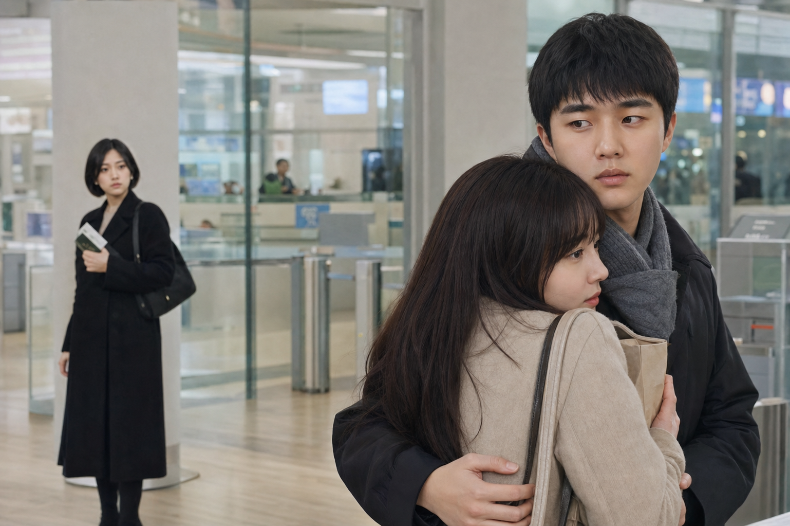

# 131. 인천공항의 유리문

12월 10일 새벽.

수지 집 앞 도로는 아직 어두웠다. 용식은 캐리어 바퀴 소리가 현관 앞에서 너무 크게 울릴까 봐 손잡이를 들어 올렸다. 가족에게는 학교 앞에서 단체 버스를 탄다고 말해 두었지만, 실제로는 큰길 건너 편의점 앞에서 택시를 부를 생각이었다.

찬 공기가 목도리 틈으로 파고들었다. 초연이 생일날 둘러 준 목도리였다. 그는 목도리를 손으로 한번 눌렀다. 버릴 수도, 안 할 수도 없는 물건이었다.

택시 뒷좌석에 캐리어를 밀어 넣자 폴더폰이 울렸다.

[김초연] 나 출발했어. 공항에서 봐.

용식은 눈을 감았다가 떴다.

[김용식] 조심히 와.

답장을 보내자마자 다른 문자가 들어왔다.

[학원자료] 저는 공항철도 타요. 말한 대로 따로 움직일게요.

그 문장은 얌전했다. 그래서 더 불편했다. 서윤이 받아들인 게 아니라, 잠시 접어 둔 것뿐이라는 걸 용식은 알았다.

택시는 고속도로로 올라갔다. 겨울 새벽의 도로는 검은 유리처럼 반짝였고, 멀리 보이는 공항 표지판은 파란빛으로 떠 있었다. 운전기사는 라디오 볼륨을 낮춰 놓았고, 뉴스에서는 환율과 겨울방학 해외연수 이야기가 흘러나왔다.

그 말이 꼭 자기 얘기 같았다.

인천공항 출국장에 도착했을 때, 천장 조명은 낮처럼 밝았다. 캐리어를 끄는 사람들, 단체 여행 깃발, 목도리를 칭칭 감은 대학생들, 울먹이는 가족들 사이로 바퀴 소리가 겹쳐졌다.

용식은 먼저 학교 프로그램 인솔자 쪽으로 갔다. 이름표를 받은 뒤, 짐을 잠시 세워 두고 주변을 살폈다. 서윤은 아직 보이지 않았다. 대신 유리문 너머로 초연이 들어오는 모습이 먼저 보였다.

초연은 분홍색 니트 위에 베이지 코트를 입고 있었다. 생일날보다 더 단정하게 꾸몄고, 손에는 작은 종이봉투를 들고 있었다. 그녀는 사람들 사이에서 용식을 찾다가, 눈이 마주치자 바로 걸어왔다.

김초연 "진짜 있었네."

김용식 "그럼 없겠어?"

김초연 "몰라. 너 요즘 자꾸 이상하게 움직이니까."

농담처럼 말했지만, 눈은 웃지 않았다.

용식은 초연의 가방을 보려다 말았다. 초연도 그의 손에 들린 이름표를 봤다. 학교 이름과 프로그램명이 인쇄되어 있었다. 진짜였다. 진짜라서 거짓말이 더 단단해졌다.

김초연 "이름표 보여 줘."

용식은 이름표를 내밀었다.

초연은 손끝으로 인쇄된 이름을 문질러 보듯 만졌다.

김초연 "혼자 방 쓰는 거 맞아?"

김용식 "응. 도착하면 사진 보낼게."

김초연 "오늘도."

김용식 "응."

그때 폴더폰이 진동했다. 용식은 주머니 안에서 휴대폰을 손바닥으로 눌렀다. 초연의 시선이 그 손으로 내려갔다.

김초연 "봐."

김용식 "나중에."

김초연 "지금."

공항 안내방송이 두 사람 사이로 지나갔다. 일본 도쿄행 항공편 탑승 수속 안내였다. 용식은 주머니에서 폴더폰을 꺼냈다. 화면에는 발신자 이름이 떴다.

[학원자료] 저 C구역 뒤쪽이에요. 멀리 있어요.

초연은 발신자 이름만 봤다. 내용까지 읽지는 못했다. 하지만 이름만으로도 충분했다.

김초연 "왜 지금 와?"

김용식 "학원 사람이니까. 일본 간다니까 그냥..."

김초연 "그 사람도 오늘 공항이야?"

용식은 숨을 삼켰다.

김용식 "모르지."

초연은 한참 동안 그를 봤다. 용식은 자신의 대답이 너무 빨랐다는 걸 바로 알았다. 모르면 모르는 표정이어야 했는데, 그는 이미 들키지 않는 쪽으로 몸이 굳어 있었다.

김초연 "모르는데 왜 그렇게 대답해?"

김용식 "초연아."

김초연 "됐어. 오늘은 안 싸울래."

초연은 종이봉투를 내밀었다. 안에는 작은 손난로 몇 개와 편의점에서 산 초콜릿이 들어 있었다.

김초연 "비행기에서 먹어."

김용식 "고마워."

김초연 "그리고 목도리 하고 있네."

그 말에 용식은 목도리를 만졌다.

초연의 얼굴이 잠깐 풀렸다. 아주 짧게. 그 틈에 용식은 그녀를 안았다. 초연은 처음에는 굳어 있다가 천천히 팔을 올렸다. 공항의 사람 소리와 캐리어 바퀴 소리 사이에서, 그녀의 손이 등 뒤 옷감을 움켜쥐었다.

김초연 "가서 전화해."

김용식 "응."

김초연 "나 속이면 진짜 끝이야."

김용식 "알아."

그는 안다고 말했다.

그런데 바로 그 순간, 멀리 C구역 기둥 옆에 선 서윤이 보였다. 검은 코트에 짧은 단발, 한 손에는 여권과 항공권 봉투가 들려 있었다. 서윤은 두 사람을 보고 있었다. 가까이 오지도, 피하지도 않았다.

용식은 초연을 안은 채로 시선을 돌렸다.

초연이 그의 어깨 너머를 보려 했다.

김용식 "초연아."

용식은 그녀를 조금 더 세게 안았다.

김초연 "왜?"

김용식 "그냥. 조금만 더."

그 말은 다정하게 들렸을 것이다. 하지만 사실은 시야를 막는 말이었다.

탑승 수속이 끝나고, 보안검색대로 들어가기 전 초연은 끝까지 따라왔다. 유리문 앞에서 그녀는 다시 물었다.

김초연 "도착하면 바로 연락해."

김용식 "응."

김초연 "사진."

김용식 "보낼게."

김초연 "혼자 있는 거."

용식은 고개를 끄덕였다.

초연은 손을 놓지 않았다. 유리문 너머에서는 학교 인솔자가 학생들을 모으고 있었다. 뒤쪽에서는 서윤이 조금 떨어진 줄에 서 있었다. 셋이 같은 공간에 있었지만, 아무도 같은 장면 안에 있어서는 안 됐다.

용식은 초연의 손을 떼어냈다.

김용식 "나 가야 돼."

초연은 손끝이 떨어진 뒤에도 한 박자 늦게 서 있었다.

김초연 "잘 다녀와."

김용식 "응."

유리문 안으로 들어간 뒤, 용식은 뒤돌아보지 않으려 했다. 하지만 결국 돌아봤다. 초연은 아직 그 자리에 있었다. 그녀는 웃지 않고, 손만 작게 흔들었다.

그 순간 폴더폰이 울렸다.

[학원자료] 이제부터는 내 옆에 있어요.

용식은 화면을 닫았다.

유리문 너머의 초연은 아직 보고 있었다.
