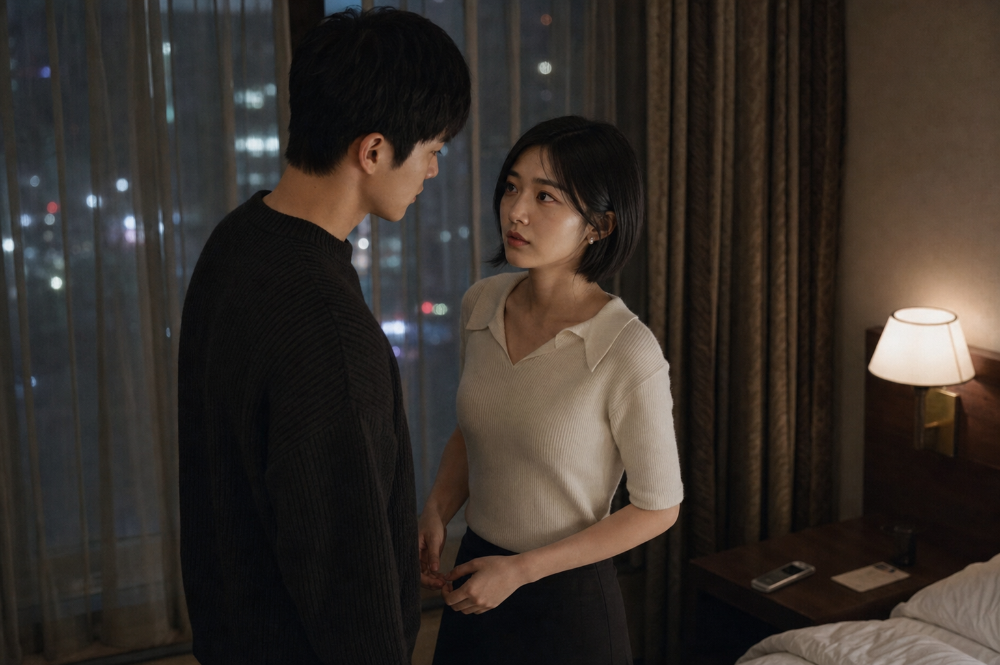

# 132. 도쿄 첫밤

나리타 공항의 공기는 인천보다 조금 더 건조했다.

비행기 문을 나서는 순간, 용식은 익숙한 일본어 안내방송을 들었다. 여름에 두 달을 보낸 나라였는데도 겨울 공항은 다른 얼굴이었다. 사람들의 코트 색은 더 어두웠고, 창밖 활주로 위 바람은 낮게 깔려 있었다.

학교 프로그램 학생들은 인솔자 주변에 모여 입국 절차를 확인하고 있었다. 용식은 그 사이에 서 있었지만, 시선은 자꾸 뒤쪽으로 갔다. 서윤은 두 줄 뒤에서 여권을 들고 있었다. 공항에서는 아직 남이었다.

서윤은 아무 말도 하지 않았다.

그 침묵이 더 오래 남았다.

입국장을 나와 리무진버스 표를 사는 곳에서, 용식은 학교 일행에게 잠시 개인 일정이 있다고 둘러댔다. 인솔자는 이미 그의 개인 연장 일정을 알고 있었고, 별다른 의심 없이 고개를 끄덕였다. 진짜 서류가 다시 한 번 거짓말의 문을 열어 줬다.

버스 승강장 밖으로 나오자 서윤이 조금 떨어진 곳에서 기다리고 있었다. 검은 코트의 허리끈이 단정하게 묶여 있었고, 짧은 단발 끝에는 비행기 안 건조한 공기 때문인지 잔머리가 조금 일어나 있었다. 그녀는 용식을 보자마자 웃지 않았다.

한서윤 "이제 말 걸어도 돼?"

김용식 "미안해요."

한서윤 "공항에서부터 계속 미안하네."

김용식 "초연이가 봐서..."

한서윤 "알아. 그래서 참았잖아."

말끝이 차분했다. 화를 내지 않는 목소리라서 더 아팠다. 용식은 캐리어 손잡이를 고쳐 잡았다.

김용식 "호텔 가요. 추워요."

한서윤 "응. 오늘부터는 내가 모르는 사람 아니지?"

용식은 바로 대답하지 못했다.

서윤은 그 짧은 침묵을 듣고, 먼저 걸음을 옮겼다.

리무진버스 안에서 두 사람은 나란히 앉았다. 창가에는 서윤이 앉고, 용식은 통로 쪽에 앉았다. 버스가 고속도로로 올라가자 공항의 불빛이 뒤로 밀려났다. 서윤은 창밖을 보고 있었고, 용식은 폴더폰을 열었다 닫았다.

[김초연] 도착했어?

아직 답장을 보내지 못했다.

서윤이 옆에서 말했다.

한서윤 "보내."

김용식 "뭘요?"

한서윤 "도착했다고. 그거 기다릴 거 아니야."

용식은 화면을 봤다. 서윤은 창밖을 보고 있었지만, 목소리는 바로 옆에서 낮게 붙었다.

김용식 "서윤 씨."

한서윤 "괜찮아. 대신 나도 옆에 있다는 건 잊지 마."

그 말은 허락 같았지만, 사실은 조건이었다.

용식은 답장을 보냈다.

[김용식] 도착했어. 지금 이동 중.

초연의 답장은 바로 왔다.

[김초연] 누구랑 앉았어?

용식은 손끝이 멈췄다.

한서윤은 그 화면을 보지 못했지만, 용식의 숨이 막히는 걸 느낀 듯했다.

한서윤 "또 물어봐?"

김용식 "응."

한서윤 "혼자라고 해."

김용식 "그럼..."

한서윤 "어차피 그렇게 말할 거잖아."

버스 창문에 두 사람 얼굴이 희미하게 겹쳤다. 용식은 거짓말을 입력했다.

[김용식] 학교 애들이랑. 자리 따로 앉았어.

보내고 나서 그는 폴더폰을 닫았다.

서윤은 웃었다. 아주 작게.

한서윤 "돈도 내주고, 비행기도 같이 타고, 호텔도 같이 가는데. 문자 하나에서는 또 없는 사람이네."

용식은 할 말이 없었다.

도쿄 시내에 들어서자 빌딩 불빛이 젖은 유리처럼 버스 창에 번졌다. 호텔은 신주쿠 골목 안쪽에 있었다. 로비는 작고 따뜻했고, 프런트 직원은 두 사람을 번갈아 보며 예약 확인서를 받았다. 용식이 여권 두 개와 카드키를 받아 들자 서윤의 시선이 그 손에 멈췄다.

한서윤 "방 하나야?"

김용식 "예약할 때... 그렇게 했어요."

한서윤 "물어보지도 않고?"

김용식 "싫으면 지금 바꿀게요."

용식은 바로 프런트 쪽으로 몸을 돌리려 했다. 서윤이 그의 소매를 잡았다.

한서윤 "싫다고 안 했어."

손끝이 오래 머물렀다.

엘리베이터 안은 좁았다. 캐리어 두 개가 들어가자 두 사람 사이가 자연스럽게 가까워졌다. 서윤의 코트에서 차가운 바깥 냄새와 은은한 향수 냄새가 같이 났다. 용식은 층수 표시만 봤다. 숫자가 느리게 올라갔다.

방 안에는 작은 침대 하나와 창가 테이블, 전기포트, 얇은 커튼이 있었다. 용식은 먼저 캐리어를 벽 쪽에 세웠다. 서윤은 문가에 서서 방을 천천히 둘러봤다.

한서윤 "여기서 보름이야?"

김용식 "중간에 일정 좀 움직일 수도 있어요."

한서윤 "그래도 시작은 여기네."

서윤은 코트를 벗었다. 안에는 몸에 잘 맞는 아이보리 니트와 짙은 스커트를 입고 있었다. 화려하지 않았지만, 긴 목선과 마른 어깨가 조명 아래서 더 선명해 보였다. 용식은 눈을 돌렸다.

한서윤 "왜 피해?"

김용식 "안 피했어요."

한서윤 "거짓말."

서윤은 침대 끝에 앉았다. 손가락으로 진주귀걸이를 만지다가, 천천히 용식을 올려다봤다. 그 귀걸이는 5월에 용식이 사 준 것이었다. 한 계절을 지나 겨울 도쿄 호텔 방 안에 와 있었다.

한서윤 "나 오늘 많이 참았어."

김용식 "알아요."

한서윤 "아니. 몰라. 알면 공항에서 그렇게 안 했지."

용식은 침대에서 조금 떨어진 의자에 앉았다. 서윤은 그의 거리를 봤다.

한서윤 "또 멀리 앉네."

김용식 "서윤 씨가 화났으니까."

한서윤 "화난 사람은 가까이 오면 안 돼?"

말이 끝나고 방 안이 조용해졌다. 복도에서 누군가 캐리어를 끄는 소리가 지나갔다. 서윤은 자리에서 일어나 용식 앞에 섰다. 그녀는 먼저 손을 내밀었다. 용식은 그 손을 잡았다.

한서윤 "오늘은 내가 없는 사람 아니지?"

김용식 "아니에요."

한서윤 "그럼 나 봐."

용식은 고개를 들었다. 서윤의 눈은 흔들리고 있었지만 물러서지는 않았다. 용식은 손을 놓으려다, 오히려 더 조심스럽게 잡았다.

김용식 "괜찮아요?"

서윤은 대답 대신 고개를 끄덕였다. 그리고 한 걸음 더 가까이 왔다.

창밖의 네온 불빛이 커튼 틈으로 작게 들어와 그녀의 뺨 위에 붉은 줄을 그었다가 지웠다. 방 안 히터 소리가 낮게 돌았고, 두 사람의 숨소리 말고는 아무것도 들리지 않았다. 서윤의 손끝이 그의 셔츠 깃을 스쳤다. 아주 잠깐이었는데, 그 잠깐이 오래 남을 것 같았다.

한서윤 "오늘 하루 종일 아무 사이 아닌 척했잖아."

김용식 "미안해요."

한서윤 "사과 말고. 지금은 그냥... 오늘 있었던 일 다 잊고 싶어."

용식은 그 말이 허락이라는 걸 알았다. 동시에 서윤이 자기 자신에게 하는 말이라는 것도 알았다. 밖에서는 숨겨야 할 사람이었지만, 이 문 안에서는 서윤이 유일하게 진짜인 사람이었다.

그는 그녀의 뺨에 손을 올렸다. 차가운 바깥 공기를 머금었던 피부가 방 안 온기 속에서 천천히 데워지고 있었다. 서윤은 눈을 감지 않았다. 그 눈이 흔들리는 걸 보면서, 용식은 고개를 숙였다.

첫 입맞춤은 짧았다. 두 번째는 조금 길었다. 서윤의 손이 그의 목덜미로 올라왔고, 손끝이 파고들 때마다 옷깃 아래 살갗에 낮은 소름이 돋았다. 그녀의 숨이 조금씩 가빠졌고, 그 숨이 귓가에 닿을 때마다 방 안 공기가 한 겹씩 데워지는 것 같았다.

한서윤 "오늘까지만이야."

낮게 잠긴 목소리였다. 상대에게 하는 말이라기보다, 스스로에게 거는 다짐에 가까웠다.

김용식 "응."

거짓말이라는 걸 둘 다 알았다. 그래도 그 순간만큼은 진짜처럼 들렸다.

창밖 네온사인이 커튼 사이로 붉은 줄을 그었다 지웠다 하는 동안, 두 사람 사이의 거리는 천천히 사라졌다.

새벽에 먼저 움직인 건 폴더폰 진동이었다.

[김초연] 방 사진 보내 줘. 혼자 있는 거.
