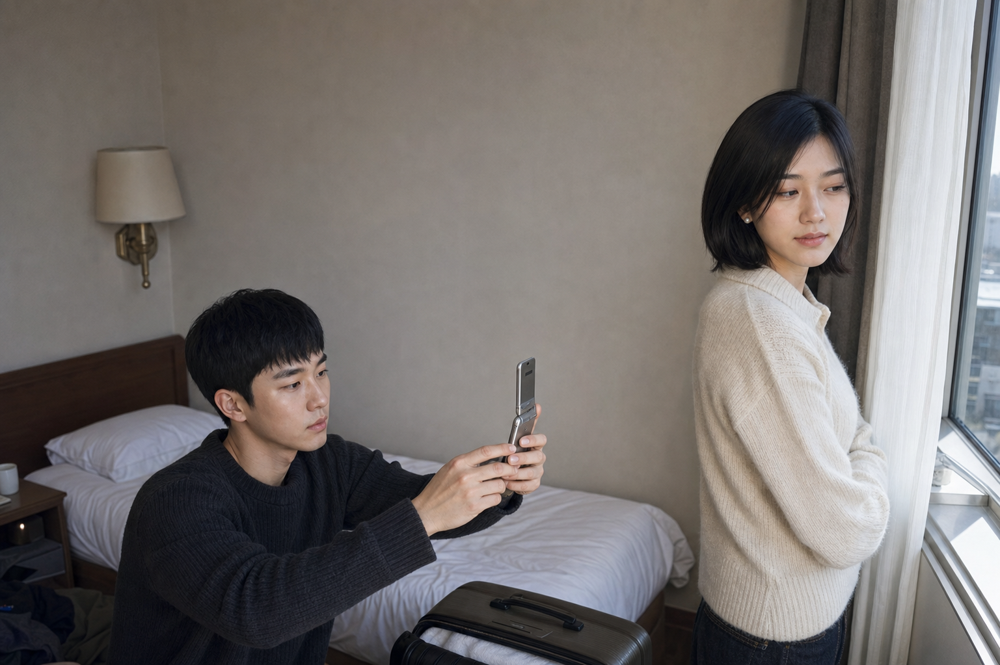

# 133. 사진 밖의 여자

12월 11일 아침.

호텔 방 커튼 사이로 들어온 빛은 흐렸다. 도쿄의 겨울 아침은 한국보다 덜 매섭지만, 방 안 공기는 밤새 꺼진 히터 때문에 식어 있었다. 용식은 테이블 위에서 계속 진동하는 폴더폰을 뒤집어 봤다.

[김초연] 자?

[김초연] 방 사진.

[김초연] 지금 보내.

세 문장이 순서대로 쌓여 있었다.

옆에서 이불이 조금 움직였다. 서윤은 이미 깨어 있었다. 그녀는 말없이 천장을 보고 있었다. 짧은 머리카락이 베개 위에 흐트러져 있었고, 왼쪽 눈 아래 작은 점이 아침빛에 더 또렷해 보였다.

한서윤 "보내야죠."

김용식 "조금 있다가."

한서윤 "지금 보내라잖아요."

용식은 말문이 막혔다. 서윤은 몸을 일으켜 침대 끝에 앉았다. 어제 입었던 니트가 의자 등받이에 걸려 있었고, 바닥에는 쇼핑백도 짐도 아닌 두 사람의 흔적이 어지럽게 남아 있었다. 초연에게 보낼 수 없는 것들뿐이었다.

용식은 급히 바닥의 가방을 세웠다. 테이블 위 컵 두 개를 하나로 줄이고, 세면대 앞 수건 하나를 캐리어 안으로 밀어 넣었다. 침대 위 이불을 대충 정리하다가, 서윤이 앉아 있는 쪽을 보고 멈췄다.

한서윤 "나 비켜요?"

김용식 "서윤 씨."

한서윤 "비켜야 찍히죠. 혼자 있는 방."

서윤은 웃었다. 웃음이 너무 얇아서 차라리 울음보다 아팠다. 그녀는 침대에서 내려와 창가 커튼 뒤쪽으로 갔다. 용식은 그 모습을 보며 폴더폰 카메라를 열었다.

작은 화면 안에는 침대와 테이블, 벽에 걸린 그림, 캐리어 하나만 들어왔다. 서윤은 프레임 밖에 있었다. 하지만 용식은 셔터를 누르기 전 손이 굳었다. 사진 밖에 있는 사람이 사진 안의 거짓말보다 더 선명했다.

찰칵.

[김용식] 지금 일어났어.

사진이 전송됐다.

초연의 답장은 바로 오지 않았다. 그 사이 서윤이 커튼 뒤에서 나왔다.

한서윤 "잘 나왔어요?"

김용식 "미안해요."

한서윤 "그 말 말고 다른 거 없어요?"

용식은 폰을 닫았다.

한서윤 "어제는 내가 있는 사람 같았는데, 아침 되니까 또 없네요."

김용식 "초연이는 모르니까..."

한서윤 "알아요. 몰라야 하니까 내가 비킨 거잖아요."

그녀는 세면대 쪽으로 걸어갔다. 문이 반쯤 닫히고, 물소리가 났다. 용식은 침대 끝에 앉아 두 손으로 얼굴을 쓸어내렸다. 잠을 거의 못 잤다. 그런데 피곤함보다 먼저 밀려오는 건 미안함이 아니라 이상한 안도였다.

오늘도 넘겼다.

그 생각이 드는 순간, 그는 스스로가 싫어졌다.

초연의 답장이 왔다.

[김초연] 컵 하나밖에 없네?

용식은 화면을 보며 숨을 멈췄다. 어제 밤 테이블 위 컵 두 개를 치웠다고 생각했는데, 사진 오른쪽 끝에 유리컵 하나가 아주 작게 더 비친 모양이었다. 아니면 초연이 일부러 떠보는 걸 수도 있었다.

[김용식] 하나는 욕실에 있어. 내가 물 마셔서.

보내자마자 말이 이상했다. 욕실에 컵이 있다는 설명은 너무 설명 같았다.

서윤이 세면대 문을 열고 나왔다.

한서윤 "또 뭐래요?"

김용식 "컵."

한서윤은 잠깐 멈췄다가, 낮게 웃었다.

한서윤 "사진도 거짓말하려면 어렵네요."

그 말은 놀리는 것 같았지만, 눈은 웃지 않았다.

오전 일정은 학교 프로그램 오리엔테이션이었다. 용식은 혼자 참석해야 했다. 서윤은 호텔 근처 카페에서 기다리겠다고 했다. 용식은 미안하다며 점심에 좋은 데 가자고 했고, 서윤은 고개를 끄덕였다.

한서윤 "돈 쓰면 다 괜찮아질 것 같죠?"

김용식 "그런 뜻 아니에요."

한서윤 "그럼 어떤 뜻인데요?"

용식은 코트를 입다가 멈췄다.

김용식 "내가 할 수 있는 게 그거라서요."

서윤은 그 말을 듣고 한동안 조용했다. 그리고 의자에 걸려 있던 니트를 집어 들었다.

한서윤 "그럼 오늘은 제대로 해 줘요."

김용식 "뭘요?"

한서윤 "밥 먹을 때는 폰 뒤집지 말고. 길 걸을 때는 먼저 걷지 말고. 누가 보면 모르는 사람처럼 떨어지지도 말고."

그 요구는 크지 않았다. 그래서 더 피하기 어려웠다.

용식은 고개를 끄덕였다.

오리엔테이션은 길지 않았다. 어학원 담당자는 일정표를 나눠 주고, 오전 수업과 단체 견학, 자유 시간에 대해 설명했다. 용식은 설명을 듣는 내내 사진 한 장 때문에 진이 빠져 있었다. 주변 학생들은 겨울 도쿄 어디를 갈지 떠들고 있었지만, 그는 일정표 여백에 나고야행 가능한 시간을 작게 표시했다가 바로 지웠다.

점심 무렵 호텔 근처 카페로 갔을 때, 서윤은 창가에 앉아 있었다. 커피잔은 거의 비어 있었고, 그녀 앞에는 일본 취업 정보지가 펼쳐져 있었다. 하지만 눈은 글자를 읽고 있지 않았다.

김용식 "많이 기다렸어요?"

한서윤 "아니요. 기다리는 건 이제 익숙해서."

용식은 그 말에 바로 앉지 못했다. 서윤은 의자를 가리켰다.

한서윤 "앉아요. 오늘은 내 앞에."

점심은 신주쿠의 작은 돈카츠집에서 먹었다. 용식은 계산을 먼저 했고, 서윤은 영수증을 보는 그의 손을 유심히 봤다. 식당 밖으로 나오자 찬바람이 불었다. 서윤의 손이 코트 주머니 밖에서 얼어 있었다.

용식은 먼저 그 손을 잡았다.

서윤은 손을 빼지 않았다.

한서윤 "이런 건 잘하네요."

김용식 "뭐가요?"

한서윤 "밖에서 잡아 주는 거."

골목 끝의 편의점 불빛이 두 사람 얼굴을 잠깐 하얗게 비췄다. 서윤은 손을 잡힌 채로 용식을 봤다.

한서윤 "한국에서는 왜 못 했어요?"

용식은 대답하지 못했다.

서윤은 대답을 기다리다가, 결국 고개를 돌렸다.

그날 밤 호텔로 돌아왔을 때, 초연에게서 다시 문자가 왔다.

[김초연] 오늘 누구랑 밥 먹었어?

서윤은 용식의 손에 든 폴더폰을 봤다. 이번에는 비키지 않았다.

한서윤 "대답해요."

김용식 "서윤 씨."

한서윤 "나 보면서 대답해요."

용식은 화면을 켠 채 서윤을 봤다. 방 안에는 편의점에서 사 온 따뜻한 캔커피 냄새가 났고, 창밖으로는 늦은 도쿄의 차 소리가 낮게 깔렸다.

그는 초연에게 답장을 쓰지 못했다.

서윤은 천천히 폴더폰을 닫았다.

한서윤 "오늘 밤은 사진 밖으로 안 나갈래요."
