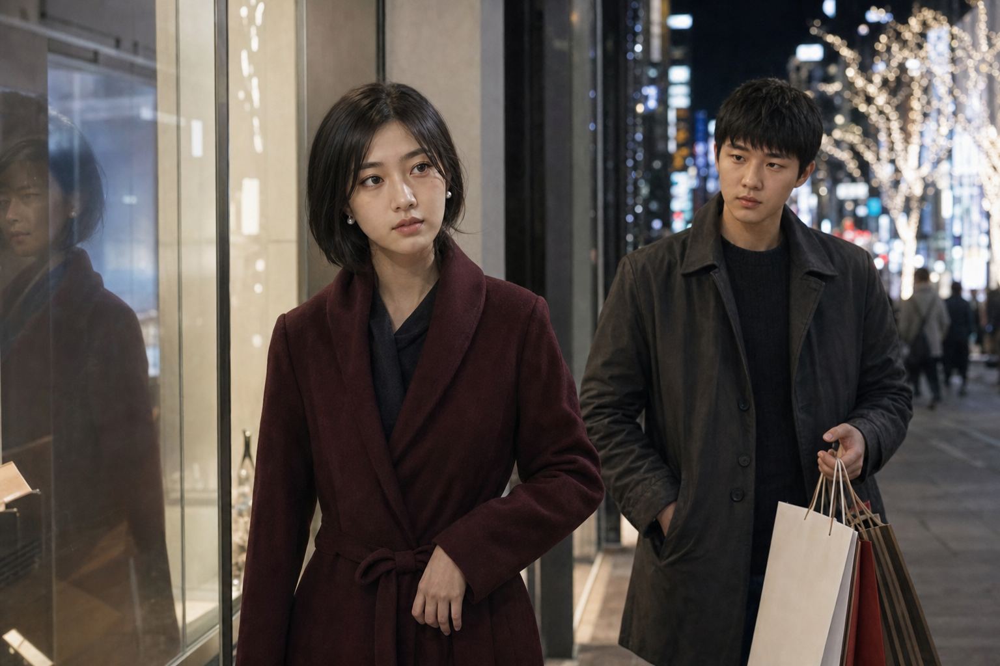

# 134. 긴자에서 산 것들

12월 12일 오후.

긴자 거리의 쇼윈도는 겨울 햇빛을 너무 깨끗하게 반사해서 눈이 시렸다. 유리 너머 마네킹들은 얇은 코트와 스카프를 두르고 있었고, 거리의 사람들은 자기 속도대로 지나갔다. 서윤은 쇼윈도 앞에서 걸음을 멈추지 않으려 했다.

용식은 그걸 봤다.

보고도 모른 척하지 않았다.

김용식 "들어가요."

한서윤 "괜찮아."

김용식 "보고 있었잖아요."

한서윤 "보기만 한 거야."

김용식 "입어 봐요."

서윤은 용식을 돌아봤다. 그 눈빛에는 망설임보다 먼저 자존심이 있었다. 서울 백화점에서 정장을 사 줄 때도 그랬다. 받고 싶지 않은 척하면서도, 누군가가 자기에게 아낌없이 쓰는 순간을 아주 조용히 기억하는 얼굴.

한서윤 "또 사 주려고?"

김용식 "마음에 들면요."

한서윤 "왜?"

김용식 "어울릴 것 같아서."

서윤은 웃지 않고 쇼윈도 속 자기 얼굴을 봤다.

한서윤 "그런 말은 참 쉽게 하네."

가게 안은 따뜻했다. 직원은 일본어로 두 사람을 맞았고, 서윤은 자연스럽게 대답했다. 용식은 여름보다 조금 나아진 일본어로 옆에서 필요한 말만 보탰다. 서윤은 짙은 와인색 코트와 회색 니트를 들고 피팅룸으로 들어갔다.

커튼이 닫히자 용식은 쇼파에 앉았다. 폴더폰을 꺼냈다가 다시 넣었다. 초연에게는 오전 수업 중이라고 둘러댔다. 실제로는 오전 일정이 끝난 뒤 곧바로 서윤을 데리고 긴자로 나왔다.

진짜 수업보다 더 열심히 짠 일정이었다.

커튼이 열렸다.

서윤은 와인색 코트를 입고 서 있었다. 짧은 단발 끝이 턱선에 닿았고, 코트 허리끈을 묶지 않았는데도 긴 실루엣이 자연스럽게 살아났다. 진주귀걸이는 작게 반짝였다.

용식은 잠깐 말을 잊었다.

한서윤 "이상해?"

김용식 "아니요."

한서윤 "그럼 왜 말이 없어?"

김용식 "잘 어울려서."

서윤은 고개를 돌렸다. 쇼윈도 옆 거울에 비친 얼굴은 무표정했지만, 입술 끝이 아주 조금 풀렸다.

한서윤 "비싸."

김용식 "괜찮아요."

한서윤 "용식 씨한테는 맨날 괜찮네."

김용식 "서윤 씨한테 쓰는 건 아깝지 않아요."

말이 나가고 나서, 용식은 자신이 또 돈으로 감정을 대신하고 있다는 걸 알았다. 하지만 서윤은 그 말을 싫어하지 않았다. 싫어하지 않는 자신을 싫어하는 얼굴이었다.

코트, 니트, 구두, 작은 가죽 장갑까지 계산대 위에 올라갔다. 카드가 긁히는 소리가 짧게 났다. 서윤은 영수증을 보는 대신 용식의 얼굴을 봤다.

한서윤 "이러면 내가 뭐가 돼?"

김용식 "뭘요?"

한서윤 "위증해 주고, 여행 따라오고, 옷 받고, 호텔에 같이 있는 사람."

용식은 봉투를 받아 들었다.

김용식 "그렇게 말하지 마요."

한서윤 "그럼 뭐라고 말해?"

가게 문이 열리며 찬바람이 들어왔다. 두 사람 사이에 직원의 인사말이 지나갔다. 밖으로 나오자 긴자 거리의 불빛이 조금씩 켜지고 있었다.

용식은 쇼핑백을 한 손에 몰아 들고, 다른 손으로 서윤의 손을 잡았다. 서윤은 이번에도 빼지 않았다. 오히려 손가락을 조금 더 깊게 걸었다.

저녁은 작고 조용한 레스토랑이었다. 용식은 창가 자리를 예약했고, 서윤은 새 코트를 의자 등받이에 조심히 걸었다. 테이블 위의 촛불은 너무 작아서, 두 사람 얼굴을 다 밝히지 못했다.

한서윤 "너, 나한테 왜 이렇게 잘해?"

그 물음은 평소보다 더 날것이었다. 용식은 물잔을 들다가 멈췄다.

김용식 "기분 나빠요?"

한서윤 "아니. 그래서 더 싫어."

김용식 "왜요?"

한서윤 "좋으니까. 내가 이러면 안 되는 사람 같은데, 좋은 건 좋아서."

서윤은 포크를 내려놓았다. 접시 위 음식은 거의 줄지 않았다.

한서윤 "초연 씨한테는 뭐라고 했어?"

김용식 "오늘 수업 있다고."

한서윤 "나랑 쇼핑한다고는 못 하고."

김용식 "못 하죠."

한서윤 "그래도 내 앞에서는 솔직하네."

그 말이 칭찬인지 비난인지 알 수 없었다.

호텔로 돌아오는 택시 안에서 서윤은 새 장갑을 낀 손을 무릎 위에 올려두고 있었다. 용식은 그 손을 잡았다. 서윤은 창밖을 보다가, 조용히 손을 뒤집어 그의 손가락 사이에 손을 넣었다.

한서윤 "나 오늘 예뻐?"

김용식 "응."

한서윤 "그 말, 다른 사람한테도 해?"

용식은 그녀를 봤다.

김용식 "예뻐."

서윤은 그제야 웃었다. 하지만 웃음 끝에는 물기가 조금 묻어 있었다.

방으로 돌아오자 쇼핑백들이 벽 아래 줄지어 섰다. 영수증은 테이블 위에 놓였고, 초연의 문자는 아직 읽지 않은 채 남아 있었다. 서윤은 새 코트를 벗어 침대 위에 곱게 놓았다.

한서윤 "오늘은 내가 받은 것들 생각 안 할래."

김용식 "서윤 씨."

한서윤 "오늘은 그냥... 네가 나 봤던 것만 생각할래."

그녀는 먼저 다가왔다. 용식은 한 번 멈춰 섰다.

김용식 "괜찮아?"

서윤은 고개를 끄덕였다.

한서윤 "내가 먼저 온 거야."

그 말을 하고 나서, 서윤은 한 번 더 스스로에게 다지듯 덧붙였다.

한서윤 "오늘 하루만. 딱 오늘만 다 잊을래."

용식은 그 말을 받아 주는 대신, 그녀의 목선에 얼굴을 묻었다. 새 니트의 낯선 섬유 냄새 아래로 익숙한 향이 있었다. 서윤의 손이 그의 등을 천천히 쓸어내렸고, 그 손끝이 지나갈 때마다 옷 위로도 체온이 그대로 전해졌다. 낮게 가라앉은 숨소리가 귓가에서 부서졌다.

한서윤 "너무 빨리 식지 마."

김용식 "안 식어."

그녀는 웃었다. 웃음 끝에 숨이 섞였다.

방 안 조명이 낮아지고, 쇼핑백 그림자가 벽에 길게 겹쳤다. 폴더폰은 테이블 위에서 계속 뒤집힌 채였다. 창밖 긴자의 불빛이 점점 흐려질 때까지, 두 사람은 서로의 체온 말고는 아무것도 확인하지 않았다.

아침이 되었을 때, 와인색 코트는 침대 끝에 반쯤 흘러내려 있었다. 서윤은 등을 돌린 채 잠들어 있었고, 용식은 그 어깨선을 오래 봤다. 어젯밤의 온기는 아직 방 안에 남아 있었지만, 그 온기를 붙잡을수록 초연에게 못 보낸 답장의 무게도 함께 무거워졌다.

그리고 영수증 하나가 바닥에 떨어져 있었다.
