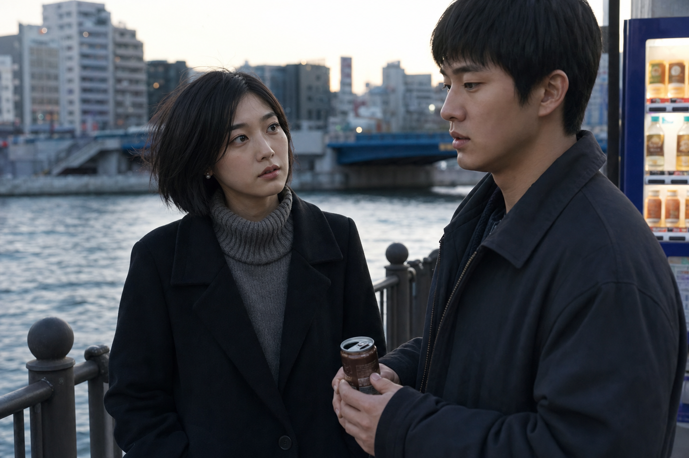

# 135. 보름이라는 이름

12월 13일 아침, 서윤은 새 코트를 입지 않았다.

전날 밤 침대 끝에 흘러내려 있던 와인색 코트는 의자 등받이에 가지런히 걸려 있었다. 대신 그녀는 짙은 회색 니트와 검은 스커트를 입고, 진주귀걸이만 그대로 했다. 용식이 왜 새 코트를 안 입느냐고 묻자 서윤은 거울 앞에서 머리끝을 정리하며 대답했다.

한서윤 "너무 좋은 건 매일 입으면 내가 우스워질 것 같아서요."

김용식 "누가 그렇게 봐요."

한서윤 "제가요."

그 말 앞에서 용식은 더 묻지 못했다.

아사쿠사로 가는 전철 안은 주말을 앞둔 사람들로 붐볐다. 서윤은 손잡이를 잡고 서 있었고, 용식은 그녀 뒤에 서서 사람들 사이에 밀리지 않게 어깨로 공간을 만들었다. 전철이 흔들릴 때마다 서윤의 등이 그의 가슴팍에 아주 가깝게 닿았다가 떨어졌다.

한서윤 "이런 건 잘하네요."

김용식 "뭐가요?"

한서윤 "사람 많은 데서 안 밀리게 해 주는 거."

김용식 "그건 해야죠."

한서윤 "해야 하는 건 잘하고, 말해야 하는 건 자꾸 피하고."

전철 소음이 말끝을 삼켰다. 용식은 대답 대신 손잡이를 잡은 서윤의 손 옆에 자기 손을 놓았다. 손등이 닿았다. 서윤은 피하지 않았다.

아사쿠사 거리는 겨울 관광객들로 가득했다. 나카미세 거리에는 따뜻한 만주 냄새와 달콤한 센베이 냄새가 섞여 있었고, 서윤은 가끔 쇼윈도 앞에 멈춰 섰다. 용식은 그녀가 바라보는 것을 사 주려 하지 않으려고 애썼다. 어제처럼 돈이 먼저 나가면, 오늘도 같은 말로 돌아갈 것 같았다.

그 대신 작은 부적 하나를 샀다.

한서윤 "이건 왜요?"

김용식 "취업 잘되라고."

서윤은 부적을 손바닥 위에 올려놓고 오래 봤다.

한서윤 "이런 건 돈 많이 안 드네요."

김용식 "그래도 마음은 들었어요."

한서윤 "그 말, 좀 낫네요."

그녀는 부적을 지갑 안쪽에 넣었다. 정장 영수증이나 호텔 계산서 같은 것과 달리, 그 작은 부적은 발각 단서가 되기보다 그냥 마음에 가까워 보였다. 그래서 용식은 잠깐 편해졌다.

하지만 편한 순간은 오래가지 않았다.

스미다강 쪽으로 걸어가던 중 초연에게서 전화가 왔다. 화면에 이름이 뜨자 용식은 무의식적으로 걸음을 늦췄다. 서윤은 바로 알아차렸다.

한서윤 "받아요."

김용식 "지금?"

한서윤 "안 받으면 더 이상하잖아요."

용식은 강변 난간 쪽으로 몸을 돌리고 전화를 받았다.

김초연 "뭐 해?"

김용식 "밖에 나왔어. 프로그램 사람들하고."

김초연 "사진 보내."

김용식 "지금?"

김초연 "응. 배경 보이게."

용식은 전화를 귀에 댄 채 서윤을 봤다. 서윤은 한 걸음 뒤로 물러나 있었다. 이번에도 사진 밖으로 나가야 한다는 걸 그녀가 먼저 알았다.

김용식 "알겠어. 끊고 보낼게."

김초연 "여자 없지?"

강바람이 차갑게 불었다. 용식은 대답하기 전, 서윤의 얼굴을 봤다. 그녀는 멀리 강 건너를 보고 있었다.

김용식 "없어."

통화가 끊겼다.

서윤은 아무 말 없이 난간에서 더 멀어졌다. 용식은 강과 하늘만 나오게 사진을 찍었다. 보내고 나서 돌아보니, 서윤은 작은 자판기 앞에서 캔커피를 뽑고 있었다.

한서윤 "여자 없어요?"

김용식 "서윤 씨."

한서윤 "아니요. 맞잖아요. 사진 안에는 여자 없으니까."

캔커피는 따뜻했다. 서윤은 하나를 용식에게 던지듯 건넸다. 용식이 받자, 손바닥에 금속의 열이 남았다.

한서윤 "보름 지나면 나는 돌아가는 거죠?"

김용식 "일단 그렇게 예약했어요."

한서윤 "일단?"

용식은 대답을 골랐다. 하지만 좋은 대답은 없었다.

김용식 "서윤 씨도 한국 일 있고, 취업 준비도 해야 하니까."

한서윤 "그 말도 맞는 말이네요. 맞는 말이라 더 싫고."

그날 저녁 두 사람은 강변 근처 작은 식당에서 우동을 먹었다. 서윤은 평소보다 말을 적게 했다. 호텔로 돌아오는 길에도 손은 잡았지만, 손가락에 힘이 덜 들어가 있었다.

방에 들어오자 서윤은 코트를 벗지 않은 채 창가에 섰다.

한서윤 "나고야는 언제 가요?"

용식은 캐리어에서 잠옷을 꺼내다가 멈췄다.

김용식 "아직 정확히는..."

한서윤 "검색했잖아요. 어제 일정표 뒤에 적었다가 지우는 것도 봤어요."

용식은 더 숨기지 못했다.

김용식 "보름 뒤에요. 서윤 씨 한국 가고 나서."

서윤은 창밖을 봤다. 도쿄의 불빛은 멀리서 보면 다 비슷했다. 사람의 마음도 그렇게 멀리서 보면 구분이 안 될까. 용식은 그런 생각을 하다가, 자신이 또 아무 대답도 안 하고 있다는 걸 깨달았다.

한서윤 "그 사람은 거기 있어요?"

김용식 "누구요?"

한서윤 "나고야에 있는 사람."

방 안이 조용해졌다.

서윤은 천천히 돌아섰다.

한서윤 "용식 씨, 그 사람 여자예요?"
